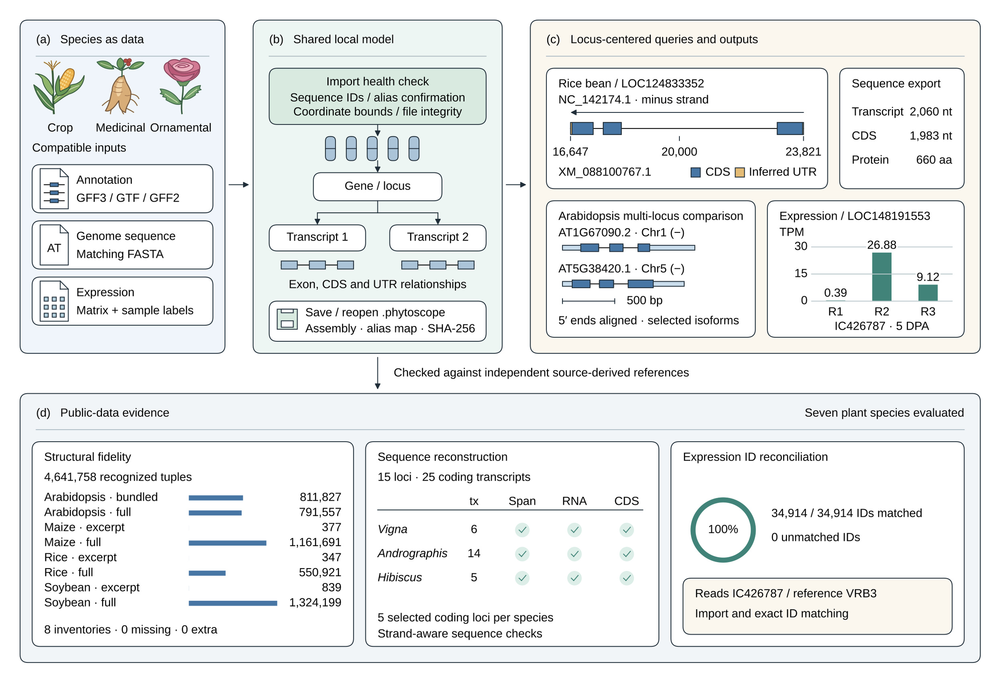

# PhytoScope


PhytoScope is a local desktop app for browsing plant genome annotations, inspecting transcript structures, comparing loci, and viewing expression data.

## Download and run

Download [PhytoScope for Windows x64](https://github.com/omixcore/phytoscope/releases/download/v0.0.1/PhytoScope-Windows-0.0.1.zip). Check the archive against [SHA256SUMS.txt](https://github.com/omixcore/phytoscope/releases/download/v0.0.1/SHA256SUMS.txt), extract the ZIP, and run `PhytoScope.exe` from the extracted folder. Java is included.

## Overview



## Quick start

1. Open a bundled annotation example or choose **File → Import annotation** to load a GFF3 or GTF file.
2. Search by gene ID or genomic interval. Select a gene to inspect its transcripts, exons, CDS and UTRs.
3. Import a matching genome FASTA for sequence extraction, or an expression matrix to display expression.
4. Add loci to the comparison view, export figures as PNG or SVG, or save your work as a `.phytoscope` project.

See [input formats](docs/input-format-specification.md) and the [research analysis guide](docs/research-analysis.md).

## Build from source

Use JDK 21. On Windows, use `mvnw.cmd` in place of `sh mvnw`.

```sh
sh mvnw clean package
java -jar target/phytoscope-0.0.1.jar
```

To launch from IntelliJ, set both the project SDK and the Maven runner JRE to JDK 21. Run `clean javafx:run` in the Maven tool window. From Windows PowerShell, the equivalent command is `.\mvnw.cmd clean javafx:run`.

See [desktop packaging](docs/desktop-distribution.md) to build an archive with a bundled Java runtime.

## License

[MIT](LICENSE). Third-party data retain their own terms.
