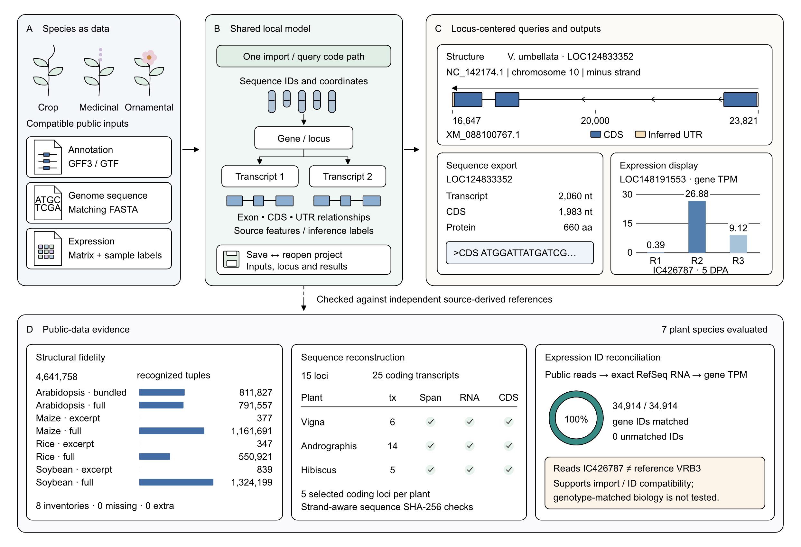

# PhytoScope

<p align="left">
  <a href="https://github.com/omixcore/phytoscope"></a>
  <a href="https://github.com/omixcore/phytoscope"></a>
  <a href="https://www.java.com/"></a>
  <a href="https://openjfx.io/"></a>
  <a href="https://github.com/omixcore/phytoscope/blob/dev/LICENSE"></a>
</p>


A local JavaFX desktop browser for plant gene structures. Import GFF3/GTF
annotations, switch between sequences, inspect transcripts/exons/CDS/UTRs,
attach a traceable expression matrix, compare multiple loci, and connect selected
genes to promoter extraction, sample groups, sequence checks, protein similarity
and domain mapping. Save portable projects and export TSV, PNG or editable SVG.
No external service is required while browsing local files.

## Download for Windows (no JDK required)

Download the packaged Windows application (x64) from the releases page: [PhytoScope v0.2.0](https://github.com/omixcore/phytoscope/releases) — SHA-256 checksums in [desktop_program/SHA256SUMS.txt](desktop_program/SHA256SUMS.txt). That released v0.2.0 archive predates the data-slimming change; it includes a slim jlink runtime, so nothing else has to be installed. For the current tree's freshly measured build sizes see [Build artifact size](#build-artifact-size).

1. Extract the ZIP to any local folder, keeping `PhytoScope.exe`, `app/` and `runtime/` together.
2. Double-click `PhytoScope.exe` — a bundled Java runtime is included, so nothing else has to be installed.
3. The browser opens with the Arabidopsis KB-scale chromosome-subset example. Pick another of the six small bundled examples from the **dataset selector**; the complete reference data has been moved to an independent repository (see [Complete reference data](#complete-reference-data)). Use **File → Import annotation / Import expression matrix / Import genome FASTA…** for your own or the archived data.
4. Click any gene to see its structure and expression profile; sequence extraction needs a user-imported matching FASTA and expression tracks need an imported matrix. Use **Export** to save PNG/SVG views or **File → Save project** for a portable `.phytoscope` file.



## Reference examples (KB-scale bundled samples)

PhytoScope ships six small, version-pinned annotation samples so the app stays
self-contained and starts instantly. All complete reference data has been moved
to an independent repository (see [Complete reference data](#complete-reference-data));
no example bundles a measured expression matrix, and no genome FASTA is bundled.

| Example | Reference material | Assembly / annotation | Bundled scope |
| --- | --- | --- | --- |
| Arabidopsis | Col-0 | TAIR10 / Araport11 original June 2016 | 5.5 KB chromosome-subset sample (10 genes / 24 transcripts), single gzipped GFF3 |
| Rice | Nipponbare | IRGSP-1.0 / Ensembl Plants 62 | Two real gene families per nuclear chromosome (12) |
| Maize | B73 | NAM 5.0 / Ensembl Plants 62 | Two real gene families per nuclear chromosome (10) |
| Soybean | Williams 82 | v2.1 / Ensembl Plants 62 | Two real gene families per nuclear chromosome (20) |
| Mint | Horse mint CMEN585 | Mlong_CMEN585_v3.01b / WSU Mint Genome Resources (INSDC GCA_001642375.2) | Twelve chromosome-scale sequences, two real Maker gene families each |
| Mint (plastid) | Spearmint | MG256495 / INSDC (GenBank, ENA) | Complete chloroplast genome, 152,132 bp, 134 genes |

Assembly and annotation releases are recorded separately. Every example is now a
single KB-scale file loaded through the same GFF3/GTF import path. The default
Arabidopsis example uses a 5.5 KB subset with sequence names `1`–`5`; the
complete nuclear Chr1–Chr5 annotation, the TAIR10 genome FASTA, the measured
E-MTAB-7978 transcriptome panel and the complete horsemint annotation with its
4-leaf TPM matrix are **no longer bundled** — they are archived in the
independent reference-data repository (historical result, requires the external
data to reproduce). Source URLs and checksums are retained as a traceability
index in the per-reference manifests and
[data provenance](src/main/resources/data/reference-provenance.json).

Expression tracks appear only after **File → Import expression matrix…**; without
an imported matrix the Gene Details pane shows an explicit "No data loaded"
state rather than a wall of `NA` cells.

The rice-bean non-model validation now includes three public 5-DPA RNA-seq
replicates re-quantified against RefSeq assembly GCF_029865625.1. All 34,914
gene-level expression IDs reconcile exactly to that assembly's annotation.
The read genotype (IC426787) differs from the reference cultivar (VRB3), so
this is data-import/ID-compatibility evidence, not genotype-matched biology;
see the [full validation record](docs/non-model-portability-evidence.md).

The [example guide](examples/arabidopsis-atlas/README.md) records data sources,
import steps and reproducible commands for the historical RBCS case; its
`expression.tsv` is a standalone example file, not a classpath resource. Data
fixtures and provenance manifests support the bundled examples and automated
regression tests.

## Complete reference data

The complete reference data was removed from this repository's current tree with
a plain `git rm` + one new commit at baseline `8fd01ca`; **git history was not
rewritten**. It now lives in the independent `phytoscope-reference-data`
repository: **the local directory is ready, remote URLs are pending user
provision**. The application has no in-app download and never fetches a remote
manifest.

| Item | Value |
| --- | --- |
| Local directory | `G:/WorkBuddy/2026-10-27-22-02-43/phytoscope-reference-data/` (outside this working tree) |
| Baseline commit | `8fd01ca` (removed from the current tree only; blobs remain in history) |
| Contents | 9 files, 68,518,847 bytes — TAIR10 genome FASTA, Araport11 Chr1–Chr5 GFF3, complete horsemint GFF3 + 4-leaf TPM matrix, E-MTAB-7978 atlas matrix |
| Authoritative manifest | `MANIFEST.json` (per-file bytes / re-computed SHA-256 / source / license) and `SHA256SUMS.txt` |
| Mirrors | gitee + github, same commit, mutual mirrors — **remote addresses pending user provision** |
| In this repository | `src/main/resources/data/reference-provenance.json` is an **index** (`storage: external` / `bundled`); all checksums retained |

Verify before use:

```bash
cd phytoscope-reference-data
sha256sum -c SHA256SUMS.txt                                  # 9/9 OK
./scripts/verify-against-baseline.sh <app-repo-dir> 8fd01ca  # byte-identical to the historical blobs
```

To use an archived file, copy it out of `data/` and import it through
**File → Import annotation… / Import expression matrix… / Import genome FASTA…**.
Old `.phytoscope` projects still open (they embed their own annotation and
expression bytes); only sequence extraction needs a freshly imported matching
FASTA, and the app states this explicitly instead of silently showing nothing.

## Build artifact size (measured)

Measured on 2026-11-13 (Windows 11 x64, JDK 21.0.6) after `./mvnw clean package`
and `python tools/package_desktop.py --jar target/phytoscope-0.2.0.jar`:

| Artifact | Measured size |
| --- | --- |
| Executable JAR `target/phytoscope-0.2.0.jar` | **22,317,249 bytes (21.28 MiB)** |
| jlink app-image ZIP `PhytoScope-Windows-AMD64.zip` | **46,146,746 bytes (44.01 MiB)** |

The historical v0.2.0 README quoted "about 105 MiB" for its released Windows
archive; that describes the old release **with the complete data bundled**, not
the current tree. The two numbers above are freshly measured, not derived by
subtracting 68.5 MB. `jar tf` confirms no archived file is packaged.

**Scope of the reduction:** only the current checkout's working tree and its
build artifacts (JAR / jlink ZIP) get smaller. Because the removal is a normal
`git rm` in a new commit and history was never rewritten, the **git history pack
(~209 MiB) and a fresh clone are unchanged** — there is no "smaller repository"
or "faster clone" claim.

## Run

```bash
# Windows
mvnw.cmd javafx:run

# Linux / macOS
sh mvnw javafx:run

# Build and run the executable JAR (Windows: substitute mvnw.cmd for sh mvnw)
sh mvnw clean package
java -jar target/phytoscope-0.2.0.jar
```

The first build downloads Maven and dependencies. JavaFX may print an
`unnamed module` warning when running the executable JAR.

## Browse your data

1. Use **Example datasets** to explore a reference, or **File → Import annotation**
   to open your GFF3, GFF, GTF or GFF2 file.
2. Select a sequence using the toolbar or Chromosome menu. Names and counts are
   rebuilt from the imported annotation, without a species-specific limit.
3. Search by gene ID, name, alias or description, or enter an IGV-style interval
   such as `Chr1:1,000-2,000` and press Enter (1-based, inclusive coordinates).
   Scroll to zoom, drag to pan, and click a gene to inspect its structure.
4. Use **Fit all** to fit the loaded genes, **Focus selected** for a single locus,
   or **View → Show full chromosome** for the complete declared sequence extent.
5. When an imported matrix matches the loaded annotation, sample-level expression appears as a per-gene bar chart in the right-hand Gene Details panel. No expression matrix is bundled; use **File → Import expression matrix…** to supply one, then use **Export** to save the current tracks as PNG or SVG.

The toolbar counts **sequences present in the loaded file**, which may include
scaffolds and organelles. It does not infer missing chromosomes from a species
name. A partial annotation can contain fewer chromosomes than a whole genome.
Duplicate declarations are merged and observed bounds cannot be clipped by an
incomplete header. Dataset changes replace the old sequence list and selection.

## Input formats

Annotations use standard GFF3 `ID`/`Parent` attributes or GTF
`gene_id`/`transcript_id` attributes. Sequence lengths come from
`##sequence-region` directives; without them, bounds are inferred from observed
features. Arbitrary chromosome, scaffold and organelle names are supported.

Expression matrices are tab-, comma- or semicolon-delimited tables with a
header. Quoted single-line fields are supported. The first column contains
identifiers; remaining columns are samples or conditions. Declare metadata before
the header:

```text
# unit=TPM
# level=gene
GeneID   Root   Leaf
```

Use actual tabs in TSV files. Units default to `unspecified`; level defaults to
`gene`. Set `# level=transcript` for transcript measurements. Blank/duplicate
sample names, duplicate IDs and inconsistent row widths are rejected before
replacing the previous matrix. Missing and invalid cells stay missing; **zero is
never substituted**. The import report lists matches, unmatched IDs and invalid
cells. Matching accepts exact IDs and unambiguous annotation `gene:`/`transcript:`
prefixes; it does not strip versions or aggregate transcripts into genes.

## Compare and restore

Select genes and click **Add to comparison**. The comparison tab keeps loci from
different chromosomes in separate rows. Choose genomic-start, transcription-start
or CDS-start alignment; minus-strand loci are reversed for the latter two.
CDS alignment uses the earliest CDS boundary in transcription direction across
the selected gene's isoforms. Loci without CDS require another alignment.
A shared linear bp scale is the default. Optional intron compression caps gaps
outside the union of annotated exons and retained CDS/UTR blocks at 80 display units and labels the scale as nonlinear.

Expression uses a shared linear or signed log1p magnitude color scale. Cells
show original input values; gray `NA` differs from measured zero. Gene-level
expression is drawn once per gene; transcript data are drawn per transcript.
Export SVG/PNG with the accompanying coordinate and expression TSV. Selection or
alignment does not establish homology or causation.

**File → Save project / Open project** preserves source annotation bytes,
expression values, checksums, selected loci, coordinate window, search and
comparison settings in one `.phytoscope` ZIP. The project is portable and does not
need the original annotation file. Research inputs, parameters, sample-group
assignments and the latest analysis output are included. All recorded sources
are verified before the live dataset is replaced. New projects use schema
version 3; versions 1 and 2 remain readable. Maximum 2 GB expanded input.

User-triggered imports and project restoration run in background workers with
progress and cancellation. Failed or cancelled loads keep the previous analysis.
CDS/UTR segments without an overlapping annotated exon are retained separately
and flagged in figures/details; they do not create invented exons or introns.

The genome browser limits detailed tracks to 100 overlapping loci, with a visible
notice when more overlap. The gene list retains all loci. Zoom or select a gene
to inspect it; use batch export for complete collections.

## Research analysis

Select a gene in the browser, then open **Research analysis**. The selected locus
is shared with the workspace. These five tabs are available:

| Tab | Input and action | Output |
| --- | --- | --- |
| Intervals | Matching genome FASTA; upstream/downstream lengths or a custom 1-based interval | Strand-aware sequence, also passed to Sequence QC |
| Sample groups | Assign expression samples to named groups; summarize the selected gene | Group means and observed-value counts; missing values excluded, measured zeros retained |
| Sequence QC | Paste DNA/CDS or use an extracted sequence | Length, GC, ambiguous bases and coding-frame/start/stop flags |
| Homology | Proteins from both species in FASTA with `>species\|protein_id` headers | Local-alignment identity, coverage and reciprocal-best-hit candidates |
| Domains | Exact protein or transcript ID, domain name and 1-based amino-acid start/end in tab-delimited rows | Genomic CDS blocks for the matching annotated isoform |

**Export results…** saves the latest output as a two-column `Analysis`/`Result`
TSV with escaped tabs and line breaks. **Save project / Open project** restores
the workspace inputs, settings and latest output. A new analysis replaces the
displayed output; export it before running another analysis if both are needed.

See [research analysis](docs/research-analysis.md) for coordinate conventions,
FASTA requirements and limits. Similarity candidates are not established
orthologs, domain records must be supplied, and sample summaries are not
differential-expression tests.

## Batch export

```bash
java -jar target/phytoscope-0.2.0.jar \
  --example maize --out figures --format svg

java -jar target/phytoscope-0.2.0.jar \
  --gff3 annotation.gff3 --expression expression.tsv \
  --loci gene1,gene2 --out figures --format both
```

Optional arguments: `--width`, `--height`, `--padding`, `--no-expression`.
Use `--help` for usage. The older `soybean-v2` ID remains an alias for `soybean`.

## Validate

With JDK 21 and Maven (or the Maven Wrapper):

```bash
# JavaFX control tests run without a native display using the test-only Monocle dependency.
mvn -Pui-tests test

# Reproduce official excerpts and verify them against source archives.
python tools/build_chromosome_fixtures.py --cache /path/to/cache --update-examples
python tools/audit_reference_datasets.py --cache /path/to/cache

# Optional full-annotation re-validation (needs the external reference data) and JAR build.
mvn -Pui-tests -Dphytoscope.fullAnnotationDir=/path/to/cache verify
```

Full genome archives are downloaded by the extraction script, not by unit tests.
See the audit document for source URLs, checks and interpretation of parser counts.

## Documentation and distribution

- [Research analysis](docs/research-analysis.md)
- [Desktop packaging](docs/desktop-distribution.md)
- [Annotation and reference validation](docs/chromosome-validation.md)
- [Validation and benchmark commands](docs/validation-and-benchmarks.md)
- [Non-model data compatibility](docs/non-model-portability-evidence.md)
- [Research-module tests](docs/research-module-validation.md)
- [Historical RBCS expression example (standalone files)](examples/arabidopsis-atlas/README.md)

Display-free comparison (does not initialize the JavaFX toolkit):

```bash
java -jar target/phytoscope-0.2.0.jar --compare --example arabidopsis \
  --expression examples/arabidopsis-atlas/expression.tsv \
  --loci AT1G67090,AT5G38410,AT5G38420,AT5G38430 --out results \
  --project results/atlas.phytoscope
```

Optional comparison flags: `--alignment GENOMIC_START|TRANSCRIPTION_START|CDS_START`,
`--compress-introns`, `--scale LINEAR|LOG1P`, `--no-expression`.

```bash
java -Xmx3g -jar target/phytoscope-0.2.0.jar --benchmark \
  --example arabidopsis --out benchmark-results
```

The desktop and legacy PNG browser batch mode require a native display (or Xvfb
on Linux). The SVG comparison and parser benchmark commands do not. The normal
CI runs JavaFX regression tests and builds runtime-inclusive app images on Linux,
Windows and macOS; actual native dialog/hardware checks are reported separately.


### Gene sequence details

The right-hand Gene Details → Sequences section displays the gene genomic span and, for each annotated transcript, the spliced transcript, CDS, 5′ UTR, 3′ UTR and translated protein sequence — **but only after a genome FASTA is imported**. Each sequence then has Copy sequence and Copy FASTA actions. Transcript IDs, protein IDs, exon counts, lengths, strand orientation, source FASTA and UTR provenance are shown where available.

**No genome FASTA is bundled with any example.** With no FASTA loaded, this section (and the Research analysis promoter / interval extraction) shows an explicit empty state — it does not return an empty string, a placeholder sequence, or a sequence borrowed from another assembly. Use **File → Import genome FASTA…** to supply a genomic DNA FASTA (`*.fa`, `*.fasta`, `*.fna`, `*.gz`, gzip auto-detected) whose assembly version and sequence names match the current annotation; the status bar reports chromosome-name coverage and warnings. Switching datasets or opening a project clears the imported FASTA, so import it again. The extractor respects 1-based inclusive GFF3 coordinates, reverse-complements minus-strand loci, concatenates exons/CDS in transcription order, and translates CDS with the standard nuclear genetic code. If UTR features are absent, terminal exonic bases outside annotated CDS boundaries are labelled as inferred; missing transcript/CDS models are never fabricated. Checksums and chromosome lengths of the archived TAIR10 FASTA remain in `genome-sequence-provenance.json` as a traceability index.

## Citation

Song X, Chen P, Liang F. *PhytoScope for portable local queries of plant genome data.* Concise Report.

## License

**MIT** · [View the full license](LICENSE)
