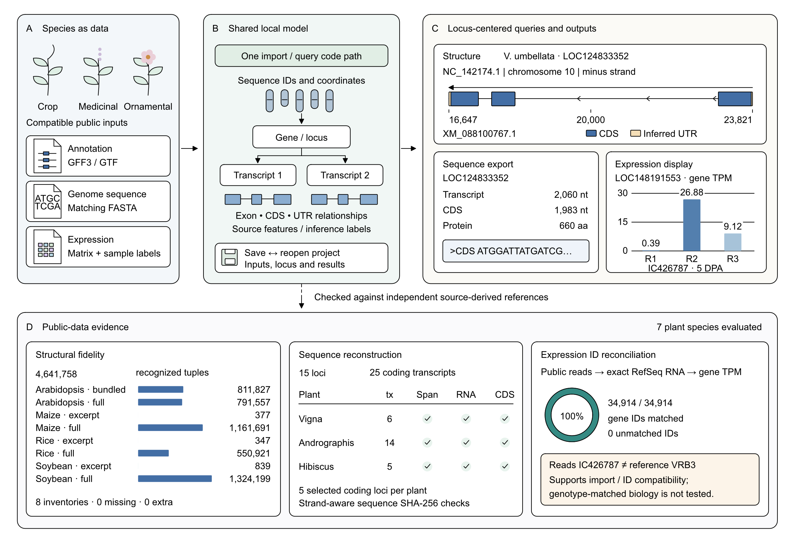

# PhytoScope

A local JavaFX desktop browser for plant gene structures. Import GFF3/GTF
annotations, switch between sequences, inspect transcripts/exons/CDS/UTRs,
attach a traceable expression matrix, compare multiple loci, and connect selected
genes to promoter extraction, sample groups, sequence checks, protein similarity
and domain mapping. Save portable projects and export TSV, PNG or editable SVG.
Requires JDK 21. No external service is required while browsing local files.

**License: MIT** · [View the full license](LICENSE)



## Reference examples and real expression case

| Example | Reference material | Assembly / annotation | Bundled scope |
| --- | --- | --- | --- |
| Arabidopsis | Col-0 | TAIR10 / Araport11 original June 2016 | Complete nuclear Chr1–Chr5 |
| Rice | Nipponbare | IRGSP-1.0 / Ensembl Plants 62 | Two real gene families per nuclear chromosome (12) |
| Maize | B73 | NAM 5.0 / Ensembl Plants 62 | Two real gene families per nuclear chromosome (10) |
| Soybean | Williams 82 | v2.1 / Ensembl Plants 62 | Two real gene families per nuclear chromosome (20) |

Assembly and annotation releases are recorded separately. Arabidopsis is split
into five files without changing feature coordinates. Source URLs and checksums
are in the per-reference manifests and
[data provenance](src/main/resources/data/reference-provenance.json).

**The default Arabidopsis reference also bundles the measured transcriptome panel** used by the browser expression track: **32,833 genes** across six single-assay conditions from Expression Atlas **E-MTAB-7978**, with SHA-256 pinned inputs and a fully traceable extraction manifest. Select any measured gene to see a **six-column vertical TPM bar chart in the right Gene Details pane**. Genes without measured data show an explicit missing-data message rather than a wall of `NA` cells.

The rice-bean non-model validation now includes three public 5-DPA RNA-seq
replicates re-quantified against RefSeq assembly GCF_029865625.1. All 34,914
gene-level expression IDs reconcile exactly to that assembly's annotation.
The read genotype (IC426787) differs from the reference cultivar (VRB3), so
this is data-import/ID-compatibility evidence, not genotype-matched biology;
see the [full validation record](docs/non-model-portability-evidence.md).

The [example guide](examples/arabidopsis-atlas/README.md) records data sources,
import steps and reproducible commands. Data fixtures and provenance manifests
support the bundled examples and automated regression tests.

## Run

```bash
# Windows
mvnw.cmd javafx:run

# Linux / macOS
sh mvnw javafx:run

# Build and run the executable JAR (Windows: substitute mvnw.cmd for sh mvnw)
sh mvnw clean package
java -jar target/phytoscope-0.2.0.jar
```

The first build downloads Maven and dependencies. JavaFX may print an
`unnamed module` warning when running the executable JAR.

## Browse your data

1. Use **Example datasets** to explore a reference, or **File → Import annotation**
   to open your GFF3, GFF, GTF or GFF2 file.
2. Select a sequence using the toolbar or Chromosome menu. Names and counts are
   rebuilt from the imported annotation, without a species-specific limit.
3. Search by gene ID, name, alias or description, or enter an IGV-style interval
   such as `Chr1:1,000-2,000` and press Enter (1-based, inclusive coordinates).
   Scroll to zoom, drag to pan, and click a gene to inspect its structure.
4. Use **Fit all** to fit the loaded genes, **Focus selected** for a single locus,
   or **View → Show full chromosome** for the complete declared sequence extent.
5. When the bundled or imported matrix matches the loaded annotation, sample-level expression appears as a per-gene bar chart in the right-hand Gene Details panel. Import a matching matrix when available, then use **Export** to save the current tracks as PNG or SVG.

The toolbar counts **sequences present in the loaded file**, which may include
scaffolds and organelles. It does not infer missing chromosomes from a species
name. A partial annotation can contain fewer chromosomes than a whole genome.
Duplicate declarations are merged and observed bounds cannot be clipped by an
incomplete header. Dataset changes replace the old sequence list and selection.

## Input formats

Annotations use standard GFF3 `ID`/`Parent` attributes or GTF
`gene_id`/`transcript_id` attributes. Sequence lengths come from
`##sequence-region` directives; without them, bounds are inferred from observed
features. Arbitrary chromosome, scaffold and organelle names are supported.

Expression matrices are tab-, comma- or semicolon-delimited tables with a
header. Quoted single-line fields are supported. The first column contains
identifiers; remaining columns are samples or conditions. Declare metadata before
the header:

```text
# unit=TPM
# level=gene
GeneID   Root   Leaf
```

Use actual tabs in TSV files. Units default to `unspecified`; level defaults to
`gene`. Set `# level=transcript` for transcript measurements. Blank/duplicate
sample names, duplicate IDs and inconsistent row widths are rejected before
replacing the previous matrix. Missing and invalid cells stay missing; **zero is
never substituted**. The import report lists matches, unmatched IDs and invalid
cells. Matching accepts exact IDs and unambiguous annotation `gene:`/`transcript:`
prefixes; it does not strip versions or aggregate transcripts into genes.

## Compare and restore

Select genes and click **Add to comparison**. The comparison tab keeps loci from
different chromosomes in separate rows. Choose genomic-start, transcription-start
or CDS-start alignment; minus-strand loci are reversed for the latter two.
CDS alignment uses the earliest CDS boundary in transcription direction across
the selected gene's isoforms. Loci without CDS require another alignment.
A shared linear bp scale is the default. Optional intron compression caps gaps
outside the union of annotated exons and retained CDS/UTR blocks at 80 display units and labels the scale as nonlinear.

Expression uses a shared linear or signed log1p magnitude color scale. Cells
show original input values; gray `NA` differs from measured zero. Gene-level
expression is drawn once per gene; transcript data are drawn per transcript.
Export SVG/PNG with the accompanying coordinate and expression TSV. Selection or
alignment does not establish homology or causation.

**File → Save project / Open project** preserves source annotation bytes,
expression values, checksums, selected loci, coordinate window, search and
comparison settings in one `.phytoscope` ZIP. The project is portable and does not
need the original annotation file. Research inputs, parameters, sample-group
assignments and the latest analysis output are included. All recorded sources
are verified before the live dataset is replaced. New projects use schema
version 3; versions 1 and 2 remain readable. Maximum 2 GB expanded input.

User-triggered imports and project restoration run in background workers with
progress and cancellation. Failed or cancelled loads keep the previous analysis.
CDS/UTR segments without an overlapping annotated exon are retained separately
and flagged in figures/details; they do not create invented exons or introns.

The genome browser limits detailed tracks to 100 overlapping loci, with a visible
notice when more overlap. The gene list retains all loci. Zoom or select a gene
to inspect it; use batch export for complete collections.

## Research analysis

Select a gene in the browser, then open **Research analysis**. The selected locus
is shared with the workspace. These five tabs are available:

| Tab | Input and action | Output |
| --- | --- | --- |
| Intervals | Matching genome FASTA; upstream/downstream lengths or a custom 1-based interval | Strand-aware sequence, also passed to Sequence QC |
| Sample groups | Assign expression samples to named groups; summarize the selected gene | Group means and observed-value counts; missing values excluded, measured zeros retained |
| Sequence QC | Paste DNA/CDS or use an extracted sequence | Length, GC, ambiguous bases and coding-frame/start/stop flags |
| Homology | Proteins from both species in FASTA with `>species\|protein_id` headers | Local-alignment identity, coverage and reciprocal-best-hit candidates |
| Domains | Exact protein or transcript ID, domain name and 1-based amino-acid start/end in tab-delimited rows | Genomic CDS blocks for the matching annotated isoform |

**Export results…** saves the latest output as a two-column `Analysis`/`Result`
TSV with escaped tabs and line breaks. **Save project / Open project** restores
the workspace inputs, settings and latest output. A new analysis replaces the
displayed output; export it before running another analysis if both are needed.

See [research analysis](docs/research-analysis.md) for coordinate conventions,
FASTA requirements and limits. Similarity candidates are not established
orthologs, domain records must be supplied, and sample summaries are not
differential-expression tests.

## Batch export

```bash
java -jar target/phytoscope-0.2.0.jar \
  --example maize --out figures --format svg

java -jar target/phytoscope-0.2.0.jar \
  --gff3 annotation.gff3 --expression expression.tsv \
  --loci gene1,gene2 --out figures --format both
```

Optional arguments: `--width`, `--height`, `--padding`, `--no-expression`.
Use `--help` for usage. The older `soybean-v2` ID remains an alias for `soybean`.

## Validate

With JDK 21 and Maven (or the Maven Wrapper):

```bash
# JavaFX control tests run without a native display using the test-only Monocle dependency.
mvn -Pui-tests test

# Reproduce official excerpts and verify them against source archives.
python tools/build_chromosome_fixtures.py --cache /path/to/cache --update-examples
python tools/audit_reference_datasets.py --cache /path/to/cache

# Validate the four complete annotations and build the executable JAR.
mvn -Pui-tests -Dphytoscope.fullAnnotationDir=/path/to/cache verify
```

Full genome archives are downloaded by the extraction script, not by unit tests.
See the audit document for source URLs, checks and interpretation of parser counts.

## Documentation and distribution

- [Research analysis](docs/research-analysis.md)
- [Desktop packaging](docs/desktop-distribution.md)
- [Annotation and reference validation](docs/chromosome-validation.md)
- [Validation and benchmark commands](docs/validation-and-benchmarks.md)
- [Non-model data compatibility](docs/non-model-portability-evidence.md)
- [Research-module tests](docs/research-module-validation.md)
- [Bundled expression example](examples/arabidopsis-atlas/README.md)

Display-free comparison (does not initialize the JavaFX toolkit):

```bash
java -jar target/phytoscope-0.2.0.jar --compare --example arabidopsis \
  --expression examples/arabidopsis-atlas/expression.tsv \
  --loci AT1G67090,AT5G38410,AT5G38420,AT5G38430 --out results \
  --project results/atlas.phytoscope
```

Optional comparison flags: `--alignment GENOMIC_START|TRANSCRIPTION_START|CDS_START`,
`--compress-introns`, `--scale LINEAR|LOG1P`, `--no-expression`.

```bash
java -Xmx3g -jar target/phytoscope-0.2.0.jar --benchmark \
  --example arabidopsis --out benchmark-results
```

The desktop and legacy PNG browser batch mode require a native display (or Xvfb
on Linux). The SVG comparison and parser benchmark commands do not. The normal
CI runs JavaFX regression tests and builds runtime-inclusive app images on Linux,
Windows and macOS; actual native dialog/hardware checks are reported separately.


### Gene sequence details

The right-hand Gene Details → Sequences section displays the gene genomic span and, for each annotated transcript, the spliced transcript, CDS, 5′ UTR, 3′ UTR and translated protein sequence. Each sequence has Copy sequence and Copy FASTA actions. Transcript IDs, protein IDs, exon counts, lengths, strand orientation, source FASTA and UTR provenance are shown where available.

The Arabidopsis TAIR10 example bundles the version-pinned Ensembl Plants release 62 genomic FASTA (src/main/resources/data/species/arabidopsis/TAIR10_genomic.fna.gz); its checksum and chromosome lengths are recorded in genome-sequence-provenance.json. Other species or assemblies can use File → Import genome FASTA. The genome FASTA must match the annotation assembly and sequence names. The extractor respects 1-based inclusive GFF3 coordinates, reverse-complements minus-strand loci, concatenates exons/CDS in transcription order, and translates CDS with the standard nuclear genetic code. If UTR features are absent, terminal exonic bases outside annotated CDS boundaries are labelled as inferred; missing transcript/CDS models are never fabricated.

## License

See [LICENSE](LICENSE).
