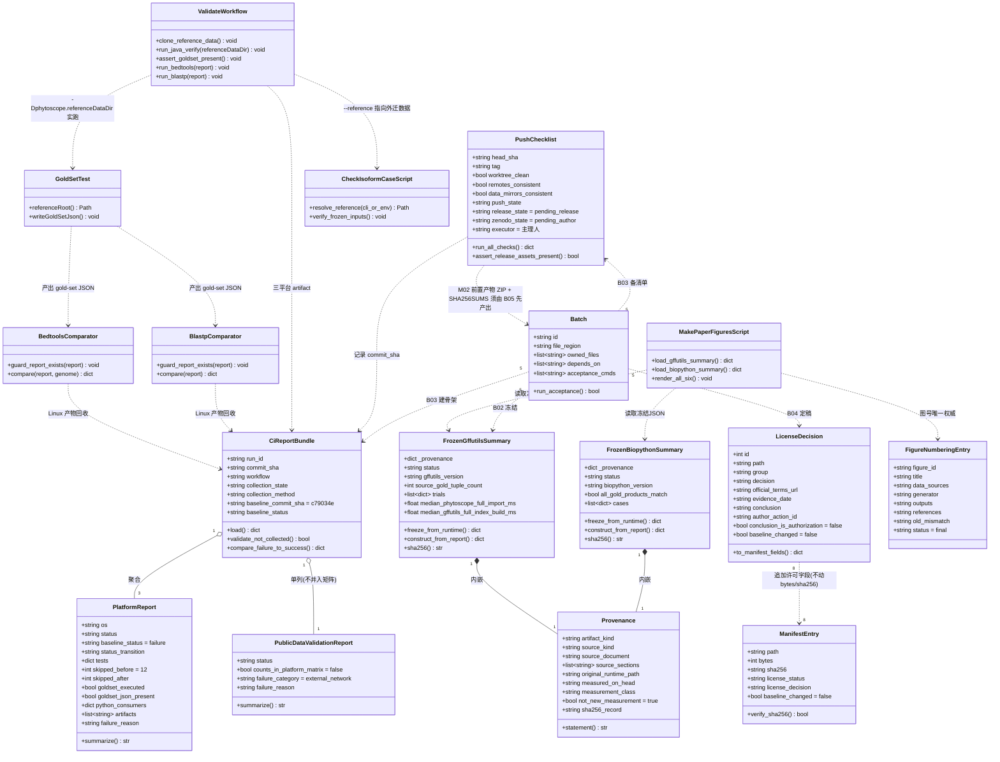
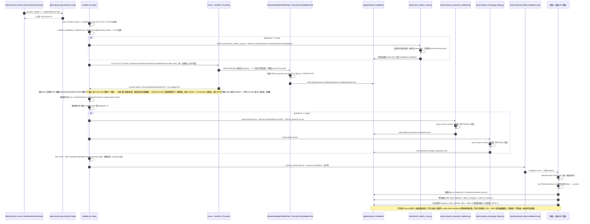
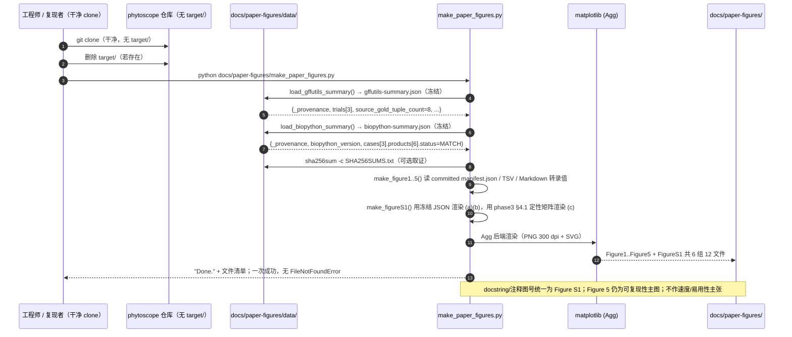
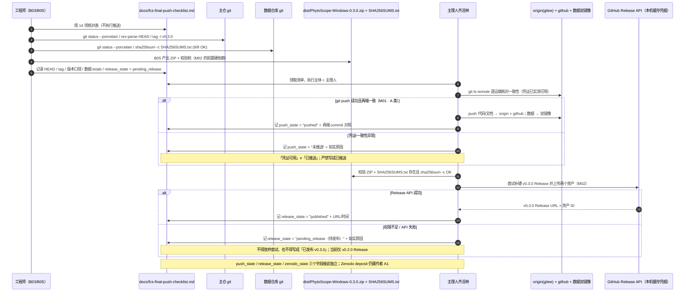
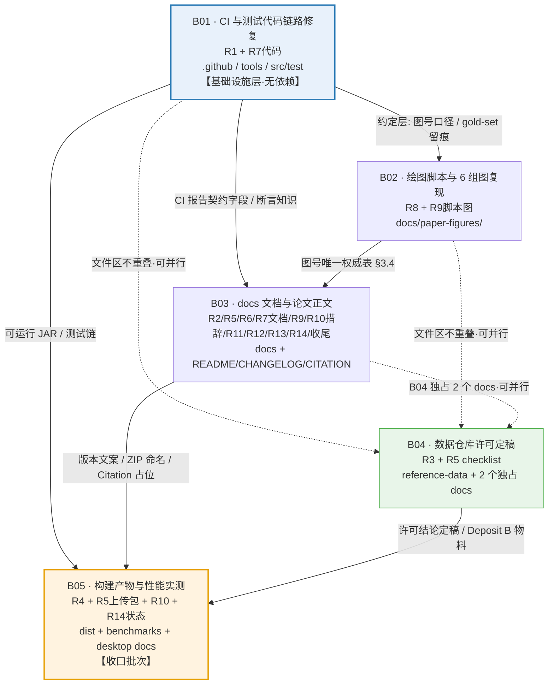

# PhytoScope · FCS 投稿 14 项收尾交付 · 增量系统设计与任务分解

> 文档类型：**增量系统设计 + 任务分解**（只做设计，不含实现、不含代码改动）· 编写人：架构师 高见远（Gao）· 日期：2026-11-14
> 权威输入：`docs/prd-fcs-final-delivery.md`（增量 PRD，R1–R14 / §5 交付物映射 / §7 待拍板 / §8 完成判定口径）
> 上游参考：`docs/fcs-submission-gap-audit.md`（仅引用结构，不引用过时状态值）、`docs/fcs-phase2-verification-plan.md`、`docs/fcs-phase3-comparison-plan.md`、`docs/zenodo-deposit-checklist.md`、`docs/paper-figures/README.md`、`docs/input-format-specification.md`、`docs/fcs-paper-outline.md`、`docs/fcs-paper-manuscript-draft.md`
> 代码事实来源：主理人实测结论（已逐条复核关键文件，见 §0.1），**不重复排查、不另行推测**
> 本文件与两份 mermaid 图（`docs/design-fcs-final-delivery-class-diagram.mermaid`、`docs/design-fcs-final-delivery-sequence-diagram.mermaid`）为本次**唯一新建文件**；不修改任何既有文件，不写实现代码

---

## 0. 设计基线与硬约束（前置）

### 0.1 变更基线（主理人已实测，直接采信）

| 维度 | 基线 |
|---|---|
| 主仓 | `G:/WorkBuddy/2026-10-27-22-02-43/phytoscope` · HEAD `c79034e` · 工作区干净 · 与 `origin/dev` 0/0 |
| tag / 版本 | tag `v0.2.0` + `v0.3.0`；`pom.xml` 应用版本 **0.3.0**；**3.2.5 = Spring Boot 父 POM，非应用版本** |
| **GitHub Release 现状（PRD §1 新增）** | **目前只有 `v0.2.0`**（资产 `PhytoScope-Windows-AMD64.zip` + `SHA256SUMS.txt`），**没有 `v0.3.0`** → R4 发布目标即补建 `v0.3.0` Release；禁止把「现有 v0.2.0 Release」写成「已发布 v0.3.0」 |
| 远端 / **推送凭证（PRD §1 新增）** | `origin` = gitee HTTPS；`github` = SSH over 443 别名；两远端 `git ls-remote` 均可达、gitee API / api.github.com 本机 200；**主理人已实测推送凭证可用 → 收尾 git push 属本机 A 类动作，不再受写权限阻塞**（但「凭证可用」≠「已推送」） |
| 数据仓库 | `phytoscope-reference-data` HEAD `2c6608b` · 工作区干净 · **9 文件 / 68,518,847 B** · 双镜像 |
| 产物目录 | `G:/WorkBuddy/2026-10-27-22-02-43/dist`（**工作区根，独立于两个 git 仓库**），现存 `PhytoScope-Windows-0.2.0.zip`、`PhytoScope-Windows-AMD64.zip`、`PhytoScope/`、`薄荷完整数据/` |
| 本机环境 | **仅 Windows x64** · JDK 21.0.6 · jpackage 21.0.6 · Python 3.13.14 · `mvnw` · matplotlib(Agg) · gffutils 0.13 / Biopython 1.88 已装 · blastp 2.17.0+ 可用 · **bedtools 不在 PATH** · 无 macOS/Linux 真机 · 无 GUI 脚本化快照 |
| 数据许可现状 | `MANIFEST.json` 8 项 `license_status: needs_confirmation`，仅薄荷 GFF3 为 `confirmed`（CC BY 4.0） |
| CI 现状 | `validate.yml:51` Java 步 = `sh mvnw -B -Pui-tests verify`，**未传 `-Dphytoscope.referenceDataDir`**；`ResearchModuleGoldSetTest:69-71` 用 `Assumptions.assumeTrue` 门控 → skip → `target/research-validation/research-module-gold-set.json` 不生成 → `:58` bedtools / `:62` BLASTP 失去输入；CI 数据从 gitee clone 到 `target/reference-data` |
| **CI 实跑现状（PRD §1 / §1.1，主理人拉取日志）** | HEAD `c79034e` 最新实跑：**三个平台 `validation` job 全部 `failure`，不是 success**。旧文档「CI 三平台通过（bedtools 8/8、BLASTP 20/20）」一律为数据外迁前历史留痕，**禁止沿用为当前状态**。Java 层 `Tests run: 211, Failures: 0, Errors: 0, Skipped: 12`，其中 **`ResearchModuleGoldSetTest` = `Tests run: 1, Skipped: 1`** |
| **逐平台失败清单（PRD §1.1）** | ① **ubuntu / validation** `check_isoform_case.py`（`:48`）`FileNotFoundError: src/main/resources/data/species/arabidopsis/TAIR10_genomic.fna.gz` → **代码类**；② **windows / validation** `Real case`（`:83-88`）`error: Unknown exact gene ID: AT1G67090` 退出码 3 → **代码类**；③ **macos / validation** 同 windows → **代码类**；④ **三平台连带** 金标准门控未传参 → `Skipped: 1`、gold-set JSON 不产出、bedtools/BLASTP 两处对比形同虚设 → **代码类**；⑤ **`public-data-validation`（独立 job）** 外部 PMC/PastDB/ENA 不可达 → **外部网络类（非代码逻辑）**，单独归类、**不计入 validation job 成败判定** |
| **R1 验收总口径（PRD §1.1 末）** | 三平台 `validation` 由 failure 转 **success** 属 **R2 远端实跑后的目标态，不计入本机 A 类闭环**；本机 A 类只到「配置修复 + 本地实跑证明金标准非 skipped（Skipped 由 12 下降）+ gold-set JSON 生成并被两处 Python 成功消费」 |
| 绘图现状 | `make_paper_figures.py:59,62` 常量指向 `target/phase3-comparison/{gffutils,biopython}/summary.json`（干净 clone 不存在）；docstring `:20-22` 把该两 JSON 错标为「Figure 5」；注释 `:607`、`:763` 各一处「Figure 5」；`:929` `make_figureS1()` 存为 `FigureS1`（正确） |
| 图号现状 | `paper-figures/README.md` Numbering note = 1 架构 / 2 数据模型与输入格式 / 3 七模块 / 4 跨物种验证 / 5 可复现性，工具对比降为 **Figure S1**；`fcs-paper-outline.md` §4 仍写 Figure 2 = 跨物种、Figure 4 = 公平对比 |

**本次复核确认的额外代码事实**（用于 R1 精确改法，均已实读）：

1. `ResearchModuleGoldSetTest:68-75` 的 `referenceRoot()` 读 `System.getProperty("phytoscope.referenceDataDir")`，断言体在 `:84` 用 `root.resolve("data/species/arabidopsis/TAIR10_genomic.fna.gz")` → 与 CI clone 到 `target/reference-data` 后的 `target/reference-data/data/species/arabidopsis/` **路径结构完全对齐**，故 `-Dphytoscope.referenceDataDir=target/reference-data` 一处改动即可让 gold-set 与 `DomainCaseValidationTest` 一并实跑。
2. `tools/check_isoform_case.py:24` 硬编码 `reference = root / 'src/main/resources/data/species/arabidopsis'`，`:29` 的 `resolve(reference, name)` 会在此找 `TAIR10_genomic.fna.gz` → 正是 ubuntu 的报错来源。该目录外迁后仅剩 `arabidopsis_chromosomes.gff3.gz` / `manifest.json` / `genome-sequence-provenance.json`。
3. `validate.yml:41`（`--directory target/reference-data/data/species/arabidopsis`）与 `:58`（`--genome target/reference-data/.../TAIR10_genomic.fna.gz`）**已正确指向外迁数据，无需改动**；真正失效的是 `:48` 的脚本内部路径、`:51` 的 Java 步、`:86` 的 `Real case` 位点。
4. `tools/compare_promoters_bedtools.py:85-87` / `compare_homology_blastp.py:95-96` 先检查外部工具、再 `args.report.read_text()`；文件缺失时抛未包装的 `FileNotFoundError`，且守卫不在最前 → 本机无 bedtools 时会先报「bedtools is required」，掩盖「report 缺失」。
5. 内置 `--example arabidopsis` 的 `arabidopsis_chromosomes.gff3.gz` 实际只含 10 个 ID：`AT1G01010, AT1G01020, AT2G01008, AT2G01021, AT3G01010, AT3G01015, AT4G00005, AT4G00020, AT5G01010, AT5G01015`；而 `examples/arabidopsis-atlas/annotation.gff3` 含 `AT1G67090, AT5G38410, AT5G38420, AT5G38430`，`expression.tsv` 存在 → `Real case` 应把 `--example arabidopsis` 换成 `--gff3 examples/arabidopsis-atlas/annotation.gff3`（`ComparisonRunner:25` 规定 `--example` 与 `--gff3` 互斥），保留原 4 个 `--loci`。
6. `make_paper_figures.py` 的 `make_figureS1()` 消费字段：gffutils 需 `trials[]`（含 `exact_tuple_agreement_with_each_other_and_source`、`phytoscope.selected_gene_search_median_ms`、`gffutils.selected_gene_query_100_median_ms`）、`source_gold_tuple_count`、`median_phytoscope_full_import_ms`、`median_gffutils_full_index_build_ms`；Biopython 需 `biopython_version`、`cases[]`（`species` / `gene_id` / `strand` / `exon_count` / `products.{genomic_span,transcript,CDS,protein,five_prime_UTR_inferred,three_prime_UTR_inferred}.status`）。上述数值在 `docs/fcs-phase3-comparison-plan.md` §3.1/§3.2 均有**既有实测记录**，可据此构造冻结 JSON。

### 0.2 主理人 §7 六项裁定 → 设计硬约束（不再开放讨论）

| # | 裁定 | 本设计的落地约束 |
|---|---|---|
| 1 | 薄荷 4 叶 TPM **不删除、不编造来源**；保持 9 文件 / 68,518,847 B / SHA256SUMS / Figure 5(c) / 补表 S1 / Zenodo Deposit B 稳定；`LICENSES.md` 与 `MANIFEST.json` 定稿为「来源与许可无法确证 → 不得再分发，需作者追根或删除」；产出给作者的「授权/替换请求清单」；删除与否留给作者 | **数据仓库 9 个数据文件字节、`totals.files=9`、`totals.bytes=68518847`、9 行 `SHA256SUMS.txt` 全部不改**；仅改 `LICENSES.md` 结论段与 `MANIFEST.json` 的许可字段（新增结论字段，不动 `sha256`/`bytes`/`path`）；Figure 5(c) 与补表 S1 的 9 文件 / 68,518,847 B 数字稳定；B 类「授权/替换请求清单」只交物料 |
| 2 | Araport11 Chr1–5 与 TAIR10 FASTA **不替换为 NCBI RefSeq**；只给结论「需向 Phoenix/TAIR 申请书面许可，或后续版本再替换」，保持基线稳定 | 8 条结论中这 6 条归「需作者授权」，不得写入 `replace_required` 的本机替换动作、不得改任何 SHA-256 或金标准基线；替换仅作为「后续版本」建议文字 |
| 3 | Zenodo 两 deposit 的 license 字段按 R3 结论**如实填写**；8 条未定稿前不得归并成 CC BY 4.0；`{{SOFTWARE_DOI}}`/`{{DATA_DOI}}`/`{{ORCID}}`/`{{AFFILIATION}}` **保持未回填** | `zenodo-deposit-checklist.md` §5 改为「Other / 多许可 + 引用 LICENSES.md」，逐条列 1 confirmed + 8 待确认；4 个占位符（含 `{{PAPER_DOI}}`）一律保持未回填并集中登记于 `fcs-zenodo-handoff.md` |
| 4 | CI 报告回收由主理人在推送后用远端 API 回收；本设计给出 `docs/ci-reports/v0.3.0/{ubuntu,windows,macos}/` **目录契约**与汇总文档字段 | 见 §3.1；以 **`c79034e` 三平台 `validation` 全 failure 为对照基线**，汇总须留档基线并逐平台记录 **failure → success** 变化、金标准是否实跑、两处 Python 是否消费成功；本机只建骨架 + 汇总模板，字段初值 `not_collected` / `materials_ready_pending_remote`；**禁止伪造 pass/fail 或报告内容**；`public-data-validation` **单独归类为外部网络类失败**、不计入三平台矩阵、不据此判定代码失败；「三平台转 success」由 R2 远端实跑出具证据，**不计入本机 A 类闭环** |
| 5 | R6 接受「定性对照 + 既有 gffutils/Biopython 实机基线」定稿，三工具明确标注**非本机实测**；R13 用户测试明确列 **future work** | 冻结 JSON 的 `_provenance.not_new_measurement = true`；`fcs-tool-comparison-final.md` 中 JBrowse2/IGV/TBtools 行固定标注「定性对照（基于公开文档，非本机实测）」；`fcs-user-study-results.md` 空白 + 「未执行」；manuscript §4.2/§4.4 写「未做用户研究 / future work」 |
| 6 | 收尾推送**由主理人执行**；本设计给出 `docs/fcs-final-push-checklist.md` 核对项 | 见 §3.5；**git push 属 A 类本机可执行动作**（PRD §1 实测两远端 `git ls-remote` 可达、推送凭证可用），不再是 B 类阻塞；核对项含工作区干净 / HEAD / tag / 两远端一致性 / 数据双镜像一致性 / **两端 commit 对照** / 失败时如实标注「未推送」；**Release 资产上传是 git push 之外的另一个动作**（见下） |

> **裁定 6 补充（主理人本轮新增口径，硬约束）**：**R4 必须拆成两段** ——
> **① 本机构建 + 校验和 + smoke = A 类，由工程师在 B05 闭环**（`dist/PhytoScope-Windows-0.3.0.zip` + `desktop_program/SHA256SUMS.txt` + smoke PASS + `sha256sum -c` OK）；
> **② `v0.3.0` Release 附件公开 = 主理人交付动作 M02**，在推送后由主理人**用本机缓存凭据走 GitHub Release API 尝试**（历史依据：2026-10-30 曾用同一方式成功创建 `v0.2.0` 并上传 zip + `SHA256SUMS.txt`），**成功才标「已发布」，权限不足则如实标「待发布」**。**不得把该上传设计成「作者必做」而直接放弃**，也不得在未执行前称「已发布 v0.3.0 Release」。M02 所需产物路径 `dist/PhytoScope-Windows-0.3.0.zip` 与 `desktop_program/SHA256SUMS.txt` **必须先由 B05 工程师产出**（见 §5「主理人交付动作」）。

### 0.3 A / B / C 状态口径（强制，禁止虚报）

- **A · 本机可完全闭环（7 项）**：R1 / R4 / R7 / R8 / R9 / R10 / R11 → 以「文件存在 + 命令/测试通过」判定。
  - **R1 边界（PRD §8 第 1 条）**：本机 A 类只到「三类代码类 CI 失败已修 + 本地 `ResearchModuleGoldSetTest` 非 skipped（Skipped 数由 **12 下降**）+ `research-module-gold-set.json` 真实生成且被 bedtools / BLASTP **两处 Python 成功消费**」；**「三平台 `validation` job 转 success」是 R2 远端实跑后的目标态，不计入本机 A 类闭环**。
  - **R4 边界（PRD §8 第 1 条）**：本机 A 类 = `dist/` ZIP + `desktop_program/SHA256SUMS.txt` `sha256sum -c` OK + smoke PASS；**Release 资产上传属网页/API 动作（M02），未做须标「待发布」**，不计入工程师 A 类闭环。
  - **收尾 git push**（PRD §8 第 4 条）：两远端 `git ls-remote` 可达、**推送凭证可用** → 按 **A 类**执行（主理人 M01），以「两远端指向同一提交 + 工作区干净 + 清单记录」判定；**「凭证可用」不等于「已推送 / 已发布」**。
- **B · 只交物料/协议，需作者执行（6 项）**：R2 / R3 / R5 / R6 / R13 / R14 → 以「物料齐备且如实标注『待作者执行 / 未执行 / 未取得 DOI / 未获授权 / 未实测』」判定。**所有 B 类事项在本设计中一律标注「只交物料/协议，需作者执行」，不得设计成本机完成。**
- **C · 受网络/权限限制可能只能给结论（1 项）**：R12 → 以「结论成文 + 逐条标注确证渠道与无法确证项」判定；`⏳` 条目访问不到 DOI/Crossref/出版商时标「受网络限制未能确证」，不判 confirmed，不臆造文献。
- **CI 失败分类（PRD §1.1 / Q13，强制）**：`c79034e` 三平台 `validation` 全 failure 中，四类为**代码类**（isoform 路径 / windows+macos Real case 位点 / 金标准门控），由 R1 修复；`public-data-validation` 的 PMC/PastDB/ENA 不可达为**外部网络类（非代码逻辑）**，单独归类、单独记录，**不并入代码失败口径、不据此判定 validation job 失败、不混入「CI 转 success」结论**。
- **门控解禁暴露的既有 UI 缺陷（B01 → B01b，已修复；设计 §11）**：`ComparisonWorkflowUiTest` 的确定性失败属数据外迁后长期被门控遮蔽的既有缺陷（非 R1 引入、非外部网络），曾短暂构成阻断 R2 的风险；**已由主理人第三轮裁定 + 工程师 B01b（`ca8743e`）在测试侧两阶段 FX 重构修复**（单条 `verify` 不变、断言 verbatim、`src/main/java/**` 零改动），当前 HEAD 全量 `216/0/0/7` `BUILD SUCCESS`。**不并入 `c79034e` 基线、不并入 `public-data-validation` 外部网络类、不并入三平台 failure→success 矩阵、不写成 failure 项**；仅作证据链脚注（§11.2）。三平台 success 仍属 R2 目标态，不虚报。
- 对外表述只能用「**A 类 7 项本机已闭环、B 类 6 项物料齐备待作者执行、C 类 1 项给出核查结论**」；禁止「14 项全部完成」「已完成 Zenodo 归档/取得 DOI」「已完成用户测试」「已完成三平台原生验证」「许可问题已解决」。**PRD §8 第 5 条另特别禁止**：把 `c79034e` 三平台全 failure 说成「CI 三平台通过」；把「推送凭证可用」说成「已推送」；把「现有 v0.2.0 Release」说成「已发布 v0.3.0」；把 `public-data-validation` 外部网络失败计入代码失败。

### 0.4 设计边界（白名单 / 禁止清单）

**允许改动（仅此 5 类）**：① CI 配置（`.github/workflows/validate.yml`）；② Python 路径与守卫（`tools/check_isoform_case.py`、两个 `compare_*.py`）；③ 测试夹具与测试类（`src/test/resources/gff2/**`、`src/test/java/**/Gff2ParserSupportTest.java`）；④ 绘图脚本的路径常量与注释、`docs/**` 文档/JSON/Markdown 数据文件；⑤ 数据仓库**许可字段**（`LICENSES.md` / `MANIFEST.json`，非数据字节）、构建产物与归档包。

**禁止改动**：`src/main/java/**` 下任何算法 / 解析器 / 服务类（含 `MainView` / `LoadingOperation` / `ResearchAnalysisPane` 的线程模型）；`pom.xml` 版本与依赖；`target/` 产物作为可提交数据源；数据仓库 9 个数据文件字节与 `SHA256SUMS.txt`；`docs/performance.json` 的历史数值；`dist/` 历史 ZIP 的字节；`docs/design-fcs-final-delivery*` 之外的既有设计文档；任何 DOI / ORCID / 许可的「已获得」表述。

> **§0.4 补丁指针（B01 → B01b，主理人第三轮裁定，设计 §11）**：白名单③原**仅授权新建** `src/test/resources/gff2/**` 与 `Gff2ParserSupportTest.java`。**主理人第三轮裁定已一次性、定向授权**修改既有测试类 `ComparisonWorkflowUiTest.java`（仅此一个文件、仅测试侧两阶段 FX 编排），用于修复 B01 暴露的 UI 缺陷（B01b / `ca8743e`）。**硬边界不变**：`src/main/java/**` 零改动、断言 verbatim、禁用 `@Disabled`/`Assumptions` 绕过、保持真实异步加载覆盖、`validate.yml` 单条 `verify` 不改。除该定向授权外，白名单③不扩大到任何其他既有测试类。

---

## 1. 实现方案与框架选型

### 1.1 六个核心难点

| # | 难点 | 本质 | 设计对策 |
|---|---|---|---|
| D1 | **证据链真实性（以 `c79034e` 三平台全 failure 为基线）**：gold-set 测试 `Assumptions.assumeTrue` 门控 → `Skipped: 1` → gold-set JSON 不产出 → bedtools/BLASTP 两处形同虚设；另有 ubuntu isoform 路径、windows/macos `Real case` 失效位点共三类代码类失败；gold-set JSON 是 `target/` 运行时产物 | 开关在 JVM system property，CI 与本地必须一致；运行时产物不可提交；**代码类失败与外部网络类失败必须分流** | 配置驱动：Java 步显式传 `-Dphytoscope.referenceDataDir=target/reference-data`；CI 追加 `test -s` 断言 + surefire 非 skip / Skipped 总数下降校验；`check_isoform_case.py` 外迁路径 + `Real case` 换 `--gff3`；下游脚本 report 守卫前置；`target/` 只作 CI artifact，报告由远端回收落到 `docs/ci-reports/`，并留档 `c79034e` failure 基线供 failure→success 对照；`public-data-validation` 单独归类为外部网络类、不计入 validation 成败 |
| D2 | **多处一致性**：图号散落在 README / outline §4 / 旧 PRD §4 / manuscript / 脚本 docstring+注释；版本散落在 pom / tag / README / CHANGELOG / Release 名 | 缺唯一权威 → 自相矛盾 | 单一权威对照表 `docs/fcs-figure-numbering-map.md`（+ `paper-figures/README.md` Numbering note 为图文件命名权威），其余文档只引用不改编号；旧 PRD 采用「加修订说明」最小改动 |
| D3 | **合规真实性**：8 条 `needs_confirmation` 不能写成 confirmed；薄荷 TPM 来源无法确证 | 本机不能代替权利人授权，也不能编造来源 | 许可决策表结构（§3.3）三选一 + `conclusion_is_authorization=false` + `baseline_changed=false`；结论 ≠ 已获授权；不删不改字节 |
| D4 | **口径真实性**：A/B/C、历史 CI 留痕、历史性能值、三工具实机、Windows RSS | 易把历史/定性/未测写成当前实测 | 跨文件约定（§7）：`measurement_class` 强制二值、三工具固定措辞、RSS 固定 `not measured`、CI 报告初值 `not_collected` |
| D5 | **并行写冲突**：14 项共享多个高频文件（`fcs-paper-manuscript-draft.md` 被 R9/R11/R12/R13 改；`fcs-paper-outline.md` 被 R7/R9/R10/R11/R12 改；`zenodo-deposit-checklist.md` 被 R3/R5 改） | 按需求拆任务必然互相覆盖 | 按**文件区域 + 独占权**拆 5 个批次（§5），每个高频共享文件只归一个批次；批次间仅通过「约定值」耦合，不通过写同一文件耦合 |
| D6 | **R4 三段口径易混淆**：①本机构建（A 类）②Release 附件公开（网页/API）③收尾 git push（A 类，凭证已可用）——三者曾一并被写成「作者必做 / 待发布」而放弃上传 | 「凭证可用」「已推送」「已发布」是三个不同状态；上传不是纯 B 类 | **R4 拆两段**：① B05 工程师闭环（A 类）；② 列为**主理人交付动作 M02**（不派工程师、不放弃），推送后由主理人用本机缓存凭据走 Release API **尝试**，成功标「已发布」、权限不足标「待发布」；git push 单列为 M01（A 类）。三者状态字段彼此独立，见 §3.5 / §5 |

### 1.2 框架与库选型（沿用既有栈，**不引入任何新依赖**）

| 层 | 选型 | 本次用途 | 是否新增 |
|---|---|---|---|
| 应用 / 测试 | Java 21.0.6 + JavaFX + Spring Boot 父 POM 3.2.5 + Maven Wrapper (`-Pui-tests`) | gold-set 实跑、GFF2 兼容级测试、构建 `phytoscope-0.3.0.jar` | 否 |
| 桌面打包 | jpackage 21.0.6（经 `tools/package_desktop.py`） | R4 瘦身版 ZIP（约 44 MiB 级） | 否 |
| 绘图 | Python 3.13.14 + matplotlib 3.11（`Agg`）+ numpy | 6 组图 PNG@300dpi + SVG | 否 |
| 独立基线 | gffutils 0.13 / Biopython 1.88（已装） | Figure S1 既有实机基线的**冻结**，本次不重跑计时 | 否 |
| CI 外部基线 | bedtools 2.31.1 / BLASTP 2.12.0+（apt，Linux runner） | gold-set JSON 的下游消费 | 否 |
| CI / 归档 | GitHub Actions（3 平台 matrix）、`git archive`、Zenodo 网页端（作者） | R2 / R5 | 否 |

### 1.3 架构模式（增量收尾，无新架构）

1. **配置驱动（Configuration over code）**：R1 全部通过 `validate.yml` 参数与脚本路径配置修复，零算法改动。
2. **守卫前置（Fail-fast guards）**：下游 Python 脚本在 `main()` 参数解析之后、**任何外部工具检查之前**校验 `--report` 存在性；CI 在 Java 步与 bedtools 步之间插入显式断言步。
3. **数据冻结（Freeze runtime artifacts）**：`target/phase3-comparison/*.json` → `docs/paper-figures/data/*.json`（带 `_provenance` + 独立 `SHA256SUMS.txt`），彻底切断干净 clone 对 `target/` 的依赖。
4. **单一权威（Single source of truth）**：图号对照表、许可决策表、CI 报告汇总各设唯一权威文件，其余文档只引用。
5. **批次独占写（Ownership-based batching）**：§5 的 5 个批次按文件区域划分，§7 给出文件独占权表，允许 B01–B04 并行、B05 收口。

### 1.4 「只改配置/守卫/测试夹具/文档，不动算法与解析器」的落地

- **R1** 只改 `validate.yml`（1 处命令 + 1 处 `Real case` 行 + 1 个断言步）、`check_isoform_case.py`（路径可配置 + 缺失显式报错）、两个 `compare_*.py`（各加 3–5 行守卫）；**不改** `src/main/java/**`、不改 `ResearchModuleGoldSetTest` 断言体。
- **R7** 只加 `src/test/resources/gff2/**` fixture + 1 个测试类，走既有 importer；**不新增解析器**，不宣称「独立 GFF2 解析器 / 独立验证」。
- **R8** 只改绘图脚本的 2 个路径常量 + docstring/注释图号；**不改任何绘图逻辑与数值**。
- **R3** 只改许可**字段与结论文字**，不动 9 文件字节。
- **R10** 性能数字靠既有 `--benchmark` CLI 实跑产出，不新增埋点、不改 JAR 代码。
- **R1 / R4 的「目标态 vs 本机闭环」边界**：R1 的「三平台 validation 转 success」由 R2 远端实跑出具证据，本机只修配置/路径/守卫并留本地实跑证据；R4 的 Release 资产上传由主理人 M02 执行，工程师 B05 只产出前置文件。**两者都不得计入工程师批次的「已完成」判定**（详见 §0.3、§5「主理人交付动作」）。

---

## 2. 完整文件列表（PRD §5 映射表 → 可执行清单）

> 动作图例：**新建** / **修改** / **仅重生成** / **不改动**。「批次」= §5 中唯一有权写该文件的批次（独占权，见 §7.7）。
> 路径说明：`phytoscope/` = 主仓相对路径；`phytoscope-reference-data/` = 数据仓库相对路径；`dist/` = **工作区根** `G:/WorkBuddy/2026-10-27-22-02-43/dist`（不在 git 仓库内）。

### 2.1 主仓 `phytoscope/`

| # | 文件 | 动作 | 需求 | 批次 | 要点 |
|---|---|---|---|---|---|
| 1 | `.github/workflows/validate.yml` | 修改 | R1 | B01 | Java 步传 `-Dphytoscope.referenceDataDir=target/reference-data`；`Real case` 换 `--gff3`；`check_isoform_case.py` 传 `--reference`；新增 gold-set 断言步 |
| 2 | `tools/check_isoform_case.py` | 修改 | R1 | B01 | `reference` 由硬编码改为可配置（默认 `target/reference-data/data/species/arabidopsis`），目录缺失显式 `SystemExit` |
| 3 | `tools/compare_promoters_bedtools.py` | 修改 | R1 | B01 | `main()` 最前加 `--report` 存在性守卫（含 guard 文案） |
| 4 | `tools/compare_homology_blastp.py` | 修改 | R1 | B01 | 同上 |
| 5 | `src/test/resources/gff2/**`（≥3 个 fixture） | 新建 | R7 | B01 | CDS phase / 转录本边界 / 多 parent / 无 exon 的 CDS / ≥1 负例 |
| 6 | `src/test/java/io/gitee/omixcore/phytoscope/Gff2ParserSupportTest.java` | 新建 | R7 | B01 | 走既有 importer，含 ≥1 负例 |
| 7 | `docs/fcs-ci-goldset-fix-report.md` | 新建 | R1 | **B01 独占** | 本地实跑留痕：三类代码类失败修复项、命令、surefire 非 skip 且 **Skipped 总数由 12 下降** 证据、gold-set JSON 存在、两处 Python 消费证据、守卫报错证据；**预留「三平台报告链接」小节由 R2 回收后填**（PRD §5 R1） |
| 8 | `docs/input-format-specification.md` | 修改 | R7 | B03 | 补「GFF2 支持范围」小节，明确兼容级 / 非独立解析器 / 非独立验证 |
| 9 | `docs/paper-figures/data/gffutils-summary.json` | 新建 | R8 | B02 | 冻结 JSON（字段见 §3.2），含 `_provenance` |
| 10 | `docs/paper-figures/data/biopython-summary.json` | 新建 | R8 | B02 | 同上 |
| 11 | `docs/paper-figures/data/SHA256SUMS.txt` | 新建 | R8 | B02 | 两个冻结 JSON 的 SHA-256（避免 JSON 内自指哈希） |
| 12 | `docs/paper-figures/data/README.md` | 新建 | R8 | B02 | 来源说明 + 生成方式 + 生成脚本名 + 「非新测」声明 |
| 13 | `docs/paper-figures/make_paper_figures.py` | 修改 | R8/R9 | B02 | `:58-63` 常量改指 `docs/paper-figures/data/`；docstring `:20-22` 改标 Figure S1；`:607` 注释改 Figure S1；`:763` 注释按 map 归一 |
| 14 | `docs/paper-figures/README.md` | 修改 | R8/R9 | B02 | Data sources 表 Figure 5 / S1 归属修正、复现命令可用、Residual mismatch 标记已解决 |
| 15 | `docs/paper-figures/Figure{1,2,3,4,5}.{png,svg}`、`FigureS1.{png,svg}`（12 文件） | **仅重生成** | R8 | B02 | 删除 `target/` 后由脚本一次生成，不手工编辑图像 |
| 16 | `docs/fcs-figure-numbering-map.md` | 新建 | R9 | B03 | 唯一对照表（字段见 §3.4） |
| 17 | `docs/fcs-paper-outline.md` | 修改 | R5/R7/R9/R10/R11/R12 | **B03 独占** | §4 Figure 2/4 标题、§7 参考文献状态、§3.2(b) GFF2 措辞、§5.1 性能指针、§3.6 DOI 占位、§2/§3.1/§3.5 skeleton→filled 标记 |
| 18 | `docs/fcs-paper-manuscript-draft.md` | 修改 | R7/R9/R11/R12/R13 | **B03 独占** | Abstract/Introduction/Data & Code Availability 成文、§2.2 GFF2、§3.1–3.5 图号、§3.4/§4.3 性能、§4.2/§4.4 future work、编号键、删除末尾待办 |
| 19 | `docs/fcs-paper-abstract-intro.md` | 新建（可选） | R11 | B03 | 若正文内联成文则本文件可不建，需在 B03 回执说明 |
| 20 | `docs/prd-fcs-submission.md` | 修改（最小改动） | R7/R9 | B03 | §4 加「图号以增量 PRD 图号对照表为准」修订说明；R1.1/R3.1 补 GFF2 备注；**不重排旧编号** |
| 21 | `docs/fcs-submission-gap-audit.md` | 修改 | R2/R9 | B03 | #10 状态（**仅在 CI 结果真实回收后**改，未回收前标「待远端回收」）；涉及图表述处按 map 对齐 |
| 22 | `docs/fcs-phase3-comparison-plan.md` | 修改 | R6 | B03 | 补「定稿说明」：三工具定性非本机实测、gffutils/Biopython 为既有实机基线、不重造计时 |
| 23 | `docs/fcs-tool-comparison-final.md` | 新建 | R6 | B03 | 定性对照定稿 + 共同任务矩阵 + 功能差异单列 + 不作优劣主张 |
| 24 | `docs/fcs-tool-comparison-external.md` | 新建（空白协议） | R6 | B03 | 外部实机补充协议，显式标注「未执行」 |
| 25 | `docs/fcs-reference-verification.md` | 新建 | R12 | B03 | 16 条逐条核查表（字段见 PRD R12），`unverifiable` 如实标注 |
| 26 | `docs/fcs-user-study-protocol.md` | 新建 | R13 | B03 | 五任务协议 / 招募 ≥3 人 / 随机工具顺序 / 记录表 / 知情同意 / 定性结论模板 |
| 27 | `docs/fcs-user-study-results.md` | 新建（空白+未执行标注） | R13 | B03 | 固定「未执行：需作者招募 ≥3 名参与者」 |
| 28 | `docs/fcs-desktop-native-verification-checklist.md` | 新建（含空白结果模板） | R14 | B03 | macOS / Linux 各一份手动清单；区分「CI 构建 artifact ≠ 真机人工验证」 |
| 29 | `docs/fcs-phase2-verification-report.md` | 新建/修改 | R2 | B03 | T06 汇总落点：以 `c79034e` 三平台全 failure 为对照，逐平台记 **failure → success** 变化 + Skipped 数变化 + 金标准是否实跑 + **两处 Python 是否消费成功** + `public-data-validation` 单列为外部网络类；结果未回收前只写骨架 |
| 30 | `docs/ci-reports/v0.3.0/README.md` + `c79034e-baseline.md` | 新建（骨架） | R2 | B03 | 汇总文档字段见 §3.1（含 `baseline_commit_sha` / `baseline_status` / `status_transition` / `python_consumers`），初值 `not_collected`；**`c79034e-baseline.md` 留档 PRD §1.1 逐平台失败清单作为对照基线** |
| 31 | `docs/ci-reports/v0.3.0/{ubuntu,windows,macos}/`（目录契约 + `.gitkeep` / 平台 `job-summary.md` 模板） | 新建（骨架） | R2 | B03 | 目录契约见 §3.1；平台模板含 `baseline_status` / `status_transition` / `skipped_before→after` / `goldset_executed` / `python_consumers` 字段；**实际 surefire-reports（Skipped 须体现金标准非 skipped）/ 3 个 JSON 由主理人远端 API 回收后填入** |
| 32 | `docs/ci-reports/v0.3.0/public-data-validation/`（目录 + `job-summary.md` 模板） | 新建（骨架） | R2 | B03 | **单列**：标 `failure_category = external_network`、`counts_in_platform_matrix = false`，不并入三平台矩阵、不据此判定代码失败（Q13） |
| 33 | `docs/fcs-zenodo-handoff.md` | 新建 | R5 | B03 | 4+1 个占位符集中登记，**保持未回填**；交作者动作 5 步 |
| 34 | `docs/fcs-final-push-checklist.md` | 新建 | 收尾 | B03 | 核对项见 §3.5：含**两端 commit 对照**、git push 标为 **A 类**（凭证已实测可用）、`push_state` 与 **`release_state` 两个独立状态字段**；执行主体固定「主理人」（M01/M02） |
| 35 | `README.md` | 修改 | R4/R5 | **B03 独占** | 下载链接/版本统一到 0.3.0；Citation 段留 `{{SOFTWARE_DOI}}`/`{{DATA_DOI}}` 占位；明确 3.2.5 = Spring Boot 父 POM |
| 36 | `CHANGELOG.md` | 修改 | R4 | B03 | 回填 0.3.0 条目，下载链接统一 |
| 37 | `CITATION.cff` | 修改 | R5 | B03 | 仅加 DOI 占位标注「待 Zenodo 发布后回填」 |
| 38 | `docs/fcs-data-license-decision.md` | 新建 | R3 | **B04 独占** | 8 条三选一结论 + 官方条款 URL + 取证日期 + 需作者动作清单 + 「结论 ≠ 已获授权」 |
| 39 | `docs/zenodo-deposit-checklist.md` | 修改 | R3/R5 | **B04 独占** | §5 License 按 R3 结论如实填写、两个 deposit 定稿、Related identifiers / Citation 模板、占位保持未回填 |
| 40 | `docs/desktop-distribution.md` | 修改 | R4/R14 | B05 | 唯一权威 ZIP 命名 `PhytoScope-Windows-0.3.0.zip`；历史包标 historical；macOS/Linux 待真机 |
| 41 | `docs/desktop-verification.md` | 修改 | R4/R14 | B05 | Windows x64 已测 / macOS·Linux 待真机；CI artifact ≠ 人工验证 |
| 42 | `docs/fcs-v0.3.0-release-notes.md` | 新建 | R4 | B05 | 瘦身版说明、smoke 记录、如实标注打包脚本 `--app-version` 为 jpackage bundle 常量（见 §5 B05 实测发现）；**独立 `release_state` 字段初值 `pending_release`（待发布）**，由主理人 M02 成功后改为 `published`、权限不足保持 `pending_release` 并记原因；**当前仅 `v0.2.0` Release，禁止写成已发布 v0.3.0** |
| 43 | `docs/fcs-performance-benchmark.md` | 新建 | R10 | B05 | 硬件/数据/任务/轮次/交替顺序声明；每项标 `current_measured` 或 `historical`；RSS `not measured` |
| 44 | `docs/performance.json` | 修改（追加指针，不覆盖历史值） | R10 | B05 | 仅追加 `_fcs_v0_3_0_pointer` + 说明字段 |
| 45 | `benchmarks/results/2026-11-14-v0.3.0/**` | 新建 | R10 | B05 | ≥3 次交替冷启动的 `*.json`（导入时间 / 堆池峰值 / 搜索 p50·p95 / 比较布局耗时） |
| 46 | `desktop_program/SHA256SUMS.txt`（**主仓内**路径） | 修改 | R4 | B05 | 更新 0.3.0 包校验和并把头部 `# PhytoScope 0.2.0 ...` 注释口径改为 0.3.0；`sha256sum -c` OK。**本文件与 #59 的 ZIP 同为 M02 上传资产，须先由 B05 产出** |
| 47 | `pom.xml` | **不改动** | — | — | 应用版本已 0.3.0；3.2.5 为父 POM |
| 48 | `src/main/java/**` | **不改动** | — | — | 算法 / 解析器 / 服务类零改动 |
| 49 | `docs/design-fcs-final-delivery.md` | 新建 | 本设计 | 架构师 | 本文档 |
| 50 | `docs/design-fcs-final-delivery-class-diagram.mermaid` | 新建 | 本设计 | 架构师 | 类图（§3.6） |
| 51 | `docs/design-fcs-final-delivery-sequence-diagram.mermaid` | 新建 | 本设计 | 架构师 | 时序图（§4） |

### 2.2 数据仓库 `phytoscope-reference-data/`

| # | 文件 | 动作 | 需求 | 批次 | 要点 |
|---|---|---|---|---|---|
| 52 | `LICENSES.md` | 修改 | R3 | B04 | 8 条各带三选一结论 + 官方条款 URL + 取证日期；薄荷 TPM 定稿「来源与许可无法确证 → 不得再分发，需作者追根或删除」，**不出现臆造 source_url/许可** |
| 53 | `MANIFEST.json` | 修改（**仅许可字段**） | R3 | B04 | 8 条 `license_status` 结论定稿 + 新增 `license_decision` / `license_decision_date` / `official_terms_url` / `author_action_required` / `conclusion_is_authorization=false` / `baseline_changed=false`；**`totals.files=9`、`totals.bytes=68518847`、`files[].bytes/sha256/path/source_url/baseline_blob` 全部不动** |
| 54 | `SHA256SUMS.txt` | **不改动**（仅校验留痕） | R3 | B04 | `sha256sum -c SHA256SUMS.txt` 9/9 OK；裁定 1 要求保持稳定 |
| 55 | `data/species/mint/mentha_longifolia_expression.tsv` | **不改动 / 不删除** | R3 | B04 | 裁定 1：保持 9 文件基线；删除与否留给作者 |
| 56 | `data/**` 其余 8 个文件 | **不改动** | R3 | B04 | 裁定 1/2：SHA-256 与金标准基线稳定 |
| 57 | `scripts/**`、`README.md`（数据仓库） | **不改动** | — | — | 避免范围蔓延 |
| 58 | `data/species/mint/mentha_longifolia_horsemint.gff3.gz` | **不改动**（仅登记 `confirmed` 结论） | R3 | B04 | CC BY 4.0 已在既有文件确证 |

### 2.3 产物目录 `dist/`（工作区根，**不在 git 内**）

| # | 文件 | 动作 | 需求 | 批次 | 要点 |
|---|---|---|---|---|---|
| 59 | `dist/PhytoScope-Windows-0.3.0.zip` | **仅重生成** | R4 | B05 | `python tools/package_desktop.py --jar target/phytoscope-0.3.0.jar --out target/desktop-v0.3.0` 后，把产物 **重命名/复制**为该唯一命名（脚本原生输出名为 `PhytoScope-Windows-AMD64.zip`，见 §5 B05 实测发现）；约 44 MiB 级，非 110 MB 历史包；**不改动打包脚本本身** |
| 60 | `dist/phytoscope-v0.3.0-source.zip` | **仅重生成** | R5 | B05 | 在主仓执行 `git archive --format=zip --output ../dist/phytoscope-v0.3.0-source.zip v0.3.0`，Deposit A 上传包（`../dist/` = 工作区根，见下表注） |
| 61 | `dist/phytoscope-reference-data-v0.3.0.zip` | **仅重生成** | R5 | B05 | `git -C <reference-data> archive 2c6608b`（或 B04 定稿后实际 HEAD，见 §5 B05 第 3 点）归档，含 MANIFEST / SHA256SUMS / LICENSES / scripts，Deposit B 上传包 |

> **路径注（`dist/` 在工作区根，不在主仓内）**：主仓为 `.../2026-10-27-22-02-43/phytoscope`，产物目录为 `.../2026-10-27-22-02-43/dist`（平级）。从主仓执行 `git archive` 时输出须写 `../dist/` 或绝对路径；**不得写成 `dist/...`**（那会在主仓内误建 `phytoscope/dist/`）。`desktop_program/SHA256SUMS.txt` 则位于**主仓内**（`phytoscope/desktop_program/`），二者不要混淆。
| 62 | `dist/PhytoScope-Windows-0.2.0.zip`、`dist/PhytoScope-Windows-AMD64.zip` | **不改动**（标 historical） | R4 | — | 历史命名保留不删除；仅在 release-notes / README 声明唯一权威包为 0.3.0；删除需另行确认 |

> **M02（主理人交付动作）的前置产物（硬依赖，必须工程师先产出）**：`dist/PhytoScope-Windows-0.3.0.zip`（#59）与 `desktop_program/SHA256SUMS.txt`（#46）。二者由 **B05** 产出并通过 `sha256sum -c` 后，主理人才可执行 `v0.3.0` Release 资产上传；**不得由主理人代建、也不得跳过 B05 直接上传**。M02 不派给工程师，见 §5「主理人交付动作」。

### 2.4 「不改动」清单（汇总）

`src/main/java/**`（全部算法/解析器）、`pom.xml`、`ResearchModuleGoldSetTest.java` 断言体、`DomainCaseValidationTest.java`、`validate.yml:41/:58` 已正确的路径、`docs/paper-figures/Figure*.png|svg` 的图像内容（只由脚本重生成）、`docs/performance.json` 历史数值、`docs/prd-fcs-submission.md` 的旧编号体系、`docs/fcs-submission-gap-audit.md` 的过时状态值（仅按结构追加状态）、数据仓库 9 文件字节与 `SHA256SUMS.txt`、`dist/` 历史 ZIP、4+1 个 DOI/ORCID 占位符的值（保持未回填）。

### 2.5 PRD §5 覆盖核对

R1→#1–4/#7 · R2→#21/#29–32 · R3→#38–39/#52–58 · R4→#35–36/#40–42/#46/#59/#62 · R5→#33/#35/#37/#39/#60–61 · R6→#22–24 · R7→#5–6/#8/#17/#18/#20 · R8→#9–15 · R9→#13–14/#16–18/#20–21 · R10→#17/#18/#43–45 · R11→#17–19 · R12→#17–18/#25 · R13→#18/#26–27 · R14→#28/#40–41 · 收尾→#34。**PRD §5 每条交付物均已落表，无遗漏。**

---

## 3. 数据结构与接口

> 本节定义的是**文件/JSON 契约**（本次无新增 Java 类，`src/main/java/**` 零改动）。§3.6 的 classDiagram 用「契约实体 + 流程角色」表达关系，供工程师理解，不需落地为代码类。

### 3.1 CI 报告目录契约（`docs/ci-reports/v0.3.0/`）— 裁定 4

```
docs/ci-reports/v0.3.0/
├── README.md                          # 汇总文档（唯一权威，字段见下表）
├── c79034e-baseline.md                # 【对照基线】PRD §1.1 逐平台 failure 清单留档
├── ubuntu/
│   ├── job-summary.md                 # 单平台 failure→success 变化 + 金标准是否实跑
│   │                                  #   + Skipped 前后 + 两处 Python 消费结果 + 失败原因
│   ├── surefire-reports/              # 从 validation-ubuntu artifact 回收（Skipped 须体现非 skipped）
│   ├── research-module-gold-set.json          # 仅 Linux（Java 金标准实跑产物）
│   ├── bedtools-promoter-comparison.json      # 仅 Linux
│   └── blastp-homology-comparison.json        # 仅 Linux
├── windows/
│   ├── job-summary.md
│   └── surefire-reports/
├── macos/
│   ├── job-summary.md
│   └── surefire-reports/
└── public-data-validation/            # 【单列·外部网络类】不并入三平台矩阵
    ├── job-summary.md                 # failure_category = external_network
    └── (目标：audit_public_splicing_evidence 产物 / 外网失败原因记录)
```

**汇总文档 `README.md` 字段契约**（B03 建骨架时所有状态初值必须如实）：

| 字段 | 类型 | 说明 / 初值 |
|---|---|---|
| `run_id` | string | GitHub Actions run id；初值 `"pending_remote"` |
| `commit_sha` | string(40) | 修复后 HEAD（R1 之后的新提交）；须与 `docs/fcs-final-push-checklist.md` 记录一致 |
| `workflow` | string | 固定 `"Validate and package PhytoScope"` |
| `trigger` | enum | `workflow_dispatch` / `push`；初值 `"not_triggered"` |
| `triggered_at_utc` | ISO-8601 UTC | 初值 `null` |
| `collected_at_utc` | ISO-8601 UTC | 主理人远端 API 回收时间；初值 `null` |
| `collection_method` | string | 固定 `"GitHub Actions REST API artifact download（主理人执行）"` |
| `collection_state` | enum | 初值 `"materials_ready_pending_remote"`；回收后 `"collected"` |
| **`baseline_commit_sha`** | string(40) | 固定 `"c79034e"`（PRD §1.1 对照基线） |
| **`baseline_status`** | string | 固定 `"validation 三平台全部 failure；public-data-validation 外部网络类 failure（单独归类）"` |
| **`baseline_source`** | string | 固定 `"docs/prd-fcs-final-delivery.md §1.1；docs/ci-reports/v0.3.0/c79034e-baseline.md"` |
| `platforms.{ubuntu,windows,macos}.status` | enum | `pass` / `fail` / **`not_collected`**（初值） |
| **`platforms.{os}.baseline_status`** | enum | 固定 `"failure"`（该平台 `c79034e` 实跑结论） |
| **`platforms.{os}.status_transition`** | string | `"failure → success"` / `"failure → failure"` / `"pending"`（初值）；由 R2 回收后填 |
| `platforms.{os}.tests` | object | `{run, failures, errors, skipped}`；初值全 `null` |
| **`platforms.{os}.skipped_before`** | int | 固定 `12` 的全局基线（逐平台按实际 surefire 填）；用于验证「Skipped 数下降」 |
| **`platforms.{os}.skipped_after`** | int | 回收后填；须 < 12 且 `ResearchModuleGoldSetTest` 非 skipped |
| `platforms.{os}.goldset_executed` | bool | `ResearchModuleGoldSetTest` 是否 **run 非 skipped**；初值 `null` |
| `platforms.{os}.goldset_json_present` | bool | gold-set JSON 是否回收；初值 `false` |
| **`platforms.{os}.python_consumers`** | object | `{bedtools: pending/pass/fail, blastp: pending/pass/fail}`；两处是否成功消费 gold-set JSON 并产出比对 JSON（Linux 才有实值） |
| `platforms.{os}.artifacts` | list[string] | 实际回收的文件相对路径；初值 `[]` |
| `platforms.{os}.failure_reason` | string | 失败时**如实记录**代码类原因（`check_isoform_case` / `Real case` / 金标准门控）；**外网类原因一律归入下面的 `public_data_validation`，不得写在这里** |
| **`evidence_chain_footnote`** | string | **证据链脚注（非失败项，设计 §11.2）**：如实记录「B01 曾暴露 `ComparisonWorkflowUiTest` 既有 FX 缺陷 → 主理人第三轮裁定必修 → B01b（`ca8743e`）测试侧两阶段 FX 重构修复（断言 verbatim / `src/main/java` 零改动 / 单条 `verify` 不变）→ 当前 HEAD 全量 `216/0/0/7` 绿」。**不并入 `c79034e` 基线、不并入外部网络类、不并入 failure→success 矩阵、不判代码失败**；初值 `""` |
| `public_data_validation.status` | enum | **单列**；典型 `"fail (external network)"`；初值 `"not_collected"` |
| `public_data_validation.counts_in_platform_matrix` | bool | 固定 `false` |
| **`public_data_validation.failure_category`** | enum | 固定 `"external_network"`（**非代码逻辑**，Q13） |
| `public_data_validation.failure_reason` | string | 「外网 PMC/PastDB/ENA 依赖不可达，非代码缺陷；不据此判定 validation job 失败」 |
| `overall_honest_statement` | string | 固定「A 类本机闭环 / B 类物料齐备待作者执行 / C 类给出结论」，禁止「全部完成」「CI 三平台通过（指 `c79034e`）」 |
| `baseline_reference` | string | 固定 `"docs/prd-fcs-final-delivery.md §1 / §1.1（HEAD c79034e）；本 run 为其后的修复 HEAD"` |

> **硬约束**：本机（Windows）**不得**生成或伪造 `surefire-reports/`、三个 JSON 的内容；骨架中只能出现目录 + 模板 + `not_collected`。真实报告由主理人在推送后经远端 API 回收填入（裁定 4）。
> **状态归属硬约束**：三平台 `validation` 由 failure 转 success 是 **R2 远端实跑的目标态证据，不计入本机 A 类闭环**；本机 A 类闭环由 B01 的本地实跑留痕（`docs/fcs-ci-goldset-fix-report.md`）证明。`public-data-validation` 的失败**永远不并入三平台 `validation` 矩阵结论，也不据此判定代码失败**（PRD §8 第 5 条 / Q13）。

### 3.2 Figure S1 冻结 JSON（R8）— 目标路径、字段、来源说明与 SHA-256

**目标路径（固定）**：`docs/paper-figures/data/gffutils-summary.json`、`docs/paper-figures/data/biopython-summary.json`。

**生成方式（二选一，按优先级；工程师在 `docs/paper-figures/data/README.md` 记录实际采用分支）**：

- **分支 A（拷贝）**：若本机 `target/phase3-comparison/{gffutils,biopython}/summary.json` 仍存在 → **按字节复制**到目标路径 → 追加顶层 `_provenance` 块 → `sha256sum` 写入 `docs/paper-figures/data/SHA256SUMS.txt`。
- **分支 B（构造，干净 clone 默认）**：若 `target/` 下不存在 → 从 `docs/fcs-phase3-comparison-plan.md` §3.1 / §3.2 **已记录的实测数值**构造最小 JSON（字段必须覆盖 `make_figureS1()` 全部读取点，见下表），每个数值在 `_provenance.transcribed_from` 中标注出处；`not_new_measurement = true`、`measurement_class = "historical_measured_not_new"`。**禁止新测、禁止虚构任何计时**。
- 两分支都必须：记录**生成脚本名**（分支 A：`tools/compare_public_case.py` / `tools/compare_biopython_seqio.py`；分支 B：`docs/paper-figures/data/README.md` 中登记的构造步骤）、**来源说明**、**SHA-256**（放独立 `SHA256SUMS.txt`，JSON 内只记 `sha256_record` 路径，避免自指哈希）。

**`_provenance` 公共字段（两个 JSON 共有顶层块）**：

| 字段 | 类型 | 说明 |
|---|---|---|
| `artifact_kind` | string | 固定 `"frozen_phase3_summary"` |
| `source_kind` | enum | `"runtime_copy"`（分支 A） / `"transcribed_from_committed_report"`（分支 B） |
| `source_document` | string | 固定 `"docs/fcs-phase3-comparison-plan.md"` |
| `source_sections` | list[string] | `["§3.1"]` / `["§3.2"]` |
| `original_runtime_path` | string | `target/phase3-comparison/{gffutils,biopython}/summary.json` |
| `measured_at` | string | 既有实测日期（该报告记录 2026-11-14） |
| `measured_on_head` | string | `247ff11`（既有报告记录的仓库 HEAD） |
| `measurement_class` | enum | 固定 `"historical_measured_not_new"` |
| `not_new_measurement` | bool | 固定 `true` |
| `frozen_at` | ISO-8601 UTC | 本次冻结日期 |
| `generator_scripts` | list[string] | 见上 |
| `sha256_record` | string | 固定 `"docs/paper-figures/data/SHA256SUMS.txt"` |
| `statement` | string | 固定「非新测；仅冻结既有实机基线，未重跑计时」 |

**`gffutils-summary.json` 业务字段**（与 `make_figureS1():629-649` 一一对应）：

| 字段 | 类型 | 既有实测值（来自 phase3 §3.1） |
|---|---|---|
| `status` | string | `"PASS"` |
| `gffutils_version` | string | `"0.13"` |
| `source_gold_tuple_count` | int | `8` |
| `trials` | list[object] | 3 轮；每轮含 `exact_tuple_agreement_with_each_other_and_source: true`、`phytoscope.selected_gene_search_median_ms`、`gffutils.selected_gene_query_100_median_ms` |
| `median_phytoscope_full_import_ms` | float | `2670.76` |
| `median_gffutils_full_index_build_ms` | float | `57801.95` |
| `note` | string | 「冷导入与建索引分开报告，不同存储设计，不作速度优劣主张」 |

**`biopython-summary.json` 业务字段**（与 `make_figureS1():675-711` 一一对应）：

| 字段 | 类型 | 既有实测值（来自 phase3 §3.2） |
|---|---|---|
| `status` | string | `"PASS"` |
| `biopython_version` | string | `"1.88"` |
| `all_gold_products_match` | bool | `true` |
| `cases` | list[object] | 3 个物种：`vigna-umbellata`（`gene-LOC124833352`、strand `−`、3 exons）、`andrographis-paniculata`（`LOC127243311`、`+`、11）、`hibiscus-syriacus`（`LOC120212642`、`−`、2）；每 case 的 `products` 含 6 键（`genomic_span` / `transcript` / `CDS` / `protein` / `five_prime_UTR_inferred` / `three_prime_UTR_inferred`），每值 `{ "status": "MATCH" }` |
| `note` | string | 「链方向感知重建，与冻结金标 FASTA 逐字节一致；单进程墙钟中位，非速度优劣主张」 |

**`docs/paper-figures/data/SHA256SUMS.txt`**：两行 `<64hex>  <filename>`；验收 `cd docs/paper-figures/data && sha256sum -c SHA256SUMS.txt`。

### 3.3 许可决策表结构（R3）

**`docs/fcs-data-license-decision.md` 主表字段**：

| 字段 | 类型 | 说明 |
|---|---|---|
| `id` | int | 1–8，对应 8 条 `needs_confirmation` |
| `path` | string | 与 `MANIFEST.json` 的 `path` 完全一致 |
| `group` | string | `E-MTAB-7978` / `Araport11-Chr1-5` / `TAIR10-FASTA` / `mint-4leaf-TPM` |
| `decision` | enum | **`redistribute`（可分发） / `replace_required`（需替换） / `author_authorization_required`（需作者授权）** 三选一 |
| `official_terms_url` | string | 官方条款 URL（TAIR / Ensembl / EBI / figshare） |
| `evidence_date` | ISO date | 取证日期 |
| `conclusion` | string | 结论文字；薄荷 TPM 固定「来源与许可无法确证 → 不得再分发，需作者追根或删除」 |
| `author_action_id` | string | 关联 PRD §6.1 的 `A2`/`A3`/`A4` |
| `conclusion_is_authorization` | bool | **固定 `false`**（「结论 ≠ 已获授权」） |
| `baseline_changed` | bool | **固定 `false`**（裁定 1/2：SHA-256 与 9 文件基线不变） |
| `zenodo_license_effect` | string | 对 Deposit B license 字段的影响（按裁定 3 如实填写） |

**8 条结论口径（按裁定 1/2 定稿，不再讨论）**：

| group | 条数 | `decision` | 说明 |
|---|---|---|---|
| Araport11 Chr1–5 | 5 | `author_authorization_required` | 需向 Phoenix/TAIR 申请书面许可；**本次不替换 RefSeq**（裁定 2），替换仅作后续版本建议 |
| TAIR10 FASTA | 1 | `author_authorization_required` | 同上，Ensembl 第三方数据约束责任在用户 |
| E-MTAB-7978 | 1 | `author_authorization_required` | 向 Mergner/TUM 确认所有者许可，或作者拍板按 EBI 条款 + 引用 DOI 使用 |
| 薄荷 4 叶 TPM | 1 | `replace_required` | 「来源与许可无法确证 → 不得再分发，需作者追根或删除」；**文件保留、字节不动**，删除与否留给作者 |

**`MANIFEST.json` 新增字段**（仅追加，不覆盖既有值）：每条 `files[]` 追加 `license_decision`、`license_decision_date`、`official_terms_url`、`author_action_required`、`conclusion_is_authorization: false`、`baseline_changed: false`；顶层可选追加 `license_decision_summary: {confirmed: 1, needs_confirmation: 8, decisions_finalized: true, totals_unchanged: true}`。**`totals` / `files[].bytes/sha256/path/source_url/baseline_blob` 一律不动**，故 `sha256sum -c SHA256SUMS.txt` 仍 9/9 OK。

### 3.4 图号对照表结构（R9，唯一权威 `docs/fcs-figure-numbering-map.md`）

字段：`figure_id` / `title` / `content` / `data_sources` / `generator`（脚本 + 函数） / `outputs` / `references`（各文档引用位置） / `old_mismatch`（旧错位） / `status=final`。

| figure_id | title | 数据源 | generator | outputs | 旧错位修正 |
|---|---|---|---|---|---|
| `Figure1` | 架构与本地管线（schematic） | `src/main/java/**` 类名 | `make_figure1()` | Figure1.png/.svg | 无 |
| `Figure2` | **数据模型与输入格式** | vigna `manifest.json` + `input-format-specification.md` | `make_figure2()` | Figure2.png/.svg | `fcs-paper-outline.md` §4 旧标题「cross-species portability」；manuscript §3.2 标题 |
| `Figure3` | 七模块金标准一致性 | `research-module-validation.md` | `make_figure3()` | Figure3.png/.svg | 无 |
| `Figure4` | **跨物种验证与正确性** | `chromosome-validation.md` + `additional-nonmodel-manifest.json` + `multi-locus-sequence-gold.tsv` | `make_figure4()` | Figure4.png/.svg | `fcs-paper-outline.md` §4 旧标题「fair comparison」 |
| `Figure5` | 可复现性（provenance + 自包含项目） | `portability-and-reproducibility.md` + `design-slim-bundled-data.md` §2.1（9 文件 / 68,518,847 B，Panel c 实数据） | `make_figure5()` | Figure5.png/.svg | 脚本 docstring `:20-22` 与注释 `:607` 误把 S1 数据标为 Figure 5 |
| `FigureS1` | 工具对比（**补充图**） | `docs/paper-figures/data/*.json` + `fcs-phase3-comparison-plan.md` §4.1（定性矩阵） | `make_figureS1()` | FigureS1.png/.svg | `:929` 已正确；`:607` 注释改标 Figure S1；`:763` 注释按本表归一 |

**引用修改映射（B03 执行）**：outline §4 的 Figure 2/4 标题改为「数据模型与输入格式 / 跨物种验证」，工具对比指向 S1；manuscript §3.2 标题改为数据模型与输入格式（跨物种内容改引 Figure 4）、§3.4「Fair comparison (Figure 4)」改引 **Figure S1** 并注明三工具定性非实测、§3.1/§3.3/§3.5 保持 Figure 1/3/5；`prd-fcs-submission.md` §4 只加修订说明不重排旧编号；`gap-audit.md` 涉及图表述处按本表对齐；`paper-figures/README.md` 「Residual mismatch to flag」标记已解决。

### 3.5 收尾核对表结构（`docs/fcs-final-push-checklist.md`）— 裁定 6 / M01 / M02

> **三个状态字段彼此独立，禁止串写**：`push_state`（git push，A 类）、`release_state`（Release 资产上传，M02）、`zenodo_state`（作者 A1，见 §9）。**「推送凭证可用」≠「已推送」≠「已发布」**（PRD §8 第 4/5 条）。当前 GitHub Release **只有 `v0.2.0`**，禁止写成「已发布 v0.3.0」。

| # | 核对项 | 命令 | 期望 / 失败口径 |
|---|---|---|---|
| 1 | 主仓工作区干净 | `git status --porcelain` | 输出为空（须先 `git add` 新增的设计/PRD 文档） |
| 2 | HEAD | `git rev-parse HEAD` | 与汇总文档 / 本清单记录一致 |
| 3 | tag | `git tag -l v0.3.0` + `git rev-parse v0.3.0^{commit}` | 存在且指向预期提交；`v0.2.0` 保留不删 |
| 4 | 版本口径 | `grep -m1 '<version>' pom.xml` | 应用版本 0.3.0；并注明 3.2.5 = Spring Boot 父 POM |
| 5 | 两远端一致性 | `git ls-remote origin HEAD` / `git ls-remote github HEAD` | 指向同一 SHA |
| 6 | 数据双镜像一致性 | 两数据仓库远端 `git ls-remote ... HEAD` | 同一提交 |
| 7 | 数据仓库工作区 | `git -C <reference-data> status --porcelain` | 输出为空 |
| 8 | 数据校验 | `sha256sum -c SHA256SUMS.txt`（数据仓库） | 9/9 OK；totals 9 文件 / 68,518,847 B 不变 |
| 9 | 本地测试 | `sh mvnw -B -Pui-tests -Dphytoscope.referenceDataDir=target/reference-data test` | 绿、`ResearchModuleGoldSetTest` 非 skip、Skipped 总数由 12 下降 |
| 10 | **git push（M01，A 类）** | 推送代码/文档 → `origin` + `github`；数据 → 双镜像 | **凭证已实测可用，按 A 类本机执行**；成功记 `push_state = pushed`；**失败如实标注「未推送」，不得称已推送** |
| 11 | **两端 commit 对照** | `git rev-parse HEAD` 与两远端 `git ls-remote ... HEAD` 三方比对 | 记录三方实际 SHA 于清单；一致才算推送闭环 |
| 12 | **Release 前置产物（B05 工程师产出）** | `ls -l ../dist/PhytoScope-Windows-0.3.0.zip` + `sha256sum -c desktop_program/SHA256SUMS.txt` | 两个文件必须存在且校验 OK，**M02 才能启动**；不得由主理人代建 |
| 13 | **Release 资产上传（M02，主理人）** | 推送后用**本机缓存凭据**走 GitHub Release API 尝试：补建 `v0.3.0` Release，上传 #12 两个资产 | **成功**才记 `release_state = published` + Release URL/时间；**权限不足/失败**记 `release_state = pending_release（待发布）` + 如实原因；**未执行前一律 `pending_release`，不得称已发布 v0.3.0** |
| 14 | 执行主体 | 固定字段 | M01/M02 均为**主理人齐活林**；工程师只备清单与前置产物；Zenodo deposit 仍属作者 A1 |

### 3.6 类图（契约实体 + 流程角色）

> 独立文件：`docs/design-fcs-final-delivery-class-diagram.mermaid`。本次 `src/main/java/**` 零改动，下图为**设计契约**，不需落地为代码类。



---

## 4. 程序调用流程

> 独立文件：`docs/design-fcs-final-delivery-sequence-diagram.mermaid`（含下列 3 段时序）。

### 4.1 时序一：CI 取回外部数据 → Java 金标准实跑 → gold-set JSON → bedtools / BLASTP 消费（R1 → R2）



### 4.2 时序二：干净 clone → 读冻结 JSON → 重生成 6 组图（R8）



### 4.3 时序三：收尾 git push（M01，A 类）与 Release 资产上传（M02，主理人交付动作）



---

## 5. 任务列表（批次分解）★ 最重要

> **5 个批次**，按**文件区域**划分（CI/测试代码 · 绘图脚本与图 · docs 文档 · 数据仓库许可 · 构建产物），满足「4–6 批」且不超过 5 个任务。
> **每个批次是一条可独立下发给工程师的指令**：含批次编号、涉及文件、具体改动要点、可直接执行的验收命令、依赖的前序批次、B 类标注。
> **并行写冲突规避**：每个文件只归一个批次（§7.7 独占权表）；B01–B04 文件区互不重叠可并行；B05 依赖 B01/B03/B04 的输出后收口。批次间只通过「约定值」（图号口径、ZIP 命名、许可结论文字、占位符清单）耦合，不通过写同一文件耦合。
> **B01 为本次增量的基础设施层**（CI 配置 + 测试夹具 + 工具守卫），先行落地。
> **另有 2 条「主理人交付动作」（M01 / M02）单列于本节末尾，不派给工程师、不计入 5 个批次**：M01 = 收尾 git push（**A 类**，凭证已实测可用）；M02 = **R4 第②段 `v0.3.0` Release 资产上传**（推送后由主理人用本机缓存凭据走 Release API 尝试，成功标「已发布」、权限不足标「待发布」）。**M02 不得设计成「作者必做」而直接放弃**；其前置产物由 B05 工程师产出。
> **R1 边界**：三平台 `validation` 转 success 是 R2 远端实跑的**目标态**，不计入 B01 的本机 A 类闭环；`public-data-validation` 外部网络类失败单独归类，不并入代码失败口径。

### 批次总览

| 批次 | 名称 | 区域 | 覆盖需求 | 依赖 | 可并行 |
|---|---|---|---|---|---|
| **B01** | CI 与测试代码链路修复（基础设施层） | `.github/`、`tools/`、`src/test/`、`docs/fcs-ci-goldset-fix-report.md` | R1、R7（代码部分） | 无 | 与 B02/B03/B04 并行 |
| **B02** | 绘图脚本与 6 组图复现 | `docs/paper-figures/` | R8、R9（脚本/图部分） | B01（仅约定层） | 与 B03/B04 并行 |
| **B03** | docs 文档与论文正文 / 报告契约 / 协议清单 | `docs/**`（除 paper-figures 与 B04/B05 独占文件）、`README.md`、`CHANGELOG.md`、`CITATION.cff` | R2、R6、R7（文档）、R9（文档）、R10（论文措辞）、R11、R12、R13、R14、R5（handoff/占位）、收尾 | B01、B02（约定层） | 与 B04 并行 |
| **B04** | 数据仓库许可定稿 + 合规/归档物料 | `phytoscope-reference-data/{LICENSES.md,MANIFEST.json}`、`docs/fcs-data-license-decision.md`、`docs/zenodo-deposit-checklist.md` | R3、R5（checklist 定稿） | 无（可与 B01 并行） | 与 B01/B02/B03 并行 |
| **B05** | 构建产物、Zenodo 上传包与性能实测 | `dist/`、`desktop_program/SHA256SUMS.txt`、`docs/desktop-*.md`、`docs/fcs-v0.3.0-release-notes.md`、`docs/fcs-performance-benchmark.md`、`docs/performance.json`、`benchmarks/results/2026-11-14-v0.3.0/**` | **R4 第①段**（本机构建 A 类）、R5（上传包）、R10（实测结果）、R14（desktop 文档状态） | B01、B03、B04 | 收口批次 |
| **M01 / M02** | **主理人交付动作（不派工程师）** | 不改文件，只回填 `docs/fcs-final-push-checklist.md` 与 `docs/fcs-v0.3.0-release-notes.md` 的状态字段 | M01 收尾 git push（A 类）· **M02 = R4 第②段 Release 资产上传** | B05 前置产物 + M01 推送完成 | — |

> **R4 两段式（硬约束）**：① 本机构建 + 校验和 + smoke = **B05 工程师 A 类闭环**；② `v0.3.0` Release 附件公开 = **M02 主理人交付动作**（API 尝试，成功标「已发布」/ 权限不足标「待发布」）。两段状态独立记录，B05 不得因 ② 未做而被判为未完成，也不得因 ① 完成而宣称「已发布」。

---

### 【B01】CI 与测试代码链路修复（R1 + R7 代码）· 基础设施层

**区域**：`.github/workflows/`、`tools/`、`src/test/`、`docs/fcs-ci-goldset-fix-report.md`（唯一有权写）。**不得触碰**：`src/main/java/**`、`docs/**` 其他文件、`README.md`、数据仓库、`dist/`。

**涉及文件**：`.github/workflows/validate.yml`（修改）、`tools/check_isoform_case.py`（修改）、`tools/compare_promoters_bedtools.py`（修改）、`tools/compare_homology_blastp.py`（修改）、`src/test/resources/gff2/**`（新建 ≥3）、`src/test/java/io/gitee/omixcore/phytoscope/Gff2ParserSupportTest.java`（新建）、`docs/fcs-ci-goldset-fix-report.md`（新建）。

**具体改动要点（R1 精确到行/参数）**：

> **✅ 处方复核结论（B01 → B01b，已闭环；设计 §11）**：下方 **第 1 点**的单条 `-Pui-tests -Dphytoscope.referenceDataDir=... verify` 处方**保持不变、且现已被实测证明为绿**。B01（`b26dbac`）实跑暴露盲点：`referenceDataDir` 是 5 类共享 K9 开关，连带解禁 `ComparisonWorkflowUiTest` 并暴露既有 FX 线程缺陷（`Errors:1`）。**主理人第三轮裁定「必修 + 保持真实异步加载覆盖」，工程师 B01b（`ca8743e`）在测试侧两阶段 FX 重构修复**（断言 verbatim、`src/main/java/**` 零改动、`validate.yml` 未改），当前 HEAD 全量 `216 / Failures 0 / Errors 0 / Skipped 7`、`BUILD SUCCESS`。**不采纳任何 CI 门控解耦 / re-gating 变通**。B01 本机 A 类闭环成立，三平台 success 仍属 R2 目标态、不虚报。

> **修复基线 = PRD §1.1 的 `c79034e` 逐平台失败清单**。本批只处理其中**三类代码类失败**（ubuntu isoform 路径 / windows+macos `Real case` 位点 / 三平台金标准门控连带），加上 PRD R1 明确要求的 report 缺失守卫。**`public-data-validation` 的外部 PMC/PastDB/ENA 失败属外部网络类，不在本批修复对象内、不并入代码失败口径**（Q13）。本批的「三平台 `validation` 转 success」由 R2 远端实跑出具证据，**不计入本批本机 A 类闭环**。

1. **`validate.yml:49-51` Java 步**：`run: sh mvnw -B -Pui-tests verify` →
   `run: sh mvnw -B -Pui-tests -Dphytoscope.referenceDataDir=target/reference-data verify`。
   依据：`ResearchModuleGoldSetTest:69` 读 `phytoscope.referenceDataDir`，`:84` 解析 `root.resolve("data/species/arabidopsis/TAIR10_genomic.fna.gz")`，与 CI `:31` clone 到 `target/reference-data` 的结构精确对齐；`DomainCaseValidationTest` 同一门控一并实跑。
2. **`validate.yml` 新增断言步**（置于 Java 步之后、`:52` 之前，全平台执行）：
   ```
   - name: Assert gold-set report was actually produced
     shell: bash
     run: |
       test -s target/research-validation/research-module-gold-set.json
       python - <<'PY'
       import glob, xml.etree.ElementTree as ET
       p = glob.glob("target/surefire-reports/TEST-*ResearchModuleGoldSetTest.xml")
       assert p, "surefire report for ResearchModuleGoldSetTest missing"
       r = ET.parse(p[0]).getroot()
       print("tests/skipped/failures/errors =", r.get("tests"), r.get("skipped"), r.get("failures"), r.get("errors"))
       assert int(r.get("skipped") or 0) == 0, "gold-set test was SKIPPED, not executed"
       assert int(r.get("failures") or 0) == 0 and int(r.get("errors") or 0) == 0
       PY
   ```
3. **`validate.yml:46-48`**：`run: python tools/check_isoform_case.py` → `run: python tools/check_isoform_case.py --reference target/reference-data/data/species/arabidopsis`（Linux-only 步，数据已在 `:31` 取回）。
4. **`validate.yml:83-88` `Real case` 行**：把 `--example arabidopsis` 换成 `--gff3 examples/arabidopsis-atlas/annotation.gff3`，保留 `--expression examples/arabidopsis-atlas/expression.tsv --loci AT1G67090,AT5G38410,AT5G38420,AT5G38430`（`ComparisonRunner:25` 规定 `--example` 与 `--gff3` 互斥；内置示例仅含 10 个 `ATxG010xx` ID，atlas 注释恰含这 4 个位点）。**`:87` 的 `--benchmark --example rice` 与 `:88` 保持不变**。
5. **`validate.yml:41`、`:58` 路径已正确，禁止改动**（已在 §0.1 复核）。
6. **`tools/check_isoform_case.py:21-24`**：`reference` 改为可配置——新增 `argparse` 的 `--reference`（默认 `target/reference-data/data/species/arabidopsis`，可用环境变量 `PHYTOSCOPE_REFERENCE_DATA_DIR` 覆盖）；在 `resolve()` 前加 `if not reference.is_dir(): raise SystemExit(f"[guard] 外迁参考数据目录不存在: {reference}；请先取回 phytoscope-reference-data")`。`:32-35` 的 `--reference` 传参同步改用该变量。
7. **两个 `compare_*.py` 的 report 守卫**：在 `main()` 的 `parse_args()` 之后、**`shutil.which("bedtools")/("blastp")` 检查之前**插入：
   ```
   if not args.report.is_file():
       raise SystemExit(f"[guard] gold-set report 缺失: {args.report}；"
                        "请先运行 `sh mvnw -B -Pui-tests "
                        "-Dphytoscope.referenceDataDir=target/reference-data test` 产出该文件，"
                        "禁止静默跳过")
   ```
   并把 `json.loads(args.report.read_text(...))` 包进 `try/except (FileNotFoundError, json.JSONDecodeError)` 统一 guard 文案。**守卫必须在外部工具检查之前**（否则本机无 bedtools 会掩盖 report 缺失）。
8. **R7 夹具与测试**：`src/test/resources/gff2/` 建最小 fixture（含 CDS phase、转录本边界、多 parent / 无 exon 的 CDS、≥1 负例）；`Gff2ParserSupportTest` 走既有 importer，断言兼容级行为，测试类注释与文档一致声明「非独立解析器、非独立验证宣称」。**不新增解析器、不改 `src/main/java/**`**。
9. **`docs/fcs-ci-goldset-fix-report.md`（本机 A 类闭环的唯一留痕）**：记录 ①三类代码类失败的对应修复项与改后命令；②本地 `sh mvnw -B -Pui-tests -Dphytoscope.referenceDataDir=target/reference-data test` 输出中 **`ResearchModuleGoldSetTest` 非 skipped 且全量 Skipped 总数由 12 下降** 的 surefire 证据；③ `research-module-gold-set.json` 真实存在；④ **两处 Python 消费证据**（blastp 处产出比对 JSON；bedtools 处 report 成功读取后因本机缺工具明确报错，详见验收命令 1c 的如实边界）；⑤ 守卫报错证据；⑥ **预留「三平台报告链接」小节**，由 R2 回收后由主理人填（未回收前标「待远端回收」）。**明确写「三平台 `validation` 转 success 属 R2 目标态，非本批结论」**；`public-data-validation` 外网失败单列为外部网络类、不计入代码失败。

**验收命令（可直接执行，Windows Git Bash）**：

```sh
# 0) 取回外迁数据（gitee 本机 200）
git clone --depth 1 https://gitee.com/omixcore/phytoscope-reference-data.git target/reference-data
# 1) R1 主验收：gold-set 实跑、非 skip、Skipped 总数由 12 下降（PRD §1.1 / §8 第 1 条）
sh mvnw -B -Pui-tests -Dphytoscope.referenceDataDir=target/reference-data test
test -s target/research-validation/research-module-gold-set.json && echo "GOLDSET_OK"
python -c "
import glob, xml.etree.ElementTree as E
p=glob.glob('target/surefire-reports/TEST-*ResearchModuleGoldSetTest.xml'); assert p
r=E.parse(p[0]).getroot()
print('goldset tests/skipped/failures/errors=',r.get('tests'),r.get('skipped'),r.get('failures'),r.get('errors'))
assert int(r.get('skipped') or 0)==0, 'gold-set 仍被 skipped'
roots=[E.parse(q).getroot() for q in glob.glob('target/surefire-reports/TEST-*.xml')]
total=sum(int(x.get('skipped') or 0) for x in roots)
print('total skipped =',total,'(baseline 12)'); assert total < 12, 'Skipped 总数未下降'
"
# 1c) 两处 Python 成功消费 gold-set JSON（本机 A 类口径，如实标注工具边界）
#   (a) BLASTP 本机 2.17.0+ 可用 → 真实产出比对 JSON
python tools/compare_homology_blastp.py --report target/research-validation/research-module-gold-set.json --out target/research-validation/blastp-homology-comparison.json && echo "BLASTP_CONSUMED_OK"
#   (b) bedtools 本机不在 PATH → report 已被成功读取消费，随后按既有「bedtools is required」明确报错
#       退出（绝不静默跳过）；完整 bedtools 比对 JSON 由 CI Linux runner 在 R2 目标态产出
python tools/compare_promoters_bedtools.py --report target/research-validation/research-module-gold-set.json --genome target/reference-data/data/species/arabidopsis/TAIR10_genomic.fna.gz --out target/research-validation/bedtools-promoter-comparison.json ; echo "exit=$? （预期非 0；报错须为 bedtools required 而非 report 缺失）"
#   (c) 输入契约自检：两个脚本所需的 gold-set 字段均存在（纯读取校验，不新增算法）
python -c "
import json; d=json.load(open('target/research-validation/research-module-gold-set.json',encoding='utf-8'))
assert len(d['promoter_extraction']['records'])==8 and 'protein_similarity' in d
print('GOLDSET_CONTRACT_OK: 两处 Python 消费者的输入契约均满足')
"
# 2) 守卫：缺 report 必须显式报错（本机无 bedtools 也应先报 guard，而非工具缺失）
python tools/compare_promoters_bedtools.py --report target/nonexistent.json --genome target/reference-data/data/species/arabidopsis/TAIR10_genomic.fna.gz --out target/guard-bedtools.json ; echo "exit=$?"
python tools/compare_homology_blastp.py --report target/nonexistent.json --out target/guard-blastp.json ; echo "exit=$?"
# 3) 外迁路径修复（Linux CI 步；本机可跑至输入校验）
python tools/check_isoform_case.py --reference target/reference-data/data/species/arabidopsis
# 4) Real case 位点修复（本地等价 smoke）
java -Xmx3g -jar target/phytoscope-0.3.0.jar --compare --gff3 examples/arabidopsis-atlas/annotation.gff3 --expression examples/arabidopsis-atlas/expression.tsv --loci AT1G67090,AT5G38410,AT5G38420,AT5G38430 --out target/case-study --project target/case-study.phytoscope
# 5) R7 专用测试（含 ≥1 负例）
sh mvnw -B -Pui-tests -Dtest=Gff2ParserSupportTest test
# 6) 全量回归（B01b 后为绿：Tests run 216 / Failures 0 / Errors 0 / Skipped 7，BUILD SUCCESS，见 §11.2）
#    金标准 ResearchModuleGoldSetTest 非 skipped；ComparisonWorkflowUiTest 经 B01b 测试侧修复后通过
sh mvnw -B -Pui-tests -Dphytoscope.referenceDataDir=target/reference-data test
```

> **本机 A 类边界（必须写入 `docs/fcs-ci-goldset-fix-report.md`，禁止虚报）**：本机 `bedtools` 不在 PATH，故 `compare_promoters_bedtools.py` 本机只能证明「gold-set JSON 被成功读取消费 + 守卫/工具缺失明确报错、绝不静默跳过」；**「两处均产出比对 JSON」及「三平台 `validation` 转 success」由 R2 的 GitHub Actions Linux runner 出具，属远端目标态证据，不计入本机 A 类闭环**。`public-data-validation` 外网失败单独归类为外部网络类，不并入代码失败。

**依赖前序批次**：无（最前置）。
**A 类闭环判定（本批）**：三类代码类失败已修 + 本地 `ResearchModuleGoldSetTest` 非 skipped 且 Skipped 总数由 12 下降 + `research-module-gold-set.json` 真实生成 + 两处 Python 成功消费（按上方如实边界）+ 守卫缺 report 显式报错 + R7 测试绿 → **R1/R7 代码部分 A 类闭环**。
**不计入本批闭环**：三平台 `validation` 由 failure 转 **success** 属 **R2 远端实跑的目标态**；三平台真实报告回收属 B 类（主理人远端 API）；`public-data-validation` 外网失败属**外部网络类**，单独归类、不并入代码失败口径（Q13）。**禁止把「本地已修」写成「CI 三平台已通过」**。

---

### 【B02】绘图脚本与 6 组图复现（R8 + R9 脚本/图）

**区域**：`docs/paper-figures/`（唯一有权写）。**不得触碰**：`docs/**` 其他文件、`tools/`、`src/`、数据仓库、`dist/`。

**涉及文件**：`docs/paper-figures/data/gffutils-summary.json`（新建）、`data/biopython-summary.json`（新建）、`data/SHA256SUMS.txt`（新建）、`data/README.md`（新建）、`make_paper_figures.py`（修改）、`README.md`（修改）、`Figure{1-5}.{png,svg}` + `FigureS1.{png,svg}`（**仅重生成 12 文件**）。

**具体改动要点**：

1. **冻结 JSON（R8 指定路径与生成方式）**：目标 `docs/paper-figures/data/`；**分支 A** 若 `target/phase3-comparison/{gffutils,biopython}/summary.json` 存在则按字节拷贝 + 追加 `_provenance`；**分支 B（干净 clone 默认）** 从 `docs/fcs-phase3-comparison-plan.md` §3.1/§3.2 的既有实测数值构造，字段严格覆盖 §3.2 两表（`trials[3]`、`source_gold_tuple_count=8`、`median_*_ms`；`biopython_version="1.88"`、`cases[3].products[6].status="MATCH"`）。`_provenance.not_new_measurement=true`、`measurement_class="historical_measured_not_new"`、`source_document`、`measured_on_head="247ff11"`、`generator_scripts`、`sha256_record` 全部填齐。**必须标注「非新测」**，禁止重跑计时、禁止虚构数字。
2. `SHA256SUMS.txt` 写两个 JSON 的 SHA-256；`data/README.md` 写来源说明、实际采用分支、生成方式、生成脚本名、「非新测」声明、复现命令。
3. **`make_paper_figures.py:58-63`**：
   ```
   DATA = os.path.join(REPO, "docs", "paper-figures", "data")
   GFFUTILS_SUMMARY  = os.path.join(DATA, "gffutils-summary.json")
   BIOPYTHON_SUMMARY = os.path.join(DATA, "biopython-summary.json")
   ```
   **不改任何绘图逻辑与数值**。
4. **图号清理**：docstring `:20-22` 的「Figure 5: target/phase3-comparison/...」改标为「Figure S1: docs/paper-figures/data/...」；`:607` 注释 `# Figure 5 — fair comparison...` → `# Figure S1 — fair comparison...`；`:763` 注释按 §3.4 权威表归一为 `# Figure 5 — reproducibility ...`（保留 Figure 5 但明确不与 S1 混淆）；`:929` 保持不变。
5. **`docs/paper-figures/README.md`**：Data sources 表把 S1 行改为 `docs/paper-figures/data/*.json`、Figure 5 行不含这两个 JSON；补「删除 `target/` 后复现」命令；「Residual mismatch to flag」标记「已解决，见 `docs/fcs-figure-numbering-map.md`」。
6. **重生成**：删除 `target/` 后运行脚本一次，产出 6 组 12 文件；**不手工编辑图像**。

**验收命令（可直接执行）**：

```sh
# 干净 clone 语义：删除运行时产物后复现
rm -rf target
python docs/paper-figures/make_paper_figures.py
# 6 组 12 文件存在
python -c "import pathlib; d=pathlib.Path('docs/paper-figures'); fs=[f'{n}.{e}' for n in ['Figure1','Figure2','Figure3','Figure4','Figure5','FigureS1'] for e in ['png','svg']]; miss=[f for f in fs if not (d/f).is_file()]; print('missing=',miss); assert not miss, miss"
# 冻结 JSON 的 SHA-256 与来源声明
cd docs/paper-figures/data && sha256sum -c SHA256SUMS.txt && cd ../../..
python -c "import json,pathlib; d=pathlib.Path('docs/paper-figures/data'); [print(f.name, json.loads(f.read_text())['_provenance']['not_new_measurement'], json.loads(f.read_text())['_provenance']['measurement_class']) for f in [d/'gffutils-summary.json', d/'biopython-summary.json']]"
# 脚本中不得再有 target/phase3-comparison 或错标 Figure 5 的 S1 数据源
grep -n "target.*phase3-comparison" docs/paper-figures/make_paper_figures.py || echo "NO_RUNTIME_PATH_OK"
```

**依赖前序批次**：B01（仅约定层：图号口径与 gold-set 留痕由 B01 固定；无代码依赖）。
**B 类标注**：本批为 A 类；三工具「非本机实测」措辞属 R6 定稿（B03），本批冻结 JSON 只标「非新测」。

---

### 【B03】docs 文档与论文正文 / 报告契约 / 协议清单（R2/R5/R6/R7/R9/R10 论文措辞/R11/R12/R13/R14/收尾）

**区域**：`docs/**`（**排除**：`docs/paper-figures/**` = B02；`docs/fcs-ci-goldset-fix-report.md` = B01；`docs/fcs-data-license-decision.md`、`docs/zenodo-deposit-checklist.md` = B04；`docs/desktop-distribution.md`、`docs/desktop-verification.md`、`docs/fcs-v0.3.0-release-notes.md`、`docs/fcs-performance-benchmark.md`、`docs/performance.json` = B05）、`README.md`、`CHANGELOG.md`、`CITATION.cff`（唯一有权写）。

**涉及文件**：见 §2.1 #16–37（含 `docs/ci-reports/v0.3.0/**` 骨架、`docs/fcs-figure-numbering-map.md`、`docs/fcs-reference-verification.md`、用户研究协议/结果、桌面原生清单、`docs/fcs-final-push-checklist.md`、`docs/fcs-zenodo-handoff.md` 等）。

**具体改动要点**：

1. **R9 图号**：新建 `docs/fcs-figure-numbering-map.md`（§3.4 完整 6 行 + 字段定义）为唯一权威；按 §3.4「引用修改映射」改 `fcs-paper-outline.md` §4、`fcs-paper-manuscript-draft.md` §3.1–3.5、`prd-fcs-submission.md` §4（**只加修订说明，不重排旧编号**）、`fcs-submission-gap-audit.md`（图表述处）。
2. **R11 正文**：`fcs-paper-manuscript-draft.md` 补 Abstract（五问结构）、Introduction、Data Availability、Code Availability 成文，删除末尾「End of draft sections…」待办；Abstract/Introduction 不含新算法、新发现、更快/更好主张；Data Availability 写「9 文件 / 68,518,847 B / `sha256sum -c` 9/9 OK / 双镜像 / 1 confirmed + 8 待确认（按 R3 结论）」，DOI 留 `{{SOFTWARE_DOI}}`/`{{DATA_DOI}}` 并标 `pending Zenodo`；与 outline §2/§3.1/§3.5 结构一致，outline 标 skeleton→filled。
3. **R12 参考文献（C 类）**：`docs/fcs-reference-verification.md` 16 条逐条核查表（编号→文献→DOI→作者→支撑论断→核查渠道→结论 `confirmed`/`unverifiable`）；`⏳` 条目（TAIR 2024 Genetics、Araport11、Ensembl r62 映射、PRJNA765494、gffutils、JBrowse2、GFF3 spec、JavaFX）访问不到 DOI/Crossref/出版商时标「受网络限制未能确证」，**不判 confirmed、不臆造**；同步 outline §7 与 manuscript 编号键；删去任何无法核实条目。
4. **R6 定稿（B 类）**：`fcs-phase3-comparison-plan.md` 补定稿说明；新建 `fcs-tool-comparison-final.md`（三工具固定标注「定性对照（基于公开文档，非本机实测）」、JBrowse2 未安装、IGV/TBtools GUI 未脚本化；共同任务矩阵与功能差异单列；**不作「更快/更好/更易用」主张**；gffutils/Biopython 只引用既有实机报告，不重造计时）；新建 `fcs-tool-comparison-external.md` 空白协议并标「未执行」。
5. **R13（B 类）**：`fcs-user-study-protocol.md` 五任务协议 + 招募 ≥3 人 + 随机工具顺序 + 记录表 + 知情同意 + 定性结论模板；`fcs-user-study-results.md` **空白且显式「未执行：需作者招募 ≥3 名参与者」**；manuscript §4.2/§4.4 如实写「未做用户研究 / future work」，不作省时/易用性主张。
6. **R14（B 类）**：`fcs-desktop-native-verification-checklist.md` macOS/Linux 各一份手动清单（含原生对话框/DPI/SmartScreen 类项）+ 空白结果模板 + 「未执行：需 macOS/Linux 真机」；明确「GitHub Actions 三平台构建 artifact ≠ 原生人工验证」。
7. **R2（B 类，报告契约）**：按 §3.1 建 `docs/ci-reports/v0.3.0/` 目录骨架、 `README.md` 汇总模板与 **`c79034e-baseline.md` 对照基线留档**（抄录 PRD §1.1 逐平台 failure 清单）；字段含 `baseline_commit_sha=c79034e` / `baseline_status` / `platforms.{os}.status_transition`（`failure → success`）/ `skipped_before=12` / `skipped_after` / `python_consumers`（两处消费结果）；所有状态初值 `not_collected` / `collection_state=materials_ready_pending_remote`；`public_data_validation` 设 `counts_in_platform_matrix=false` + **`failure_category=external_network`**（Q13）；`fcs-phase2-verification-report.md` 与 `gap-audit.md` #10 **在结果真实回收前只写「待远端回收」**，不得写 pass；`overall_honest_statement` 固定口径。**汇总文档须明确写「三平台转 success 属 R2 远端目标态，不计入本机 A 类闭环」**。
8. **R5（B 类，占位）**：`fcs-zenodo-handoff.md` 集中登记 `{{SOFTWARE_DOI}}`/`{{DATA_DOI}}`/`{{PAPER_DOI}}`/`{{ORCID}}`/`{{AFFILIATION}}`，**全部保持未回填**；README Citation、`CITATION.cff`、outline §3.6 只加占位标注「待 Zenodo 发布后回填」；明确「DOI 未取得」。
9. **R7 文档**：`input-format-specification.md` 补「GFF2 支持范围」（兼容级 / 走既有 importer / 非独立解析器 / 非独立验证宣称），与 outline §3.2(b)、manuscript §2.2、`prd-fcs-submission.md` R1.1/R3.1 备注措辞一致。
10. **R10 论文措辞**：manuscript §3.4/§4.3 与 outline §5.1 只写「性能数据见 `docs/fcs-performance-benchmark.md`，区分 `current_measured` 与 `historical`，RSS = `not measured`」——**不写死任何数字**（数字由 B05 产出），避免跨批次数值冲突；历史 `docs/performance.json` 不在本批。
11. **R4 文档**：README/CHANGELOG 下载链接与版本统一到 **0.3.0**，明确「3.2.5 = Spring Boot 父 POM」；ZIP 命名按 §7 约定 `PhytoScope-Windows-0.3.0.zip`（B05 按此命名生成）。
12. **收尾（裁定 6 / M01 / M02）**：`docs/fcs-final-push-checklist.md` 按 §3.5 建 **14 项**核对表，执行主体固定「主理人齐活林」；**git push 明确标为 A 类本机动作（两远端 `ls-remote` 可达、推送凭证已实测可用）**，含两端 commit 对照；设 `push_state` / `release_state` / `zenodo_state` **三个独立状态字段**（`release_state` 初值 `pending_release`）；第 12/13 项登记 M02 的前置产物路径 `dist/PhytoScope-Windows-0.3.0.zip` + `desktop_program/SHA256SUMS.txt` 与「Release API 尝试 → 成功标已发布 / 权限不足标待发布」口径；含「失败时如实标注未推送」「当前仅 v0.2.0 Release」提示。**不得把 Release 上传写成「作者必做」而放弃，也不得写成已发布 v0.3.0。**

**验收命令（可直接执行）**：

```sh
# 图号唯一权威与引用一致性
grep -n "Figure 2\|Figure 4\|Figure S1" docs/fcs-figure-numbering-map.md
grep -rn "cross-species portability\|fair comparison" docs/fcs-paper-outline.md | head -20   # 应已按 map 修正
# 占位符保持未回填（不得出现真实 DOI）
grep -rn "{{SOFTWARE_DOI}}\|{{DATA_DOI}}\|{{ORCID}}\|{{AFFILIATION}}" docs/fcs-zenodo-handoff.md README.md CITATION.cff
# B 类如实标注
grep -n "未执行\|future work\|非本机实测\|未取得\|待远端回收" docs/fcs-user-study-results.md docs/fcs-tool-comparison-final.md docs/fcs-desktop-native-verification-checklist.md docs/ci-reports/v0.3.0/README.md
# CI 报告骨架不得伪造 pass；须含 c79034e 对照基线与外部网络类单列
test -f docs/ci-reports/v0.3.0/c79034e-baseline.md && echo "BASELINE_OK"
grep -rn "not_collected\|materials_ready_pending_remote\|c79034e\|failure → success\|external_network\|counts_in_platform_matrix" docs/ci-reports/v0.3.0/README.md docs/ci-reports/v0.3.0/public-data-validation/job-summary.md
# 对外口径正向断言：汇总/清单/报告骨架必须含 A/B/C 如实口径（不做全库反向 grep，
# 因为 §0.3 与 §7 的「禁止虚报表述清单」本身含这些词，反向 grep 会自指误报）
grep -rn "A 类 7 项\|B 类 6 项\|C 类 1 项\|物料齐备待作者\|not_collected" docs/fcs-phase2-verification-report.md docs/fcs-final-push-checklist.md docs/ci-reports/v0.3.0/README.md
# 收尾清单：git push=A 类、三状态独立、M02 前置产物与待发布口径
grep -n "A 类\|push_state\|release_state\|zenodo_state\|pending_release\|未推送\|主理人\|两端 commit\|PhytoScope-Windows-0.3.0.zip\|desktop_program/SHA256SUMS.txt\|v0.2.0" docs/fcs-final-push-checklist.md
# 三平台 success 目标态不得写成本机已闭环
grep -rn "不计入本机 A 类\|R2 远端实跑\|目标态" docs/ci-reports/v0.3.0/README.md docs/fcs-phase2-verification-report.md
```

**依赖前序批次**：B01（CI 报告契约字段需 R1 修复后的实际路径/断言知识）、B02（图号脚本侧已归一；通过 §3.4 权威表耦合，不写同一文件）。
**B 类标注**：**R2 / R5 / R6 / R13 / R14 全部「只交物料/协议，需作者执行」**，本批只产出协议、清单、空白模板、占位符、汇总骨架；R12 为 C 类，只给核查结论。

---

### 【B04】数据仓库许可定稿 + 合规/归档物料（R3 + R5 checklist）

**区域**：`phytoscope-reference-data/LICENSES.md`、`MANIFEST.json`（唯一有权写）；`docs/fcs-data-license-decision.md`、`docs/zenodo-deposit-checklist.md`（**B04 独占，B03 不得修改**）。**不得触碰**：数据仓库 9 个数据文件、`SHA256SUMS.txt`、`scripts/**`、主仓其他 docs、`dist/`。

**涉及文件**：`phytoscope-reference-data/LICENSES.md`（修改）、`MANIFEST.json`（修改·仅许可字段）、`SHA256SUMS.txt`（**不改动**，仅校验）、`docs/fcs-data-license-decision.md`（新建）、`docs/zenodo-deposit-checklist.md`（修改）。

**具体改动要点（严格执行裁定 1/2/3）**：

1. **裁定 1（薄荷 4 叶 TPM）**：文件**不删除、字节不动、`source_url` 不臆造**；`LICENSES.md` 与 `MANIFEST.json` 把该项定稿为「来源与许可无法确证 → 不得再分发，需作者追根或删除」，`decision=replace_required`，`author_action_required=A4`；**保持 9 文件 / 68,518,847 B / `SHA256SUMS.txt` / Figure 5(c) / 补表 S1 / Zenodo Deposit B 稳定**；删除与否留给作者。
2. **裁定 2（Araport11 Chr1–5 + TAIR10 FASTA）**：6 条 `decision=author_authorization_required`，结论文字「需向 Phoenix/TAIR 申请书面许可，或后续版本再替换为 NCBI RefSeq（CP002684–CP002688 / INSDC）」；**本次不替换、不改任何 SHA-256 与金标准基线**。
3. **E-MTAB-7978**：`author_authorization_required`，`A3`（向 Mergner/TUM 确认所有者许可，或作者拍板按 EBI 条款 + 引用 DOI 10.1038/s41586-020-2094-2 使用）。
4. **8 条三选一**：每条带 `official_terms_url` + `evidence_date` + `conclusion` + `conclusion_is_authorization=false` + `baseline_changed=false`（字段见 §3.3）；`LICENSES.md` 汇总表与 `MANIFEST.json` 逐条一一对应；`MANIFEST.json` 顶层 `license_decision_summary` 标 `totals_unchanged: true`。
5. **`docs/fcs-data-license-decision.md`**：8 条结论主表 + **给作者的「授权/替换请求清单」**（A2/A3/A4 具体动作、联系人/条款 URL、预计影响）+ 醒目声明「**结论 ≠ 已获授权；本机不能代替权利人授予许可**」+ 「本次未删除任何文件、未改变基线」。
6. **`docs/zenodo-deposit-checklist.md`（裁定 3）**：§5 License 改为「软件 MIT / 数据 **Other（多许可）+ 引用 `LICENSES.md`**」，逐条列 1 confirmed（CC BY 4.0）+ 8 待确认，**8 条未定稿前不得归并成 CC BY 4.0**；两个 deposit 文件清单、Description、Related identifiers（`isSupplementTo`/`isRequiredBy`）、Citation 模板定稿；4+1 个占位符**保持未回填**并指向 `docs/fcs-zenodo-handoff.md`；§3 数据 Description 保持「9 文件」表述不变。
7. **`SHA256SUMS.txt` 与 9 文件一律不改动**，仅执行校验留痕。

**验收命令（可直接执行）**：

```sh
cd G:/WorkBuddy/2026-10-27-22-02-43/phytoscope-reference-data
sha256sum -c SHA256SUMS.txt                      # 必须 9/9 OK
python -c "import json; m=json.load(open('MANIFEST.json',encoding='utf-8')); print('totals=',m['totals']); assert m['totals']['files']==9 and m['totals']['bytes']==68518847; assert len(m['files'])==9; print('BASELINE_UNCHANGED_OK')"
git diff --stat                                  # 只应出现 LICENSES.md / MANIFEST.json
git status --porcelain                           # 不应出现 data/ 或 SHA256SUMS.txt
cd G:/WorkBuddy/2026-10-27-22-02-43/phytoscope
grep -n "不得再分发\|需作者追根或删除\|结论 ≠ 已获授权\|author_action_required" docs/fcs-data-license-decision.md
grep -n "Other\|多许可\|CC BY 4.0\|{{SOFTWARE_DOI}}\|{{DATA_DOI}}" docs/zenodo-deposit-checklist.md
# 正向断言（反向 grep 会命中「结论 ≠ 已获授权」本身，故只做必含项检查）
grep -n "未删除\|未改变基线\|totals_unchanged\|9 文件" docs/fcs-data-license-decision.md
```

**依赖前序批次**：无（可与 B01/B02/B03 并行；B03 的论文 Data Availability 按 §0.2 已裁定的稳定口径「1 confirmed + 8 待确认」措辞，不需等待本批文件产出）。
**B 类标注**：**R3 / R5 为 B 类「只交物料/协议，需作者执行」**——本批只做结论定稿与请求清单；取得书面许可、Zenodo 发布、DOI 回填、薄荷 TPM 删除决策**均不由本机完成**。

---

### 【B05】构建产物（R4 第①段）、Zenodo 上传包与性能实测（R4① + R5 上传包 + R10 实测 + R14 desktop 状态）· 收口批次

> **本批只做 R4 第①段（本机构建 + 校验和 + smoke，A 类工程师闭环）**；**R4 第②段（Release 资产上传）= 主理人交付动作 M02，不在本批、不派给工程师**，见本节末「主理人交付动作」与 §5 前言。

**区域**：`dist/`（工作区根）、`desktop_program/SHA256SUMS.txt`、`docs/desktop-distribution.md`、`docs/desktop-verification.md`、`docs/fcs-v0.3.0-release-notes.md`、`docs/fcs-performance-benchmark.md`、`docs/performance.json`、`benchmarks/results/2026-11-14-v0.3.0/**`（唯一有权写）。**不得触碰**：`README.md`/`CHANGELOG.md`/`CITATION.cff`（B03）、`docs/zenodo-deposit-checklist.md`（B04）、数据仓库、`src/`、`.github/`。

**涉及文件**：见 §2.1 #40–46、§2.3 #59–62。

**具体改动要点**：

1. **R4 构建（含一处必须如实处理的实测发现）**：实读 `tools/package_desktop.py` 确认：`:4` `--out` 默认 `target/desktop`；`:43-44` 归档名由 `platform.system()/machine()` 生成为 **`PhytoScope-Windows-AMD64.zip`**（不含版本号）；`:21` `--app-version` 硬编码 **`0.2.0`**（macOS 分支为 `1.0.0`）。因此**仅跑脚本不会产出 `PhytoScope-Windows-0.3.0.zip`**。按「只改配置/守卫/测试夹具/文档，不动算法与解析器」的边界，本设计**不修改该脚本**，改用「独立输出目录 + 构建后重命名」，并在文档中如实标注 bundle 版本常量：
   ```
   python tools/package_desktop.py --jar target/phytoscope-0.3.0.jar --out target/desktop-v0.3.0
   # 脚本内已跑 launcher --benchmark --example rice（packaged smoke），记录 PASS
   cp target/desktop-v0.3.0/PhytoScope-Windows-AMD64.zip ../dist/PhytoScope-Windows-0.3.0.zip
   ```
   - 用全新 `--out target/desktop-v0.3.0` **避免覆盖工作区根 `dist/` 里 110 MB 的历史 `PhytoScope-Windows-AMD64.zip`**（历史包字节不动、标 historical）。
   - 生成 `../dist/PhytoScope-Windows-0.3.0.zip`（约 44 MiB 级，**非 110 MB 历史包**）；更新主仓内 `desktop_program/SHA256SUMS.txt`（含把头部 `# PhytoScope 0.2.0 ...` 注释口径改为 0.3.0）并 `sha256sum -c` OK。
   - `docs/fcs-v0.3.0-release-notes.md` 写明瘦身说明、smoke 结果，并**如实标注**：「打包脚本 `--app-version 0.2.0` 是 jpackage bundle 版本常量，属历史遗留；应用版本以 `pom.xml` 0.3.0 / tag `v0.3.0` / ZIP 命名 0.3.0 为准，二者不等同」；**设独立字段 `release_state = pending_release（待发布）`**，并登记「M02 由主理人在推送后用本机缓存凭据走 GitHub Release API 尝试上传本 ZIP + `desktop_program/SHA256SUMS.txt`；成功才改 `published`，权限不足保持 `pending_release` 并记原因；**当前 GitHub Release 仅 `v0.2.0`，禁止写成已发布 v0.3.0**」。
   - 若主理人后续决定让脚本原生输出 0.3.0 命名与 bundle 版本，属**配置层微调**，需另行下发，不在本 5 批次范围内。
2. **R4/R14 desktop 文档**：`docs/desktop-distribution.md` 声明唯一权威包命名 `PhytoScope-Windows-0.3.0.zip`（历史两 ZIP 标 historical，**不删除字节**）；`docs/desktop-verification.md` 补「Windows x64 已测 / macOS·Linux 待真机」，明确「CI 三平台构建 artifact ≠ 原生人工验证」（与 B03 的 `fcs-desktop-native-verification-checklist.md` 措辞一致，不写同一文件）。
3. **R5 上传包（B 类物料）**：`dist/` 在**工作区根**（主仓上一级），从主仓执行须写 `../dist/` 或绝对路径，禁止写 `dist/`（会在主仓内误建目录）：
   ```
   # Deposit A：软件源码，tag v0.3.0
   git archive --format=zip --output ../dist/phytoscope-v0.3.0-source.zip v0.3.0
   # Deposit B：数据仓库归档，commit 由实际状态决定（见下）
   git -C G:/WorkBuddy/2026-10-27-22-02-43/phytoscope-reference-data \
       archive --format=zip \
       --output G:/WorkBuddy/2026-10-27-22-02-43/dist/phytoscope-reference-data-v0.3.0.zip \
       <DATA_REPO_COMMIT>
   ```
   **`<DATA_REPO_COMMIT>` 的取值规则（避免与裁定 3 冲突）**：
   - **优先**：取 **B04 许可结论定稿并推送后**数据仓库的实际 HEAD（`git -C <reference-data> rev-parse HEAD`），使 Deposit B 包内 `LICENSES.md` / `MANIFEST.json` 含最终三选一结论，与 Zenodo dataset license 字段如实填写一致；把该 SHA 记入 `docs/fcs-zenodo-handoff.md` 与 `docs/fcs-final-push-checklist.md`。
   - **若按 PRD §6.3 字面用基线 `2c6608b`**：必须在 `docs/zenodo-deposit-checklist.md` 与 handoff 中**如实标注**「包内 LICENSES.md / MANIFEST.json 为基线版（8 条 needs_confirmation），最终许可结论见主仓 `docs/fcs-data-license-decision.md` 与数据仓库定稿后 HEAD」，不得让 Zenodo metadata 的 license 与包内文件相互矛盾。
   - 两分支都必须校验包内含 `MANIFEST.json` / `SHA256SUMS.txt` / `LICENSES.md` / `scripts/`。**上传与发布由作者执行**，本批只生成包。
4. **R10 性能（当前版本真实实测，禁止用 v0.2.0 历史值冒充）**：`docs/fcs-performance-benchmark.md` 声明硬件（CPU / 内存 / OS / JDK 21.0.6 / Python 3.13.14 / `-Xmx3g`）、固定数据与任务、≥3 次**交替冷启动**及轮次顺序；`benchmarks/results/2026-11-14-v0.3.0/*.json` 落盘导入时间 / JVM 堆池峰值 / 搜索 p50·p95 / 比较布局耗时；**每个数字标 `measurement_class: current_measured` 或 `historical (v0.2.0 / 8fd01ca)`**；gffutils/PhytoScope RSS 固定写 `not measured (Windows lacks Python resource module; JVM heap pool peak only)`；`docs/performance.json` **只追加** `_fcs_v0_3_0_pointer` + 说明，**不覆盖历史值**。复现命令必须写入文档（见下）。
5. **版本一致性**：ZIP 命名、SHA256SUMS、release-notes 与 B03 的 README/CHANGELOG 的 0.3.0 口径一致；`pom.xml` 不动（已 0.3.0）。

**验收命令（可直接执行）**：

```sh
# R4 构建与校验（dist/ 在主仓上一级，用 ../dist/）
sh mvnw -B -DskipTests package
python tools/package_desktop.py --jar target/phytoscope-0.3.0.jar --out target/desktop-v0.3.0
cp target/desktop-v0.3.0/PhytoScope-Windows-AMD64.zip ../dist/PhytoScope-Windows-0.3.0.zip
sha256sum -c desktop_program/SHA256SUMS.txt
java -Xmx3g -jar target/phytoscope-0.3.0.jar --benchmark --example rice --out target/smoke-rice
# R5 上传包（DATA_REPO_COMMIT 按 B05 第 3 点规则取值；下例用基线 2c6608b）
git archive --format=zip --output ../dist/phytoscope-v0.3.0-source.zip v0.3.0
DATA_REPO_COMMIT=2c6608b
git -C G:/WorkBuddy/2026-10-27-22-02-43/phytoscope-reference-data archive --format=zip --output G:/WorkBuddy/2026-10-27-22-02-43/dist/phytoscope-reference-data-v0.3.0.zip "$DATA_REPO_COMMIT"
unzip -l ../dist/phytoscope-reference-data-v0.3.0.zip | grep -E "MANIFEST.json|SHA256SUMS.txt|LICENSES.md|scripts/"
# R10 当前版本真实实测（≥3 次交替冷启动，逐次独立进程）
java -Xmx3g -jar target/phytoscope-0.3.0.jar --benchmark --example rice --out benchmarks/results/2026-11-14-v0.3.0/rice/run-1.json
java -Xmx3g -jar target/phytoscope-0.3.0.jar --benchmark --example rice --out benchmarks/results/2026-11-14-v0.3.0/rice/run-2.json
java -Xmx3g -jar target/phytoscope-0.3.0.jar --benchmark --example rice --out benchmarks/results/2026-11-14-v0.3.0/rice/run-3.json
python -c "import json,glob; fs=glob.glob('benchmarks/results/2026-11-14-v0.3.0/**/*.json',recursive=True); print('result files=',len(fs)); assert len(fs)>=3; [json.load(open(f,encoding='utf-8')) for f in fs]; print('CURRENT_MEASURED_OK')"
grep -n "current_measured\|historical\|not measured (Windows lacks" docs/fcs-performance-benchmark.md
# 版本与产物一致性（历史 ZIP 字节未被动过）
ls -l ../dist/PhytoScope-Windows-0.3.0.zip ../dist/PhytoScope-Windows-0.2.0.zip
grep -rn "0.3.0\|bundle" docs/fcs-v0.3.0-release-notes.md docs/desktop-distribution.md | head
```

**依赖前序批次**：B01（构建链需 `-Dphytoscope.referenceDataDir` 修复后 JAR 可用）、B03（版本文案 / ZIP 命名 / Citation 占位口径）、B04（Deposit B 归档需许可结论定稿后的 `LICENSES.md` / `MANIFEST.json` 已提交；若 B04 未推送，归档仍按 PRD 用 `2c6608b` 并在 handoff 如实标注）。
**B 类标注**：**Release 附件公开、Zenodo 上传/发布、macOS/Linux 真机验证均为 B 类「需作者/远端执行」**，本批只生成本地产物与文档，不得称「已公开发布 / 已归档 / 已真机验证」。

---

## 6. 依赖包清单

> **无新增依赖**。本次不引入任何第三方库、不修改 `pom.xml`、不 `pip install` 新包。

| 工具 / 库 | 版本 | 用途 | 本机（Windows x64）可用性边界 |
|---|---|---|---|
| JDK + JavaFX | 21.0.6 | Java 回归、gold-set 实跑、JAR 运行 | ✅ 可用 |
| Maven Wrapper | `mvnw` + `-Pui-tests` | `verify` / `test` / `package` | ✅ 可用 |
| Spring Boot 父 POM | 3.2.5 | 构建底座（**非应用版本**） | ✅ 既有，不改 |
| jpackage | 21.0.6（经 `tools/package_desktop.py`） | R4 瘦身 ZIP | ✅ 仅 Windows x64；无 macOS/Linux 真机 |
| Python | 3.13.14 | 工具脚本 / 绘图 / 打包 / 基准 | ✅；**无 `resource` 模块 → RSS 不可测** |
| matplotlib | 3.11（`Agg`）+ numpy | 6 组图 PNG@300dpi + SVG | ✅ 既有，不重装 |
| gffutils | 0.13 | Figure S1(a) **既有实机基线**的冻结来源 | ✅ 已装；**本次不重跑计时、不新测** |
| Biopython | 1.88 | Figure S1(b) **既有实机基线**的冻结来源 | ✅ 已装；**本次不重跑计时、不新测** |
| bedtools | 2.31.1（CI apt） | R1 启动子 8/8 独立比对 | ❌ 本机不在 PATH；**仅 GitHub Actions ubuntu runner**（`sudo apt-get install bedtools`）；本机 B01 只验证守卫报错，不实跑比对 |
| BLASTP / ncbi-blast+ | CI 2.12.0+ / 本机 2.17.0+ | R1 同源 20/20 独立比对 | ⚠️ 本机 `blastp` 2.17.0+ 可用，但 gold-set JSON 须先由 Java 产出；CI 该步仅 Linux；本机不做版本一致性主张 |
| Git / `git archive` | 既有 | Zenodo 上传包、收尾核对 | ✅；两远端 `git ls-remote` 可达、**推送凭证已实测可用**（收尾 git push 属 A 类，主理人 M01 执行，见 §3.5 / §9）；Release 资产上传为另一动作 M02 |
| GitHub Actions | 既有 `validate.yml` | R2 三平台 CI | ❌ 本机不可替代；远端触发 + 主理人 API 回收 |
| JBrowse2 / IGV / TBtools | 未装 / GUI | R6 定性对照 | ❌ JBrowse2 未安装；IGV 2.19.3 / TBtools-II 为 GUI 未脚本化 → **固定标注「非本机实测」** |
| Zenodo / ORCID | 网页端 | R5 两个 DOI | ❌ 需作者账号，本机无法取得 DOI |
| macOS / Linux 真机 | — | R14 原生验证 | ❌ 本机仅 Windows x64；只交清单 |

---

## 7. 共享知识（跨文件约定，工程师必须遵守）

1. **图号唯一权威**：`docs/fcs-figure-numbering-map.md`（跨文档对照）+ `docs/paper-figures/README.md`「Numbering note」（图文件命名）。最终编号固定 **1 架构 / 2 数据模型与输入格式 / 3 七模块 / 4 跨物种验证 / 5 可复现性 / S1 工具对比**。其余文档只引用、不另立编号；`prd-fcs-submission.md` §4 用「加修订说明」最小改动。
2. **A / B / C 状态口径**：见 §0.3。对外统一表述「A 类 7 项本机已闭环、B 类 6 项物料齐备待作者执行、C 类 1 项给出核查结论」。**所有 B 类一律「只交物料/协议 + 显式标注未执行」，不得设计成本机完成**。
3. **禁止虚报表述清单**（全局 grep 自检）：`14 项全部完成`、`已完成 Zenodo 归档/取得 DOI`、`已完成用户测试`、`已完成三平台原生验证`、`许可问题已解决`、`许可齐全`、`已获授权`、`全部确证`；禁止把历史 CI（2026-10-18 三平台通过）、历史性能值（v0.2.0 / `8fd01ca`）、外迁前留痕、`8b6bf0b` 时代 gap-audit 状态值冒充当前实测；禁止把三工具定性对照写成实机计时；禁止编造 RSS；禁止用 `2c6608b` 之外的许可结论冒充已定稿授权。
4. **SHA-256 与 MANIFEST 同步规则**：裁定 1/2 下 9 文件**不删不换** → `totals.files=9`、`totals.bytes=68518847`、`files[].sha256/bytes/path/source_url/baseline_blob`、`SHA256SUMS.txt` **一律不动**，任何批次都不得触发「删除/替换 → totals 重算」分支；`MANIFEST.json` 只**追加**许可结论字段。冻结 JSON 的 SHA-256 放 `docs/paper-figures/data/SHA256SUMS.txt`（JSON 内只记 `sha256_record` 路径，禁止自指哈希）。R4 的 `desktop_program/SHA256SUMS.txt` 单独更新并 `sha256sum -c` OK。
5. **占位符命名（保持未回填）**：`{{SOFTWARE_DOI}}`、`{{DATA_DOI}}`、`{{PAPER_DOI}}`、`{{ORCID}}`、`{{AFFILIATION}}`；集中登记于 `docs/fcs-zenodo-handoff.md`，只允许在 README Citation / `CITATION.cff` / outline §3.6 / manuscript / zenodo checklist 中**作为占位符**出现，禁止填入任何真实值，禁止新增别名。
6. **`target/` 运行时产物不得作为可提交数据源**：Figure S1 的 JSON 必须冻结到 `docs/paper-figures/data/`；gold-set JSON / bedtools / BLASTP 的 JSON 是 CI 运行时产物，只能作为 artifact 由主理人回收落到 `docs/ci-reports/v0.3.0/`，**不得被脚本当作仓库内数据源**；`docs/performance.json` 历史数值不覆盖。
7. **文件独占权表（避免并行写冲突）**：

| 高频共享文件 | 唯一归属批次 | 其他批次约束 |
|---|---|---|
| `.github/workflows/validate.yml`、`tools/*.py`、`src/test/**` | B01 | 其余批次不碰 |
| `docs/paper-figures/**`（含 12 张图） | B02 | B03 只在别的文档里引用图号 |
| `docs/fcs-paper-outline.md`、`docs/fcs-paper-manuscript-draft.md`、`docs/prd-fcs-submission.md`、`docs/fcs-submission-gap-audit.md`、`README.md`、`CHANGELOG.md`、`CITATION.cff`、`docs/ci-reports/**`、`docs/fcs-*-protocol*.md`、`docs/fcs-final-push-checklist.md` | B03 | B05 不得写 README/CHANGELOG/CITATION；B04 不得写 zenodo checklist 之外的 docs |
| `docs/fcs-data-license-decision.md`、`docs/zenodo-deposit-checklist.md`、`phytoscope-reference-data/{LICENSES.md,MANIFEST.json}` | B04 | B03 不得修改这两个 docs（只在论文里按已裁定口径引用） |
| `dist/**`、`desktop_program/SHA256SUMS.txt`、`docs/desktop-*.md`、`docs/fcs-v0.3.0-release-notes.md`、`docs/fcs-performance-benchmark.md`、`docs/performance.json`、`benchmarks/results/2026-11-14-v0.3.0/**` | B05 | 其余批次不碰 |

8. **版本与命名**：应用版本 **0.3.0**；`3.2.5` 恒等于 Spring Boot 父 POM（须在 README 显式澄清）；唯一权威安装包 `PhytoScope-Windows-0.3.0.zip`；tag `v0.2.0` 保留不删；`dist/` 两个历史 ZIP 标 historical 但**不删除字节**。`tools/package_desktop.py:21` 的 `--app-version 0.2.0` 是 **jpackage bundle 版本常量（历史遗留）**，不等于应用版本，须在 `docs/fcs-v0.3.0-release-notes.md` 如实标注，且**本次不修改该脚本**；`:43` 原生输出名 `PhytoScope-Windows-AMD64.zip` 不含版本号，0.3.0 命名通过「独立 `--out` + 构建后重命名」实现（`dist/` 在主仓上一级，用 `../dist/`）。
9. **实测口径**：R10 每个数字标 `current_measured` 或 `historical (v0.2.0 / 8fd01ca)`；RSS 固定 `not measured (Windows lacks Python resource module)`；gffutils/Biopython 冻结数据固定 `measurement_class=historical_measured_not_new` / `not_new_measurement=true`；三工具固定「定性对照（基于公开文档，非本机实测）」。
10. **日期 / 编码 / 语言**：所有新增日期用 ISO-8601 UTC；所有文件 UTF-8；本设计与交付文档用中文（论文正文按 FCS 要求为英文）；JSON 用 `ensure_ascii=false`、2 空格缩进。
11. **推送与报告**：收尾推送执行主体固定「主理人」；CI 报告回收执行主体固定「主理人（远端 API）」；工程师只备清单与骨架；`git ls-remote` 一致性、`git status --porcelain` 为空是硬门槛；失败一律标「未推送 / not_collected」；`push_state` / `release_state` / `zenodo_state` 三字段独立，不得串写。
12. **`phytoscope.referenceDataDir` 是共享门控，不是 gold-set 专用开关（B01 → B01b，已闭环；设计 §11）**：该属性被 5 个测试类共用（`ResearchModuleGoldSetTest` / `DomainCaseValidationTest` / `ReferenceDatasetIntegrityTest` 纯计算单门控；`MintTranscriptomeUiTest` / `ComparisonWorkflowUiTest` 叠加 `@EnabledIfSystemProperty(phytoscope.ui.tests=true)` 的 UI 双门控，`-Pui-tests` 下三平台都会跑）。**单条 `-Pui-tests -Dphytoscope.referenceDataDir=... verify` 处方不变且现为绿**：B01 暴露的 `ComparisonWorkflowUiTest` 既有 FX 缺陷已由 B01b（`ca8743e`）在测试侧两阶段短 FX 任务修复（断言 verbatim、`src/main/java/**` 零改动、非 skip、保持真实异步加载覆盖）。后续任何改动该属性 / Surefire / CI Java 步的批次，验收须覆盖「5 类全实跑、0 failures、0 errors」；**严禁**把长断言体塞进单个阻塞 FX `FutureTask`、改生产线程模型、用 `@Disabled`/`Assumptions` 或 `continue-on-error` 绕过、或改成 re-gating 变通。该修复历史只作 R2 证据链脚注，不登记为失败、不进矩阵、不虚报 success。

---

## 8. 任务依赖图



**实现顺序**：B01（先行）→ B02 / B03 / B04 可并行 → B05 收口。最长链 `B01 → B02 → B03 → B05`；B04 无前序依赖，可最早并行启动。

---

## 9. 待明确事项（**仅列真正需要作者本人决策/执行的动作**）

> 主理人 §7 六项裁定**已定口径，此处不重复裁定内容**，只登记「裁定之后仍需作者本人（或主理人代执行但需作者授权/凭证）完成的动作」。共 **9 项**，对应 PRD §6.1 A1–A9。本机一律不代替执行。

| # | 对应 | 需作者/主理人执行的动作 | 关联需求 | 本设计已备物料 |
|---|---|---|---|---|
| 1 | A1 | ORCID 登录 Zenodo 网页端，创建 software / dataset 两个 deposit，上传 §2.3 两个 ZIP + 安装包，按 R3 结论填 license / metadata / related identifiers，发布取得两个 DOI，并回填 5 个占位符 | R5 | `docs/zenodo-deposit-checklist.md`、`docs/fcs-zenodo-handoff.md`、两个上传包 |
| 2 | A2 | 向 Phoenix/TAIR 申请 Araport11 Chr1–5 与 TAIR10 FASTA 再分发的**书面许可**；或拍板「后续版本再替换为 NCBI RefSeq」的排期 | R3 | `docs/fcs-data-license-decision.md` 授权请求清单 |
| 3 | A3 | 向 Mergner/TUM 确认 E-MTAB-7978 所有者许可；或拍板按「EBI 无额外限制 + 引用 DOI 10.1038/s41586-020-2094-2」使用 | R3 | 同上 |
| 4 | A4 | 追根薄荷 4 叶 TPM 矩阵真实来源与许可；**或拍板删除**（删除会联动 9 文件 / 68,518,847 B / SHA256SUMS / Figure 5(c) / 补表 S1 / Deposit B，本设计按裁定 1 保持不动） | R3 | 同上（含删除影响清单） |
| 5 | A5 | 在 GitHub Actions 触发修复后 HEAD 的 `Validate and package PhytoScope` 三平台完整 CI，并把 run id 与三平台报告交回（报告回收由主理人按裁定 4 用远端 API 执行） | R2 | `docs/ci-reports/v0.3.0/**` 骨架 + 汇总模板 |
| 6 | A6 | 招募 ≥3 名科研人员参与者，按五任务协议执行用户测试并交回记录（裁定 5 已明确列 future work） | R13 | `docs/fcs-user-study-protocol.md`、`docs/fcs-user-study-results.md`（空白） |
| 7 | A7 | 在 macOS / Linux 真机按手动清单执行「启动→导入→浏览→导出→存/读项目」及原生对话框/DPI/驱动核查，交回记录 | R14 | `docs/fcs-desktop-native-verification-checklist.md`（含空白模板） |
| 8 | A8 | （可选）在外部机器安装 JBrowse2 / IGV / TBtools 补做实机同任务对照 | R6 | `docs/fcs-tool-comparison-external.md`（空白协议） |
| 9 | A9 | 在网页/API 完成 **v0.3.0 Release 资产上传**（当前仅 `v0.2.0`；由主理人 M02 用本机缓存凭据尝试，成功标「已发布」、权限不足标「待发布」）与 **Zenodo 两个 deposit 发布**（同 A1），并确认收尾推送两远端 commit 一致。**git push 凭证已实测可用、属 A 类（M01），不再是 B 类阻塞** | 收尾 / R4 / R5 | `docs/fcs-final-push-checklist.md`（14 项核对表）、`docs/fcs-v0.3.0-release-notes.md` |

> 另：论文投稿后回填 `{{PAPER_DOI}}`（PRD §5），已含在第 1 项占位符统一回填动作内，不单列。
> **本设计不请求、不等待上述任一动作的结论即可完成 A 类 7 项闭环与 B/C 类物料齐备。**
> **B01 实测反馈已闭环（不新增「需主理人裁定」项）**：`referenceDataDir` 共享门控 / `ComparisonWorkflowUiTest` 既有 UI 缺陷，已由**主理人第三轮裁定 + 工程师 B01b（`ca8743e`，当前 HEAD）**修复，见 **§11**。这不是作者动作、不列入上表 9 项。R2 三平台远端实跑与报告回收仍为 A5（第 5 项），三平台 success 属目标态、本机不虚报。

---

## 10. 交付物与回执口径

| 交付物 | 路径 | 状态 |
|---|---|---|
| 增量系统设计 + 任务分解（本文档） | `docs/design-fcs-final-delivery.md` | 新建 |
| 类图 | `docs/design-fcs-final-delivery-class-diagram.mermaid` | 新建 |
| 时序图 | `docs/design-fcs-final-delivery-sequence-diagram.mermaid` | 新建 |

**回执口径（对外）**：「已完成增量系统设计与任务分解：5 个批次（B01 CI/测试代码 → B02 绘图 → B03 docs 文档 → B04 数据仓库许可 → B05 构建产物），逐批含独立可下发指令、验收命令与依赖；需作者/主理人执行项 9 项 + 主理人交付动作 M01（git push，A 类）/ M02（Release 资产上传）。**本次未修改任何既有文件、未写实现代码、未推送。**」

> **本轮增量修订（B01 → B01b 实测反馈）**：新增 §11「主理人第三轮裁定 + B01b 落地 + 交付后续批次的设计约定」，并同步 §0.3 / §0.4 / §3.1 / §4.1 / §5 B01 前言与验收 / §7 第 12 条 / §9 尾部注记 / §6 Git 行 / 两张 mermaid 图；顺带清理 §6「推送凭证未验证」与 §9 第 9 项「11 项核对表 / 需提供写凭证」两处旧口径（改为 14 项、git push 属 A 类）。**只改动本人 3 份设计文档，未写实现、未改 PRD、未改 CI、未改测试、未推送**；当前 HEAD `ca8743e` 全量绿，三平台 success 仍属 R2 目标态、不虚报。

---

> 本设计为增量 PRD 的技术基线，交工程师按 B01 → B05 顺序执行。所有验收数值以 `docs/prd-fcs-final-delivery.md` §1 基线及 R1/R3 定稿后的实际结果为准；若后续作者采纳「替换为 NCBI RefSeq」（当前裁定 2 明确本次不采纳），需整体重跑并修订 SHA-256、金标准基线与论文数字。

---

## 11. 增量修订记录 · B01 实测反馈、主理人第三轮裁定与 B01b 落地（**已闭环**）

> **权威状态**：本节记录一处设计盲点的「发现 → 裁定 → 修复」全链路，供 B03–B05 与 R2 下发时引用。B01（`b26dbac`）上报的 `ComparisonWorkflowUiTest` 确定性失败，已由**主理人第三轮裁定**定调、由工程师 **B01b（`ca8743e`，当前 HEAD）** 修复，并留痕于 `docs/fcs-ci-goldset-fix-report.md` §2.2 / §2.8 / §4。本节**不推翻既有批次设计、不改写 `.github/workflows/validate.yml`、不改 PRD、不改 `src/main/java/**`**；只固化「共享门控事实 + 已授权的白名单边界 + 后续批次须遵守的约定」。**本机全量已绿；三平台 `validation` 转 success 仍属 R2 远端目标态，不得虚报**（PRD §8 第 1 / 5 条）。

### 11.1 发现：一处真实的设计盲点（保留为可复用事实）

- **现象**：`validate.yml` Java 步传入 `-Dphytoscope.referenceDataDir=target/reference-data` 后，全量 `skipped 12 → 7`，**5 个门控类**由 skip 转实跑：`ResearchModuleGoldSetTest`、`DomainCaseValidationTest`、`ReferenceDatasetIntegrityTest`（纯计算）、`MintTranscriptomeUiTest`、`ComparisonWorkflowUiTest`（UI 工作流）。我原设计 §0.1 事实 1 与 §5 B01 #1 只预判到前 2 个，**低估了该属性的连带激活范围**。
- **确定性失败**：`ComparisonWorkflowUiTest.realAtlasComparisonProjectRoundTripAndVectorRasterExports` 的 promoter 断言为 false，本机单跑两次 `exit=1`，与显示器 / bedtools 无关。
- **根因**（工程师定位）：`MainView.loadGenomeFasta()` 经 `LoadingOperation.run()` 后台加载 36 MB FASTA，再以 `Platform.runLater` 提交 `sequenceService.replaceWith(next)`；原测试把整段断言放进单个 `FutureTask` 并在 FX 线程 `task.get(240s)` 阻塞 → commit 回调永远排不上 → `isLoaded()==false` → promoter 提前返回。属**数据外迁后长期被门控遮蔽的既有 UI 工作流缺陷，非 R1 修复引入**。
- **门控结构**（复核 `src/test/java/**` 与 `pom.xml:125` 确认）：

| 测试类 | 类型 | 门控 | 是否需 `-Pui-tests` |
|---|---|---|---|
| `ResearchModuleGoldSetTest` / `DomainCaseValidationTest` / `ReferenceDatasetIntegrityTest` | 纯计算 | 仅 `Assumptions.assumeTrue(referenceDataDir)` | 否 |
| `MintTranscriptomeUiTest` / `ComparisonWorkflowUiTest` | UI 工作流 | `@EnabledIfSystemProperty(phytoscope.ui.tests=true)` **且** `assumeTrue(referenceDataDir)` | **是** |

> **可复用事实**：`phytoscope.referenceDataDir` 是**共享 K9 opt-in 开关，不是 gold-set 专用开关**；`-Pui-tests` 另设 `phytoscope.ui.tests=true`。两重条件齐备时历史 atlas 端到端 UI 工作流也会实跑。后续任何改动该属性或 CI 门控的批次，必须按「5 类全部实跑且全绿」验收，不得只验金标准。

### 11.2 裁定与落地（权威状态，不再开放讨论）

| 项 | 结论 |
|---|---|
| **主理人第三轮裁定** | **否决** ①重新门控 / 拆独立系统属性使其 skip ②记为已知失败 ③把生产加载路径改为同步；**要求「必修 + 保持真实异步加载覆盖」**（见 `fcs-ci-goldset-fix-report.md` §2.2 / §4） |
| **B01b 落地（`ca8743e`，当前 HEAD）** | 测试侧**两阶段 FX 重构**：单个长 `FutureTask` 拆为「setup 短任务 + 断言短任务」，测试线程有界等待 `getPendingLoad()` / `getSequenceService().isLoaded()`，令 FX 事件队列空闲以执行 `LoadingOperation` 的 `Platform.runLater` commit 回调；fixture 改用 `MainView.loadExpression(...)` 刷新 detail pane（修第二处隐性失败 `Expression (TPM)` caption） |
| **硬边界（全部满足）** | **断言一条未删、未弱化、未改期望值**；未用 `@Disabled` / `Assumptions` 绕过；未改生产异步加载为同步；**`src/main/java/**` 零改动**（复用既有 `getPendingLoad()` / `getSequenceService()` 只读 hook）；**`.github/workflows/validate.yml` 未改** |
| **CI 处方** | §5 B01 #1 的单条 `sh mvnw -B -Pui-tests -Dphytoscope.referenceDataDir=target/reference-data verify` **维持不变且现为绿**；5 个归档门控类全部实跑通过。**不采纳任何 CI 门控解耦 / 专步带参 / 不带参 `verify` 的变通**（会削弱「真实异步加载覆盖」，与裁定相悖） |
| **B01b-2 顺带修复** | 跨平台换行不确定性：`check_isoform_case.py` 把 `candidates.json` 由字节比较改为 JSON 语义比较 + `canonical_text()` LF 归一；`screen_domain_isoforms.py` 3 个文本输出固定 `newline='\n'`；`candidates.tsv` 逐字节比较与 `input_sha256` 校验不变；**未改任何业务算法 / 候选筛选 / TSV 写入逻辑**。本机 `ISOFORM_EXIT=0` |
| **实测（`fcs-ci-goldset-fix-report.md` §2.2 / §2.8）** | `sh mvnw -B -Pui-tests -Dphytoscope.referenceDataDir=target/reference-data test` → `Tests run: 216, Failures: 0, Errors: 0, Skipped: 7`，`BUILD SUCCESS`；`ResearchModuleGoldSetTest` 与 `ComparisonWorkflowUiTest` 均 `1/0/0/0`；gold-set JSON 52,392 B 生成；全量 `Skipped=7 ≤ 基线 12`，满足 PRD §8 第 1 条 |

**归类（禁止虚报）**：B01 阶段暴露的是「门控解禁后暴露的既有 UI 工作流缺陷（代码类、非 R1 引入、非外部网络）」，B01b 已在当前 HEAD **修复**。因此它：
- **不并入** §1.1 的 `c79034e` 逐平台失败基线（不同 commit）；
- **不并入** `public-data-validation` 外部网络类（唯一仍单列的外部项）；
- **不是 R2 报告中的失败项**，不得登记为失败、不得写入 failure→success 矩阵、不得据此判定代码失败；
- 仅作为**证据链脚注**在 `fcs-ci-goldset-fix-report.md` / `docs/fcs-phase2-verification-report.md` 如实记录「B01 暴露 → B01b 测试侧修复（非 skip、非改生产码、断言 verbatim）」。

### 11.3 设计约定（交付 B03–B05 / R2 的核心产物，**即工程师所请求的「一条约定」**）

1. **共享门控约定**：`phytoscope.referenceDataDir` 与 `phytoscope.ui.tests` 是两套正交开关，前者一次激活 5 个门控类。任何批次改动 `validate.yml` Java 步、Surefire 配置或该属性的传参方式，验收必须覆盖「5 类全实跑、0 failures、0 errors」；`@EnabledIfSystemProperty(ui.tests)` 的 UI 工作流测试在三平台 `-Pui-tests` 下同样会跑，不得假设只在 Windows 跑。
2. **CI 处方冻结**：R1 的 CI 落地形态 = 单条 `-Pui-tests -Dphytoscope.referenceDataDir=target/reference-data verify`，**不得**改为「金标准专步带参 + 全量 `verify` 不带参」或任何 re-gating；PRD §1.1 / §3 R1 / §8 的字面口径**无需微调**。
3. **白名单边界（主理人已授权）**：主理人第三轮裁定**已授权**在 `src/test/java/**/ComparisonWorkflowUiTest.java` 做测试侧修复，这是对 §0.4 白名单③（原仅授权新建 GFF2 fixture / `Gff2ParserSupportTest.java`）的**一次性、定向扩大**。硬边界不变：**`src/main/java/**` 零改动、断言 verbatim、禁用 `@Disabled` / `Assumptions` 绕过、保持真实异步加载覆盖**。其他既有测试类不在此授权内。
4. **修复范式约定**：JavaFX 后台加载类 UI 测试必须遵循项目既有范式（`BackgroundLoadingUiTest.fx(Callable)` 短 FX 任务、测试线程等待），**不得把长断言体塞进单个阻塞 FX `FutureTask`**；修复走「测试侧编排」而非「改生产线程模型」或「跳过测试」。
5. **R2 报告约定**：`c79034e` 仍是唯一对照基线；`public-data-validation` 仍是唯一外部网络单列项；汇总文档的 `skipped_before=12 → skipped_after=7`、`goldset_executed=true`、`python_consumers` 按真实回收填写；三平台 failure→success 由远端实跑出具，**本机不生成 / 不伪造** surefire-reports 与三个 JSON。B01→B01b 的修复历史只作脚注，不进矩阵。
6. **后续批次无感**：B03–B05 的文件区与 `validate.yml` / `src/test/**` 无写冲突；B01b 未改动任何 B03–B05 独占文件，三批按 §5 原计划下发即可。

### 11.4 修订索引（本章节替代本轮早前所有「待裁定 / 方案 A」注记）

- 本轮曾短暂写入的「§11 待裁定 / 推荐方案 A（CI 门控解耦）/ `known_gated_ui_defects` 失败字段 / §4.1 与时序图的两段式 `verify` / §5 B01 前言与验收 #6 的 `Errors:1` 提示 / §9 第 10 项待裁定」**全部作废**，以 §11.2–11.3 为准。
- §0.3、§0.4、§3.1、§4.1、§5 B01、§7、§9、§10 及两张 mermaid 图同步改为「已闭环 + 共享门控事实 + 已授权白名单边界」口径；**§5 B01 #1 正文处方一字不改**（现为绿）。
- **类图收尾（本轮补齐）**：`docs/design-fcs-final-delivery-class-diagram.mermaid` 曾残留 `GatedUiDefect` 契约类、`PlatformReport.known_gated_ui_defects` 字段、两者关系线及「方案 A / 待主理人裁定」注释——现已全部清除；`CiReportBundle` 增 `evidence_chain_footnote`（与 §3.1 字段契约同名同型同初值），并新增 `ComparisonWorkflowUiTest` 契约节点 + `ValidateWorkflow ..>` 关系，体现「5 类共享门控 + B01b 测试侧修复」。至此 3 份设计文件与 `ca8743e` 无相互矛盾。
- **B03 骨架字段对齐（跨成员约定，不改其独占文件）**：`docs/ci-reports/v0.3.0/README.md` 汇总字段表原用旧名 `known_gated_ui_defects: []`，须按 §3.1 改为 `evidence_chain_footnote: ""`（string，非失败项、不预填失败叙事），并删除「§11 为待裁定提案」的过时注记；该文件由 B03 独占，本设计只给出字段契约、不代改。已通过 SendMessage 告知工程师。
- `docs/fcs-ci-goldset-fix-report.md` 由 B01/B01b 独占维护，本节只引用、不改写。
