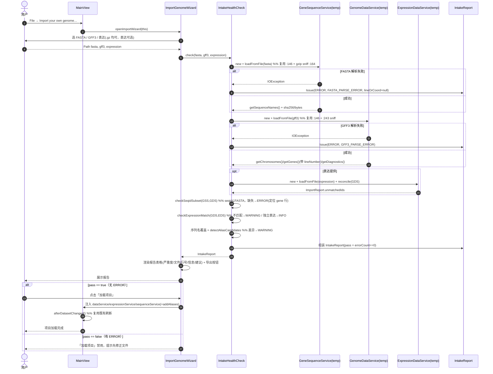
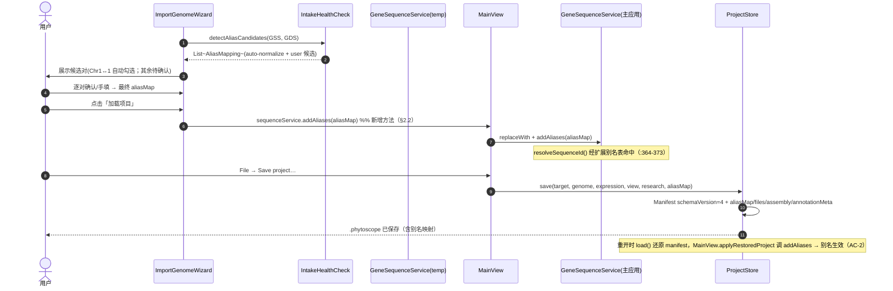
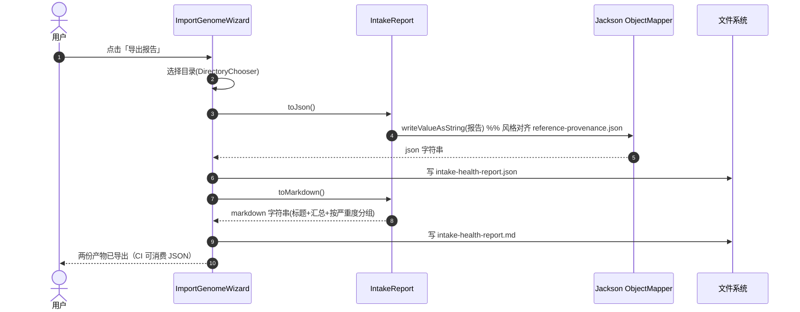
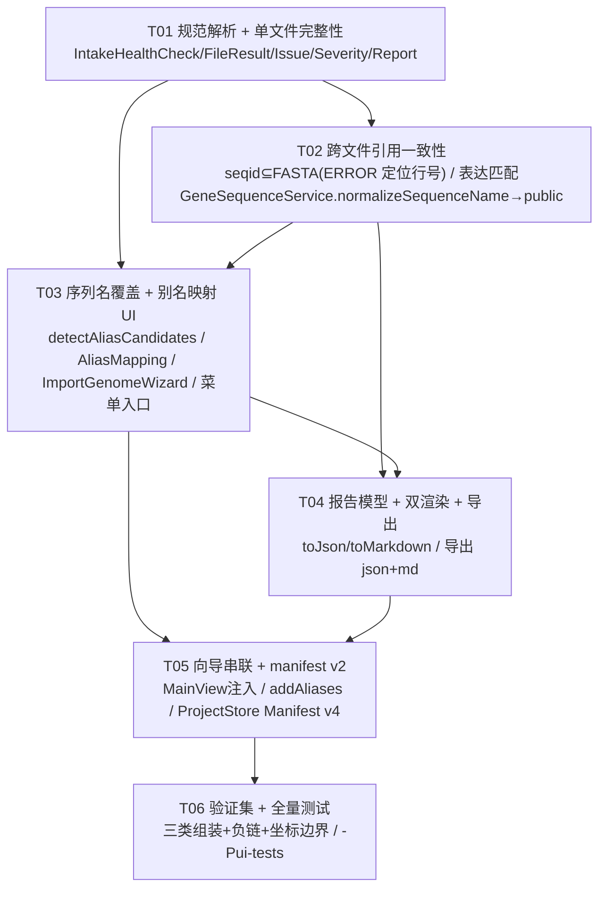

# PhytoScope 增量系统设计：自定义基因组导入体检（custom genome import health-check）

> **文档类型**：增量系统设计 + 任务分解（增量档）。**只描述本次变更**，未提及的模块、分层、算法与交互一律沿用基线设计，不重写系统架构。
> **编写**：架构师 高见远　|　**状态**：待主理人 / 工程实现评审
> **上游输入**：`docs/prd-import-health-check.md`（增量 PRD v1.0，含 R1–R11、AC-1~AC-8、Q1–Q2、§0.2 现状核对结论）。本文的实测纠正已与 PRD §0.2 一致；PRD §0.2 引用的真实路径与方法名均已在 `dev @ 235b196` 工作树复核。
> **代码基线**：`dev` 分支 @ `235b196`（已含「剥离内置完整数据」`8cef0c8` 与 provenance 回填 `235b196`；gitee origin 与 github 两远端均已同步），Java 21 + Spring Boot 3.2.5 + JavaFX，Maven，包根 `io.gitee.omixcore.phytoscope`
> **远端**：`origin` = `https://gitee.com/omixcore/phytoscope.git`；`github` = `git@github-w1996jy:omixcore/phytoscope.git`（均已同步）

---

## 0. 决议继承、实测核对与纠错登记

### 0.1 直接继承、不再讨论的决议

| 来源 | 决议 |
|---|---|
| 用户 4 项（PRD §0.1） | ① 报告 = JSON（机读，可进 CI 门禁）+ Markdown（人读）双产物；② 严重度 ERROR/WARNING/INFO，报告可作放行判据；③ 新增独立「导入自己的基因组」向导，与 Example datasets 分流，向导跑完报告后再决定是否加载；④ v1 = FASTA+GFF3+表达矩阵；BED/bedGraph 与 0-based↔1-based 换算属 v2；⑤ 别名映射持久化在 project manifest（按项目），不引入全局别名表；⑥ gzip 处理复用 `Gff3Parser` sniff；⑦ 复用现有解析/比对逻辑，不重写核心算法；不新增第三方依赖、不联网 |
| 主理人（用户特性方向） | 同 PRD §0.1 七条；并明确 IntakeReport 定义**独立**严重度枚举，不污染 `AnnotationHealthService` 的四级模型（见 §1.4 / Q1） |
| 环境边界 | 沿用「剥离内置数据」的离线约束：不新增网络能力、不新增第三方依赖、不改动 `pom.xml` 依赖列表 |

### 0.2 本设计新增的实测核对结论（架构师复核，均基于 `235b196` 工作树）

| # | 结论 | 证据 / 影响 |
|---|---|---|
| **C1** | **`describeFastaAlignment()` 确在 `MainView:339`（私有方法），不在 `GeneSequenceService`**；它比对 FASTA 序列名（经 `MainView.normalizeSequenceName:371`）与注释染色体，对「N of M 注释染色体没有 FASTA 记录」输出 `WARNING`（`:364-367`）。这是**导入后** UI 反馈，非可导出、非可定位到具体记录的报告 | 本次新增的「导入时体检」要把这条 WARNING 语义**提升为一份可导出、可定位的报告**，且二者口径对齐（§1.4） |
| **C2** | **「AnnotationHealthCheck」实为 `AnnotationHealthService`**（`service/AnnotationHealthService.java`）：`assess(GenomeDataService, ExpressionDataService)` → `HealthReport`，`Severity` 为 `ERROR/WARNING/NOTICE/NOT_CHECKED`（`:29-34`），`HealthIssue`（`:52-55`）含 `lineNumber/rawEvidence/geneId/transcriptId`；`toText()/toJson()`（`:84/:100`）；在 `MainView:469`（`showHealthReport()`）触发，是**导入后**注释一致性体检 | 本增量**不改动**它；新增「导入时」跨文件引用一致性体检；两者 Severity 口径书面约定（§1.4） |
| **C3** | **FASTA 解析底座**（`GeneSequenceService`）：`loadFromFile(Path)`（`:146`）/`loadFromContent`（`:154`）；标题行首个空白前字段为序列 ID（`:178-180`）；gzip sniff `first==0x1f && second==0x8b`（`:164`）；`getSequenceNames()`（`:110`）；`normalizeSequenceName()`（`:226-233`，小写+去非字母数字+去 `chr` 前缀）；`resolveSequenceId()`（`:364-373`，先精确匹配再走别名）；自动加 `ChrN`↔`N` 别名（`addChromosomeAliases:216-219`）。`normalizeSequenceName` 当前为 `private static` | v1「FASTA-ID ↔ GFF3-ID 别名映射」的权威实现依据；实现时把 `normalizeSequenceName` 提升为 `public static` 供 intake 包复用（§2.2 修改项） |
| **C4** | **表达矩阵解析底座**（`ExpressionDataService`）：`readMatrix()`（`:243-305`）复用 `# unit=...`/`# level=...`（`:254-261`）；首列 feature_id（`:281`）；空值/`NA`/`N/A`/`.`/`NULL`→missing（`:287`），`0`→实测零值（区别于 missing）；`reconcile(GenomeDataService)`（`:149`）产出 `ImportReport.unmatchedIds/matchedIds/annotationIds`（`:122-133`）；`serializeMatrix()`（`:426`）输出带 `# unit=`/`# level=` 的规范 TSV | `ImportReport` 已是「表达 ID 匹配」现成底座，intake 直接复用，不重写 |
| **C5** | **GFF3/GTF 解析底座**（`Gff3Parser`）：`parse()`（`:237`）gzip sniff（`:243`，与 FASTA 同一魔数）；九列校验 `<9` 列 → 计入 `skippedRows`（`:289-296`）；ID/Parent 装配与 `OrphanFeature` 收集（`:358-363`）。`ParseDiagnostics`（`parser` 包）：`MAX_RECORDS=10_000`（`:26`，明细封顶、总数 `skippedRowTotal` 不封顶）；`SkippedRow`（`:50`，含 `lineNumber/rawLine/SkipReason`）；`OrphanFeature`（`:64`，含 `lineNumber/featureId/featureType/missingParentId`）。`AnnotationFormat`（`:16/23`）含 `GFF3/GTF`，`allExtensions()`（`:58`）覆盖 `*.gff3/*.gff/*.gtf/*.gff2/*.gz` | intake 复用解析结果；**关键缺口见 C8** |
| **C6** | **项目持久化底座**（`ProjectStore`）：`Manifest` record（`:38-40`）含 `schemaVersion`（当前 **3**）、`applicationVersion`、`annotationFormat`、`annotations(List<Source>)`、`expression(Source)`、`view`、`importReport`、`research`；`Source`（`:22`）= `{entry, origin, sha256}`。`save()`（`:46-81`）把注释字节内嵌 zip（`annotation/part-N.txt`，`:60`）+ 逐文件 SHA-256（`:63`，`MessageDigest.getInstance("SHA-256")`），manifest 写入 `project.json`（`:72-75`）；`load()`（`:83-115`）校验 `schemaVersion` 1–3（`:90`） | manifest v2 在其上扩展（§3.4），**bump schemaVersion 到 4 并放宽 `load()` 到 1–4**；SHA-256 直接复用既有 `sha()` 工具（`:148`） |
| **C7** | **`GenomeDataService` 解析结果对外暴露面**：`getChromosomes()`（`:252`，来自 `GenomeMetadata.getSequenceNames()`）；`getGenes()`（`:236`，每个 `Gene` 继承 `GenomicFeature.getLineNumber()`，解析时已 set，见 `Gff3Parser:342`）；`getDiagnostics()`（`:85`，返回 `ParseDiagnostics`）；`getSkippedRows()`（`:80`）；`getSourceInputs()`（`:62`，`SourceInput(location, resource, sha256)`，`pin()` 已算 SHA-256，`:45-55`）；`getFormat()`、`getMetadata()` | intake 协调器通过这些只读接口取数，**不深入 parser 内部**；行号来自 `Gene.getLineNumber()` 与 `ParseDiagnostics` |
| **C8（重要缺口）** | **现有解析器不保留「每个 GFF3 特征 seqid 对应的行号」**。`ParseDiagnostics` 仅记录 `SkippedRow`（格式错误行）与 `OrphanFeature`（Parent 引用缺失行）的行号；`getChromosomes()` 只返回去重后的 seqid 列表（无行号）。一个 seqid 若既未触发跳过、也未触发孤儿 Parent，**当前没有任何结构体记录它出现在哪一行**。因此「注释引用了 FASTA 不存在的序列 → 定位到具体记录行号」（AC-3）**不能靠现有 `ParseDiagnostics` 直接拿到，需 intake 自行定位** | 见 §1.5 / §3.5：intake 协调器复用 `Gene.getLineNumber()`（基因行是 seqid 的主要载体）实现「定位到第 N 行」，并诚实标注 child-feature-only seqid 的行号精度缺口 |
| **C9** | **既有导入入口彼此解耦、均不改动**：`MainView.importAnnotation()`（`:255`）、`importGenomeFasta()`（`:295`）、`importExpression()`（`:379`）及其非对话框入口 `loadAnnotation/loadGenomeFasta/loadExpression`（`:401/:308/:408`）；`ExampleDataset.CATALOGUE` 与 `File` 菜单（`:756-765`）均已存在 | 新向导为**独立新增**入口，插入 `File` 菜单（§2.2），AC-7 要求不耦合既有路径 |
| **C10** | **`reference-provenance.json`** 结构（`datasets`、`external_resources`、`baseline_commit`、逐文件 `sha256`/`bytes`）是 manifest v2 与报告 JSON 字段风格的权威参考；`external_resources` 已记录 `{storage, repository, moved_at_commit, external_path, sha256, bytes}` 三元组 | manifest v2 `files[]` 与报告 `files[]` 字段风格对齐该 JSON |

### 0.3 纠错登记（相对 PRD v1.0 §0.2 引用）

> PRD §0.2 已正确引用本工作树现状（与本文 C1–C10 一致），无历史笔误需要纠正。仅强调两点：**`describeFastaAlignment` 在 `MainView:339`（非 GeneSequenceService）**、**模块名是 `AnnotationHealthService`（非 AnnotationHealthCheck）**——本文据此设计，确认与 PRD 一致。

### 0.4 范围外已知遗留（明确排除，仅登记）

- **BED3/BED6 导入与查询、bedGraph 轨道、BED↔GFF3 0-based/1-based 真实换算**：全部属 v2（PRD §2.2 / R10 / AC-8）。v1 代码**不实现**换算。
- **全局别名预设（R9）**：默认不建，P2 可选，不影响 v1。
- **CI 门禁集成脚本（R11）**：仅示例脚本，非应用内功能，可选 P2。

---

## 1. 实现方案

### 1.1 核心技术难点与对策

| 难点 | 对策 | 落地位置 |
|---|---|---|
| **D1 导入时 vs 导入后两套体检口径冲突** | IntakeReport 用**独立**枚举（ERROR/WARNING/INFO）；AnnotationHealthService 四级模型**一行不改**；两者是两份独立交付物，按阶段分工（§1.3） | §1.4、§3.1 |
| **D2 跨文件引用一致性需先解析再比对** | 协调器各自 `new` 临时服务实例（FASTA/GFF3/表达），调用既有 `loadFromFile()` 解析；任一抛 `IOException` → 该文件 ERROR；不把坏文件塞进主应用 | §3.2、`IntakeHealthCheck` |
| **D3 行号定位缺口（C8）** | 协调器复用 `Gene.getLineNumber()`（继承 `GenomicFeature`）定位 seqid 缺失的**基因行**；child-feature-only seqid 退化为「按 seqid 汇总」WARNING（不丢信息） | §1.5、§3.5 |
| **D4 别名映射要能「写入项目并还原生效」** | manifest v2 新增 `aliasMap[{from,to,confirmedBy}]`；`GeneSequenceService` 新增 `addAliases(Map)` 注入项目级别名；`ProjectStore.load()` 还原后由 `MainView` 调 `addAliases` | §3.4、`T05` |
| **D5 向导与既有流程耦合** | 新增独立 `ImportGenomeWizard` 类 + 独立 `File` 菜单项；既有 `importAnnotation/importGenomeFasta/importExpression` 与 `CATALOGUE` 零改动 | §2.2、AC-7 |
| **D6 报告双产物、可进 CI 门禁** | `IntakeReport.toJson()`（Jackson，字段含 severity/code/message/file/lineOrCoord/suggestion）/`toMarkdown()`（手写，无新依赖）；`pass = (errorCount==0)` | §3.3 |
| **D7 离线、零新依赖** | 仅用既有 Jackson（`ProjectStore` 已在用）、`java.security.MessageDigest`（SHA-256，已在 `ProjectStore`/`GenomeDataService` 用）、JavaFX 既有控件；`pom.xml` 不变 | §7 |

### 1.2 为何沿用现有栈、不引入任何新依赖

- 本次是**新增一套「导入时联合体检 + 独立向导 + manifest v2」**，核心解析（GFF3/GTF/FASTA/表达 TSV）**一行不重写**，仅调用 `GenomeDataService.loadFromFile` / `GeneSequenceService.loadFromFile` / `ExpressionDataService.loadFromFile(+reconcile)`。
- gzip 复用 `Gff3Parser.parse()` `:243` 与 `GeneSequenceService.load()` `:164` 的魔数 sniff。
- 序列名归一化复用 `GeneSequenceService.normalizeSequenceName`（仅提升可见性，§2.2）。
- 报告 / manifest 仅用 **Jackson**（已在 `ProjectStore` 用）+ **`MessageDigest("SHA-256")`**（已在 `ProjectStore.sha()` / `GenomeDataService.SourceInput.pin` 用）+ JavaFX 既有 `TableView`/`TextArea`/`FileChooser`/`DirectoryChooser`。
- **`pom.xml` 依赖增量 = 0**（§7）。全程离线，无 HTTP 客户端、无下载入口。

### 1.3 「导入时体检」与「导入后体检」的分工与汇总关系

> 这是本增量最关键的设计判断，回应 PRD §7 Q1 与 R8。

**两份体检，两个阶段，互不复用 Severity 枚举，但可串联汇总：**

| 维度 | 导入时体检（**新增**，本增量） | 导入后体检（**既有** `AnnotationHealthService`，不改） |
|---|---|---|
| 触发时机 | 向导选完文件、**尚未加载**到主应用 | 用户点 `File → Annotation health report…`（`:761`/`:469`），数据已加载 |
| 关注点 | **跨文件**引用一致性：FASTA 有否、GFF3 seqid⊆FASTA、表达 feature_id 匹配、序列名覆盖/别名、单文件解析能否成功 | **单注释内部**正确性：孤儿 Parent、坐标倒置/越界、CDS 帧/相位、表达 ID 不匹配、组装匹配不可验证 |
| 严重度枚举 | **独立** `IntakeSeverity{ERROR, WARNING, INFO}` | `AnnotationHealthService.Severity{ERROR, WARNING, NOTICE, NOT_CHECKED}` |
| 产物 | JSON（机读，CI 门禁）+ Markdown（人读），可导出 | `HealthReport.toText()/toJson()`，弹窗展示 |
| 是否阻断加载 | **是**：含 ERROR → 向导禁止「加载项目」 | 否：仅展示，不影响已加载数据 |

**汇总关系（串联而非重复）：**
- 向导在加载**前**跑 `IntakeHealthCheck`，产出 `IntakeReport`。若 `pass=false`（有 ERROR），向导不开放「加载项目」按钮 —— 这是**前置门禁**。
- 用户确认放行后，三个文件才真正加载进主应用（`dataService`/`expressionService`/`sequenceService`），随后一切照旧。
- 若用户仍想做**深度内容体检**（如坐标/相位），主动点 `Annotation health report…` 跑既有 `AnnotationHealthService`。
- **口径对齐规则（避免「同一现象两种严重度」）**：
  1. `IntakeSeverity` 与 `AnnotationHealthService.Severity` 是两个**不同类型**，永不混用、永不在同一报告里出现。
  2. 「注释染色体无 FASTA 记录」在**导入时**归 `WARNING`（等价于 `describeFastaAlignment` 的既有 WARNING，见 C1）；**导入后** `AnnotationHealthService` 不重复报序列覆盖，它只发 `ASSEMBLY_MATCH_UNVERIFIED`（NOT_CHECKED，`:211-216`）—— 语义不同，不冲突。
  3. 「表达 feature_id 未匹配」在**导入时**由 `reconcile().unmatchedIds` 归 `WARNING`；若用户放行加载，**导入后** `AnnotationHealthService` 会再发 `EXPRESSION_ID_MISMATCH`（WARNING）。这是**同一数据的两阶段体检**（前置快照 vs 加载后深检），不是矛盾；CI 门禁用 `IntakeReport`，人工深检用 `HealthReport`，二者用途分明。
  4. 既有的 `describeFastaAlignment()`（`:339`）**保留不动**（导入后 UI 反馈照常）；导入时体检是它能力的「可导出、可定位」升级版，不删、不改其 WARNING 语义，只是把同一条语义在新报告里也记为 WARNING。

### 1.4 严重度口径对齐（Q1 决议）

**决议：导入报告定义独立的 `IntakeSeverity{ERROR, WARNING, INFO}`，不扩展 `AnnotationHealthService.Severity`。**

| 现象 | IntakeReport 严重度 | 说明 |
|---|---|---|
| 任一文件解析失败（FASTA/GFF3/TSV 抛 IOException）、编码/截断错误 | **ERROR** | 阻断导入 |
| 注释/轨道引用了 FASTA 不存在的序列 | **ERROR** | 定位到具体基因行（C8/D3） |
| 注释染色体无 FASTA 记录（FASTA 缺对应序列） | **WARNING** | 等价于 `describeFastaAlignment` 既有 WARNING |
| 序列名差异需别名映射（Chr1 vs 1 之外、需人工确认） | **WARNING** | 不阻断，需用户确认 |
| 表达 feature_id 不在注释里（注释存在时） | **WARNING** | 列出未匹配 ID |
| 独立表达矩阵（无注释） | **INFO** | 可正常放行 |
| FASTA 有序列无注释（容错保留） | **INFO** | 不报错 |
| GFF3 `<9` 列被跳过行 / 非法值（可计数、非致命） | **WARNING**（汇总）/ 逐行 **INFO** | 复用 `ParseDiagnostics` |
| 别名映射经规范化自动发现（Chr1↔1）并确认 | **INFO** | `confirmedBy="auto-normalize"` |

### 1.5 「定位到具体记录行号」对现有解析器行号保留能力的依赖与缺口（如实说明）

- **已具备**：`Gene`（继承 `GenomicFeature`）在解析时被 `Gff3Parser:342` 写入 `lineNumber`；`ParseDiagnostics.SkippedRow` 与 `OrphanFeature` 均带 `lineNumber`。
- **缺口（C8）**：现有解析器**不记录「每个 GFF3 特征的 seqid 出现在哪一行」**。对于「seqid⊆FASTA」检查，intake 协调器采用如下策略保证可定位：
  - 遍历 `genome.getGenes()`，对每个 `gene.getChromosome()` 不在 FASTA 序列集（精确 + 归一化别名匹配）的，**以 `gene.getLineNumber()` 作为该 seqid 首个出现行**发出 ERROR（满足 AC-3「定位到第 N 行」）。
  - 对 `genome.getChromosomes()`（去重 seqid 列表）中剩余未匹配项做汇总 ERROR（列出 seqid，行号 = 首个承载它的基因行或 null）。
  - **已知精度边界**：若一个 seqid 只出现在某条**非基因子特征行**（如孤立 mRNA/CDS 行、无 enclosing gene），当前无法精确到该行；协调器退化为「按 seqid 汇总」WARNING（不丢信息，但行号可能指向首个基因行或 null）。要补齐需给 `ParseDiagnostics` 增加一类 `MissingSequence` 行号记录——但那会触碰解析器（与 R2/R3「仅调用、不重写」冲突），故 **v1 明确接受此精度边界**，并在报告中标注「子特征级行号待 v2 细化」。
- **表达矩阵行号**：`ExpressionDataService.reconcile()` 产出 `unmatchedIds`（ID 列表），**不含逐行行号**（TSV 首列是 ID，无结构化行号上下文）。表达 ID 不匹配 WARNING 以「ID 列表」呈现，行号字段置 null（用户可据 ID 自行 grep）。这属既有能力边界，v1 不补 TSV 行号追踪。

---

## 2. 文件列表

### 2.1 新增清单（包根 `io.gitee.omixcore.phytoscope`）

| 文件 | 职责 |
|---|---|
| `src/main/java/.../intake/IntakeHealthCheck.java` | **体检协调器**：接收 FASTA/GFF3/表达 `Path`（均可空，至少 FASTA+GFF3），各自 `new` 临时服务解析，做单文件完整性 + 跨文件引用一致性 + 序列名覆盖/别名候选，产出 `IntakeReport`。纯逻辑、无 JavaFX 依赖，可单测 |
| `src/main/java/.../intake/IntakeReport.java` | 报告模型 record：`files[]`、`issues[]`、`summary`、`pass`；`toJson()`（Jackson）、`toMarkdown()`（手写）双渲染；`errorCount()/warningCount()/infoCount()` |
| `src/main/java/.../intake/IntakeIssue.java` | 单条问题 record：`severity(IntakeSeverity)`、`code(String)`、`message(String)`、`file(String|null)`、`lineOrCoord(String|null)`、`suggestion(String|null)` |
| `src/main/java/.../intake/IntakeSeverity.java` | 枚举 `ERROR / WARNING / INFO`（独立于 `AnnotationHealthService.Severity`） |
| `src/main/java/.../intake/IntakeFileResult.java` | 单文件解析结果 record：`path`、`kind(FASTA/GFF3/EXPRESSION)`、`sha256`、`bytes`、`ok`、`error` |
| `src/main/java/.../intake/AliasMapping.java` | 别名映射 record：`from`、`to`、`confirmedBy`（"user" / "auto-normalize"） |
| `src/main/java/.../intake/IntakeManifestMeta.java` | manifest v2 新增字段的承载 record（组装/注释/文件/别名），供 `ProjectStore.Manifest` 扩展引用（见 §3.4） |
| `src/main/java/.../ui/ImportGenomeWizard.java` | **独立向导**（JavaFX `Stage`/`Dialog`）：① 选 FASTA/GFF3/表达（均可 .gz，表达可选）② 调 `IntakeHealthCheck` 跑报告 ③ 展示报告表格（严重度/文件/行号/信息/建议）+ 导出 JSON/Markdown 按钮 ④ 序列名差异 → 别名映射确认 UI（候选对 + 勾选/手动填）⑤ 无 ERROR 时「加载项目」按钮；确认后把 `aliasMap` 注入加载流程 |
| `src/test/java/.../intake/IntakeHealthCheckTest.java` | intake 逻辑单测（三类组装 + 负链 + 别名 + 缺失 seqid + 表达不匹配） |
| `src/test/java/.../intake/ImportGenomeWizardUiTest.java` | 向导端到端 UI 测试（Monocle headless，复用 `-Pui-tests`） |
| `src/test/java/.../intake/ProjectStoreAliasRestoreTest.java` | AC-2：别名写入 manifest 后重开项目 `resolveSequenceId` 生效 |
| `src/test/resources/intake/` | KB 级自包含 fixture（见 §6）：`chr_level.*`、`scaffold_fragmented.*`、`organelle.*`、`negative_strand.*`、`alias_mismatch.*`、`missing_seqid.*`、`standalone_expression.*` |
| `docs/design-import-health-check.md` | 本文档 |
| `docs/design-import-health-check-class-diagram.mermaid` | 增量类图（**不覆盖**既有全量 `docs/class-diagram.mermaid`） |
| `docs/design-import-health-check-sequence-diagram.mermaid` | 增量时序图（**不覆盖**既有全量 `docs/sequence-diagram.mermaid`） |
| `scripts/intake-ci-gate.sh` / `scripts/intake-ci-gate.ps1`（可选 P2，R11） | 示例：读 `intake-health-report.json`，存在 ERROR 即以非零退出，供 CI 消费 |

### 2.2 修改清单

| 文件 | 本次改动 |
|---|---|
| `src/main/java/.../service/GeneSequenceService.java` | `normalizeSequenceName()`（`:226-233`）由 `private static` 提升为 `public static`（供 intake 包复用，不改算法）；**新增** `addAliases(Map<String,String> aliasMap)`：把 `(normalizeSequenceName(from), to)` 并入别名表（用于项目级别名还原，AC-2）；`resolveSequenceId()`（`:364-373`）逻辑不变，自动读取扩展后的别名表 |
| `src/main/java/.../project/ProjectStore.java` | `Manifest` record（`:38-40`）**扩展**新字段（见 §3.4），`save()`（`:46-81`）在 schemaVersion=**4** 时填充新字段；`load()`（`:90`）放宽 `schemaVersion` 接受 **1–4** 且对新增字段 null 容错；共享 `JSON`（`ObjectMapper`）配置 `FAIL_ON_UNKNOWN_PROPERTIES=false` 并给 `Manifest` 加 `@JsonCreator` 兼容构造（向后兼容旧 1–3 项目） |
| `src/main/java/.../ui/MainView.java` | `File` 菜单（`:762-765`）**新增**独立 `MenuItem("Import your own genome…")` → `openImportWizard()`；新增 `openImportWizard()`：启动 `ImportGenomeWizard`，向导回调里把解析结果注入主应用（`dataService.replaceWith` / `expressionService.replaceWith` / `sequenceService.replaceWith` 并 `sequenceService.addAliases(aliasMap)`），复用既有 `afterDatasetChanged()`；**不改动** `importAnnotation/importGenomeFasta/importExpression`、`CATALOGUE`、`describeFastaAlignment` |
| `README.md` | 新增「导入自己的基因组」向导说明（与「完整参考数据获取」小节并列），明确这是独立于 Example datasets 的「带来你自己的数据」入口 |

### 2.3 明确**不动**的文件

- 解析核心：`Gff3Parser`（sniff/`parse`/`decompressPerPart`）、`GenomeDataService`、`ExpressionDataService` 的解析与比对算法（仅调用）。
- 既有导入入口：`MainView.importAnnotation/importGenomeFasta/importExpression` 与 `loadAnnotation/loadGenomeFasta/loadExpression`，`ExampleDataset.CATALOGUE`。
- `AnnotationHealthService`（四级模型不动）。
- `AnnotationFormat`、`ParseDiagnostics` 现有结构（不新增 `MissingSequence` 类，v1 接受 §1.5 精度边界）。
- `pom.xml`、`application.properties`、`.gitattributes`、全量 `docs/class-diagram.mermaid` / `docs/sequence-diagram.mermaid`。

---

## 3. 数据结构与接口

### 3.1 增量类图（仅涉及本次变更的类与关系）

```mermaid
classDiagram
    %% 状态标注：NEW=本次新增 / MODIFIED=本次修改 / UNCHANGED=核对后不动
    class IntakeHealthCheck {
        <<service>>
        +IntakeReport check(Path fasta, Path gff3, Path expression)
        -checkSingleFileIntegrity(Path, Kind) IntakeFileResult
        -checkSeqidSubset(GeneSequenceService, GenomeDataService) List~IntakeIssue~
        -checkExpressionMatch(GenomeDataService, ExpressionDataService) List~IntakeIssue~
        -detectAliasCandidates(GeneSequenceService, GenomeDataService) List~AliasMapping~
    }
    class IntakeReport {
        <<record>>
        +List~IntakeFileResult~ files
        +List~IntakeIssue~ issues
        +String summary
        +boolean pass
        +toJson() String
        +toMarkdown() String
        +errorCount() int
    }
    class IntakeIssue {
        <<record>>
        +IntakeSeverity severity
        +String code
        +String message
        +String file
        +String lineOrCoord
        +String suggestion
    }
    class IntakeSeverity {
        <<enum>>
        ERROR
        WARNING
        INFO
    }
    class IntakeFileResult {
        <<record>>
        +String path
        +String kind
        +String sha256
        +long bytes
        +boolean ok
        +String error
    }
    class AliasMapping {
        <<record>>
        +String from
        +String to
        +String confirmedBy
    }
    class IntakeManifestMeta {
        <<record>>
        +String specVersion
        +Assembly assembly
        +AnnotationMeta annotation
        +List~IntakeFileResult~ files
        +List~AliasMapping~ aliasMap
    }
    class Assembly {
        <<record>>
        +String id
        +String source
        +List~String~ sequences
    }
    class AnnotationMeta {
        <<record>>
        +String format
        +String version
        +String source
    }
    class ImportGenomeWizard {
        <<ui>>
        +openImportWizard(MainView host)
        -chooseFiles() void
        -runCheckAndShowReport() void
        -confirmAliases(List~AliasMapping~) List~AliasMapping~
        -exportReport(Path, Format) void
        -loadProject(AliasMapping[]) void
    }
    class GeneSequenceService {
        <<service>>
        +normalizeSequenceName(String) String  %% MODIFIED: private -> public static
        +addAliases(Map~String,String~) void   %% NEW
        +getSequenceNames() List~String~
        +loadFromFile(Path) void
        +resolveSequenceId(String) String
    }
    class GenomeDataService {
        <<service>>
        +loadFromFile(Path) void
        +getChromosomes() List~String~
        +getGenes() List~Gene~
        +getDiagnostics() ParseDiagnostics
        +getSourceInputs() List~SourceInput~
    }
    class ExpressionDataService {
        <<service>>
        +loadFromFile(Path) void
        +reconcile(GenomeDataService) ImportReport
        +getImportReport() ImportReport
    }
    class ProjectStore {
        <<project>>
        +save(Path, GenomeDataService, ExpressionDataService, ViewState, ResearchState) void  %% MODIFIED: 填 manifest v2
        +load(Path) Restored  %% MODIFIED: schemaVersion 1-4
        -Manifest Manifest(record 扩展 specVersion/assembly/annotation/files/aliasMap)
    }
    class AnnotationHealthService {
        <<service>>
        +assess(GenomeDataService, ExpressionDataService) HealthReport  %% UNCHANGED
    }
    class ParseDiagnostics {
        <<parser>>
        +MAX_RECORDS = 10000  %% UNCHANGED
        +List~SkippedRow~ skippedRows
        +List~OrphanFeature~ orphans
    }
    class MainView {
        <<ui>>
        +openImportWizard() void  %% NEW 菜单入口
    }

    note for IntakeHealthCheck "NEW: 协调器，复用 GenomeDataService/GeneSequenceService/ExpressionDataService 解析，不重写算法"
    note for IntakeSeverity "NEW: 独立枚举，不扩展 AnnotationHealthService.Severity（避免 Q1 口径冲突）"
    note for ImportGenomeWizard "NEW: 独立向导入口，与 Example datasets 分流"
    note for GeneSequenceService "MODIFIED: normalizeSequenceName 提升 public static；新增 addAliases 支持项目级别名还原"
    note for ProjectStore "MODIFIED: Manifest 扩展 v2 字段；schemaVersion 3->4；load 接受 1-4"
    note for AnnotationHealthService "UNCHANGED: 导入后体检四级模型不动"
    note for ParseDiagnostics "UNCHANGED: 行号缺口见 §1.5（v1 接受精度边界）"
    note for MainView "MODIFIED: File 菜单新增独立入口，不耦合既有 import* 方法"

    ImportGenomeWizard ..> IntakeHealthCheck : check()
    ImportGenomeWizard ..> MainView : 注入 dataService/expressionService/sequenceService
    IntakeHealthCheck ..> GeneSequenceService : loadFromFile / getSequenceNames
    IntakeHealthCheck ..> GenomeDataService : loadFromFile / getGenes / getDiagnostics
    IntakeHealthCheck ..> ExpressionDataService : loadFromFile / reconcile
    IntakeHealthCheck ..> IntakeReport : 组装
    IntakeReport "1" *-- "many" IntakeIssue
    IntakeReport "1" *-- "many" IntakeFileResult
    IntakeManifestMeta "1" *-- "many" AliasMapping
    IntakeManifestMeta "1" *-- "1" Assembly
    IntakeManifestMeta "1" *-- "1" AnnotationMeta
    ProjectStore ..> IntakeManifestMeta : 序列化 manifest v2
    ImportGenomeWizard ..> GeneSequenceService : addAliases(aliasMap)
    MainView "1" *-- "1" ImportGenomeWizard : 启动
```



### 3.2 输入规范各格式的解析入口与归一化结果

> 严格逐行落实 PRD §3 权威契约；解析入口全部复用既有方法（C3/C4/C5），不重写。

| 格式 | 解析入口（复用） | 归一化 / 取数 | 进报告的字段 |
|---|---|---|---|
| **FASTA**（.fa/.fasta/.fna/.gz） | `GeneSequenceService.loadFromFile(Path)`（`:146`），gzip sniff `:164` | 序列 ID = 标题行首个空白前字段（`:178-180`）；`getSequenceNames()`；`normalizeSequenceName()`（`:226-233`）去 `chr` 前缀 + 去非字母数字 | `files[]` 记 `sha256`/`bytes`/`path`；序列名集供 seqid 比对 |
| **GFF3/GTF**（.gff3/.gff/.gtf/.gff2/.gz） | `GenomeDataService.loadFromFile(Path)`（`:146`）→ `Gff3Parser.parse()`（`:237`），gzip sniff `:243` | 九列校验（`<9`→`SkippedRow`）；ID/Parent 装配；`getChromosomes()`、`getGenes()`（每个 `Gene` 带 `getLineNumber()` 继承自 `GenomicFeature`）；`getDiagnostics()` | `files[]` 记 `sha256`/`bytes`；`skippedRows`/`orphans` → 报告；seqid 列表供比对 |
| **表达 TSV**（.tsv，UTF-8） | `ExpressionDataService.loadFromFile(Path)`（`:89`）+ `reconcile(GenomeDataService)`（`:149`） | `# unit=`/`# level=` 元数据（`:254-261`）；首列 feature_id（`:281`）；空值/`NA`/`N/A`/`.`/`NULL`→missing，`0`→零值（`:287`）；`ImportReport.unmatchedIds` | `files[]` 记 `sha256`/`bytes`；`unmatchedIds` → WARNING（或 INFO 当独立表达矩阵） |
| **BED3/BED6/BedGraph**（.bed/.bedgraph） | **v1 不解析**（§2.4/AC-8） | — | v1 不出现在报告；v2 预留 |
| **manifest v2**（随 .phytoscope） | `ProjectStore.save/load`（§3.4） | 规范版本/组装标识/注释版本/路径/SHA-256/别名映射 | 见 §3.4 |

### 3.3 报告模型 schema

```java
public enum IntakeSeverity { ERROR, WARNING, INFO }   // 独立于 AnnotationHealthService.Severity

public record IntakeIssue(
        IntakeSeverity severity,   // ERROR / WARNING / INFO
        String code,               // 机器可读码，如 SEQID_NOT_IN_FASTA / EXPRESSION_ID_UNMATCHED / FASTA_PARSE_ERROR
        String message,            // 人读描述
        String file,               // 来源文件名（FASTA/GFF3/TSV 之一），可空
        String lineOrCoord,        // 定位：GFF3 行号（来自 Gene.getLineNumber）或坐标；表达不匹配置 null（见 §1.5）
        String suggestion          // 修复建议，可空
) {}

public record IntakeFileResult(
        String path, String kind,  // kind: FASTA / GFF3 / EXPRESSION
        String sha256, long bytes,
        boolean ok, String error   // error 仅在解析失败时有值
) {}

public record IntakeReport(
        List<IntakeFileResult> files,
        List<IntakeIssue> issues,
        String summary,
        boolean pass               // pass = errorCount() == 0
) {
    public int errorCount()   { return (int) issues.stream().filter(i -> i.severity()==ERROR).count(); }
    public int warningCount() { return (int) issues.stream().filter(i -> i.severity()==WARNING).count(); }
    public int infoCount()    { return (int) issues.stream().filter(i -> i.severity()==INFO).count(); }
    public String toJson()    { /* Jackson: 同 AnnotationHealthService.toJson 风格，含 files/issues/summary/pass + 计数 */ }
    public String toMarkdown(){ /* 手写：标题 + 汇总表 + 按严重度分组的问题列表（行号/坐标/建议） */ }
}
```

**JSON 字段风格**（对齐 `reference-provenance.json` / `AnnotationHealthService.toJson`）：顶层 `{ "specVersion", "summary", "pass", "errorCount","warningCount","infoCount", "files":[...], "issues":[ {"severity","code","message","file","lineOrCoord","suggestion"} ] }`。CI 门禁：`errorCount>0` → 失败。

### 3.4 manifest v2 schema（在 `ProjectStore.Manifest` 上扩展）

**设计**：保留既有 `Manifest` 全部字段（`schemaVersion/applicationVersion/annotationFormat/annotations/expression/view/importReport/research`），**追加** v2 字段；`schemaVersion` 由 3 **bump 到 4**；`save()` 在写 4 时填充新字段；`load()` 接受 1–4 且对新增字段 null 容错（旧项目仍是 1–3，照常开）。

```java
// ProjectStore.Manifest 扩展后（新增字段追加在末尾）
public record Manifest(
        int schemaVersion,                 // 4（v2）；旧项目 1-3 仍可加载
        String applicationVersion,
        String annotationFormat,
        List<Source> annotations,
        Source expression,
        ViewState view,
        ExpressionDataService.ImportReport importReport,
        ResearchState research,
        // ---- v2 新增（可为 null，向后兼容）----
        String specVersion,                // "import-health-check/1.0" 规范版本号（字段名固定为 specVersion）
        Assembly assembly,                 // 参考组装标识 + FASTA 序列名
        AnnotationMeta annotationMeta,     // 注释版本 / 格式 / 来源
        List<IntakeFileResult> files,      // 三件套规范路径 + SHA-256 + bytes（复用 IntakeFileResult）
        List<AliasMapping> aliasMap        // 用户确认的序列别名映射（按项目）
) {}

public record Assembly(String id, String source, List<String> sequences) {}
public record AnnotationMeta(String format, String version, String source) {}
// AliasMapping { from, to, confirmedBy } 见 §3.1；from=注释/轨道侧名, to=FASTA 序列 ID, confirmedBy="user"|"auto-normalize"
```

**`files[]` 数据来源**：直接复用 `genome.getSourceInputs()`（`SourceInput.location`+`sha256`）+ `expression.getSource()` + `Files.size(Path)`，无需新增字节流统计。`bytes` = 原始导入文件字节数（非 zip 内嵌字节）。

**向后兼容实现要点**：共享 `ObjectMapper JSON` 设置 `DeserializationFeature.FAIL_ON_UNKNOWN_PROPERTIES = false`；给 `Manifest` 加一个 `@JsonCreator` 兼容构造（新字段 `@JsonProperty(required=false)`），旧 1–3 项目反序列化时新字段为 null，`load()` 对 null 新字段按「无别名 / 无 v2 元数据」处理。**不破坏既有 `.phytoscope` 项目**。

### 3.5 别名映射数据结构与确认流程

- **数据**：`AliasMapping { from, to, confirmedBy }`。`from` = 注释/GFF3 侧序列名（如 `1`），`to` = FASTA 序列 ID（如 `Chr1`），`confirmedBy` = `"auto-normalize"`（规范化发现并自动确认，如 `Chr1`↔`1`）或 `"user"`（向导里人工确认的差异对）。
- **候选生成**（`IntakeHealthCheck.detectAliasCandidates`）：对 GFF3 每个 `chromosome`，若不在 FASTA 精确名集但 `normalizeSequenceName(chromosome)` 命中某 FASTA 名 → 自动候选（`auto-normalize`）；否则列入「需人工确认」候选（`user`）。
- **确认 UI**（`ImportGenomeWizard.confirmAliases`）：列出候选对，自动候选默认勾选，差异对由用户逐对勾选/可手填；确认后形成最终 `aliasMap`。
- **写入项目**：向导「加载项目」时把 `aliasMap` 传给 `MainView`，由 `sequenceService.addAliases(map)` 注入；随后 `ProjectStore.save()` 把 `aliasMap` 写入 manifest v2（§3.4）。
- **还原生效（AC-2）**：`ProjectStore.load()` 还原后，`MainView.applyRestoredProject` 调 `sequenceService.addAliases(manifest.aliasMap)` → `GeneSequenceService.resolveSequenceId()`（`:364-373`）经扩展别名表命中，`extract()` 能正确匹配（§2.2）。

---

## 4. 程序调用流程

### 4.1 用户选文件 → 解析 → 联合体检 → 展示报告 → 放行/放弃



### 4.2 序列名差异 → 别名映射确认 → 写入项目



### 4.3 报告导出 JSON + Markdown



---

## 5. 任务列表（有序、含依赖、按实现顺序）

> 用户/主理人已明确采纳 **T01–T06** 六阶段分解（PRD §5 任务列表建议）。本设计如实落盘该顺序与依赖；每个任务标注改哪个文件、加什么/删什么、验收点。团队「≤5 任务」的硬上限在此被**用户显式六阶段计划**覆盖（可在分派时按需合并，但顺序/依赖/验收点不变）。

### T01　规范解析与单文件完整性校验（P0）

- **依赖**：无
- **优先级**：P0
- **源文件**：`src/main/java/.../intake/IntakeHealthCheck.java`、`src/main/java/.../intake/IntakeFileResult.java`、`src/main/java/.../intake/IntakeIssue.java`、`src/main/java/.../intake/IntakeSeverity.java`、`src/main/java/.../intake/IntakeReport.java`
- **做什么**：
  - 建 `IntakeSeverity` 枚举（ERROR/WARNING/INFO）、`IntakeFileResult`、`IntakeIssue` record。
  - `IntakeHealthCheck.checkSingleFileIntegrity(Path, kind)`：各自 `new GeneSequenceService/GeneSequenceService/ExpressionDataService` 调 `loadFromFile`（FASTA/GFF3/表达），捕获 `IOException` → 该文件 `IntakeFileResult.ok=false` + 报告 `FASTA_PARSE_ERROR/GFF3_PARSE_ERROR/TSV_PARSE_ERROR` ERROR；成功则记 `sha256`（`GenomeDataService.SourceInput.pin` 风格或 `ProjectStore.sha()`）、`bytes`（`Files.size`）。
  - `IntakeReport` 雏形：聚合 `files[]` + `issues[]` + `pass`。
- **验收点**：单个坏 FASTA（非核酸字符）/ 坏 GFF3（不可解析）/ 坏 TSV（列数错）分别触发对应 ERROR 且 `pass=false`；正常小文件 `files[]` 含正确 `sha256`/`bytes`、`ok=true`；不引入新依赖（§7）。

### T02　跨文件引用一致性（P0）

- **依赖**：T01
- **优先级**：P0
- **源文件**：`src/main/java/.../intake/IntakeHealthCheck.java`（增加 `checkSeqidSubset` / `checkExpressionMatch`）、`src/main/java/.../service/GeneSequenceService.java`（仅把 `normalizeSequenceName` 提升 `public static`）、`src/test/java/.../intake/IntakeHealthCheckTest.java`
- **做什么**：
  - `checkSeqidSubset(GSS, GDS)`：遍历 `genome.getGenes()`，对 `gene.getChromosome()` 不在 FASTA 序列集（精确 + `normalizeSequenceName` 匹配）的，发 **ERROR**，`lineOrCoord = String.valueOf(gene.getLineNumber())`，`file=gff3`，`suggestion="确认 FASTA 含该序列或建立别名映射"`（满足 AC-3）；对 `getChromosomes()` 剩余未匹配项做汇总 ERROR（§1.5 精度边界）。
  - `checkExpressionMatch(GDS, EDS)`：`reconcile()` 后若 `unmatchedIds` 非空且注释存在 → **WARNING**（`EXPRESSION_ID_UNMATCHED`，列 ID）；若注释为空却有表达 → **INFO**（`EXPRESSION_STANDALONE`）。复用 `ExpressionDataService.ImportReport`。
  - `GeneSequenceService.normalizeSequenceName` 由 `private static` 改 `public static`（算法不变）。
- **验收点**：注入「GFF3 引用未知 seqid `Z`」fixture → 报告对应 Issue 含正确 `lineNumber` 与 seqid（AC-3）；表达含不在注释的 ID → WARNING 且列未匹配 ID（AC-4）；纯表达矩阵（无注释）不报 ERROR、不抛异常（AC-4）；`GeneSequenceService.normalizeSequenceName` 仍为 `public static` 且行为一致。

### T03　序列名覆盖与别名映射 UI（P0）

- **依赖**：T01、T02
- **优先级**：P0
- **源文件**：`src/main/java/.../intake/IntakeHealthCheck.java`（增加 `detectAliasCandidates`）、`src/main/java/.../intake/AliasMapping.java`、`src/main/java/.../ui/ImportGenomeWizard.java`
- **做什么**：
  - `detectAliasCandidates(GSS, GDS)`：生成 `AliasMapping` 候选（`auto-normalize` 经规范化；`user` 需人工确认）；序列名差异（含 FASTA 有序列无注释）按 §1.4 归 WARNING（覆盖）/ INFO（容错保留）。
  - `ImportGenomeWizard`：独立 JavaFX 向导——选文件 → 跑 `IntakeHealthCheck` → 展示报告 → 别名确认面板（候选对勾选/手填）→ 导出按钮。
  - `MainView.File` 菜单（`:762-765`）新增独立 `MenuItem("Import your own genome…")` → `openImportWizard()`（不改动既有 `import*` 方法与 `CATALOGUE`）。
- **验收点**：Chr1↔1 自动候选出现并默认勾选；差异对可逐对确认；菜单项独立、文案与 Example datasets 区分；既有菜单/流程零改动（AC-7）；报告 WARNING/INFO 分类正确。

### T04　报告模型 + 双渲染 + 导出（P0）

- **依赖**：T01、T02、T03
- **优先级**：P0
- **源文件**：`src/main/java/.../intake/IntakeReport.java`（完善 `toJson`/`toMarkdown`/`summary`/`pass`）、`src/main/java/.../ui/ImportGenomeWizard.java`（导出按钮）、`docs/design-import-health-check.md`（若需补报告样例）
- **做什么**：
  - `IntakeReport.toJson()`：Jackson 输出 `{specVersion, summary, pass, errorCount, warningCount, infoCount, files[], issues[]}`，字段风格对齐 `reference-provenance.json` / `AnnotationHealthService.toJson`。
  - `IntakeReport.toMarkdown()`：手写，含标题、汇总表、按严重度分组的问题（行号/坐标、文件、建议）。
  - 向导导出 `intake-health-report.json` + `intake-health-report.md`（固定文件名约定，见 §8）。
- **验收点**：双产物可导出且互相对应；JSON 可被外部脚本以「`errorCount>0` 即失败」消费（为 R11 示例脚本铺垫）；每条 Issue 含可追溯 `lineOrCoord`/`file`/`suggestion`。

### T05　向导流程串联 + manifest v2（P0）

- **依赖**：T03、T04
- **优先级**：P0
- **源文件**：`src/main/java/.../ui/MainView.java`（注入解析结果 + `addAliases` 调用）、`src/main/java/.../service/GeneSequenceService.java`（新增 `addAliases(Map)`）、`src/main/java/.../project/ProjectStore.java`（Manifest 扩展 + schemaVersion 4 + load 1–4）、`src/main/java/.../intake/IntakeManifestMeta.java`、`src/main/java/.../intake/AliasMapping.java`、`src/test/java/.../intake/ProjectStoreAliasRestoreTest.java`
- **做什么**：
  - `GeneSequenceService.addAliases(Map<String,String>)`：把 `(normalizeSequenceName(from), to)` 并入别名表（`resolveSequenceId` 自动读取）。
  - `ProjectStore.Manifest` 扩展 `specVersion/assembly/annotationMeta/files/aliasMap`（§3.4）；`save()` 填 v2 字段（schemaVersion=4）；`load()` 接受 1–4 且 null 容错；共享 `JSON` 设 `FAIL_ON_UNKNOWN_PROPERTIES=false` 并加 `@JsonCreator` 兼容构造。
  - `MainView.openImportWizard` 回调：向导放行后把 `dataService/expressionService/sequenceService` 替换，并 `sequenceService.addAliases(aliasMap)`；`saveProject` 经由 `ProjectStore.save` 写入 manifest v2。
  - `applyRestoredProject` 还原后调 `sequenceService.addAliases(manifest.aliasMap)`。
- **验收点**：构造 Chr1（FASTA）/ 1（GFF3）fixture，向导确认映射并保存；`ProjectStore.load()` 还原后 `GeneSequenceService.resolveSequenceId("1")` 命中 `Chr1`，`extract()` 能正确提取（AC-2）；旧 1–3 项目仍可打开（向后兼容）；manifest v2 含全部字段、SHA-256 与嵌入字节重算一致（AC-5）。

### T06　验证集（三类组装 + 负链 + 坐标边界）+ 全量测试（P0）

- **依赖**：T01–T05
- **优先级**：P0
- **源文件**：`src/test/resources/intake/`（KB 级 fixture）、`src/test/java/.../intake/IntakeHealthCheckTest.java`、`ImportGenomeWizardUiTest.java`、`ProjectStoreAliasRestoreTest.java`
- **做什么（验证集，§6）**：三类组装（染色体级 / scaffold 碎片化 / 带细胞器）+ 负链基因 + 坐标边界（v1 仅别名边界）fixture 与断言；运行 `./mvnw -Pui-tests test`。
- **验收点**：AC-1（三类组装报告分类正确）、AC-2（别名还原）、AC-3（定位行号）、AC-4（表达不匹配不崩）、AC-5（manifest SHA）、AC-6（零新依赖/离线）、AC-7（向导独立）、AC-8（v1 不实现 BED 换算）；`0 failures / 0 errors`。

### 5.7 任务依赖图



---

## 6. 测试策略

### 6.1 验证集 fixture（新增于 `src/test/resources/intake/`，KB 级、自包含、可提交）

| fixture 组 | 内容 | 验证目标 |
|---|---|---|
| `chr_level.fa` / `.gff3` / `.tsv` | 染色体级组装，序列名一致（如 `Chr1..Chr5` 或 `1..5`），注释与表达 ID 匹配 | **0 ERROR** 基线（AC-1①） |
| `scaffold_fragmented.fa` / `.gff3` / `.tsv` | 碎片化 scaffold（如 `scaffold_1..scaffold_20`），注释挂在 scaffold 上 | 碎片化组装下报告正常（AC-1②） |
| `organelle.fa` / `.gff3` | 带细胞器序列（核序列 + `Pt`/`Mt` 叶绿体/线粒体） | 带细胞器组装下报告正常（AC-1③） |
| `negative_strand.gfa`/`.gff3` | 含负链（`-`）基因 | 负链基因不误报（坐标边界基础） |
| `alias_mismatch.fa`（Chr1）/ `alias_mismatch.gff3`（1） | FASTA 用 `Chr1`、GFF3 用 `1` | 别名映射候选出现 + 确认后 AC-2 还原生效 |
| `missing_seqid.gff3` + `missing_seqid.fa` | GFF3 引用 `Z` 不存在于 FASTA | **ERROR 且 `lineOrCoord` 为正确行号**（AC-3） |
| `standalone_expression.tsv` + `standalone_expression.gff3`(空/极小) | 表达 ID 不在注释里 | WARNING 列未匹配 ID（AC-4）；纯表达→INFO |
| `bad_fasta.fa`（非核酸字符）/ `bad_gff3.gff3`（不可解析） | 坏文件 | 解析失败→ERROR，`pass=false` |
| `coord_boundary_*.gff3`（v1 仅别名边界） | 注释坐标边界用例，**不涉及 0/1-based 换算** | AC-8：确认 v1 不实现 BED 换算，仅别名边界 |

> 体积约束：每个 fixture 单文件 < 256 KB（沿用既有守卫阈值），整体 KB 级；不引入大文件，符合「本地、可移植、非模式物种友好」与剥离决议。

### 6.2 断言要点

- **AC-1**：三类组装（染色体级 / scaffold / 带细胞器）下 `IntakeReport` 均可生成；正确数据 `errorCount()==0`；`missing_seqid` → ERROR；`alias_mismatch`/`standalone_expression` → WARNING/INFO 分类正确。
- **AC-2**：`alias_mismatch` 向导确认映射并 `ProjectStore.save` → `load()` 还原后，`new GeneSequenceService().addAliases(map)` 后 `resolveSequenceId("1")` 返回 `"Chr1"`；`extract()` 能提取序列，不抛 `IOException("no sequence matching…")`。
- **AC-3**：`missing_seqid` 报告的对应 `IntakeIssue.severity==ERROR` 且 `lineOrCoord` 等于该 GFF3 特征行的 `Gene.getLineNumber()`，`message` 含 seqid `Z`（复用 `Gene` 行号，§1.5）。
- **AC-4**：`standalone_expression` 表达含不在注释的 ID → WARNING 且 `IntakeIssue.message` 列出未匹配 ID；空表达矩阵 / 纯表达不报 ERROR、不抛异常。
- **AC-5**：`ProjectStore.save` 后，对嵌入字节重算 SHA-256 与 manifest 记录一致（复用 `ProjectStore.sha()`）；`load()` 接受 schemaVersion=4。
- **AC-6**：`pom.xml` 依赖增量 = 0；全仓 grep 新增代码无 HTTP 客户端 / 下载入口；向导无「下载/获取远程」按钮；`./mvnw -Pui-tests test` 离线通过。
- **AC-7**：`ImportGenomeWizard` 为独立入口；`ExampleDataset.CATALOGUE` 与既有 `importAnnotation/importGenomeFasta/importExpression` 零改动；报告在加载前生成，ERROR 时「加载项目」禁用。
- **AC-8**：断言 v1 代码**不实现** BED(0-based)↔GFF3(1-based) 换算（无相关换算方法/测试）；别名映射只解决 ID 差异、不做区间换算。

### 6.3 UI 测试

- `ImportGenomeWizardUiTest`：Monocle headless（复用 `-Pui-tests`），驱动选文件 → 报告展示 → 别名确认 → 放行/禁用的状态流转；避免「假绿」，断言报告分类与按钮状态。

---

## 7. 依赖包列表

**无需新增任何第三方依赖。** `pom.xml` 依赖列表与 build 配置保持不变（同 design-slim-bundled-data §5.4 结论）。本增量复用：

- **Jackson**（`com.fasterxml.jackson.*`）：已在 `ProjectStore` 用，报告/ manifest 序列化沿用。
- **`java.security.MessageDigest("SHA-256")`**：已在 `ProjectStore.sha()` 与 `GenomeDataService.SourceInput.pin` 用，文件校验沿用。
- **JavaFX**（`javafx.*`）：已在用，`ImportGenomeWizard` 仅用既有 `Stage`/`TableView`/`TextArea`/`FileChooser`/`DirectoryChooser`。
- **JUnit 5 + openjfx-monocle**：已在 `-Pui-tests` 用，测试沿用。

无 HTTP 客户端、无下载库、无图表库。AC-6 门禁：`pom.xml` 依赖增量 = 0；离线构建通过。

---

## 8. 共享知识（跨文件约定）

| 约定 | 值 / 说明 |
|---|---|
| **规范版本号字段名** | 固定为 `specVersion`（manifest v2 与 IntakeReport JSON 顶层均用此名，字符串如 `"import-health-check/1.0"`） |
| **严重度枚举** | 导入报告用**独立** `IntakeSeverity{ERROR, WARNING, INFO}`；**不**扩展 `AnnotationHealthService.Severity{ERROR,WARNING,NOTICE,NOT_CHECKED}`。两份报告 Severity 类型永不在同一产物混用 |
| **报告文件名约定** | 导出固定为 `intake-health-report.json` 与 `intake-health-report.md`（同目录），CI 消费 JSON |
| **别名映射键名** | `AliasMapping { from, to, confirmedBy }`；`from`=注释/GFF3 侧名，`to`=FASTA 序列 ID；`confirmedBy` ∈ `{"user","auto-normalize"}`；manifest v2 `aliasMap` 用同一结构 |
| **坐标系统一说明（v1 仅别名）** | GFF3 1-based 闭区间；FASTA seqid 任意；**v1 只做 FASTA-ID ↔ GFF3-ID 别名映射**，不做 BED(0-based)↔GFF3(1-based) 真实换算（属 v2 / AC-8）。`GeneSequenceService.normalizeSequenceName`（去 `chr` 前缀 + 去非字母数字）是别名归一化唯一权威实现 |
| **行号来源** | 定位用 `Gene.getLineNumber()`（继承 `GenomicFeature`，`Gff3Parser:342` 写入）；表达不匹配行号置 null（既有 `reconcile` 不追踪 TSV 行号，§1.5） |
| **manifest 版本** | `.phytoscope` 内 `project.json` 的 `schemaVersion` bump **3 → 4**；`load()` 接受 **1–4**；旧 1–3 项目向后兼容（null 新字段容错） |
| **SHA-256 风格** | 小写 64 位 hex，复用 `ProjectStore.sha()`；路径 + 校验和 + 来源三元组风格对齐 `reference-provenance.json` 的 `external_resources` |
| **解析复用纪律** | `Gff3Parser`/`GeneSequenceService`/`ExpressionDataService` 的解析与比对**只调用不重写**；gzip 复用 `Gff3Parser.parse():243` 与 `GeneSequenceService.load():164` 的魔数 sniff |

---

## 9. 待明确事项（标注已由主理人/用户决议）

| 项 | 状态 | 说明 |
|---|---|---|
| Q1（严重度口径统一） | **已决议**：导入报告用独立 `IntakeSeverity`，不扩展 `AnnotationHealthService.Severity`；分工与汇总关系见 §1.3 / §1.4 | 无歧义 |
| Q2（全局别名预设） | **已决议**：默认不建，P2 可选，不影响 v1（§0.4） | 无阻塞 |
| R9（全局别名） | 同 Q2，v1 仅按项目别名 | — |
| R10（v2 预留） | 已明确 v1 不实现 BED/bedGraph/换算；代码不留换算实现 | AC-8 验证 |
| R11（CI 门禁示例脚本） | 可选 P2，仅示例，不进应用 | `scripts/intake-ci-gate.*` |
| 「定位到具体记录行号」精度边界 | **如实标注缺口**（§1.5 / C8）：child-feature-only seqid 行号精度有限，v1 接受；补齐需改 `ParseDiagnostics`（与「仅调用不重写」冲突），故留 v2 | 非阻塞，报告中标注 |
| 报告是否进入「可复现记录」（ReproduceExporter） | 未决议；建议 v1 不耦合，仅独立导出 JSON/MD（§4.3）。若需纳入复现记录，列为后续小增量 | 可后续追加，不影响 v1 交付 |

> 本文为增量设计，不替代既有产品文档；落地后请同步更新 `README.md`（新增「导入自己的基因组」向导说明）与相关 `docs/`。
