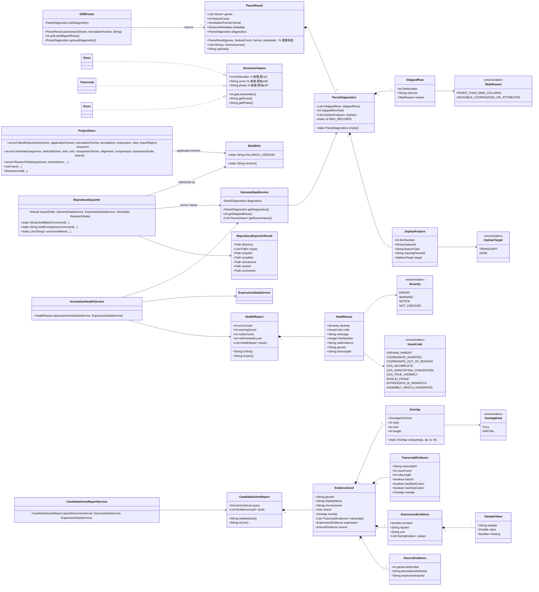
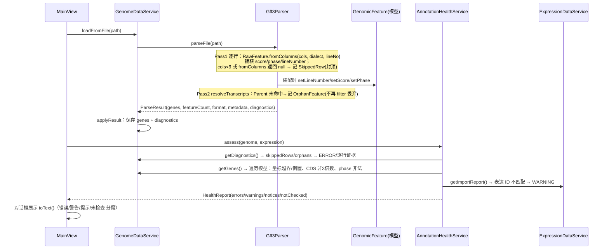
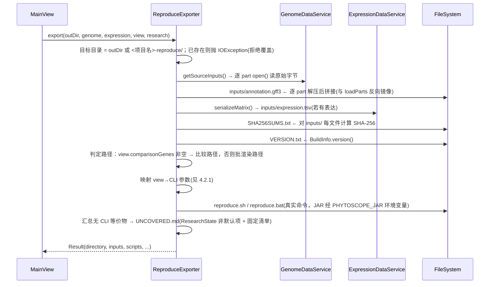
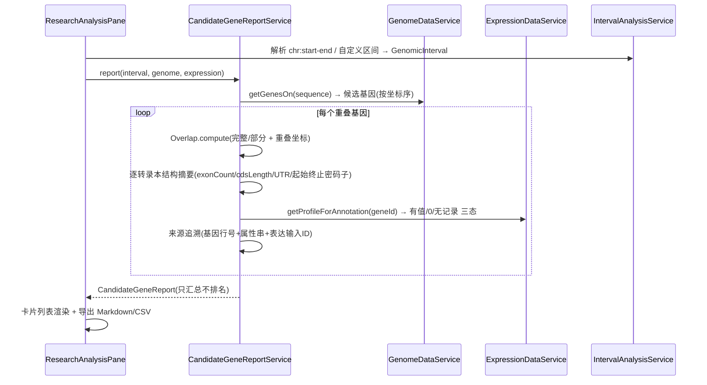
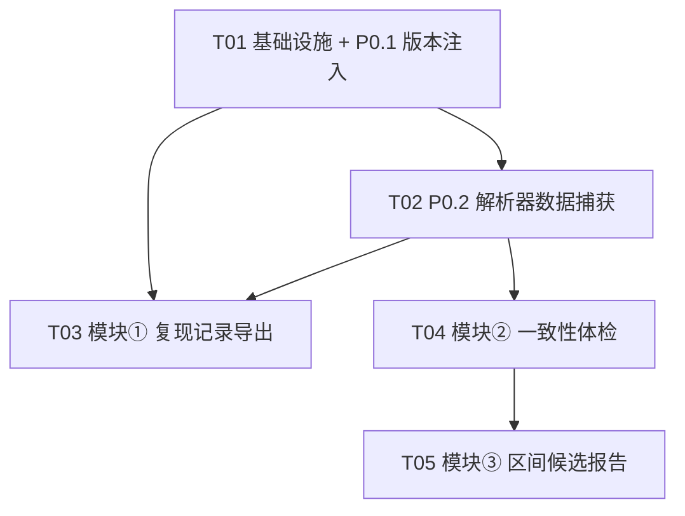

# PhytoScope 增量系统设计：可执行记录导出 · 一致性体检 · 区间候选基因报告

- **作者**：高见远（Architect）
- **输入**：增量 PRD `docs/prd-reproducibility-health-report.md`（PM 已完成，直接采信）；代码现状由主理人核对并随任务下发，本设计贴合真实代码。
- **技术栈**：Java 21 + Spring Boot 3.2.5 + JavaFX（**沿用现有栈，不引入新框架/新第三方依赖**）。

---

## 1. 实现方案与框架选型

### 1.1 核心技术挑战与对策

| 难点 | 对策 |
|------|------|
| `ParseResult` 需向后兼容地携带结构化诊断 | `ParseResult` 由 4 组件 record 升级为 5 组件（追加 `ParseDiagnostics`），并**新增一个 4 参便捷构造器**委托到 5 参（`ParseDiagnostics.empty()`）。全仓库仅 `Gff3Parser.parse()` 与 `GenomeDataService.replaceWith()` 两处构造 `ParseResult`，已核对无其他调用方（含测试），故编译零破坏。 |
| `skippedRows` 从 `int` 升级为结构化，又不破坏 `getSkippedRows()` 调用方 | 保留 `Gff3Parser.getLastSkippedRows()` 与 `GenomeDataService.getSkippedRows()` 的 `int` 返回签名（返回 `skippedRowTotal` 总量），结构化明细另存于 `ParseDiagnostics.skippedRows`（带行号/原始行/原因，且**封顶**）。`MainView` 现有 `int skipped = next.getSkippedRows()` 调用不受影响。 |
| `applicationVersion` 硬编码 | 采用 **Spring Boot `build-info` goal**（现有 `spring-boot-maven-plugin` 自带，非新增依赖），构建期生成 `META-INF/build-info.properties`，运行时由新增 `BuildInfo.version()` 读取 `build.version`，读取失败回退 `0.2.0`。 |
| 体检报告的"行级证据"与 P0.2 结构化诊断一一对应 | 让**模型层承载来源信息**：给基类 `GenomicFeature` 增加 `lineNumber`/`score`/`phase`（默认值向后兼容），解析器在装配时回填。于是体检对模型做坐标/CDS/phase 检查时能拿到行号与属性串；孤儿/跳行直接来自 `ParseDiagnostics`。 |
| 复现命令如何逐项映射 `ViewState`/`ResearchState` → 真实 CLI 参数 | 新增 `ReproduceExporter`，把 `ViewState.comparisonGenes → --loci`、`alignment → --alignment`、`compressed → --compress-introns`、`expressionScale → --scale` 等逐项映射；无 CLI 等价物的 `ResearchState` 组件自动落入 `UNCOVERED.md`。 |

### 1.2 框架/库选型（为何不引入新依赖）

| 能力 | 选型 | 理由 |
|------|------|------|
| 版本注入 | Spring Boot `build-info` goal（`spring-boot-maven-plugin` 已有） | 生成标准 `META-INF/build-info.properties`，`mvn test`/`mvn package` 均可用；无新增依赖。 |
| JSON 序列化（体检报告机器可读输出） | 现有 `com.fasterxml.jackson.databind` | 已在 pom 中，`ProjectStore` 已在使用。 |
| 文件/SHA-256 | JDK `java.nio.file` + `java.security.MessageDigest` | 现有 `ProjectStore`/`GenomeDataService.SourceInput` 已用，复用同一套。 |
| 复现脚本 | 纯文本 `reproduce.sh` / `reproduce.bat`（导出器生成） | 无需模板引擎；内容逐行拼接即可。 |
| UI | 现有 JavaFX 组件（`Alert`/`TextArea`/`TabPane`） | 与 `MainView.showImportReport`、`ResearchAnalysisPane` 同构，零新 UI 依赖。 |

**结论**：本增量**无需新增任何第三方依赖**（详见第 6 节）。

---

## 2. 文件列表（新增 / 修改）

### 2.1 新增文件

| 相对路径 | 职责 |
|----------|------|
| `src/main/java/io/gitee/omixcore/phytoscope/BuildInfo.java` | 读取 `META-INF/build-info.properties` 的 `build.version`，回退 `0.2.0`；供 `ProjectStore` 与 `ReproduceExporter` 使用。 |
| `src/main/java/io/gitee/omixcore/phytoscope/parser/ParseDiagnostics.java` | 结构化诊断载体：`SkippedRow`/`SkipReason`/`OrphanFeature`/`OrphanTarget` + `ParseDiagnostics` record（含封顶常量）。 |
| `src/main/java/io/gitee/omixcore/phytoscope/service/AnnotationHealthService.java` | 一致性体检：输入 `GenomeDataService`+`ExpressionDataService`，输出分级 `HealthReport`（含 `toText()`/`toJson()`）。 |
| `src/main/java/io/gitee/omixcore/phytoscope/project/ReproduceExporter.java` | 从当前快照导出复现目录（脚本 + `inputs/` + `SHA256SUMS.txt` + `VERSION.txt` + `UNCOVERED.md`）。 |
| `src/main/java/io/gitee/omixcore/phytoscope/research/CandidateGeneReportService.java` | 区间候选基因证据卡：只汇总不排名，含重叠/结构/表达/来源四类证据。 |
| `src/test/java/io/gitee/omixcore/phytoscope/BuildInfoTest.java` | 验证 `BuildInfo.version()` 与 pom 版本一致 + 回退策略。 |
| `src/test/java/io/gitee/omixcore/phytoscope/Gff3ParserDiagnosticsTest.java` | 验证 P0.2：score/phase 捕获、结构化跳行、孤儿捕获、向后兼容。 |
| `src/test/java/io/gitee/omixcore/phytoscope/AnnotationHealthServiceTest.java` | 用预设异常 GFF3/表达矩阵验证三级分级与 CDS 三分类。 |
| `src/test/java/io/gitee/omixcore/phytoscope/CandidateGeneReportServiceTest.java` | 用已知答案区间集验证重叠/负链/多转录本/缺失表达。 |
| `src/test/java/io/gitee/omixcore/phytoscope/ReproduceExporterTest.java` | 验证复现目录结构、脚本参数映射、UNCOVERED 清单、SHA 校验。 |

### 2.2 修改文件

| 相对路径 | 修改点 |
|----------|--------|
| `pom.xml` | 为 `spring-boot-maven-plugin` 增加 `build-info` 执行；不加任何新依赖。 |
| `src/main/java/io/gitee/omixcore/phytoscope/parser/Gff3Parser.java` | `RawFeature` 捕获 score/phase/lineNumber；结构化跳行；孤儿捕获；`ParseResult` 追加第 5 组件；`getLastSkippedRows()` 保留 int 语义。 |
| `src/main/java/io/gitee/omixcore/phytoscope/model/GenomicFeature.java` | 增加 `lineNumber`/`score`/`phase` 字段与 getter/setter（默认值向后兼容）。 |
| `src/main/java/io/gitee/omixcore/phytoscope/service/GenomeDataService.java` | `applyResult` 保存并暴露 `getDiagnostics()`；`replaceWith` 携带诊断；`getSkippedRows()` 签名不变。 |
| `src/main/java/io/gitee/omixcore/phytoscope/project/ProjectStore.java` | `Manifest.applicationVersion` 改用 `BuildInfo.version()`；抽出表达矩阵 TSV 序列化为可复用 helper。 |
| `src/main/java/io/gitee/omixcore/phytoscope/service/ExpressionDataService.java` | 新增 `serializeMatrix()`（输出与 `ProjectStore.save` 一致的 TSV），供 `ProjectStore`/`ReproduceExporter` 复用。 |
| `src/main/java/io/gitee/omixcore/phytoscope/ui/MainView.java` | File 菜单新增"导出复现记录…""注释体检报告…"两动作；复用 `showImportReport` 式对话框。 |
| `src/main/java/io/gitee/omixcore/phytoscope/ui/ResearchAnalysisPane.java` | 新增"候选基因 (Candidate genes)"Tab：区间输入 + 生成报告 + 导出 Markdown。 |

---

## 3. 数据结构与接口（class diagram）

> 图中只列本次增量新增/变更的关键成员；既有 `Gene/Transcript/Exon/GenomicFeature/ExpressionDataService` 仅标注变更点。



### 3.1 关键签名补充（Java）

```java
// BuildInfo.java  —  io.gitee.omixcore.phytoscope
public final class BuildInfo {
    public static final String FALLBACK_VERSION = "0.2.0";
    public static String version();           // 读 /META-INF/build-info.properties 的 build.version，失败回退 FALLBACK_VERSION
}

// ParseDiagnostics.java  —  io.gitee.omixcore.phytoscope.parser
public record ParseDiagnostics(List<SkippedRow> skippedRows, int skippedRowTotal,
                               List<OrphanFeature> orphans) {
    public static final int MAX_RECORDS = 10_000;   // 单类明细封顶
    public static ParseDiagnostics empty();
    public int skippedRowTotal();                   // 未封顶的真实总量
}
public enum SkipReason { FEWER_THAN_NINE_COLUMNS, UNUSABLE_COORDINATES_OR_ATTRIBUTES }
public record SkippedRow(int lineNumber, String rawLine, SkipReason reason) {}
public enum OrphanTarget { TRANSCRIPT, GENE }
public record OrphanFeature(int lineNumber, String featureId, String featureType,
                            String missingParentId, OrphanTarget target) {}
```

### 3.2 `ParseResult` 扩展方式（向后兼容关键点）

```java
public record ParseResult(List<Gene> genes, int featureCount, AnnotationFormat format,
                          GenomeMetadata metadata, ParseDiagnostics diagnostics) {
    // 向后兼容便捷构造：旧 4 参调用方（GenomeDataService.replaceWith 已改为 5 参，此构造留作保险/测试）
    public ParseResult(List<Gene> genes, int featureCount, AnnotationFormat format, GenomeMetadata metadata) {
        this(genes, featureCount, format, metadata, ParseDiagnostics.empty());
    }
    public List<String> chromosomes() { ... }
    public String species() { ... }
}
```

### 3.3 `RawFeature` 变更（解析器内部私有类）

```java
private static final class RawFeature {
    // 新增三字段
    String score;     // col[5] 原始串，"."=未知，不转数值
    String phase;     // col[7] 原始串，"."=未知，不转数值
    int lineNumber;   // 源文件行号，用于诊断/追溯
    static RawFeature fromColumns(String[] cols, AttributeDialect dialect, int lineNumber) { ... }
}
```

---

## 4. 程序调用流程（sequence diagram）

### 4.1 解析 + 一致性体检



### 4.2 可执行记录导出



#### 4.2.1 `ViewState`/`ResearchState` → CLI 参数映射表

| 快照字段 | 比较路径 `--compare` | 批渲染路径 |
|----------|----------------------|------------|
| `comparisonGenes` | `--loci <逗号连接ID>` | `--loci <逗号连接ID>`（空则省略=全基因） |
| `alignment` | `--alignment <名称>` | — |
| `compressed` | true 时 `--compress-introns` | — |
| `expressionScale` | `--scale <名称>` | — |
| `sequence` | 隐式（基因定位后自动） | 隐式 |
| `selectedGene`/`start`/`end` | — | —（窗口按基因 + `--padding` 默认 0.35 重建） |
| `search` | —（无 CLI 等价，入 UNCOVERED） | — |
| `ResearchState` 各字段 | —（区间/QC/分组/同源/结构域无 CLI 等价，入 UNCOVERED） | — |
| 表达矩阵 | `--expression inputs/expression.tsv` | `--expression inputs/expression.tsv`（`--no-expression` 为保留空操作，不虚构语义，脚注说明） |
| 注解源 | `--gff3 inputs/annotation.gff3` | `--gff3 inputs/annotation.gff3` |

> 说明：`ViewState` 未保存渲染 `width/height/padding`，故批渲染命令采用默认值 1400×700/0.35，并在 `UNCOVERED.md` 脚注如实说明。

### 4.3 区间候选基因报告



---

## 5. 任务列表（有序，≤5，按用户交付顺序编排）

> 依赖编排严格遵循用户指定顺序：**T01 → T02 → T03(模块①) → T04(模块②) → T05(模块③)**；其中 T04 先于 T05 为硬性要求。

### T01 项目基础设施 + P0.1 `applicationVersion` 注入
- **优先级**：P0
- **依赖**：无
- **文件**：`pom.xml`（改）、`BuildInfo.java`（新）、`ProjectStore.java`（改）、`BuildInfoTest.java`（新）
- **内容**：
  1. `pom.xml`：`spring-boot-maven-plugin` 增加 `<executions><execution><goals><goal>build-info</goal></goals></execution></executions>`（goal 默认绑定 `generate-resources` 阶段，`mvn test`/`mvn package` 均生成 `META-INF/build-info.properties`）。
  2. `BuildInfo.java`：读 `/META-INF/build-info.properties` 的 `build.version`，失败回退 `FALLBACK_VERSION="0.2.0"`，线程安全缓存。
  3. `ProjectStore.java`：`Manifest(3, "0.2.0", ...)` 改为 `Manifest(3, BuildInfo.version(), ...)`。
  4. 测试：读取 `pom.xml` 解析 `<version>`，断言与 `BuildInfo.version()` 一致；并断言回退策略。
- **验收点**：`mvn test` 通过；`target/classes/META-INF/build-info.properties` 存在且 `build.version=0.2.0`；保存的项目 manifest `applicationVersion` 来自构建元数据。

### T02 P0.2 `Gff3Parser` 数据捕获（体检数据来源）
- **优先级**：P0
- **依赖**：T01
- **文件**：`ParseDiagnostics.java`（新）、`Gff3Parser.java`（改）、`GenomicFeature.java`（改）、`GenomeDataService.java`（改）、`Gff3ParserDiagnosticsTest.java`（新）
- **内容**：
  1. `ParseDiagnostics` + `SkippedRow`/`SkipReason`/`OrphanFeature`/`OrphanTarget`。
  2. `GenomicFeature` 增加 `lineNumber`/`score`/`phase`（默认 0/null）。
  3. `Gff3Parser`：`RawFeature.fromColumns` 捕获 `col[5]`(score)/`col[7]`(phase)/行号；两处 `skippedRows++` 改为记录 `SkippedRow`（封顶 `MAX_RECORDS`，总量独立计数）；`resolveTranscripts` 不再静默丢弃孤儿，改为记录 `OrphanFeature`（transcript 级），`findGene==null` 的转录本丢弃处记录 gene 级孤儿；`ParseResult` 追加第 5 组件；`getLastSkippedRows()` 保持返回总量。
  4. `GenomeDataService`：`applyResult` 保存 `diagnostics`，新增 `getDiagnostics()`，`getSkippedRows()` 签名/语义不变，`replaceWith` 携带诊断。
- **验收点**：现有 `Gff3ParserTest`/`FullAnnotationValidationTest` 等全部保持绿色（正常解析结果不变）；新测试覆盖 score/phase 原始串捕获、`.`, `3`, `-1`, 非数字的 phase 保留、结构化跳行（行号+原因）、孤儿（transcript/gene 两级）、封顶保护、`getSkippedRows()` 返回未封顶总量。

### T03 模块① 可执行记录导出
- **优先级**：P0
- **依赖**：T01、T02
- **文件**：`ReproduceExporter.java`（新）、`ExpressionDataService.java`（改：`serializeMatrix()`）、`ProjectStore.java`（改：复用序列化）、`MainView.java`（改：菜单动作）、`ReproduceExporterTest.java`（新）
- **内容**：
  1. `ExpressionDataService.serializeMatrix()` 抽出与 `ProjectStore.save` 完全一致的 TSV（`# unit=`/`# level=` 头 + 引号转义 + NA 缺失），`ProjectStore.save` 改为复用。
  2. `ReproduceExporter.export(...)`：目标目录 `<项目名>-reproduce/`，已存在则抛 `IOException`（拒绝覆盖）；`inputs/annotation.gff3` 按 `loadParts` 反向镜像逐 part 解压拼接；`inputs/expression.tsv`；`SHA256SUMS.txt`；`VERSION.txt`（`BuildInfo.version()`）；`reproduce.sh`/`.bat`（`JAR="${PHYTOSCOPE_JAR:-phytoscope.jar}"`）；`UNCOVERED.md`。
  3. `MainView`：File 菜单"导出复现记录…"，调 `captureViewState()` + `researchPane.state()` 调 exporter，成功后提示目录结构。
  4. 命令生成：比较/批渲染两路径按 4.2.1 映射；`--no-expression` 不虚构语义并在脚注说明。
- **验收点**：在全新干净目录仅凭脚本+`inputs/`+校验文件可重跑；`comparison.tsv`/序列字节级一致、SVG 结构级一致；`UNCOVERED.md` 正确列出无 CLI 等价物；含不可复现 `ResearchState` 时显式降级标注。

### T04 模块② 一致性体检（先于 T05）
- **优先级**：P0
- **依赖**：T02
- **文件**：`AnnotationHealthService.java`（新）、`MainView.java`（改：菜单+对话框）、`AnnotationHealthServiceTest.java`（新）
- **内容**：
  1. `AnnotationHealthService.assess(genome, expression)`：消费 `ParseDiagnostics`（孤儿→ERROR、结构化跳行→WARNING 汇总）+ 模型遍历（坐标倒置/越界→ERROR、CDS 非 3 倍数→三分类、非法 phase→WARNING）+ 表达不匹配→WARNING + 组装版本匹配→NOT_CHECKED。
  2. CDS 三分类决策树（见第 7 节共享知识）：显式约定标记→NOTICE(提示)，缺 ATG/终止密码子→WARNING(不完整)，其余→WARNING(真实异常)。
  3. `HealthReport.toText()/toJson()`：人类可读四段（错误/警告/提示/未检查）+ 机器可读 JSON。
  4. `MainView`：菜单"注释体检报告…"展示对话框；`importAnnotation` 状态栏文案引导查看报告。
- **验收点**：预设异常 GFF3（孤儿 Parent、坐标越界、非法 phase、CDS 非 3 倍数、表达 ID 不匹配、组装版本场景）全部检出且落入正确分级；行级证据与 `ParseDiagnostics` 一一对应；CDS 三分类正确。

### T05 模块③ 区间候选基因报告
- **优先级**：P0
- **依赖**：T04
- **文件**：`CandidateGeneReportService.java`（新）、`ResearchAnalysisPane.java`（改：新 Tab）、`CandidateGeneReportServiceTest.java`（新）
- **内容**：
  1. `CandidateGeneReportService.report(interval, genome, expression)`：重叠关系（完整/部分+重叠坐标）、逐转录本结构摘要、表达三态（有值/`0`=真实测量/`NaN`=无表达记录）、来源追溯（基因行号+属性串+表达输入 ID）；**只汇总不排名**。
  2. 证据卡 `toMarkdown()/toCsv()` 导出。
  3. `ResearchAnalysisPane`：新增"候选基因"Tab（`chr:start-end` 输入 + 生成报告 + 导出 Markdown），复用 `GenomicInterval`/`IntervalAnalysisService` 解析。
- **验收点**：已知答案区间集覆盖边界重叠、负链、多转录本、缺失表达四类，第三方可独立核对；每条卡可追溯到注释行号与表达条目；缺失表达标"无表达"不补零。

---

## 6. 依赖包列表

**本次增量无需新增任何第三方依赖**。

- 复用现有：`jackson-databind`（JSON 输出）、`spring-boot-starter`（DI + `build-info`）、`javafx-*`（UI）、JDK `java.security`（SHA-256）、`java.nio.file`（文件 I/O）。
- `build-info` 由**已存在**的 `spring-boot-maven-plugin` 提供，仅加 `<execution>`，不新增坐标。

---

## 7. 共享知识（跨文件约定）

1. **诊断枚举定义位置**：`SkipReason`、`OrphanTarget`、`Severity`、`IssueCode` 统一定义在各自领域类的同文件内（`ParseDiagnostics.java` / `AnnotationHealthService.java`），不散落。
2. **phase/score 存储约定**：模型层 `GenomicFeature` 存**原始字符串**；`.` = 合法未知（不告警）；phase 合法域仅 `0/1/2`；`3`、`-1`、非数字 → 警告。
3. **分级约定**：`ERROR`（孤儿 Parent、坐标越界/倒置）／`WARNING`（CDS 非 3 倍数的"不完整/真实异常"、非法 phase、表达 ID 不匹配）／`NOTICE`（CDS 注释约定、结构化跳行汇总等提示）／`NOT_CHECKED`（组装版本匹配）。机器可读 JSON 与人类可读文本共用同一 `HealthReport`。
4. **CDS 三分类决策树（顺序固定）**：
   a. 存在显式约定标记（CDS/转录本属性 `partial=true`/`partial=1`）→ `CDS_ANNOTATION_CONVENTION`（NOTICE，提示）。
   b. 否则若缺起始密码子（`transcript.getStartCodonSegments().isEmpty()`）或终止密码子（`getStopCodonSegments().isEmpty()`）→ `CDS_INCOMPLETE`（WARNING，边界转录本）。
   c. 否则 → `CDS_TRUE_ANOMALY`（WARNING，人工复核）。
   **不引入任何位置启发式**（如"首/末外显子 CDS 允许非 3 倍数"一律不做）。
5. **坐标约定**：全项目 1-based、闭区间（沿用 `GenomicFeature`）。"越界"仅对比 `##sequence-region` 声明长度（解析期捕获声明值，避免被观测边界合并掩盖）。
6. **表达三态**：`getTpm()` 返回 `NaN` → "无表达记录（NA）"；`0.0` → "表达值为 0（真实测量）"；正值 → 数值。二者**严禁**互相转化。
7. **版本号单一来源**：pom `<version>` 为唯一事实来源，经 `build-info` 注入；`BuildInfo.FALLBACK_VERSION` 仅作 IDE/裸运行回退，发布时随 pom 同步。
8. **复现目录约定**：`<项目文件名>-reproduce/`；已存在则拒绝（抛异常），不静默覆盖；脚本引用 JAR 经 `PHYTOSCOPE_JAR` 环境变量（默认 `phytoscope.jar`），`VERSION.txt` 记录精确版本供核对检出 tag。
9. **"一致"判定**：序列/数据表（`comparison.tsv`、表达 TSV）字节级一致；SVG 去 `<title>`/时间戳等元数据后结构级比对（`SvgExporter` 与 `ComparisonFigure.writeSvg` 均无时间戳，确定性输出）。
10. **封顶保护**：`ParseDiagnostics` 各明细列表封顶 `MAX_RECORDS=10_000`，总量字段不受限；超限时在 `HealthReport` 加一条"明细已截断"提示。

---

## 8. 待明确事项（均已由主理人决议为默认值，此处固化）

| # | PRD 待确认问题 | 主理人决议（已采信，不再开放） |
|---|----------------|-------------------------------|
| 1 | phase/score 未知值语义 | `.` 归"合法未知"不告警；仅 `3`/`-1`/非数字判警告；phase 合法域 `0/1/2` |
| 2 | CDS 非 3 倍数的"注释约定"界定 | 仅用显式标记（`partial` 属性 / 缺 ATG/终止密码子）判断，不引入位置启发式；无显式证据一律"真实异常"警告 |
| 3 | 表达"0"与"无表达记录"区分 | 区分展示：`0`=真实测量，`NaN`=无表达记录（NA） |
| 4 | 复现目录默认位置与覆盖 | 默认 `<项目文件名>-reproduce/`；已存在则拒绝或加时间戳，不静默覆盖（本设计选"拒绝"，保留时间戳参数扩展点） |
| 5 | 关键图形"一致"判定粒度 | 图形取结构级可比（SVG 去时间戳/元数据后比对内容），序列/数据表取字节级一致 |

**本设计新增的工程假设（供 team-lead 知悉，非阻塞）**：
- A. 复现脚本引用 JAR 用 `PHYTOSCOPE_JAR` 环境变量（默认 `phytoscope.jar`），因 JAR 是构建产物、不随项目 ZIP 内嵌；`VERSION.txt` 记录版本供核对。
- B. 批渲染复现因 `ViewState` 未保存 `width/height/padding`，采用默认 1400×700/0.35，并在 `UNCOVERED.md` 脚注说明。
- C. 复现导出始终导真实字节（`--gff3 inputs/annotation.gff3`），不使用 `--example` 捷径（项目 ZIP 已内嵌真实字节，通用且等价）。
- D. "注释约定"用 `NOTICE`（提示）第 4 桶承载，以保持"错误/警告/未检查"三级语义不膨胀。

---

## 9. 任务依赖图


