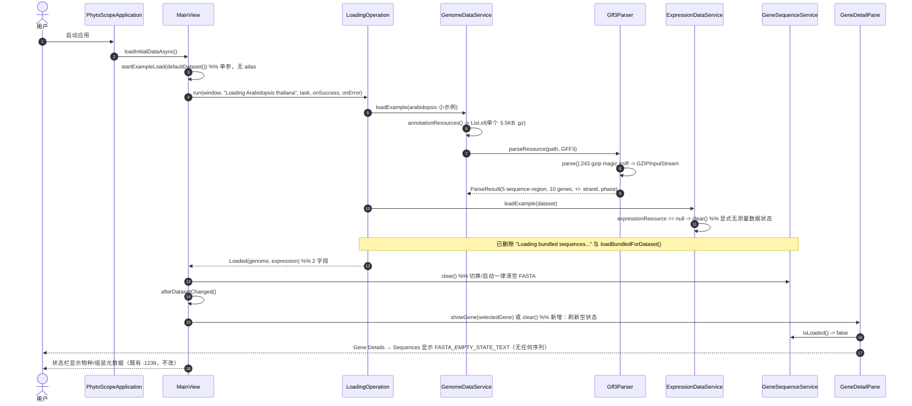
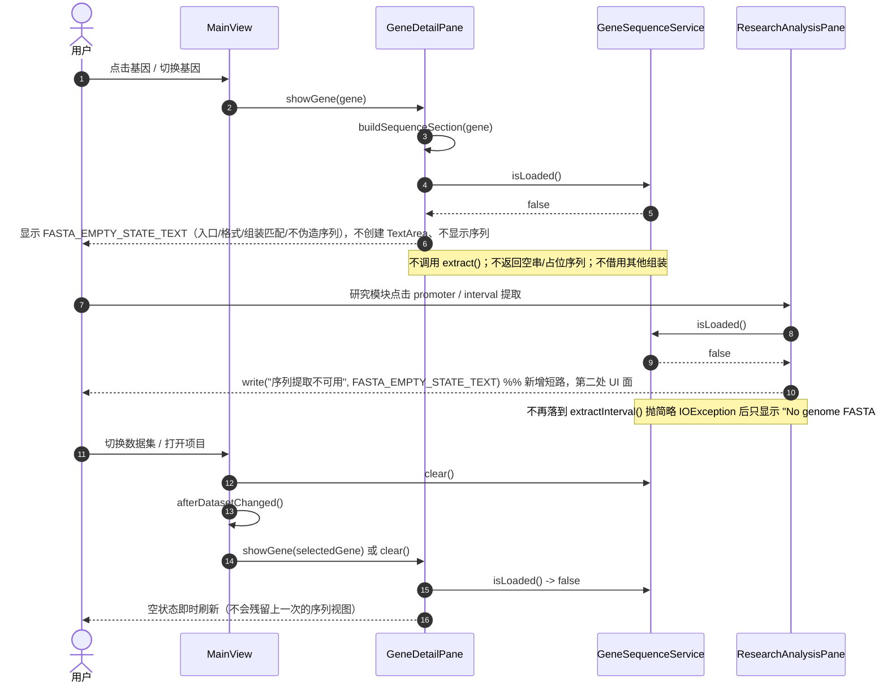
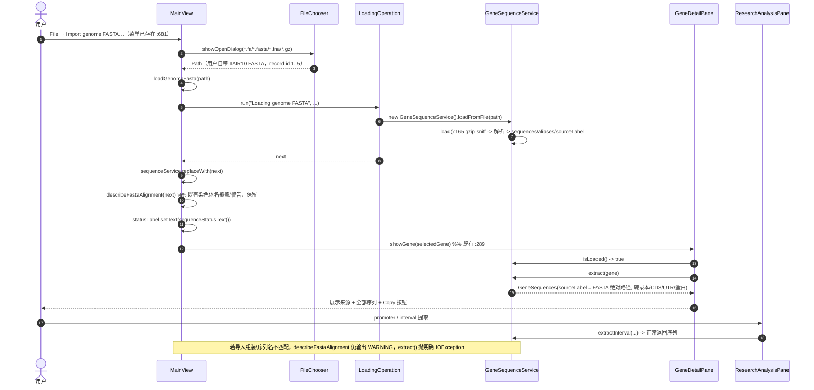
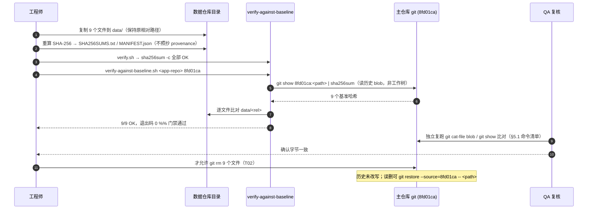
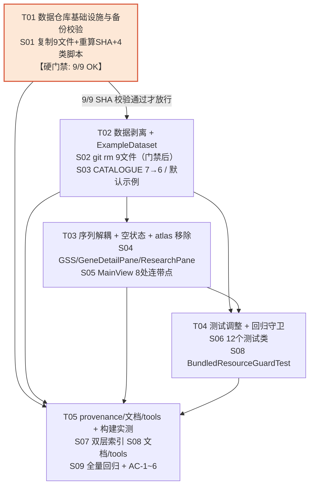

# PhytoScope 增量系统设计：剥离内置完整数据、独立存储参考数据

> **文档类型**：增量系统设计 + 任务分解（增量档）。**只描述本次变更**，未提及的模块、分层、算法与交互一律沿用基线设计，不重写系统架构。
> **编写**：架构师 高见远　|　**状态**：待主理人 / 工程实现评审
> **上游输入**：`docs/prd-slim-bundled-data.md`（增量 PRD **v1.2**，含 R1–R11、AC-1~AC-6、Q1–Q6）。PM 已按本文的实测纠正把 PRD 更新为 v1.1（9 个文件 / CATALOGUE 6 条 / 12 类测试 / 空状态已存在 / R8 降级 / 删除顺序门禁 / 数据仓库 `.gitattributes`），主理人随后授权收敛为 v1.2；**v1.2 相对 v1.1 仅措辞收敛（Q5 等开放表述改为已决议），技术方案与本文完全一致**。**两份文档当前一致**；本文 §0.3 保留的纠错记录是相对 PRD v1.0 的历史记录，不代表当前 PRD 仍存在该问题。
> **代码基线**：`dev` 分支 @ `8fd01ca`（`Revert "Make the complete horsemint genome the default example dataset"`），Java 21 + Spring Boot 3.2.5 + JavaFX，Maven，包根 `io.gitee.omixcore.phytoscope`
> **远端**：`origin` = gitee HTTPS（credential manager）；`github` = `git@github-w1996jy:omixcore/phytoscope.git`（SSH 别名）。二者仅能推送到**已存在**仓库。

---

## 0. 决议继承、实测核对与纠错登记

### 0.1 直接继承、不再讨论的决议

| 来源 | 决议 |
|---|---|
| 用户 4 项 | ① 剥离 = `src/main/resources/data/` 下全部大规模数据，只保留 KB 级小示例；② 历史 = 只用普通 `git rm` + 新提交，**禁止** filter-repo / filter-branch / BFG / `push --force` / 改写任何 commit hash，历史 pack ≈209 MiB 保持不变；③ 数据仓库 = gitee + github 各一份镜像；④ 代码完全解耦：默认示例改小数据、序列提取改为用户自带 FASTA、大数据测试条件跳过或换小 fixture，**不做按需下载、不新增网络能力、不新增第三方依赖** |
| 主理人 Q1 | 保留 `arabidopsis` 条目，`annotationResource` 改为已有的 `species/arabidopsis/arabidopsis_chromosomes.gff3.gz`（5.5 KB），`expressionResource` 置 `null`，删除 `annotationResources()` 里 Chr1–Chr5 五部分硬编码分支；**CATALOGUE 7 → 6 条**（只移除 `mint-genome`） |
| 主理人 Q2 | provenance 拆「主仓库索引 + 数据仓库权威清单」双层；主仓库 `reference-provenance.json` 保留全部条目与 SHA-256，为外迁条目加 `storage: external` / `repository`（待回填）/ `moved_at_commit`；三个保留 manifest 只改措辞不删条目 |
| 主理人 Q3 | 范围外 4 个大文件本次**不动**，仅登记为已知遗留 |
| 主理人 Q4 | 旧 `.phytoscope` 兼容 =「能开则开、不能开给明确提示」；旧示例 id / 旧 `sourceLabel` 视为元数据展示，不按旧 classpath 重载；P1 |
| 主理人 Q5 | **彻底移除** MainView 的 "Real expression case…" 菜单项、`loadAtlasCase()`、`pinAtlasGenes()`，简化 `startExampleLoad(dataset, atlas)` 的 atlas 参数/分支，不留死路径 |
| 主理人 Q6 | README 体积数字**剥离后重新打包实测再填写**，禁止沿用旧值或按 68.5 MB 做减法；发布说明写明「仅当前检出目录与构建产物变小，git 历史 pack 与克隆体积不变」 |
| 环境边界 | 本次**只交付本地独立数据仓库目录 + 推送脚本**；远端创建/推送是需用户授权的最后一步。脚本只接收已存在的空仓库 URL 参数，**不调用任何平台 API、不假称会自动新建远端仓库**。目录必须在主仓库工作树之外：`G:/WorkBuddy/2026-10-27-22-02-43/phytoscope-reference-data/` |

### 0.2 本设计新增的实测核对结论（架构师复核，均基于 `8fd01ca` 工作树）

| # | 结论 | 证据 / 影响 |
|---|---|---|
| **C1** | **待移走文件实际是 9 个，不是 10 个**；9 个文件字节加总 = **68,518,847 B**，与用户/PRD 的 68,518,847 B **完全吻合** | `git ls-files src/main/resources/data` 过滤后正好 9 条；`find ... -size +100k` 正好 9 条；逐字节加总见 §2.1。**「10 个」是 PRD 与任务书的笔误**（疑似把范围外的 `examples/arabidopsis-atlas/expression.tsv` 或某个 manifest 重复计数）。见 §0.3 纠错登记 |
| **C2** | Chr1–Chr5 合计 **17,071,413 B**（≈17 MB，非 15.6 MB） | 4,491,636 + 2,755,680 + 3,382,640 + 2,620,794 + 3,820,663 |
| **C3** | 保留 6 个小示例合计 **343,255 B**（5,554 / 49,647 / 58,568 / 99,707 / 70,202 / 59,577），单文件 5.5–99.7 KB | 远低于 256 KB 守卫阈值 |
| **C4** | **5.5 KB `arabidopsis_chromosomes.gff3.gz` 实测含** `10 gene / 24 mRNA / 238 CDS / 249 exon / 23 five_prime_UTR / 27 three_prime_UTR`；5 条 `##sequence-region`；正负链 `+/-`；phase `. / 0 / 1 / 2`；**序列名为 `1 2 3 4 5`（不是 `Chr1..Chr5`）** | 已用 gzip 解压统计复核。足以支撑基因结构浏览、多转录本、比较与序列演示。序列名 `1..5` 与 TAIR10 FASTA 的 record id `1..5` 天然一致，用户从数据仓库取回 TAIR10 FASTA 导入后可直接提取（AC-3 验证路径成立） |
| **C5** | **单文件 `.gz` 走 `Gff3Parser` 的 gzip sniff 路径无问题** | `GenomeDataService.loadExample():112` 判断 `annotationResources().size()==1` → `Gff3Parser.parseResource():131` → `parse():237` 第 243 行 `first==0x1f && second==0x8b ? new GZIPInputStream(buffered) : buffered`。Q1 改后每个示例都只有 1 个资源，**不再进入 `parseResources()` 多文件串联路径**，因此此前「gz 迁移多文件串联」bug 不会被重新引入；`decompressPerPart()` 与 `loadParts()` 的修复保持不动 |
| **C6** | **「未加载 FASTA」空状态其实已经存在**：`GeneDetailPane.buildSequenceSection():165-171` 在 `sequenceService == null || !isLoaded()` 时显示一段 hint 并 `return`，不显示任何序列 | 本次不是「从零新增」，而是**增强文案 + 修刷新时机 + 补第二处 UI 面**。AC-3 的风险点是文案不全、状态栏无反馈、切换数据集后 detailPane 不刷新，而不是「完全没有空状态」 |
| **C7** | `GeneSequenceService.loadBundledForDataset()` 在资源缺失时静默 `return`（:125-136）；`ExpressionDataService.loadExample()` 对 `expressionResource == null` 静默 `clear()`（:97-104） | 删文件后应用不崩但会静默降级，违背 AC-3「不静默失败」。设计中以**用户可见空状态 + 统一异常文案 + 状态栏**三处收口 |
| **C8** | `describeFastaAlignment()` **在 `MainView:299`（私有方法），不在 `GeneSequenceService`**；`File → Import genome FASTA…` 菜单（:681-682）、`loadGenomeFasta(Path)`（:281）、`loadFromFile/loadFromContent`（GSS:147/155）**均已存在** | 解耦 = 「移除内置自动加载 + 补空状态」，**不新增解析能力**，不要夸大工作量 |
| **C9** | **删除 `ARABIDOPSIS_TAIR10_RESOURCE` 常量 / `loadBundledForDataset()` / `loadAtlasCase()` / 改 `startExampleLoad` 签名，会导致 6 个测试类编译失败** | 引用点：`GeneSequenceServiceTest:51`、`ResearchModuleGoldSetTest:66,613`、`DomainCaseValidationTest:26`（常量+方法）；`ComparisonWorkflowUiTest:26`（loadAtlasCase）；`BackgroundLoadingUiTest:33`（startExampleLoad 双参）。PRD §4.1 清单**漏列** `DomainCaseValidationTest`、`ComparisonWorkflowUiTest`、`BackgroundLoadingUiTest`，本设计已补齐（§7.1） |
| **C10** | MainView atlas 连带点共 **8 处**：`:174-177`（atlas 分支）、`:184`（pinAtlasGenes 调用）、`:712-714`（菜单项 + separator）、`:440-445`（loadAtlasCase）、`:446-453`（pinAtlasGenes）、`:162`（签名）、`:161/:708/:816`（三处双参调用） | 与 PM 的发现一致，逐一列入 T03 |
| **C11** | `pom.xml` **无 `<resources>` / `<excludes>` / `<testResources>` / `maven-resources-plugin` 配置**，`src/main/resources` 全量打进 jar；`application.properties` 仅 5 行 Spring 配置，**无数据路径** | 二者**均不需要功能性改动**（详见 §5.4）。仅 `pom.xml:21` 的 `<description>` 中 "four version-pinned reference examples" 措辞过时，列为可选 P2 |
| **C12** | `.phytoscope` 项目文件把注释/表达矩阵**字节内嵌进 zip**（`ProjectStore.save():57-71` 写 `annotation/part-N.txt`；`load():98-101` 用 `loadParts()` 还原），`Source.origin()` 只是元数据展示 | **R8 天然满足「能开则开」**：旧项目文件不依赖 classpath 数据。只需在 `MainView.applyRestoredProject()` 补一条「数据已外迁 / 需自行导入 FASTA」的明确提示，且打开项目时清空 `sequenceService` |
| **C13** | `ResearchAnalysisPane` 存在**第二处序列提取 UI**（`:149` promoter 提取、`:159` interval 提取，调用 `sequences.extractInterval()`），catch 中只 `write(异常.getMessage())` | 未加载 FASTA 时异常来自 `GSS:254` 的 `"No genome FASTA loaded."`，文案过于简略。AC-3 要求「不静默失败」，此处也需统一到完整提示 |
| **C14** | `afterDatasetChanged()`（`:530-541`）刷新了 expression / chromosome selector / comparison / researchPane，**但不刷新 `detailPane`**；`startExampleLoad` 的 onSuccess 清空 `sequenceService` 后未重绘 Gene Details | 切换数据集后若此前选中过基因，detailPane 可能残留上一次（可能来自已卸载 FASTA）的序列视图 → **必须修**（§5.2） |
| **C15** | 主仓库 `.gitattributes` 含 `* text=auto eol=lf`；数据仓库若照抄，检出时 git 可能对 `.tsv` 做换行转换**从而改变字节、破坏 SHA-256 校验** | 数据仓库 `.gitattributes` **不得照抄**，必须 `* -text`（详见 §3.9） |
| **C16** | `reference-provenance.json` 与 `genome-sequence-provenance.json` 中记录的 SHA-256 经抽样与实测一致（TAIR10 = `80a13166…fda29ea378c1b776fff8e2`；5.5 KB 子集 = `2b908a63…47f2e199171`） | 可作为**交叉参考**，但按主理人要求 `SHA256SUMS.txt` 必须**重新计算并与文件比对**，不得直接照抄 |

### 0.3 纠错登记（相对 PRD v1.0；v1.1 已全部对齐）

> **状态说明**：下表是本文撰写时针对 **PRD v1.0** 的核对记录。PM 已发布 **v1.1** 并逐条修正（文件数 9、CATALOGUE 6 条、测试清单 12 类、R3/R8 重写、Q3 登记、删除顺序门禁与 `* -text`），因此下表「原文」列描述的是**已修复的历史状态**，仅用于追溯纠错依据。**工程实现请以 PRD v1.1 + 本文正文为准。**

| 位置 | 原文（v1.0） | 纠正 | 依据 |
|---|---|---|---|
| PRD §0.1/§2.1/§2.4/§4.3/§5 AC-5/§7、任务书 | 「10 个文件 / 68,518,847 B」 | **9 个文件 / 68,518,847 B**（文件数笔误，字节数正确） | C1：9 条 `git ls-files` 记录加总恰为 68,518,847 B；若硬凑第 10 个，必然误删范围外文件 |
| PRD R2 验收要点 | 「目录从 7 条收敛到 5 条」 | **7 → 6 条** | 主理人 Q1 已纠正；6 个小示例与 CATALOGUE 一一对应（C3） |
| PRD §4.1 测试清单 | 6 个测试类 + 2 个间接 | **补齐为 12 个类**（§7.1） | C9、C13、C14 |
| PRD §4.3 目录树 / AC-5 | 「MANIFEST 条目数 = 10」 | **= 9**，且 `data/` 下 9 个文件一一对应 | C1 |
| PRD §4.4 UI 草图 | 「条目由 7 → 5」 | **7 → 6** | 同上 |

> **执行门禁**：T02 的 `git rm` 清单**严格限定为 §2.1 的 9 条路径**。若主理人确认另有第 10 个文件，必须**先给出精确路径**再执行，禁止工程师自行补数。

### 0.4 范围外已知遗留（Q3：本次不动，仅登记）

| 文件 | 体积 | 本次处置 |
|---|---|---|
| `benchmark-results/parsed-structure.tsv` | 55,741,339 B（全仓最大，基准衍生输出，不进 jar） | 不动 |
| `examples/arabidopsis-isoform-validation/uniprot-domains.tsv` | ≈2.57 MB（案例输入） | 不动（`DomainCaseValidationTest` 仍可读取其 `annotation.gff3` / `candidates.json`） |
| `src/test/resources/non-model/vigna-umbellata/public-expression.tsv` | ≈1.38 MB（测试资源） | 不动 |
| `examples/arabidopsis-atlas/expression.tsv` | 845,431 B（与主仓 atlas 矩阵内容重复） | 不动 |

> 这 4 项会影响「全新克隆体积」与「工作区瘦身观感」，但**不进 jar**、不在用户拍板的 68.5 MB 口径内。设计中登记，另立议题，不擅自扩大范围。

---

## 1. 实现方案

### 1.1 核心技术难点与对策

| 难点 | 对策 | 落地位置 |
|---|---|---|
| **D1 数据零丢失窗口**：删主仓库文件前必须保证数据仓库已有完整可校验副本 | 「**先产出、再校验、后删除**」三段式门禁：T01 产出目录并重算 SHA-256 → T02 第一步重跑校验脚本，通过才 `git rm`；QA 另用 `git show 8fd01ca:<path>` 从**未改写的历史对象**独立比对字节 | §5.1、T01/T02、`scripts/verify-against-baseline.*` |
| **D2 静默降级**：删文件后 `loadBundledForDataset()` 静默 return、`loadExample()` 静默 clear | 删除静默路径的**调用方**，改为显式 `sequenceService.clear()`；把「未加载」变成用户可见状态（Gene Details 空状态 + ResearchAnalysisPane 提示 + 导入成功状态栏） | §3.4、§3.6、§5.2 |
| **D3 空状态刷新时机**：切换数据集 / 切换基因 / 导入 FASTA 后状态必须及时更新 | `afterDatasetChanged()` 末尾追加 `detailPane.showGene(selectedGene)` / `clear()`；`selectGene()` 既有路径已调 `showGene()`；`loadGenomeFasta()` onSuccess 保留 `showGene()` 并统一状态栏文案 | §5.2、§4.2/§4.3 |
| **D4 atlas 死路径**：菜单 + 两个方法 + 双参签名 + 测试调用方 | 一次性删除 8 处连带点，签名改为 `startExampleLoad(ExampleDataset)`，同步 4 个调用点（含 1 个测试） | §3.5、§5.3 |
| **D5 测试「假绿」**：删断言 / 整类跳过会掩盖回归 | 逐类指定策略；条件跳过必须用 `Assumptions.assumeTrue` + 显式系统属性 + 中文原因注释，且**断言体原样保留**；新增回归守卫测试 | §7.2、§7.3 |
| **D6 双层 provenance 一致性**：主仓库索引与数据仓库权威清单不能互相矛盾 | 主仓库只做「索引 + 外迁标记」，不改 SHA-256；数据仓库 `MANIFEST.json` 为权威清单，SHA 全部重算；两者用 `baseline_commit=8fd01ca` 与 `migration_commit` 关联 | §3.7、§3.8 |
| **D7 跨仓库字节一致性**：Windows 换行符转换会破坏校验和 | 数据仓库 `.gitattributes` 用 `* -text`；`SHA256SUMS.txt` 用 `sha256sum` 二进制模式重算；脚本用 `git show` 读 blob 而非检出文件 | §3.9 |
| **D8 远端创建阻塞**：无 token / `gh` 未登录 / 无 API 建仓能力 | 交付「本地目录 + 脚本」，脚本以位置参数接收**已存在空仓库 URL**，不做任何 API 调用；README 明写「远端地址待用户提供」 | §1.6、§3.9 |

### 1.2 为何沿用现有栈、不引入任何新依赖

- 本次变更是**数据治理 + 删除死路径 + 补空状态**，不涉及新算法、新协议、新 UI 组件；解析（GFF3/GTF/FASTA）、序列提取、比较、项目存储等核心能力**一行不重写**。
- 现有 `GeneSequenceService.loadFromFile()/loadFromContent()`、`Gff3Parser` gzip sniff、`MainView.describeFastaAlignment()`、`File → Import genome FASTA…` 已完整覆盖「用户自带 FASTA」路径；**无需新增解析器、无需新增网络客户端、无需新增下载器**。
- 空状态只需 JavaFX 既有 `Label` / `VBox`（`GeneDetailPane` 已在用），无需新控件或 CSS 框架。
- 数据仓库脚本只用**系统自带工具**：`git`、`sha256sum`（Git Bash）、PowerShell `Get-FileHash`、Python 3 标准库（`hashlib` / `json` / `shutil`）。`pom.xml` 依赖列表**不变**（§8）。
- 架构模式沿用既有分层：`service`（数据/领域）→ `ui` / `ui.component`（JavaFX 视图）→ `project`（持久化）→ `parser`（解析）；配置与元数据在 `resources/data/`。本次只在各层做**减法与状态补齐**，不新增抽象层、不引入 MVC/MVVM 改造。

### 1.3 「不改写历史」如何落到 git 操作流程

**允许的命令序列（全部普通、可快进推送）：**

```bash
# 前置：T01 已完成且 verify-against-baseline 通过（门禁，见 §5.1）
cd G:/WorkBuddy/2026-10-27-22-02-43/phytoscope
git status --porcelain            # 应为干净；若为脏先处理，避免误提交
# 1) 普通删除，仅影响工作树与索引
git rm src/main/resources/data/species/arabidopsis/TAIR10_genomic.fna.gz \
       src/main/resources/data/species/arabidopsis/Chr1.gff3.gz \
       ... （§2.1 的 9 条，逐条列出）
# 2) 与代码/测试/provenance/文档改动一起，一次新提交
git add -A
git commit -m "chore(data): move bulky reference data to external repository (current tree only)"
# 3) 普通快进推送，两端同一提交
git push origin dev
git push github dev
```

**明令禁止（写入 T02 验收点与发布说明）：**

```
git filter-repo / git filter-branch / BFG Repo-Cleaner
git push --force / --force-with-lease / git push -f
git rebase -i（对已推送提交）/ git commit --amend（对 8fd01ca）
任何重写 8fd01ca 或其祖先 hash 的操作
git gc --prune=now / 重新打包以「缩小 .git」
```

**约束如何被结构性地保证：**

1. 删除只用 `git rm` → 产生的是**新 tree + 新 commit**，`8fd01ca` 及其全部 blob 仍在对象库，`git log --oneline -3` 仍可见 `8fd01ca`。
2. 正因历史未改写，**误删可秒级回滚**：`git restore --source=8fd01ca -- <path>`。这是 D1 的第二重保险。
3. 也正因历史未改写，QA 可以用 `git cat-file blob 8fd01ca:<path>` / `git show 8fd01ca:<path>` 作为**独立于工作树与 provenance 的字节真值源**（§5.1）。
4. 发布说明与 README 必须写明：**仅当前检出工作树与构建产物（jar / jlink ZIP）变小；git 历史 pack ≈209 MiB、全新克隆体积不变**。

### 1.4 数据治理双层模型

```
主仓库 phytoscope（代码 + 6 个小示例 + 索引）          独立数据仓库 phytoscope-reference-data（权威）
┌────────────────────────────────────────────┐        ┌──────────────────────────────────────────┐
│ src/main/resources/data/                   │        │ data/  （9 个文件，原相对路径）           │
│   ├─ 6 个小示例 .gff3/.gz   storage=bundled │        │ MANIFEST.json   权威清单（重算 SHA-256）  │
│   ├─ reference-provenance.json  ← 索引     │◄──────►│ SHA256SUMS.txt  可机读校验                │
│   │    外迁条目: storage=external          │ 关联   │ LICENSES.md     逐条来源 / 许可           │
│   │              repository=待回填         │ commit │ README.md       取回 / 校验 / 镜像说明    │
│   │              moved_at_commit=<新提交> │        │ .gitattributes  * -text（禁换行转换）    │
│   └─ 3 个保留 manifest（只改措辞）         │        │ scripts/ verify / init-and-push / restore│
└────────────────────────────────────────────┘        └──────────────────────────────────────────┘
        ▲ git rm 9 文件 + 新提交（历史不变）                   ▲ 先复制 + 重算校验 → 才允许删除
```

- **主仓库索引**：`reference-provenance.json` 保留全部条目与 SHA-256（追溯不断层），外迁条目加标记；**不再声称「内置」**。
- **数据仓库权威清单**：`MANIFEST.json` 逐文件记录 path / bytes / sha256 / source_url / license / baseline_commit / migration_commit，是「数据版本」的唯一权威。
- **关联键**：`baseline_commit = "8fd01ca"`（数据被移走前的软件版本）、`migration_commit`（剥离提交 hash，提交后回填）、外迁条目的 `moved_at_commit`（同值）。

### 1.5 交付边界（不得越界）

| 本次交付 | 需用户配合（本次不做，且不得假称已完成） |
|---|---|
| ① 主仓库 9 文件剥离 + 代码/测试/provenance/文档适配 + 本地新提交；② 工作树外的独立数据仓库目录（9 个数据文件 + 5 个根文件 + 4 类脚本）；③ 全量回归与 AC 验证记录 | 在 gitee 与 github **各创建一个空仓库**（不要初始化 README）并提供两个地址，或提供具备建仓权限的 token → 由 `scripts/init-and-push` 完成首次提交与双端推送 → 回填主仓库文档与 `reference-provenance.json` 的 `repository` 字段 |

> 交付话术固定为：「完整参考数据已迁移至独立数据仓库（**本地目录已就绪，远端地址待用户提供**）」，**不得**写「已同步至 gitee / github」。

---

## 2. 文件列表

### 2.1 主仓库**删除**清单（精确 9 条，`git rm` 目标）

相对 `src/main/resources/data/`，字节数为 `8fd01ca` 工作树实测：

| # | 路径 | 字节 | SHA-256 交叉参考来源 |
|---|---|---:|---|
| 1 | `species/arabidopsis/TAIR10_genomic.fna.gz` | 36,462,703 | `genome-sequence-provenance.json` |
| 2 | `species/arabidopsis/Chr1.gff3.gz` | 4,491,636 | `reference-provenance.json` → `bundled_resources` |
| 3 | `species/arabidopsis/Chr2.gff3.gz` | 2,755,680 | 同上 |
| 4 | `species/arabidopsis/Chr3.gff3.gz` | 3,382,640 | 同上 |
| 5 | `species/arabidopsis/Chr4.gff3.gz` | 2,620,794 | 同上 |
| 6 | `species/arabidopsis/Chr5.gff3.gz` | 3,820,663 | 同上 |
| 7 | `species/mint/mentha_longifolia_horsemint.gff3.gz` | 10,744,463 | `reference-provenance.json` → `mint-genome.bundled_resource_sha256` |
| 8 | `species/mint/mentha_longifolia_expression.tsv` | 3,394,837 | `ExampleDataset` mint-genome 条目（无独立 provenance，需重算） |
| 9 | `case-studies/arabidopsis-atlas/expression.tsv` | 845,431 | `case-studies/arabidopsis-atlas/manifest.json` → `outputs` |
| | **合计** | **68,518,847** | |

> **注意**：`case-studies/arabidopsis-atlas/` 下的 `manifest.json` / `samples.tsv` / `source-values.tsv` **保留**；`species/arabidopsis/manifest.json`、`genome-sequence-provenance.json` **保留**；6 个小示例全部保留。SHA-256 一律以 T01 重算结果为准（§3.8）。

### 2.2 主仓库**修改**清单

| 文件 | 职责 | 本次改动 |
|---|---|---|
| `src/main/java/.../service/ExampleDataset.java` | 示例目录（record + CATALOGUE） | `CATALOGUE` 7→6 条；`arabidopsis` 改小示例 / `expressionResource=null` / label 与 attribution 去「完整/内置表达」措辞；`annotationResources()` 删 Chr1–Chr5 分支 |
| `src/main/java/.../service/GeneSequenceService.java` | FASTA 加载与序列提取 | 删 `ARABIDOPSIS_TAIR10_RESOURCE`、删 `loadBundledForDataset()`；新增 `NO_FASTA_MESSAGE` 常量；统一 `extract()` / `extractInterval()` 的未加载异常文案；其余方法全保留 |
| `src/main/java/.../ui/MainView.java` | 主窗口 / 菜单 / 加载编排 | `startExampleLoad(dataset, atlas)` → `startExampleLoad(dataset)`；删 `Loaded.sequences` 字段、atlas 分支、`pinAtlasGenes()` 调用、进度文案「Loading bundled sequences…」；删 `loadAtlasCase()` / `pinAtlasGenes()` / atlas 菜单项 + separator；`loadExample()` 与 `loadInitialDataAsync()` 移除内置 FASTA 加载；`afterDatasetChanged()` 追加 detailPane 刷新；新增 `sequenceStatusText()`；`loadGenomeFasta()` 状态栏统一；`applyRestoredProject()` 清空 sequenceService + 旧项目提示（R8） |
| `src/main/java/.../ui/component/GeneDetailPane.java` | Gene Details → Sequences 空状态承载 | 新增 `public static final String FASTA_EMPTY_STATE_TEXT`；`buildSequenceSection():165-171` 改用该常量并补足 4 个文案要点；不显示任何序列 |
| `src/main/java/.../ui/ResearchAnalysisPane.java` | 研究模块 promoter / interval 提取 | 在 `:149` / `:159` 提取前加 `!isLoaded()` 短路，显示同一空状态文案（第二处 UI 面） |
| `src/main/resources/data/reference-provenance.json` | 主仓库可追溯**索引** | 为 9 个外迁资源对应条目加 `storage: external` / `repository: null`（待回填）/ `moved_at_commit`；小示例条目显式 `storage: bundled`；顶部 `scope` 措辞改为「索引，完整数据见独立数据仓库」；**不删任何条目与 SHA-256** |
| `src/main/resources/data/species/arabidopsis/manifest.json` | 拟南芥注释元数据 | 仅措辞：标「完整 Chr1–Chr5 已归档至独立数据仓库，主仓库仅保留 5.5 KB 子集」，不删条目 |
| `src/main/resources/data/species/arabidopsis/genome-sequence-provenance.json` | TAIR10 FASTA 元数据 | 仅措辞：追加 `storage: external` / `repository: null` / `archived_note`，保留 `sha256` 与 `record_lengths` |
| `src/main/resources/data/case-studies/arabidopsis-atlas/manifest.json` | atlas 案例元数据 | 仅措辞：`outputs.expression.tsv` 标为 external；保留 `samples.tsv` / `source-values.tsv` 的 SHA-256 与 24 格校验信息，供 `AtlasProvenanceTest` 继续断言 |
| `tools/fetch_tair10_genome.py` | TAIR10 下载/生成脚本 | `DEST` 默认路径改为**必填 `--out` 参数**（不再默认写入已删的 classpath 路径）；`--help` 说明「输出至独立数据仓库，不再写入主仓库」 |
| `tools/build_mint_horsemint_gff3.py` | horsemint GFF3 生成脚本 | `--out` 说明改为指向数据仓库；顶部 docstring 标注数据已外迁 |
| `tools/screen_domain_isoforms.py` | 结构域筛选脚本（`:88`、`:280` 两处 `TAIR10_genomic.fna.gz`） | `--reference` 参数改为必填外部目录；文件头注释说明从数据仓库获取 |
| `README.md` | 用户文档 | `:22` 体积数字**实测后**填写；`:26` 改写启动示例与数据集描述；`:31-56` 移除「Complete nuclear Chr1–Chr5 / 94,883 genes / 4-leaf TPM / 32,833 genes / 内置 measured transcriptome」表述；`:253` 整段改为「序列提取需用户自带 FASTA」；新增「完整参考数据获取」小节（用途、目录、校验、双平台镜像、远端地址待回填、**无应用内下载**）；发布说明写明历史 pack / 克隆体积不变 |
| `docs/desktop-verification.md`、`docs/portability-and-reproducibility.md`、`docs/validation-and-benchmarks.md`、`docs/chromosome-validation.md`、`docs/research-module-validation.md` | 验证与可移植性文档 | 移除「内置完整数据」描述，改为「从独立数据仓库获取」；依赖完整数据的基准/验证数字标注「历史结果，需外迁数据复现」，**不伪造新数值** |
| `docs/performance.json`、`benchmark-results/performance.json` | 性能指标 | 仅核对来源标注，不伪造数值；如含依赖大数据的指标，追加 `reproduce_requires: "phytoscope-reference-data"` 说明 |
| `pom.xml`（可选，P2） | 构建描述 | `pom.xml:21` `<description>` 中 "four version-pinned reference examples" 措辞同步为「KB 级小示例」；**无功能性改动** |

### 2.3 主仓库**新增**清单

| 文件 | 职责 |
|---|---|
| `src/test/java/.../BundledResourceGuardTest.java` | 回归守卫：遍历 `CATALOGUE` 断言 `annotationResource` / 非空 `expressionResource` 在 classpath 存在、单文件 < 256 KB、无外迁文件名残留（R10） |
| `src/test/resources/sequence/small-fixture.fa`（可选） | 内联 FASTA 的磁盘等价物，供 `GeneSequenceServiceTest` / `DomainCaseValidationTest` 条件复现使用（若测试用 `loadFromContent()` 内联字符串可不建） |
| `docs/design-slim-bundled-data.md` | 本文档 |
| `docs/design-slim-bundled-data-class-diagram.mermaid` | 增量类图（不覆盖既有全量 `docs/class-diagram.mermaid`） |
| `docs/design-slim-bundled-data-sequence-diagram.mermaid` | 增量时序图（不覆盖既有全量 `docs/sequence-diagram.mermaid`） |

### 2.4 独立数据仓库**新增**清单（工作树之外）

根目录：`G:/WorkBuddy/2026-10-27-22-02-43/phytoscope-reference-data/`（与主仓库**同级**，不受主仓库 git 跟踪）。

```
phytoscope-reference-data/
├── README.md                      # 用途 / 与主仓库版本对应 / 校验与取回 / 双平台镜像 / 远端地址（待回填）
├── LICENSES.md                    # 逐条来源、发布版本、许可；不确定处写「需确认」
├── MANIFEST.json                  # 权威清单：9 条逐文件记录
├── SHA256SUMS.txt                 # 重算，逐文件 <sha256>  <data/相对路径>
├── .gitattributes                 # * -text  （禁止换行符转换，见 §3.9）
├── data/                          # 保持主仓库原相对路径
│   ├── species/arabidopsis/
│   │   ├── TAIR10_genomic.fna.gz
│   │   └── Chr1.gff3.gz … Chr5.gff3.gz
│   ├── species/mint/
│   │   ├── mentha_longifolia_horsemint.gff3.gz
│   │   └── mentha_longifolia_expression.tsv
│   └── case-studies/arabidopsis-atlas/expression.tsv
└── scripts/
    ├── verify.sh / verify.ps1                         # sha256sum -c / Get-FileHash 逐文件 OK/FAIL
    ├── verify-against-baseline.sh / .ps1              # QA 独立校验：git show 8fd01ca:<path> 对比字节
    ├── init-and-push.sh / init-and-push.ps1           # git init + 首次提交 + 接收两个已存在空仓库 URL + 双端推送
    └── restore-to-app.sh / restore-to-app.ps1         # 研究用途回填主仓库（默认 --dry-run，先校验，不自动 commit）
```

### 2.5 明确**不动**的文件

- 6 个小示例 GFF3（含 `arabidopsis_chromosomes.gff3.gz`）与全部保留的 JSON/TSV 元数据（除措辞外）。
- `pom.xml` 依赖与 build 配置、`application.properties`、主仓库 `.gitattributes`。
- `Gff3Parser`（不触碰 `decompressPerPart()` / `parse()` sniff / `loadParts()` 修复）、`GenomeDataService`、`ExpressionDataService`、`ProjectStore`、`ComparisonPane`、`GeneTrackRenderer` 等核心类。
- Q3 的 4 个范围外大文件（§0.4）。
- `LegacyAnnotationFixtures` / `SpeciesAgnosticTest`（独立历史 fixture，与 CATALOGUE 无关）。

---

## 3. 数据结构与接口

### 3.1 增量类图（仅涉及本次变更的类与关系）

```mermaid
classDiagram
    %% 状态标注：MODIFIED=本次修改 / NEW=本次新增 / UNCHANGED=核对后不动
    class ExampleDataset {
        <<record>>
        +String id
        +String label
        +String annotationResource
        +AnnotationFormat format
        +String expressionResource
        +String attribution
        +List~ExampleDataset~ CATALOGUE
        +byId(String id) ExampleDataset
        +defaultDataset() ExampleDataset
        +annotationResources() List~String~
        +fullLabel() String
    }
    class GeneSequenceService {
        <<service>>
        +String NO_FASTA_MESSAGE
        -Map~String,String~ sequences
        -String sourceLabel
        +isLoaded() boolean
        +getSequenceCount() int
        +getSequenceNames() List~String~
        +getSourceLabel() String
        +clear() void
        +replaceWith(GeneSequenceService other) void
        +loadFromResource(String path) void
        +loadFromFile(Path path) void
        +loadFromContent(String fasta, String label) void
        +extract(Gene gene) GeneSequences
        +extractInterval(String chr, int start, int end, char strand) String
    }
    class GenomeDataService {
        <<service>>
        +loadExample(ExampleDataset dataset) void
    }
    class Gff3Parser {
        <<parser>>
        +parseResource(String path, AnnotationFormat fmt) ParseResult
        +parse(InputStream in, AnnotationFormat fmt, String label) ParseResult
    }
    class ExpressionDataService {
        <<service>>
        +loadExample(ExampleDataset dataset) void
        +loadFromResource(String path, String label) void
        +clear() void
        +isEmpty() boolean
    }
    class GeneDetailPane {
        <<component>>
        +String FASTA_EMPTY_STATE_TEXT
        -GeneSequenceService sequenceService
        +setSequenceService(GeneSequenceService s) void
        +showGene(Gene gene) void
        +clear() void
        -buildSequenceSection(Gene gene) VBox
    }
    class ResearchAnalysisPane {
        <<ui>>
        -GeneSequenceService sequences
        +refresh() void
    }
    class MainView {
        <<ui>>
        -GeneSequenceService sequenceService
        -GeneDetailPane detailPane
        -ResearchAnalysisPane researchPane
        +loadInitialDataAsync() void
        +startExampleLoad(ExampleDataset dataset) CompletableFuture
        +loadGenomeFasta(Path file) void
        +sequenceStatusText() String
        +applyRestoredProject(Restored next) void
        -afterDatasetChanged() void
        -describeFastaAlignment(GeneSequenceService fasta) String
    }
    class ProjectStore {
        <<project>>
        +load(Path source) Restored
    }
    class BundledResourceGuardTest {
        <<test>>
        +everyCatalogueResourceExistsAndIsSmall() void
        +noExternalDataIsBundled() void
    }
    class ReferenceDataManifest {
        <<json>>
        +String schema_version
        +String baseline_commit
        +String migration_commit
        +MirrorRepositories mirror_repositories
        +List~ManifestFile~ files
    }
    class ManifestFile {
        <<json>>
        +String path
        +long bytes
        +String sha256
        +String source_url
        +String license
        +String license_status
        +String provenance_ref
    }

    note for ExampleDataset "MODIFIED: CATALOGUE 7 to 6, arabidopsis 改用 5.5KB 子集, expressionResource=null, annotationResources 删除 Chr1-Chr5 分支（签名不变）"
    note for GeneSequenceService "MODIFIED: 删除 ARABIDOPSIS_TAIR10_RESOURCE 与 loadBundledForDataset(String)；新增 NO_FASTA_MESSAGE；用户自带 FASTA 的既有能力全部保留"
    note for Gff3Parser "UNCHANGED: 单文件 .gz 走 parse():243 的 gzip magic sniff；不进入 parseResources 多文件串联路径"
    note for ExpressionDataService "UNCHANGED: expressionResource=null 时 clear()，表达面板显示既有显式缺失状态"
    note for GeneDetailPane "MODIFIED: Sequences 空状态承载点 buildSequenceSection():165-171；FASTA_EMPTY_STATE_TEXT 为文案单一来源"
    note for ResearchAnalysisPane "MODIFIED: 第二处序列提取 UI，提取前加 isLoaded() 短路并显示同一空状态文案"
    note for MainView "MODIFIED: 删除 loadAtlasCase / pinAtlasGenes / atlas 菜单 / Loaded.sequences / atlas 参数；afterDatasetChanged 追加 detailPane 刷新；R8 清空 FASTA 并给提示"
    note for ProjectStore "UNCHANGED: 项目 zip 内嵌注释与表达字节，旧 .phytoscope 天然可开，不按 origin 重载"
    note for BundledResourceGuardTest "NEW: 遍历 CATALOGUE 断言资源存在且单文件小于 256KB，外迁文件名不得回到 CATALOGUE"
    note for ReferenceDataManifest "NEW: 数据仓库 MANIFEST.json 权威清单，files 共 9 条，SHA-256 必须重算"

    MainView "1" *-- "1" GeneSequenceService : holds / clears
    MainView "1" *-- "1" GeneDetailPane : refreshes on dataset change
    MainView "1" *-- "1" ResearchAnalysisPane : injects sequenceService
    MainView ..> ExampleDataset : CATALOGUE / defaultDataset
    MainView ..> ProjectStore : openProject
    GenomeDataService ..> ExampleDataset : loadExample(dataset)
    GenomeDataService "1" --> "1" Gff3Parser : parseResource (single gz)
    ExpressionDataService ..> ExampleDataset : loadExample(dataset) / null to clear
    GeneDetailPane ..> GeneSequenceService : isLoaded() / extract()
    ResearchAnalysisPane ..> GeneSequenceService : isLoaded() / extractInterval()
    BundledResourceGuardTest ..> ExampleDataset : iterate + assert resources
    ReferenceDataManifest "1" *-- "9" ManifestFile
```



### 3.2 `ExampleDataset.CATALOGUE` 改后 6 条（可直接落地的 Java 片段）

```java
public static final List<ExampleDataset> CATALOGUE = List.of(
        new ExampleDataset("arabidopsis", "Arabidopsis thaliana · TAIR10 · chromosome subset sample",
                "Thale cress Col-0", "Rosid · Brassicaceae", "Arabidopsis thaliana", "TAIR10", Map.of(),
                BASE + "arabidopsis/arabidopsis_chromosomes.gff3.gz", AnnotationFormat.GFF3, null,
                "TAIR/Araport11 original June 2016 release; small version-pinned chromosome subset "
                        + "(10 genes / 24 transcripts). Complete Chr1-Chr5 annotation and the E-MTAB-7978 "
                        + "expression case have been archived to the independent reference-data repository."),
        new ExampleDataset("rice", "Oryza sativa Japonica Group · 12 chromosomes",
                "Rice Nipponbare", "Monocot · Poaceae", "Oryza sativa Japonica Group", "IRGSP-1.0", Map.of(),
                BASE + "rice/rice_chromosomes.gff3", AnnotationFormat.GFF3, null,
                "Ensembl Plants release 62: unmodified real gene families"),
        new ExampleDataset("maize", "Zea mays · 10 chromosomes",
                "Maize B73", "Monocot · Poaceae", "Zea mays", "Zm-B73-REFERENCE-NAM-5.0", Map.of(),
                BASE + "maize/maize_chromosomes.gff3", AnnotationFormat.GFF3, null,
                "Ensembl Plants release 62: unmodified real gene families"),
        new ExampleDataset("soybean", "Glycine max · 20 chromosomes",
                "Soybean Williams 82", "Rosid · Fabaceae", "Glycine max", "Glycine_max_v2.1", Map.of(),
                BASE + "soybean/soybean_chromosomes.gff3", AnnotationFormat.GFF3, null,
                "Ensembl Plants release 62: unmodified real gene families"),
        new ExampleDataset("mint", "Mentha longifolia · 12 chromosomes · sample subset",
                "Horse mint CMEN585", "Asterid · Lamiaceae", "Mentha longifolia", "Mlong_CMEN585_v3.01b", Map.of(),
                BASE + "mint/mentha_longifolia_chromosomes.gff3", AnnotationFormat.GFF3, null,
                "WSU Mint Genome Resources, Mentha longifolia CMEN585 v3.01b (also INSDC GCA_001642375.2): "
                        + "two real Maker gene families per chromosome-scale sequence"),
        new ExampleDataset("mint-plastid", "Mentha spicata · MG256495 chloroplast · 152 kb",
                "Spearmint", "Asterid · Lamiaceae", "Mentha spicata", "MG256495 chloroplast", Map.of(),
                BASE + "mint/mentha_spicata_chloroplast.gff3", AnnotationFormat.GFF3, null,
                "INSDC MG256495 (GenBank/ENA), Mentha spicata chloroplast complete genome, 152,132 bp: "
                        + "feature coordinates re-encoded as GFF3 without alteration")
);
```

**关键约定**：
- `defaultDataset()` = `CATALOGUE.getFirst()` = **`arabidopsis`（id 不变）**，README「启动打开拟南芥示例」表述仍成立。
- `byId("mint-genome")` 现返回 `null`；`byId("soybean-v2")` 的兼容别名保持。
- 6 条全部 `expressionResource == null` → `ExpressionDataService.loadExample()` 走 `clear()`，表达面板显示既有「无测量数据」状态（这是**产品既定行为**，不是静默失败；AC-3 针对的是序列提取）。

### 3.3 `annotationResources()` 简化

**签名不变**（`GenomeDataService:112/117`、`ReferenceDatasetIntegrityTest:20/26`、`SvgExporterTest:32` 均依赖它），只删分支：

```java
/** The single classpath resource of a bundled annotation; every example is single-file now. */
public List<String> annotationResources() {
    if (annotationResource == null || annotationResource.isBlank()) {
        return List.of();
    }
    return List.of(annotationResource);
}
```

- 改后 `size()==1` 恒成立 → `GenomeDataService.loadExample()` 恒定走 `parseResource()` → `Gff3Parser.parse()` 的 gzip sniff（C5），**不进入 `parseResources()` 多文件串联路径**。
- `parseResources()` 与 `decompressPerPart()` **保留不删**（`loadParts()` 恢复旧项目仍需），只是不再被默认示例触发。

### 3.4 `GeneSequenceService` 接口变更

| 类别 | 成员 | 说明 |
|---|---|---|
| **删除** | `public static final String ARABIDOPSIS_TAIR10_RESOURCE`（:40-41） | 内置 FASTA classpath 常量；AC-6 要求无残留有效加载路径 |
| **删除** | `public void loadBundledForDataset(String datasetId) throws IOException`（:120-136，含 Javadoc） | 唯一的内置自动加载入口；其「资源缺失静默 return」正是 C7 的静默降级来源 |
| **新增** | `public static final String NO_FASTA_MESSAGE` | 统一异常文案，含导入入口 / 格式 / 组装匹配 / 不伪造序列 4 要点（英文，服务层不依赖 UI） |
| **改文案** | `extract():238`、`extractInterval():254` 的 `IOException("No genome FASTA loaded.")` | 统一 `throw new IOException(NO_FASTA_MESSAGE)`，使 `ResearchAnalysisPane` 的 catch 也拿到完整提示 |
| **保留** | `isLoaded()` / `getSequenceCount()` / `getSequenceNames()` / `getSourceLabel()` / `clear()` / `replaceWith()` / `loadFromResource()` / `loadFromFile(Path)` / `loadFromContent()` / `extract()` / `extractInterval()` / `extractPromoter()` / `translateCds()` | 用户自带 FASTA 的完整能力**已存在**，一行不改算法 |
| **保留** | `loadFromResource(String)` | 通用 classpath 工具方法，主流程不再调用；允许保留（不算「有效加载路径」，因无调用方且无内置资源常量） |

`NO_FASTA_MESSAGE` 建议值：

```
"No genome FASTA loaded. Use File -> Import genome FASTA... to supply a genomic DNA FASTA "
+ "(*.fa, *.fasta, *.fna, *.gz). It must match the annotation assembly and sequence names; "
+ "no sequence is shown or fabricated until a matching FASTA is imported."
```

### 3.5 `MainView` 方法变更表

| 位置（基线行号） | 现状 | 改后 |
|---|---|---|
| `:161` `loadInitialDataAsync()` | `startExampleLoad(defaultDataset(), false)` | `startExampleLoad(defaultDataset())`；由 `PhytoScopeApplication:50` 调用，无需改调用方 |
| `:162` `startExampleLoad(ExampleDataset, boolean atlas)` | 双参 + atlas 分支 | **`public CompletableFuture<?> startExampleLoad(ExampleDataset dataset)`**；删参数、删 `:174-177` atlas 分支、删 `:184` `if (atlas) pinAtlasGenes()`、删进度 `progress.accept("Loading bundled sequences…")`、删局部变量 `GeneSequenceService sequences` 与其 `loadBundledForDataset()` 调用 |
| `:188` `record Loaded(genome, expression, sequences)` | 3 字段 | **`record Loaded(GenomeDataService genome, ExpressionDataService expression)`**（删 sequences） |
| `:180` onSuccess | `sequenceService.clear(); sequenceService.replaceWith(next.sequences());` | **`sequenceService.clear();`**（保持「切换示例即清空用户已导入 FASTA」的既有语义，见共享知识 §9） |
| `:183` onSuccess | `afterDatasetChanged()` | 不变（内部已增强，见下） |
| `:200-221` `loadExample(ExampleDataset)` 同步路径 | `:207` `sequenceService.loadBundledForDataset(dataset.id())` | **`sequenceService.clear();`** |
| `:440-445` `loadAtlasCase()` | public，被 `ComparisonWorkflowUiTest:26` 调用 | **整方法删除**（含其 `loadFromResource(atlas expression)` 与 `pinAtlasGenes()` 调用） |
| `:446-453` `pinAtlasGenes()` | 引用 `AT1G67090` 等 4 个不存在于小示例的基因，会抛 `IllegalStateException` | **整方法删除** |
| `:712-714` 菜单 | `"Real expression case: Arabidopsis RBCS atlas…"` + `SeparatorMenuItem` + `startExampleLoad(byId("arabidopsis"), true)` | **整块删除**（separator 一并删，不留空分隔线） |
| `:708` Example datasets 菜单项 | `startExampleLoad(dataset, false)` | `startExampleLoad(dataset)` |
| `:816` datasetSelector listener | `startExampleLoad(dataset, false)` | `startExampleLoad(dataset)` |
| `:268-292` `importGenomeFasta()` / `loadGenomeFasta(Path)` | 已完整，**算法不动** | `:290` 状态栏改为 `statusLabel.setText(sequenceStatusText())`；保留 `:289` `detailPane.showGene(gene)` |
| `:299-328` `describeFastaAlignment()` | 私有，染色体名比对警告 | **保留不动**（Q1 要求警告仍生效） |
| **新增** | — | `public String sequenceStatusText()`：未加载返回 `NO_FASTA_STATUS`；已加载返回 `describeFastaAlignment(sequenceService) + sequenceService.getSourceLabel()`。供状态栏与 UI 测试断言共用 |
| `:530-541` `afterDatasetChanged()` | 不刷新 detailPane（C14） | **末尾追加**：`Gene gene = renderer.getSelectedGene(); if (gene != null) detailPane.showGene(gene); else detailPane.clear();`。**不改 `statusLabel`**（避免与 `:1239` 的元数据状态栏冲突） |
| `:469-504` `applyRestoredProject()`（R8，P1） | 未清空 sequenceService | 追加 `sequenceService.clear();`；若 `next.manifest().annotations()` 的 `origin()` 含已外迁文件名，则 `statusLabel.setTooltip(new Tooltip(LEGACY_PROJECT_HINT))`。**不按 origin 重新加载，不修改 `ProjectStore`** |

> **注意**：`startExampleLoad` 双参 → 单参会影响 `BackgroundLoadingUiTest:33`，必须与 T03 同批（T04）同步，否则编译不过（C9）。

### 3.6 `GeneDetailPane` 空状态承载位置与文案

**唯一 UI 承载点**：`GeneDetailPane.buildSequenceSection(Gene gene)` 的 `:165-171` 分支（`sequenceService == null || !sequenceService.isLoaded()`）。

```java
public static final String FASTA_EMPTY_STATE_TEXT =
        "未加载基因组 FASTA — 当前不显示任何序列（不返回空串、占位序列或借用其他组装的序列）。\n"
      + "请通过 File → Import genome FASTA… 导入与当前注释组装版本匹配的基因组 DNA FASTA。\n"
      + "支持格式：*.fa / *.fasta / *.fna / *.gz（gzip 自动识别）。\n"
      + "FASTA 的序列名（如 1、2、3、4、5 或 Chr1…）必须与注释的染色体名一致或可归一匹配；"
      + "导入后状态栏会提示匹配情况与警告。切换数据集后需重新导入。";
```

- 该常量是**空状态文案的单一来源**：`GeneDetailPane`、`ResearchAnalysisPane`、`MainView.NO_FASTA_STATUS`（可引用其首行）共用，避免文案漂移。
- 与 `isLoaded()` 衔接：`isLoaded()==false` → 显示常量 + `return section`（**不调用 `extract()`、不创建任何 `TextArea`、不显示序列文本**）。
- 与 `describeFastaAlignment()` 衔接：`isLoaded()==true` 时走既有 `:172-223` 正常分支，展示 `sourceLabel` 与全部序列；导入成功瞬间由 `describeFastaAlignment()` 输出染色体名覆盖/警告到状态栏（既有能力，保留）。
- 文案 4 个必备要点：① 明确「未加载 FASTA」状态；② 导入入口；③ 支持格式；④ 组装版本 + 序列名匹配要求 + 不伪造序列。

### 3.7 `reference-provenance.json` 新增字段结构

**顶层**增补（不删任何既有键）：

```json
{
  "audit_date": "2026-10-16",
  "scope": "INDEX ONLY: KB-scale example fixtures remain bundled; complete reference data is archived in the independent phytoscope-reference-data repository (remote URL pending user provision).",
  "storage_model": {
    "bundled": "file present under src/main/resources/data in this repository",
    "external": "file removed from the current tree by git rm; authoritative copy + SHA-256 in phytoscope-reference-data/MANIFEST.json"
  },
  "baseline_commit": "8fd01ca",
  "migration_commit": "<本次剥离提交 hash，提交后回填>",
  "external_repository": {
    "name": "phytoscope-reference-data",
    "gitee": null,
    "github": null,
    "note": "两个空仓库地址待用户提供；本地目录已就绪"
  },
  "datasets": { "...": "全部原条目保留，SHA-256 一字不改" }
}
```

**外迁资源条目**追加（示例，取 `arabidopsis.bundled_resources` 中的 Chr1 与 `mint-genome.bundled_resource`）：

```json
"external_resources": {
  "species/arabidopsis/TAIR10_genomic.fna.gz": {
    "storage": "external",
    "repository": null,
    "moved_at_commit": "<本次剥离提交 hash>",
    "external_path": "data/species/arabidopsis/TAIR10_genomic.fna.gz",
    "sha256": "80a13166003333ba4982b57abdb3d2b62037bc831f4da29ea378c1b776fff8e2",
    "bytes": 36462703
  },
  "species/arabidopsis/Chr1.gff3.gz":   { "storage": "external", "repository": null, "moved_at_commit": "<...>", "external_path": "data/species/arabidopsis/Chr1.gff3.gz", "sha256": "2b6b5ed9...", "bytes": 4491636 },
  "species/mint/mentha_longifolia_horsemint.gff3.gz": { "storage": "external", "...": "..." },
  "species/mint/mentha_longifolia_expression.tsv":   { "storage": "external", "...": "..." },
  "case-studies/arabidopsis-atlas/expression.tsv":   { "storage": "external", "...": "..." }
}
```

**小示例条目**显式标记 `"storage": "bundled"`（如 `rice` / `maize` / `soybean` / `mint` / `mint-plastid` / `arabidopsis` 的 5.5 KB 子集条目）。

> **规则**：`storage` / `repository` / `moved_at_commit` 三个字段名全仓统一（§9）；`repository` 在用户给出地址前一律为 `null`，**禁止**填猜测 URL；`moved_at_commit` 在提交产生后回填（若需在提交前生成文件，先置 `null` 并在 T05 回填）。

### 3.8 数据仓库 `MANIFEST.json` schema

```json
{
  "schema_version": 1,
  "generated_at": "<ISO 8601 UTC>",
  "description": "Authoritative manifest of complete PhytoScope reference data removed from the software repository's current tree. Git history of the software repository is unchanged.",
  "source_repository": "https://gitee.com/omixcore/phytoscope.git",
  "baseline_commit": "8fd01ca",
  "migration_commit": "<本次剥离提交 hash，提交后回填>",
  "mirror_repositories": {
    "gitee": null,
    "github": null,
    "note": "两个空仓库地址待用户提供；两平台同名 phytoscope-reference-data，互为镜像，推送同一提交"
  },
  "path_mapping": {
    "data_root_in_this_repository": "data/",
    "original_root_in_app_repository": "src/main/resources/data/",
    "rule": "data/<rel> corresponds byte-for-byte to src/main/resources/data/<rel> at baseline_commit"
  },
  "totals": { "files": 9, "bytes": 68518847 },
  "files": [
    {
      "path": "data/species/arabidopsis/TAIR10_genomic.fna.gz",
      "bytes": 36462703,
      "sha256": "<重新计算，小写 64 位 hex>",
      "source_url": "https://ftp.ensemblgenomes.ebi.ac.uk/pub/plants/release-62/fasta/arabidopsis_thaliana/dna/Arabidopsis_thaliana.TAIR10.dna.toplevel.fa.gz",
      "source_release": "Ensembl Plants release 62 / TAIR10",
      "license": "需确认（Ensembl Plants / TAIR 使用条款以官方页面为准）",
      "license_status": "needs_confirmation",
      "provenance_ref": "species/arabidopsis/genome-sequence-provenance.json",
      "baseline_blob": "8fd01ca:src/main/resources/data/species/arabidopsis/TAIR10_genomic.fna.gz"
    }
  ]
}
```

**字段约定表**：

| 字段 | 类型 | 必填 | 说明 |
|---|---|---|---|
| `schema_version` | int | ✓ | 固定 `1` |
| `baseline_commit` | string | ✓ | 固定 `8fd01ca`（数据被移走前的软件版本） |
| `migration_commit` | string/null | ✓ | 剥离提交 hash；提交后回填，未知时 `null` |
| `mirror_repositories.gitee/github` | string/null | ✓ | 用户给出地址前一律 `null` |
| `files[].path` | string | ✓ | 以 `data/` 开头的**数据仓库内相对路径**，与 `SHA256SUMS.txt` 完全一致 |
| `files[].bytes` | long | ✓ | 实测字节数，与 `git cat-file -s <baseline>:<path>` 一致 |
| `files[].sha256` | string | ✓ | **重算**，不得照抄 provenance；与 `SHA256SUMS.txt` 一致 |
| `files[].source_url` | string | ✓ | 原始下载 URL；确实无独立 URL 时写 provenance 中的来源页并注明 |
| `files[].license` | string | ✓ | 许可说明；不确定写「需确认」 |
| `files[].license_status` | enum | ✓ | `confirmed` / `needs_confirmation`（**不得编造许可**） |
| `files[].provenance_ref` | string | ✓ | 主仓库中对应的 provenance 文件相对路径 |
| `files[].baseline_blob` | string | ✓ | `<commit>:<原路径>`，供 QA 独立校验 |

**`LICENSES.md` 必须逐条覆盖**（不确定处写「需确认」，不编造）：TAIR / Araport11（June 2016 release）、Ensembl Plants release 62（TAIR10 基因组 FASTA）、EBI Expression Atlas E-MTAB-7978（DOI `10.1038/s41586-020-2094-2`）、horsemint 基因组（figshare `10.6084/m9.figshare.28457522`，provenance 记 CC BY 4.0，仍标注需复核）、WSU Mint Genome Resources、`mentha_longifolia_expression.tsv`（来源未在 provenance 中明确 → **需确认**）。

### 3.9 数据仓库 `SHA256SUMS.txt` / `.gitattributes` / 脚本参数约定

**`SHA256SUMS.txt`**（二进制模式重算，格式严格为 `<64hex><两个空格><data/相对路径>`，LF 换行）：

```
80a13166…f8e2  data/species/arabidopsis/TAIR10_genomic.fna.gz
…（共 9 行，与 MANIFEST.files 一一对应且顺序一致）
```

生成命令（Git Bash）：`cd phytoscope-reference-data && find data -type f -print0 | sort -z | xargs -0 sha256sum > SHA256SUMS.txt`（**在 `data/` 内执行并对结果做路径规范化**，确保前缀为 `data/`）。

**`.gitattributes`（数据仓库专用，禁止照抄主仓库）**：

```
# Byte-for-byte preservation is mandatory: any CRLF/LF conversion would break SHA256SUMS.
* -text
*.gz   binary
*.tsv  -text
*.json -text
*.md   -text
*.sh   text eol=lf
*.ps1  text eol=crlf
```

> 主仓库的 `.gitattributes` 含 `* text=auto eol=lf`；若照抄，Windows 检出 `.tsv` 时 git 可能改换行符 → 字节变化 → `sha256sum -c` 失败（C15）。故数据仓库必须 `* -text`。

**脚本参数约定（不得调用任何平台 API）**：

| 脚本 | 参数 | 行为 |
|---|---|---|
| `verify.sh [-q]` / `verify.ps1` | 无（可选静默） | 在仓库根执行 `sha256sum -c SHA256SUMS.txt`（PS 用 `Get-FileHash` 逐行比对），逐文件输出 `OK/FAIL`，任一失败退出码 ≠0 |
| `verify-against-baseline.sh <app-repo-dir> <baseline-commit>` | 2 个位置参数 | 从主仓库 `git show <commit>:src/main/resources/data/<rel>` 读**历史 blob** 计算 SHA-256，与数据仓库 `data/<rel>` 比对；9/9 OK 才退出 0。**这是 `git rm` 的前置门禁** |
| `init-and-push.sh <gitee-url> <github-url>` | 2 个**已存在空仓库** URL | `git init`（若未初始化）→ `git add -A` → `git commit` → `git remote add gitee/github` → `git push gitee HEAD:main` → `git push github HEAD:main`。脚本头部注释写明「远端仓库需用户事先在网页创建或提供 token」；**不调用 `gh api` / `curl` / 任何建仓 API** |
| `restore-to-app.sh <app-repo-dir> [--dry-run]` | 1 个路径 + 可选开关 | 先跑 `verify`，再把 9 个文件按 `path_mapping.rule` 拷回主仓库 `src/main/resources/data/`；默认 `--dry-run` 只打印不写入；**不执行 `git add` / `git commit`**（仅研究用途复现旧完整案例，R11） |

---

## 4. 程序调用流程

### 4.1 启动加载默认示例（改后）



### 4.2 序列提取 —— 未加载 FASTA（AC-3 主路径）



### 4.3 序列提取 —— 用户导入 FASTA（AC-3 验证路径）



### 4.4 「先备份校验再删除」数据流（T01 → T02 门禁）



---

## 5. 特别设计难点方案

### 5.1 「先备份校验再删除」的原子性保证

**三重机制，缺一不可：**

1. **任务级门禁（顺序硬约束）**：T01 的**验收点**是「9 个文件全部复制到工作树外目录 + `verify.sh` 全 OK + `verify-against-baseline.sh 8fd01ca` 9/9 OK + `MANIFEST.files.size()==9` 且与 `data/` 一一对应」。**T02 显式依赖 T01，且 T02 的第一步就是重跑 `verify-against-baseline.sh`；不通过立即中止，禁止执行任何 `git rm`。** 这条顺序约束来自主理人硬性要求，是业务约束而非设计耦合。
2. **脚本级门禁**：`verify-against-baseline.sh` 从**历史 blob**（`git show <commit>:<path>`）读取字节，而不是从工作树读取，也不读 provenance。这使校验**独立于主仓库当前状态、独立于任何人工填写的清单**，且与「不改写历史」形成闭环：正因为 `8fd01ca` 的 blob 永久存在，校验才有真值源。
3. **git 级回滚保险**：`git rm` 不改写历史，删除后仍可 `git restore --source=8fd01ca -- <path>` 逐文件恢复。即使前两道门禁都失效，也不存在不可逆的数据丢失。

**QA 独立验证命令清单（Windows Git Bash，QA 可完全不信任 T01 的产出，自行复算）：**

```bash
APP="G:/WorkBuddy/2026-10-27-22-02-43/phytoscope"
DR="G:/WorkBuddy/2026-10-27-22-02-43/phytoscope-reference-data"
BASE=8fd01ca

# (a) 数据仓库自身校验
(cd "$DR" && sha256sum -c SHA256SUMS.txt)

# (b) 逐文件与「删除前」的历史字节比对（9 条，覆盖全部路径）
while read -r sum path; do
  rel=${path#data/}
  actual=$(git -C "$APP" show "$BASE:src/main/resources/data/$rel" | sha256sum | cut -d' ' -f1)
  if [ "$sum" = "$actual" ]; then echo "OK   $rel"; else echo "FAIL $rel ($sum != $actual)"; exit 1; fi
done < "$DR/SHA256SUMS.txt"

# (c) 文件数与字节数核对（应输出 9 / 68518847）
git -C "$APP" ls-tree -r -l "$BASE" -- src/main/resources/data \
  | grep -E 'TAIR10_genomic|Chr[1-5]\.gff3\.gz|horsemint|mentha_longifolia_expression|arabidopsis-atlas/expression' \
  | awk '{n++; s+=$4} END {print n, s}'
(cd "$DR" && find data -type f | wc -l && find data -type f -printf '%s\n' | awk '{s+=$1} END {print s}')

# (d) 确认历史未被改写
git -C "$APP" log --oneline -3          # 8fd01ca 仍在
git -C "$APP" cat-file -t "$BASE"       # commit
```

**PowerShell 等价**：`Get-FileHash -Algorithm SHA256` 逐文件比对；`git show` 输出需用 `[System.IO.Stream]` 或先 `git cat-file blob <hash> > tmp` 再算哈希，避免 PowerShell 管道把二进制当文本改写。

**验收口径**：(a) 全部 `OK`；(b) 输出 9 行 `OK` 且退出码 0；(c) 两侧 `9` 与 `68518847` 完全一致；(d) `8fd01ca` 可见。任一不满足 → T02 不得开始。

### 5.2 序列提取空状态在 JavaFX 中的具体实现位置

| 项 | 方案 |
|---|---|
| **承载 Pane** | `GeneDetailPane`（`ScrollPane` 子类）的 `Sequences` 区，由 `showGene():159-160` 调用 `buildSequenceSection(gene)` 生成 |
| **具体方法** | `GeneDetailPane.buildSequenceSection(Gene)` 的 `:165-171` `if (sequenceService == null \|\| !sequenceService.isLoaded())` 分支 → `Label(FastaPane.FASTA_EMPTY_STATE_TEXT)` + `return section`。**已存在，本次增强文案，不新增控件** |
| **文案常量** | `GeneDetailPane.FASTA_EMPTY_STATE_TEXT`（§3.6），单一来源 |
| **第二处 UI 面** | `ResearchAnalysisPane:149/159` 在 `extractInterval()` / promoter 提取**之前**加 `if (!sequences.isLoaded()) { write("序列提取不可用", FASTA_EMPTY_STATE_TEXT); return; }`，避免只显示简略异常 |
| **服务层兜底** | `GeneSequenceService.NO_FASTA_MESSAGE`（§3.4）统一 `extract()` / `extractInterval()` 的 IOException，即使未来新增调用方也不会静默 |
| **状态栏** | `MainView.sequenceStatusText()`：未加载 → `NO_FASTA_STATUS`（引用空状态常量首行）；已加载 → `describeFastaAlignment(sequenceService) + getSourceLabel()`。只用于 `loadGenomeFasta()` 成功后 `:290`，**不改 `afterDatasetChanged()` 里的状态栏**（避免与 `:1239` 元数据文案冲突） |

**刷新时机（确保切换基因 / 导入 FASTA 后状态及时更新）：**

| 事件 | 触发链 | 是否刷新空状态 |
|---|---|---|
| 启动 / 切换数据集（异步 `startExampleLoad`） | onSuccess → `sequenceService.clear()` → `afterDatasetChanged()` → **新增** `showGene(selectedGene)` / `clear()` | ✅ 修 C14 的关键改动 |
| 切换数据集（同步 `loadExample`） | `sequenceService.clear()` → `afterDatasetChanged()` → 同上 | ✅ |
| 点击 / 搜索 / 跳转基因 | `selectGene()` → `detailPane.showGene(gene)`（既有 `:1077` / `:1272`）→ 重建 `buildSequenceSection` | ✅ 既有路径，无需改 |
| 取消选中基因 | `:499` / `:1009` → `detailPane.clear()` | ✅ 既有 |
| 导入 FASTA 成功 | `loadGenomeFasta()` onSuccess → `replaceWith(next)` → `:289` `showGene(gene)` → 重建 | ✅ 既有，保留 |
| 导入 FASTA 失败 | `loadFailed()` → `showLoadError()`，`sequenceService` 保持旧状态 | ✅ 不会静默 |
| 打开 `.phytoscope` 项目 | `applyRestoredProject()` → **新增** `sequenceService.clear()` → `afterDatasetChanged()` → `showGene/clear()` | ✅ R8 |
| 切换数据集后用户已导入过 FASTA | 一律 `clear()`（沿用既有语义），空状态文案末句提示「切换数据集后需重新导入」 | ✅ 不残留错组装序列 |

### 5.3 `startExampleLoad` 去掉 atlas 分支后的调用方与 UI 事件调整

- **签名**：`public CompletableFuture<?> startExampleLoad(ExampleDataset dataset, boolean atlas)` → `startExampleLoad(ExampleDataset dataset)`。
- **4 个调用点同步改**（漏一个即编译失败）：
  1. `MainView:161` `loadInitialDataAsync()` → `startExampleLoad(ExampleDataset.defaultDataset())`
  2. `MainView:708` Example datasets 菜单项 `setOnAction` → `startExampleLoad(dataset)`
  3. `MainView:816` `datasetSelector` 选中监听器 → `startExampleLoad(dataset)`
  4. `src/test/.../BackgroundLoadingUiTest.java:33` → `view.startExampleLoad(ExampleDataset.byId("rice"))`
- **`PhytoScopeApplication:50`** 调用的是 `loadInitialDataAsync()`，**无需改动**。
- **UI 事件**：`examples` 菜单在循环生成 6 个条目后**不再追加** `SeparatorMenuItem` 与 atlas `MenuItem`（`:712-714` 整块删除）；因此 `Example datasets` 菜单现在正好 6 项，无空分隔线、无死路径。
- **异步编排**：`LoadingOperation.run` 的 `task` 不再创建 `GeneSequenceService`、`Loaded` 变 2 字段；`onSuccess` 里 `sequenceService.clear()` 之后不再 `replaceWith`，避免把空对象塞进共享服务。
- **测试连带**：`ComparisonWorkflowUiTest` 原调用 `view.loadAtlasCase()`（:26）→ 改为基于 `startExampleLoad(defaultDataset())` + 小示例比较流程，或按 §7.1 条件跳过；其后续 `AT1G67090` 等断言（:183）必须一并改写，**不得保留断言却让数据为空**。

### 5.4 `pom.xml` 是否需要改动（核对结论）

**结论：功能性不需要改动。** 逐项核对 `pom.xml`（133 行）：

| 检查项 | 结果 |
|---|---|
| `<resources>` / `<testResources>` / `<excludes>` / `<includes>` | **无**；`src/main/resources` 由 Spring Boot parent 默认全量打包 → 删除 9 个文件后 jar 自动变小，无需配置排除 |
| `maven-resources-plugin` / `maven-jar-plugin` 自定义 | **无** |
| `spring-boot-maven-plugin` `build-info` / `mainClass` | 与数据无关，不动 |
| `maven-surefire-plugin` / `ui-tests` profile（`phytoscope.ui.tests`、Monocle、Headless） | 与数据无关，`./mvnw -Pui-tests test` 命令不变 |
| 依赖列表（jackson-databind / spring-boot-starter / javafx-* / spring-boot-starter-test / openjfx-monocle） | **全部保留，无新增**（§8） |
| `<description>`（:18-22）"ships four version-pinned reference examples plus a headless batch renderer" | 措辞过时（改后是 6 个小示例），**可选 P2 文案同步**，不影响构建 |

`application.properties`（5 行，仅 `spring.application.name` / banner / web-application-type / logging）**无任何数据路径，不需要改动**。

> 唯一与「体积」相关的动作是 T05 的**重新打包实测**：`./mvnw clean package` 后记录 jar 与 jlink ZIP 的实测字节，再填 README；**禁止**按 68.5 MB 做减法推算（Q6）。

### 5.5 AC-6「全仓无残留有效加载路径」grep 命令清单

在 `G:/WorkBuddy/2026-10-27-22-02-43/phytoscope` 下执行（Windows Git Bash）：

```bash
# G1 已删除符号 / API 必须零命中
grep -rInE "loadBundledForDataset|ARABIDOPSIS_TAIR10_RESOURCE|loadAtlasCase|pinAtlasGenes|startExampleLoad\([^)]*,\s*(true|false)\)" src/ || echo "G1 OK: 0 hits"

# G2 有效加载路径（getResourceAsStream / loadFromResource / loadExample / Path.of 引用外迁文件）必须零命中
grep -rInE "(getResourceAsStream|loadFromResource|loadFromResource\(|parseResource|Path\.of|new File)\s*\(?[^\n]*" src/main/java \
  | grep -E "TAIR10_genomic|Chr[1-5]\.gff3\.gz|horsemint|mentha_longifolia_expression|arabidopsis-atlas/expression" \
  || echo "G2 OK: 0 hits"

# G3 全量字面量盘点：命中项只能是「历史说明 / 外迁指针 / 条件跳过注释 / provenance 索引」
grep -rIn "TAIR10_genomic\|Chr[1-5]\.gff3\.gz\|horsemint\|arabidopsis-atlas/expression\|mentha_longifolia_expression\|mint-genome" \
  src/main src/test tools README.md docs \
  --exclude=prd-slim-bundled-data.md --exclude=design-slim-bundled-data.md

# G4 已删除资源不得出现在任何 classpath 中
grep -rIn '"/data/' src/main/java src/test/java | grep -E "TAIR10|Chr[1-5]|horsemint|atlas/expression|mint_expression" || echo "G4 OK: 0 hits"

# G5 当前检出与构建产物中无 MB 级数据
find src/main/resources/data -type f -size +1M -print   # 必须无输出
find src/main/resources/data -type f -printf '%s\t%p\n' | sort -n
jar tf target/phytoscope-0.2.0.jar | grep -E "TAIR10_genomic|Chr[1-5]\.gff3|horsemint|atlas/expression" || echo "G5 OK: jar clean"

# G6 provenance 外迁标记
grep -n '"storage"\|"moved_at_commit"\|"repository"' src/main/resources/data/reference-provenance.json

# G7 git 状态与历史（AC-1）
git status --porcelain && git log --oneline -3   # 8fd01ca 仍在；工作树干净
git diff --name-status 8fd01ca HEAD -- src/main/resources/data  # 应只有 9 个 D
```

**判定标准**：G1 / G2 / G4 / G5 的 `0 hits` 与 `jar clean` 为硬性通过；G3 的每一条命中都必须能归类为「历史说明 / 外迁指针 / 条件跳过注释 / provenance 索引 / 范围外遗留登记」，且**不得是 `loadFromResource()`、`getResourceAsStream()`、`parseResource()`、`Files.newInputStream()` 的实参**。

---

## 6. 任务列表（有序、含依赖、按实现顺序）

> **关于任务数**：团队架构规范要求「任务数 ≤ 5、每任务 ≥ 3 个相关文件、按层次分组、首任务为基础设施」。主理人建议的 **T01–T09 九个阶段**在本设计中作为 **S01–S09 有序子步骤**完整保留，映射到 5 个任务中；**顺序、依赖与验收点一字不减**。若主理人需要 9 个独立任务 ID 用于分派，可立即按同一顺序拆分。

### 6.0 阶段映射表（主理人建议 → 本设计）

| 主理人建议阶段 | 落入任务 | 子步骤 |
|---|---|---|
| T01 数据仓库目录先产出并校验（先备份再删） | **T01** | S01 |
| T02 主仓库数据剥离 | **T02** | S02 |
| T03 ExampleDataset 与默认示例 | **T02** | S03 |
| T04 GeneSequenceService 解耦 + 空状态 | **T03** | S04 |
| T05 MainView atlas 移除 | **T03** | S05 |
| T06 测试调整 | **T04** | S06 |
| T07 provenance 与文档同步 | **T05** | S07（+ S08 的文档部分） |
| T08 tools 脚本 + 回归守卫测试 | **T04**（守卫）/ **T05**（tools） | S06 / S08 |
| T09 构建实测与全量回归 | **T05** | S09 |

**关键顺序约束（不可调换）**：`S01 完成且 9/9 校验通过` → `S02 才允许 git rm`。对应任务依赖 `T01 → T02` 为**硬门禁**。

---

### T01　独立数据仓库基础设施与备份校验（P0）

- **依赖**：无
- **优先级**：P0（**阻塞 T02**）
- **源文件**（均在**工作树之外** `G:/WorkBuddy/2026-10-27-22-02-43/phytoscope-reference-data/`）：
  - `data/` 下 9 个文件（§2.1 全量复制，保持原相对路径）
  - `SHA256SUMS.txt`、`MANIFEST.json`、`README.md`、`LICENSES.md`、`.gitattributes`
  - `scripts/verify.sh`、`scripts/verify.ps1`
  - `scripts/verify-against-baseline.sh`、`scripts/verify-against-baseline.ps1`
  - `scripts/init-and-push.sh`、`scripts/init-and-push.ps1`
  - `scripts/restore-to-app.sh`、`scripts/restore-to-app.ps1`
- **做什么（S01）**：
  1. 从主仓库工作树**复制**（不是移动）9 个文件到 `data/`，逐路径核对。
  2. **重新计算** SHA-256（不照抄 provenance），生成 `SHA256SUMS.txt`；逐文件写 `MANIFEST.json`（9 条，含 bytes / sha256 / source_url / license / license_status / provenance_ref / baseline_blob）。
  3. `.gitattributes` 用 `* -text`（C15，禁止照抄主仓库）。
  4. `LICENSES.md` 逐条标注 §3.8 列出的来源，不确定处写「需确认」。
  5. `README.md` 写明：用途、与 `8fd01ca` 的版本对应、校验方式、双平台镜像关系、**远端地址待用户提供**、无应用内下载、历史 pack 不变。
  6. 4 类脚本按 §3.9 参数约定实现；`init-and-push` 头部注释写明「远端仓库需用户事先创建或提供 token」，**脚本中不出现任何 API 调用**。
- **验收点**：
  - `sha256sum -c SHA256SUMS.txt` → 9/9 `OK`；`MANIFEST.files.size() == 9` 且 path 与 `data/` 一一对应；`totals.bytes == 68518847`。
  - `verify-against-baseline.sh <app-repo> 8fd01ca` → 9/9 `OK`，退出码 0。
  - `git -C <data-repo>` 无需立即 init（由 `init-and-push` 在用户给地址后执行）；目录**不在**主仓库工作树内（`git -C <app> status` 不出现该目录）。
  - 脚本 `grep -rIn "gh api\|curl .*api\|create_repo\|repos?.*POST" scripts/` → 0 命中。
  - **本任务通过前，禁止执行任何 `git rm`。**

---

### T02　主仓库数据剥离 + ExampleDataset 默认示例改造（P0）

- **依赖**：**T01（硬门禁，9/9 校验通过）**
- **优先级**：P0
- **源文件**：
  - 删除：§2.1 的 **9 个**数据文件
  - 修改：`src/main/java/.../service/ExampleDataset.java`
  - 修改（复核，无路径则不动）：`src/main/resources/application.properties`
- **做什么**：
  - **S02（删除）**：第一步重跑 `verify-against-baseline.sh 8fd01ca`，不通过立即中止。通过后按 §1.3 用普通 `git rm` 删除 9 个文件（**逐条列全路径，不通配、不补第 10 个**）；与后续代码改动合并为**一次新提交**；`git push origin dev` / `git push github dev` 普通快进，**无 `--force`**。
  - **S03（CATALOGUE）**：按 §3.2 落地 6 条（移除 `mint-genome`；`arabidopsis` 改 5.5 KB 子集、`expressionResource=null`、label/attribution 去「完整/内置表达」措辞）；按 §3.3 简化 `annotationResources()`（**签名不变**）；确认 `defaultDataset().id().equals("arabidopsis")`。
  - 复核 `application.properties` 是否含已删资源路径（C11：实测无，仅记录结论）。
- **验收点**：
  - `find src/main/resources/data -type f -size +1M` 无输出；保留 6 个小示例 + 全部元数据，合计 ≈343 KB + 元数据。
  - `GenomeDataService.loadExample(defaultDataset())` 成功，走 `parseResource()` 单文件 gzip sniff（C5），返回 5 条 `##sequence-region`、10 基因、正负链与 phase；**不进入 `parseResources()`**。
  - 逐一切换 6 个 CATALOGUE 条目无异常、无空视图。
  - `git log --oneline -3` 仍见 `8fd01ca`；`git status --porcelain` 干净；`git diff --name-status 8fd01ca HEAD -- src/main/resources/data` 正好 9 个 `D`。
  - AC-1 通过（含「仅当前检出与构建产物变小」的措辞检查）。

---

### T03　序列解耦 + 空状态 + MainView atlas 彻底移除（P0）

- **依赖**：T02（资源状态确定后改代码，避免「删文件但代码仍引用」的编译窗口）
- **优先级**：P0
- **源文件**：
  - `src/main/java/.../service/GeneSequenceService.java`
  - `src/main/java/.../ui/MainView.java`
  - `src/main/java/.../ui/component/GeneDetailPane.java`
  - `src/main/java/.../ui/ResearchAnalysisPane.java`
- **做什么**：
  - **S04（GSS 解耦 + 空状态）**：按 §3.4 删常量与 `loadBundledForDataset()`、新增 `NO_FASTA_MESSAGE`、统一两处异常文案；按 §3.6 在 `GeneDetailPane` 新增 `FASTA_EMPTY_STATE_TEXT` 并增强 `:165-171`；按 §5.2 在 `ResearchAnalysisPane:149/159` 加 `!isLoaded()` 短路。
  - **S05（MainView）**：按 §3.5 完整落地 8 处 atlas 连带点删除、`startExampleLoad` 单参化与 3 个主仓库调用点同步、`Loaded` 2 字段、进度文案删除、`loadExample()` 改 `clear()`、`afterDatasetChanged()` 追加 detailPane 刷新、新增 `sequenceStatusText()`、`loadGenomeFasta()` 状态栏统一、`applyRestoredProject()` 清空 sequenceService + 旧项目提示（R8，P1）。
  - `describeFastaAlignment()` 与其染色体名 WARNING **保留不动**。
- **验收点**：
  - 全仓 `grep -rIn "loadBundledForDataset\|ARABIDOPSIS_TAIR10_RESOURCE\|loadAtlasCase\|pinAtlasGenes" src/main` → 0 命中。
  - `grep -rIn "arabidopsis-atlas/expression" src/main` → 0 命中；`Example datasets` 菜单正好 6 项、无空 separator。
  - `startExampleLoad` 只剩单参签名，主仓库 3 个调用点全部同步。
  - **AC-3**：启动不导入 FASTA → Gene Details → Sequences 显示完整空状态且无任何序列文本；研究模块提取也显示同一提示；导入匹配的 TAIR10 FASTA（record id `1..5`）后基因/转录本/CDS/UTR/蛋白序列正常输出且 `sourceLabel` 为 FASTA 路径；导入不匹配 FASTA 时染色体名 WARNING 生效；切换基因 / 切换数据集 / 打开项目后空状态即时刷新、不残留旧序列。
  - **R8**：构造一个含旧 id / 旧 `sourceLabel` 的 `.phytoscope` 文件可正常打开或得到明确提示，不崩溃、不静默加载空数据。

---

### T04　测试调整 + 回归守卫（P0）

- **依赖**：T02、T03（签名与 CATALOGUE 定稿后才改测试）
- **优先级**：P0
- **源文件**：§7.1 表中的 **12 个测试类** + 新增 `src/test/java/.../BundledResourceGuardTest.java`
- **做什么（S06 + S08 守卫部分）**：逐类按 §7.1 策略改造；补 `BackgroundLoadingUiTest:33` 的 `startExampleLoad` 单参调用；按 §7.3 落地回归守卫；跳过一律带显式条件 + 中文原因注释，**断言体原样保留**。
- **验收点**：
  - `./mvnw -Pui-tests test` → **0 failures / 0 errors**；被跳过用例可枚举且与 §7.1 清单一致，每条带原因。
  - 无 `NullPointerException` / `IOException: Genome FASTA resource not found` / 资源找不到类失败。
  - `BundledResourceGuardTest` 通过，且人为放入一个 >256 KB 假文件时**能失败**（验证守卫有效，不是摆设）。
  - AC-4 通过。

---

### T05　provenance / 文档 / tools 同步 + 构建实测与全量回归（P0）

- **依赖**：T01、T02、T03、T04
- **优先级**：P0（其中 `pom.xml` description 与 R11 为 P2）
- **源文件**：
  - `src/main/resources/data/reference-provenance.json`
  - `src/main/resources/data/species/arabidopsis/manifest.json`
  - `src/main/resources/data/species/arabidopsis/genome-sequence-provenance.json`
  - `src/main/resources/data/case-studies/arabidopsis-atlas/manifest.json`
  - `README.md` + 6 份 `docs/*.md` + `docs/performance.json` + `benchmark-results/performance.json`
  - `tools/fetch_tair10_genome.py`、`tools/build_mint_horsemint_gff3.py`、`tools/screen_domain_isoforms.py`
  - `pom.xml`（可选 P2 文案）
- **做什么**：
  - **S07（provenance）**：按 §3.7 落地双层索引；回填 `migration_commit` / `moved_at_commit`（提交产生后）；三个保留 manifest 只改措辞、不删条目与 SHA-256；`repository` 保持 `null`。
  - **S08（文档 + tools）**：按 §2.2 逐文件更新 README 与 docs；新增「完整参考数据获取」小节；按 Q6 **重新打包实测后**填体积数字；发布说明写明历史 pack / 克隆体积不变；三个 tools 脚本改为外部路径参数（R9）；`restore-to-app` 的旧案例复现说明写入数据仓库 README（R11，P2）。
  - **S09（构建与回归）**：`./mvnw clean package` → 记录 jar / jlink ZIP 实测字节 → 回填 README；`jar tf` 确认无外迁文件；执行 §5.5 全量 grep 清单；执行 AC-1~AC-6 逐条验证并记录；输出「待用户配合事项单」（两个空仓库地址或 token → 双端推送 → 回填链接）。
- **验收点**：
  - **AC-5**：数据仓库 9 文件 `sha256sum -c` 全 OK；`MANIFEST.files` = 9 且与 `data/` 一一对应；`LICENSES.md` 覆盖 §3.8 全部来源；`init-and-push.*` 存在可执行且无 API 调用。
  - **AC-6**：§5.5 的 G1/G2/G4/G5 零命中、G3 命中项全部可归类、`reference-provenance.json` 外迁条目带 `storage: external`、文档明确「远端地址待用户提供」。
  - README 体积数字为**实测值**（记录实测命令与时间），无任何「仓库体积下降 / 克隆更快」表述。
  - 主仓库 `git status --porcelain` 干净；`8fd01ca` 仍在历史；普通 `git push` 两端成功。
  - 交付「待用户配合事项单」，措辞为「本地目录已就绪，远端地址待用户提供」。

### 6.6 任务依赖图



> T01→T02 的硬门禁来自主理人「必须先完整复制并校验 SHA-256 一致，才允许 `git rm`」的顺序约束；T04 同时依赖 T02 与 T03，是为了让测试在 CATALOGUE 与 `startExampleLoad` 签名定稿后一次性改完，避免反复编译失败。

---

## 7. 测试策略明细

### 7.1 逐测试类处理表（PRD §4.1 六类 + 架构师补齐六类，共 12 类）

| # | 测试类 / 位置 | 现有大数据依赖 | 处理策略 | 保留的断言（不假绿） |
|---|---|---|---|---|
| 1 | `GeneSequenceServiceTest:49-62` `bundledTair10Reference…` | `ARABIDOPSIS_TAIR10_RESOURCE`（**删常量会编译失败**） | **换小 fixture**：用 `loadFromContent()` 构造 7 条短 FASTA record（含 `>1 … chromosome 1` 描述以覆盖 alias 解析），断言 `isLoaded()`、`getSequenceCount()==7`、正负链 `extract()` 互逆、`sourceLabel` 为自定义 label；**新增**「未加载 FASTA 时 `isLoaded()==false`、`extract()` 抛含 `NO_FASTA_MESSAGE` 的 IOException、不返回任何序列」用例 | 保留 `reverseComplement` / `translateCds` / 重复 ID / 蛋白 FASTA / 组装不匹配 4 个既有测试**一字不改** |
| 2 | `ReferenceDatasetIntegrityTest:14-49, 51-67, 69-79, 140-161` | `assertEquals(7, …)`、arabidopsis 5 资源 / 5 染色体 / 37,898 基因 / atlas expression 20000+ profiles / `mint-genome` 完整断言 | **改写为小示例断言**：`assertEquals(6, CATALOGUE.size())`；`assertNull(byId("mint-genome"))`；删整个 `arabidopsisMultiPartAnnotationLoadsAllFiveChromosomes()`（五部分已不存在）或改写为「单资源 `annotationResources().size()==1`、5 条 sequence-region、10 基因、正负链与 phase」；删 `mintGenomeExampleCarriesTheCompletePublishedAnnotation()` 整方法（资源已外迁）；`arabidopsis` 分支改为 `assertNull(expressionResource())` + `loadExample()` 后 `isEmpty()`；删 `:36` atlas 路径断言与 `:145` mint 表达路径断言 | **保留** rice/maize/soybean 与 `/chromosome-validation/*.gff3` 的逐字节比对、mint-plastid 的 134 基因 / `Pt` / `rbcL` 层级断言、mint 的 12 染色体 / 24 基因 / 真实跨度断言、`byId("soybean-v2")` 别名、provenance 存在性、撤回 fixture 不得回归 |
| 3 | `ResearchModuleGoldSetTest:66, 75, 255, 280, 613-634` | `loadBundledForDataset("arabidopsis")`、`Chr1.gff3.gz`、atlas expression、TAIR10 FASTA 独立读取 | **条件跳过（首选）**：类级或方法级 `Assumptions.assumeTrue(System.getProperty("phytoscope.referenceDataDir") != null, "依赖已外迁的完整参考数据：需设置 -Dphytoscope.referenceDataDir=<数据仓库目录> 并提供 TAIR10 FASTA / Chr1 / atlas expression")`；断言体**原样保留**，仅在条件满足时运行；把 `ARABIDOPSIS_TAIR10_RESOURCE` 读取改为 `Files.newInputStream(Path.of(referenceDataDir, "data/species/arabidopsis/TAIR10_genomic.fna.gz"))`，`Chr1.gff3.gz` / atlas expression 同理指向外部目录。**备选**：换小 fixture 重写 gold set（工作量大，本次不采用） | 所有 gold-set 数值断言保留；跳过时在报告中出现且带中文原因 |
| 4 | `MintTranscriptomeUiTest`（`@EnabledIfSystemProperty(named="phytoscope.ui.tests")`） | 端到端完整 horsemint 转录组 UI | **条件跳过**：在现有 UI 条件之外再加 `Assumptions.assumeTrue(referenceDataDir != null, "依赖已外迁的 horsemint 完整注释与 4 叶 TPM 矩阵")`；或**改写为基于 `mint` 小示例的等价 UI 流程**（优先，能保住 UI 覆盖） | 若改写，保留 UI 交互/断言结构，只换数据源；若跳过，不得删断言 |
| 5 | `ExpressionDataServiceTest:39-47, 49-60` | `loadExample(defaultDataset())` 期望 20000+ profiles；`loadFromResource(atlas expression)` 期望 32833 profiles / 6 组织 / 具体数值 | `:39-47` 改为 `assertTrue(service.isEmpty())` + `assertEquals("No data loaded", service.getSource())`（默认示例已无表达资源，验证**显式空状态**而非静默）；`:49-60` 改为**内联小 TSV fixture**（`Files.writeString` 临时文件，6 个自定义样本列 + 少量基因），保留「6 组织 / unit=TPM / 具体数值 / `getProfile()` 查询」的**同等断言结构** | 保留 `:14-38` 的任意列名 / 元数据重置测试**一字不改**；新 fixture 断言数量与结构对齐，不降低覆盖 |
| 6 | `AtlasProvenanceTest`（全类） | `expression.tsv` + manifest 的 24 格数值校验 | **改写为元数据一致性校验**（优先）：删除 `expression.tsv` 的加载与 24 格数值比对，保留 `manifest.json` 的 SHA-256 与**仍保留的** `samples.tsv` / `source-values.tsv` 逐字节校验、`accession == "E-MTAB-7978"`、`source-values.tsv` 结构（5 分量一致、24 行）；把 `outputs.expression.tsv` 的哈希断言改为「manifest 中存在该 key 且标记为 external」。**备选**：条件跳过（若外部数据可用则跑完整 24 格） | 保留「不伪造数值」「SHA-256 精确比对」的校验精神，不用 `assertNotNull` 敷衍 |
| 7 | `DomainCaseValidationTest:26`（**PRD 漏列**） | `sequence.loadBundledForDataset("arabidopsis")` 取 TAIR10 全基因组验证 13 个候选的蛋白序列 | **条件跳过**：`Assumptions.assumeTrue(referenceDataDir != null, "依赖已外迁的 TAIR10 全基因组 FASTA；其余断言可在小 fixture 下运行")`；把 FASTA 加载改为 `loadFromFile(Path.of(referenceDataDir, "data/species/arabidopsis/TAIR10_genomic.fna.gz"))`。`examples/arabidopsis-isoform-validation/*` 是范围外文件（§0.4），**仍在仓库中**，不改 | 16 候选 / 13 基因 / 蛋白序列逐字符比对 / domain genomic blocks / 项目往返断言**全部保留** |
| 8 | `ComparisonWorkflowUiTest:19-242`（**PRD 漏列**） | `view.loadAtlasCase()`（方法将删除 → 编译失败）、`AT1G67090` 等小示例不存在的基因、atlas expression | **改写为小示例流程**（优先）：`view.startExampleLoad(ExampleDataset.defaultDataset())` + 基于 5.5 KB 子集中实际存在的基因 ID 构造比较、PNG/SVG 导出、项目往返；删 `atlas-comparison.*` 文件名中的 atlas 措辞；`:183` 的 `ordinaryProfile` 断言改为「无表达数据时显示明确缺失状态」。**备选**：条件跳过并注明 | 保留导出文件存在性 / 项目往返 / workspace 快照的断言结构，不删断言蒙混 |
| 9 | `BackgroundLoadingUiTest:33`（**PRD 漏列**） | `view.startExampleLoad(ExampleDataset.byId("rice"), false)` 双参 | **签名同步**：改为 `view.startExampleLoad(ExampleDataset.byId("rice"))` | 保留「加载不阻塞 FX 线程 / 取消不提交 staged data」全部断言 |
| 10 | `SvgExporterTest:32`（间接） | `defaultDataset().annotationResources()` | **不改代码**，默认示例改选后全量回归；改后可顺手把 `parseResources(...)` 换成 `parseResource(...)` 单资源（语义等价，`size()==1`） | 保留全部导出断言 |
| 11 | `AdaptiveChromosomeTest:77`（间接） | 遍历 `CATALOGUE` | **不改代码**，全量回归确认 6 条均无 NPE / 空资源 | 保留全部断言 |
| 12 | `SpeciesAgnosticTest` / `LegacyAnnotationFixtures` | 独立历史 fixture，与 CATALOGUE 无关 | **保持原样** | `assertEquals(4, LegacyAnnotationFixtures.CATALOGUE.size())` 等不变 |

> 另：`FullAnnotationValidationTest` 已有 `@EnabledIfSystemProperty(named = "phytoscope.fullAnnotationDir", matches = ".+")`，属既有条件测试，**不改**；`ExpressionIntegrityTest` / `GoldenRegressionTest` 等在 §6.2 全量 grep 中未发现外迁资源引用，归入 T04 的全量回归确认。

### 7.2 「不假绿」三条硬规则

1. **禁止删断言 / 空测试 / `@Disabled` 无理由**：条件跳过必须用 JUnit 5 `Assumptions.assumeTrue(条件, "中文原因：依赖已外迁的完整参考数据，需 -Dphytoscope.referenceDataDir=…")`，且**断言体完整保留在 `assumeTrue` 之后**，使得拿到数据仓库后测试可原样复跑。
2. **跳过可枚举、可复现**：所有新增条件统一使用系统属性 `phytoscope.referenceDataDir`（指向数据仓库根目录），全量报告中被跳过的用例必须能与 §7.1 的 12 类清单一一对应；T05 需记录「本次跳过 N 条、原因、复跑命令」。
3. **换 fixture 必须等价覆盖**：内联 fixture 需保留原断言的**结构与数量级检查**（如 6 样本列、unit、具体数值、正负链、多转录本），不得把 `assertEquals` 改成 `assertNotNull` 或把数值断言整体删除。

### 7.3 新增回归守卫测试（R10）实现位置

**文件**：`src/test/java/io/gitee/omixcore/phytoscope/BundledResourceGuardTest.java`（无需 `-Pui-tests`，纯 classpath 检查，全量测试必跑）。

```java
class BundledResourceGuardTest {
    private static final long MAX_BUNDLED_BYTES = 256L * 1024;   // 256 KB
    private static final List<String> EXTERNAL_MARKERS = List.of(
            "TAIR10_genomic", "Chr1.gff3.gz", "Chr2.gff3.gz", "Chr3.gff3.gz",
            "Chr4.gff3.gz", "Chr5.gff3.gz", "mentha_longifolia_horsemint",
            "mentha_longifolia_expression", "arabidopsis-atlas/expression");

    @Test void everyCatalogueResourceExistsAndIsSmall() {
        assertEquals(6, ExampleDataset.CATALOGUE.size(), "CATALOGUE 应恰好保留 6 个小示例");
        for (ExampleDataset d : ExampleDataset.CATALOGUE) {
            assertEquals(1, d.annotationResources().size(), d.id() + " 必须是单文件示例");
            for (String res : d.annotationResources()) assertBundled(res, d.id());
            if (d.expressionResource() != null) assertBundled(d.expressionResource(), d.id());
        }
    }

    @Test void noExternalDataIsBundled() {
        for (ExampleDataset d : ExampleDataset.CATALOGUE) {
            for (String res : d.annotationResources())
                assertTrue(EXTERNAL_MARKERS.stream().noneMatch(res::contains),
                        "外迁资源不得回到 CATALOGUE: " + res);
        }
        assertNull(ExampleDataset.byId("mint-genome"));
    }

    private void assertBundled(String resource, String id) {
        try (InputStream in = getClass().getResourceAsStream(resource)) {
            assertNotNull(in, id + " 的资源不存在: " + resource);
            long bytes = in.readAllBytes().length;
            assertTrue(bytes > 0, resource + " 不得为空");
            assertTrue(bytes < MAX_BUNDLED_BYTES,
                    resource + " 单文件 " + bytes + " B 超过 256 KB：完整数据请放入独立数据仓库");
        } catch (IOException e) { fail(e); }
    }
}
```

**有效性验证**：T04 需临时放入一个 >256 KB 假资源并确认该测试**确实失败**，随后移除；这是「守卫不是摆设」的验收证据。

### 7.4 全量回归命令与跳过枚举

```bash
cd G:/WorkBuddy/2026-10-27-22-02-43/phytoscope
./mvnw -Pui-tests test            # 全量（Windows Git Bash）
# 复跑需外迁数据的条件测试（用户取得数据仓库后）：
./mvnw -Pui-tests test -Dphytoscope.referenceDataDir="G:/WorkBuddy/2026-10-27-22-02-43/phytoscope-reference-data"
# 跳过用例枚举：
grep -rho "依赖已外迁[^"]*" src/test/java | sort | uniq -c
```

---

## 8. 依赖包列表

**本次不新增任何第三方依赖。** `pom.xml` 的 `<dependencies>` 保持原样：

| 现有依赖 | 用途 | 本次是否变化 |
|---|---|---|
| `com.fasterxml.jackson.core:jackson-databind`（Boot 3.2.5 BOM 管理） | provenance / project.json 解析 | 不变（`AtlasProvenanceTest` 继续用） |
| `org.springframework.boot:spring-boot-starter` | 服务层 DI | 不变 |
| `org.openjfx:javafx-controls / graphics / base / swing` @ `21.0.2` | JavaFX UI | 不变（空状态复用既有 `Label` / `VBox`） |
| `org.springframework.boot:spring-boot-starter-test`（test） | JUnit 5 / AssertJ / Mockito | 不变（`Assumptions` 来自 JUnit Jupiter，已包含） |
| `org.testfx:openjfx-monocle` @ `21.0.2`（`-Pui-tests` test） | Headless UI 测试 | 不变 |

**数据仓库脚本依赖**：仅 `git`、`sha256sum`（Git Bash）、PowerShell `Get-FileHash`、Python 3 标准库（`hashlib` / `json` / `shutil` / `argparse`）——均为系统自带，**不写入 pom、不引入 pip 包**。

---

## 9. 共享知识（跨文件约定，工程实现必须统一）

| # | 约定 | 适用范围 |
|---|---|---|
| K1 | **外迁标记字段命名固定**：`storage`（`"bundled"` / `"external"`）、`repository`（用户给地址前一律 `null`）、`moved_at_commit`（提交后回填，未知时 `null`）。不得使用 `archived` / `external_repo` 等别名 | `reference-provenance.json`、`genome-sequence-provenance.json`、atlas `manifest.json`、数据仓库 `MANIFEST.json` 的 `mirror_repositories` |
| K2 | **默认示例 id 固定为 `arabidopsis`**（`CATALOGUE.getFirst()`），`annotationResource` = `/data/species/arabidopsis/arabidopsis_chromosomes.gff3.gz`，`expressionResource` = `null`；CATALOGUE 恰好 6 条，无 `mint-genome` | Java 代码、测试断言、README、docs |
| K3 | **空状态文案单一来源**：`GeneDetailPane.FASTA_EMPTY_STATE_TEXT`（4 要点：未加载状态 / `File → Import genome FASTA…` / `*.fa *.fasta *.fna *.gz` / 组装版本与序列名匹配 + 不伪造序列）。`ResearchAnalysisPane` 与 `MainView.NO_FASTA_STATUS` 引用同一常量；`GeneSequenceService.NO_FASTA_MESSAGE` 为英文异常版，要点对齐 | 3 个 UI/服务类 |
| K4 | **切换数据集 = 清空已导入 FASTA**（沿用 `8fd01ca` 既有语义），空状态末句固定提示「切换数据集后需重新导入」；**不得**跨数据集复用可能不匹配的组装 | `MainView.startExampleLoad` / `loadExample` / `applyRestoredProject` |
| K5 | **脚本参数约定**：`init-and-push <gitee-url> <github-url>` 两个位置参数且必须是**已存在空仓库**；`verify-against-baseline <app-repo-dir> <baseline-commit>`；`restore-to-app <app-repo-dir> [--dry-run]`；`verify` 无参数。脚本**不调用任何平台 API** | 数据仓库 `scripts/` 全部 8 个脚本 |
| K6 | **双远端命名固定**：主仓库 `origin`（gitee）/ `github`（SSH 别名）；数据仓库 `gitee` / `github`（由 `init-and-push` 添加）。两平台仓库同名 `phytoscope-reference-data`，**推送同一提交**、互为镜像 | 所有脚本与文档 |
| K7 | **数据路径映射**：数据仓库 `data/<rel>` ↔ 主仓库 `src/main/resources/data/<rel>` @ `8fd01ca`；`MANIFEST.files[].path` 与 `SHA256SUMS.txt` 路径完全一致，LF 换行 | MANIFEST / SHA256SUMS / restore 脚本 / QA 校验 |
| K8 | **校验和必须重算**：`SHA256SUMS.txt` 与 `MANIFEST.files[].sha256` 一律由文件实际字节计算；provenance 中的 SHA-256 只作交叉参考，**禁止直接照抄** | T01 全部脚本 |
| K9 | **条件跳过统一开关**：`phytoscope.referenceDataDir` 系统属性（指向数据仓库根目录）；所有跳过原因注释以「依赖已外迁的完整参考数据」开头 | §7.1 全部条件测试 |
| K10 | **体积数字口径**：只写「当前检出工作树 / jar / jlink ZIP 实测体积」，**禁止**写「仓库体积下降」「克隆更快」；历史 pack ≈209 MiB 与全新克隆体积不变必须显式写明 | README、发布说明、docs |
| K11 | **交付话术**：「完整参考数据已迁移至独立数据仓库（本地目录已就绪，远端地址待用户提供）」；**不得**写「已同步至 gitee / github」 | 全部文档与回传消息 |
| K12 | **不改写历史**：仅 `git rm` + 新提交 + 普通 `git push`；误删恢复用 `git restore --source=8fd01ca -- <path>` | T02、发布说明 |
| K13 | **删除清单严格 9 条**（§2.1），禁止自行补第 10 个；范围外 4 个大文件（§0.4）本次不动 | T01/T02/T05 |

---

## 10. 待明确事项

| # | 事项 | 状态 |
|---|---|---|
| A1 | PRD Q1（默认示例 / CATALOGUE 6 条 / 5.5 KB 子集） | ✅ 已由主理人决议；本设计另以 C4/C5 实测确认子集内容与单文件 gzip sniff 无问题 |
| A2 | Q2（provenance 双层） | ✅ 已决议，见 §1.4 / §3.7 / §3.8 |
| A3 | Q3（范围外 4 个大文件） | ✅ 已决议「不动」，登记于 §0.4 |
| A4 | Q4（旧 `.phytoscope` 兼容） | ✅ 已决议；本设计补充 C12：项目文件内嵌数据字节，**天然可开**，只需清空 sequenceService + 明确提示（P1） |
| A5 | Q5（atlas 彻底移除） | ✅ 已决议，8 处连带点见 C10 / §3.5 |
| A6 | Q6（README 体积实测） | ✅ 已决议，T05 的 S09 执行 |
| A7 | **「10 个文件」vs 实测 9 个** | ⚠️ **需主理人确认**：实测 `git ls-files` 与字节加总（68,518,847 B）均对应 **9 个文件**。本设计按 9 个执行并在 §0.3 纠错登记。**若确有第 10 个文件，请给出精确路径**，再纳入 T01/T02；在此之前禁止工程师自行补数 |
| A8 | 两个远端空仓库地址 / token | ⏳ **需用户配合**（§1.5）；本次只交付本地目录 + 脚本，文档一律写「待用户提供」 |
| A9 | `migration_commit` / `moved_at_commit` 具体 hash | ⏳ 提交产生后由 T05 回填；提交前字段置 `null` |
| A10 | `LICENSES.md` 中若干条目的确切许可 | ⏳ 按主理人要求写「需确认」，不编造；尤其是 `mentha_longifolia_expression.tsv` 与 TAIR/Ensembl 使用条款 |
| A11 | `pom.xml:21` `<description>` 措辞 / R11 旧案例复现说明 | P2 可选，不影响 AC |

---

## 附录 A　验收标准 → 任务 / 命令对照

| AC | 落地任务 | 关键验证 |
|---|---|---|
| AC-1 无 MB 级文件、git 干净、普通 push、未改写历史 | T02 / T05 | `find … -size +1M` 无输出；`git log -3` 见 `8fd01ca`；`git status --porcelain` 空；`git diff --name-status 8fd01ca HEAD -- src/main/resources/data` 正好 9 个 D |
| AC-2 全新构建启动、默认示例秒开、6 条逐一切换 | T02 / T05 | `./mvnw clean package` + 启动；记录默认示例加载耗时（定性「秒开」） |
| AC-3 序列空状态 + 自带 FASTA + 染色体名警告 | T03 / T04 | §5.2 全部刷新时机；`File → Import genome FASTA…` 导入 TAIR10（record `1..5`）后序列与 `sourceLabel` 正确；不匹配 FASTA 的 WARNING 生效 |
| AC-4 全量测试 0 failures / 0 errors、跳过可枚举 | T04 / T05 | `./mvnw -Pui-tests test`；§7.4 跳过枚举 |
| AC-5 数据仓库 9 文件 + 校验清单 + 许可 + 脚本 | T01 / T05 | `sha256sum -c` 9/9 OK；`MANIFEST.files` = 9；`LICENSES.md` 覆盖；脚本无 API 调用 |
| AC-6 无残留有效加载路径、体积实测、provenance 可追溯 | T05 | §5.5 的 G1–G7 全部通过 |

## 附录 B　Mermaid 图文件

本次为**增量设计**，不覆盖既有的全量 `docs/class-diagram.mermaid` 与 `docs/sequence-diagram.mermaid`。本文 §3.1 类图与 §4 时序图另存为：

- `docs/design-slim-bundled-data-class-diagram.mermaid`
- `docs/design-slim-bundled-data-sequence-diagram.mermaid`

---

> **收尾提醒**：T01 的 9/9 校验通过是 T02 `git rm` 的**唯一放行条件**；远端仓库创建与推送不在本次交付范围内；任何「仓库体积下降 / 克隆更快 / 已同步至双平台」的表述都视为不合格。
