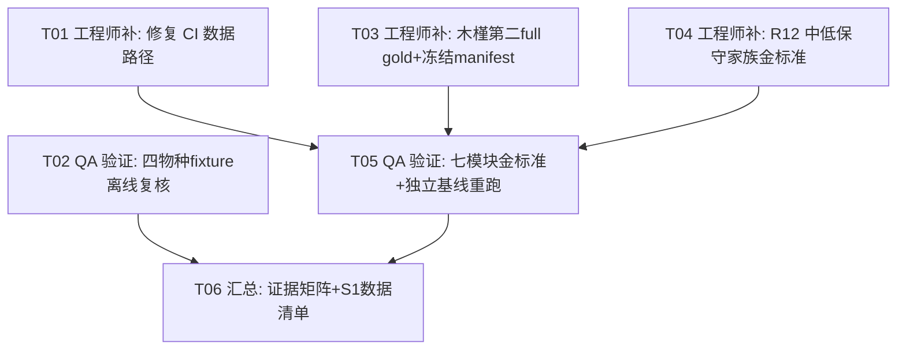

# PhytoScope 投稿第二批执行方案：跨物种验证（阶段4）+ 核心模块金标准（阶段5）

> 方案人：software-architect-3（高见远）· 日期：2026-11-14
> 仓库：`G:/WorkBuddy/2026-10-27-22-02-43/phytoscope`（dev，HEAD=`f1dc976`）+ `phytoscope-reference-data`（HEAD=`2c6608b`）。
>
> **方法**：严格只读核实（`git log/status`、`Read`、`grep`、目录列举），未改代码、未跑测试、未 push。凡需联网取数或运行 Maven/Python 才能确认的项一律标 **⏳ 待运行时验证**，并给出验证方法，不臆断。
>
> **本方案承接**：`docs/fcs-submission-gap-audit.md`（第一批只读盘点，HEAD=8b6bf0b 时代）与 `docs/prd-fcs-submission.md`（R4–R16）。本方案把 R4–R16 逐条落到**具体文件 + 真伪（真实验证留痕 / 仅文档声明 / 缺失）+ 执行动作（复核 / 补齐）**，供工程师与 QA 据此执行。
>
> **红线**：不新增算法、不虚构未测数字、不强行做实验；只做「复核留痕」与「补验证（复用既有算法）」。

**状态图例**
- 🟢 真实验证留痕：有**测试类/工具脚本 + 已落盘 fixture/报告/校验值**，真实跑过并留下可查证据。
- 🟡 仅文档声明：文档写了结论，但**无对应测试类/落地物/校验值**可查。
- 🔴 缺失：既无实现证据也无文档证据。
- ⏳ 待运行时验证：有测试/工具但需**联网取数或外迁数据**才能跑，当前无法确认结果（不计入🟢，也不判🔴）。

---

## 0. 关键前提发现（影响全部复核动作）

1. **参考数据已外迁**：`8fd01ca` 之后，完整数据（TAIR10 基因组 FASTA、Araport11 Chr1–Chr5、E-MTAB-7978、薄荷完整注释/TPM）已移入 `phytoscope-reference-data`。当前主仓库 `src/main/resources/data/` 只保留 6 个 KB 级示例 + provenance/manifest 索引。
2. **研究模块金标准测试是「条件门控」**：`ResearchModuleGoldSetTest` 与 `DomainCaseValidationTest` 用 `Assumptions.assumeTrue(-Dphytoscope.referenceDataDir != null)` 门控——**不设该属性则跳过（skip）而非失败**，断言体原样保留。
3. **CI 工作流在当前 HEAD 已过时（真实缺口，前置必修）**：`.github/workflows/validate.yml` 仍引用已外迁路径：
   - 第 46 行 `compare_promoters_bedtools.py --genome src/main/resources/data/species/arabidopsis/TAIR10_genomic.fna.gz` → **该文件已不在当前树**（已外迁）→ bedtools 步必失败。
   - 第 29 行 `validate_arabidopsis_reference.py --directory src/main/resources/data/species/arabidopsis` → 该目录现在只有 KB 示例 + provenance，无 Chr1–Chr5 → 脚本语义失效。
   - 第 44–50 行依赖 `target/research-validation/research-module-gold-set.json`，但该 JSON 由被跳过的 `ResearchModuleGoldSetTest` 产出 → 当前 CI 下**不会生成** → bedtools/BLASTP 步连锁失败。
   - 结论：文档里引用的「2026-10-18 三平台 CI 通过（bedtools 8/8、BLASTP 20/20）」是**外迁前（数据内置）时代的历史留痕**；当前 HEAD 的 CI gold-set 路径**尚未重新打通**。复核阶段5 前必须先修 CI 数据路径（见 T01）。
4. **「完整非模式」口径需先定义**：水稻豆是唯一「完整 full gold」案例；穿心莲/木槿是「import/search/序列级」（缺 protein/UTR/expression）。详见 §2。

---

## 1. 四物种现状核实（R4 / R6–R8）

### 1.1 逐物种证据落点

| 物种 | 组装 / 注释（用于验证） | 真实验证留痕（测试类 + 落地 fixture） | 仅文档声明 / 历史值 | 判定 |
|---|---|---|---|---|
| **拟南芥** Arabidopsis thaliana | TAIR10 / Ensembl Plants 62 GFF3（全注释）；另有 Araport11 2016 完整数据（已外迁） | ① `AdaptiveChromosomeTest`（`chromosome-validation/arabidopsis.gff3`，5 条核染色体）；② `SpeciesAgnosticTest.shouldExposeFiveArabidopsisChromosomes`（5 chr 公布长度）；③ `FullAnnotationValidationTest`（条件门控，全注释）；④ `chromosome-validation/manifest.json`（archive/fixture SHA-256） | 全注释 5 核染色体、32,833 gene-like、791,564 feature 为 **2026-10-15 历史值**（`chromosome-validation.md`）；assembly accession GCA_000001735.1 审计表 | 🟢（fixture 当前可跑）＋ ⏳（全注释数字需重跑） |
| **水稻** Oryza sativa | IRGSP-1.0 / Ensembl Plants 62 | ① `AdaptiveChromosomeTest`（`rice.gff3`，12 chr）；② `SpeciesAgnosticTest`（IRGSP-1.0 元数据、Chr2 5 基因、12 外显子负链、43,270,923 bp）；③ `FullAnnotationValidationTest`；④ `chromosome-validation/manifest.json` | 全注释 12 核、38,993 gene-like、551,530 feature 为历史值；GCA_001433935.1 审计 | 🟢 ＋ ⏳（全注释） |
| **玉米** Zea mays | Zm-B73-REFERENCE-NAM-5.0 / Ensembl 62 | ① `AdaptiveChromosomeTest`（`maize.gff3`，10 chr，685 序列大基因组）；② `FullAnnotationValidationTest`；③ `chromosome-validation/manifest.json` | 全注释 10 核、44,303 gene-like、1,162,376 feature 为历史值；GCA_902167145.1 审计 | 🟢 ＋ ⏳（全注释）。注：`SpeciesAgnosticTest` 无玉米物种级示例（玉米仅靠 chromosome-validation fixture + 全注释测试） |
| **大豆** Glycine max | Glycine_max_v2.1 / Ensembl 62 | ① `AdaptiveChromosomeTest`（`soybean.gff3`，20 chr）；② `SpeciesAgnosticTest`（headerless GTF、Glyma01/02/03、5 转录本可变剪接）；③ `FullAnnotationValidationTest`；④ `chromosome-validation/manifest.json` | 全注释 20 核、57,147 gene-like、1,328,989 feature 为历史值；GCA_000004515.4 审计 | 🟢 ＋ ⏳（全注释） |

### 1.2 结论

- **四物种均有「真实验证留痕」**：不存在「仅文档声明」或「缺失」的物种。四套 `chromosome-validation/*.gff3` fixture 是**当前可离线跑**的（`mvn -Pui-tests test` 不需联网）；`SpeciesAgnosticTest` 额外覆盖拟南芥/水稻/大豆（含玉米通过 chromosome-validation fixture）。
- **「全注释数字」全部是外迁前历史值**：`chromosome-validation.md` 表格中的 5/12/10/20 核、79.1万~132.9万 feature、assembly accession 审计，均是 2026-10-15 实跑并留痕，但**外迁后未在当前树重跑**。复核动作：要么重跑 `FullAnnotationValidationTest -Dphytoscope.fullAnnotationDir=<四套 Ensembl 62 归档>` 重新落盘，要么在论文中明确标注「historical / 8fd01ca-era」。
- **没有代码缺口**：四物种解析/染色体自适应无物种特定代码（`AdaptiveChromosomeTest` 注释明示「no species-to-chromosome-count table」），R4 无需改代码。

---

## 2. 两个非模式物种缺口核实（R5）

### 2.1 三非模式现状

| 案例 | 组装 / 注释 | 已覆盖 | 未覆盖 | 判定 |
|---|---|---|---|---|
| **水稻豆** *Vigna umbellata*（full gold） | GCF_029865625.1 / RS_2026_09 | GFF3+GTF 全量导入、计数断言；负链三外显子 LOC124833352 的 **genomic span / transcript / CDS / protein / 5′·3′ inferred UTR** 逐位比对；Salmon 2.8.0 重定量 34,914 基因 ID 精确对账（0 unmatched） | —（唯一「完整」案例） | 🟢 完整（`NonModelVignaReferenceTest` + committed `manifest.json` + `gold-LOC124833352.fasta`）；⏳ 需联网 fetch 才能重跑 |
| **穿心莲** *Andrographis paniculata* | GCF_009805555.1 / Annotation Release 100 | 全量 GFF3 导入（27,712 基因）、search、target locus 坐标、**span/transcript/CDS**（5 loci 序列 hash，`multi-locus-sequence-gold.tsv`） | **无 protein / 无 inferred UTR / 无表达矩阵** | 🟡 部分（`AdditionalNonModelReferenceTest`）；非「完整」 |
| **木槿** *Hibiscus syriacus* | GCF_006381635.1 / Annotation Release 100 | 全量 GFF3 导入（106,303 基因）、search、负链 target locus 坐标、**span/transcript/CDS**（5 loci 序列 hash） | **无 protein / 无 inferred UTR / 无表达矩阵** | 🟡 部分（`AdditionalNonModelReferenceTest`）；非「完整」 |

### 2.2 结论：R5「新增至少两个完整非模式案例」尚未满足

- 现状是 **1 完整（水稻豆）＋ 2 部分（穿心莲/木槿）**，未达「至少两个完整」。
- **缺口定位**：需把**穿心莲或木槿之一提升为 full gold**，补齐该案例的 **protein 翻译 + 5′/3′ inferred UTR** 金标准（表达矩阵可选，若补则更完整，但非「完整」的硬门槛——水稻豆的「完整」含表达，为口径统一建议按「结构＋序列＋翻译＋UTR」为最小完整集，表达列为加分项）。
- **推荐选木槿**（而非穿心莲）：木槿 target `LOC120212642` 在 `NW_024062564.1` 上、**负链**，与水稻豆（负链）形成链向互补；其 `AdditionalNonModelReferenceTest` 已对负链基因做了 `strand == '-'` 断言，天然适合扩展 UTR（链敏感）验证。
- **如何补（只补验证，不新增算法）**：protein 翻译与 UTR 推断逻辑已在 `GeneSequenceService` 实现并被水稻豆测试覆盖，**无需新增算法**。补齐动作：
  1. 取木槿 target 转录本对应的 **NCBI RefSeq protein 记录（XP_…）** 作为独立蛋白参考（与水稻豆 `XP_087956893.1` 同法），逐字节比对 `transcript.proteinSequence()`；
  2. 用独立切片（已有 `AdditionalNonModelReferenceTest.assertIndependentSequenceProducts` 的重建逻辑）重建 5′/3′ inferred UTR，加入冻结 gold；
  3. 扩展 `tools/build_nonmodel_sequence_gold.py` 增列 `protein_sha256`（及可选 UTR 序列），并加 Java 断言。
- **PRD 待拍板项 #3 的落点**：本方案建议「木槿提升为第二 full gold，穿心莲保留为第三广度案例」，需主理人拍板（不影响后续 T03 的 manifest 冻结）。

---

## 3. 七模块金标准逐模块核实（R10–R16）

> 实现类全部位于 `src/main/java/io/gitee/omixcore/phytoscope/` 下；金标准测试/工具位于 `src/test/java/...` 与 `tools/`。结论：**七模块均有实现＋真实验证留痕，唯一真实缺口是 R12（同源「不同保守程度」未满足）**。

| 模块 | 实现类 | 金标准测试 / 独立参考 | 独立参考结果（是否外部工具） | 判定 |
|---|---|---|---|---|
| **Promoter** 启动子/区间 | `research/IntervalAnalysisService.java`、`research/GenomicInterval.java`、`service/GeneSequenceService.extractPromoter` | `ResearchModuleGoldSetTest`（8 loci，4+/4−，2,000bp 上游+200bp 下游，test-side 坐标+FASTA 切片+反向互补）＋ `tools/compare_promoters_bedtools.py`（bedtools 2.31.1 `getfasta -s`） | ✅ 独立外部工具 bedtools，8/8 逐位一致 | 🟢（历史 CI 值）；⏳ 需 reference-data + bedtools 重跑 |
| **Sequence QC** GC/长度/帧/起止 | `research/SequenceQualityService.java` | `ResearchModuleGoldSetTest`（`referenceCdsMetrics`，4 条真实 RBCS CDS，GC/碱基/帧/起止/flag） | ✅ test-side 参考实现（非外部工具）；**无负例大规模** | 🟢；规模小（4 正例，缺负例/歧义碱基大规模）——盘点即可，非阻塞 |
| **Homology** 蛋白相似性 | `research/ProteinHomologyService.java` | `ResearchModuleGoldSetTest`（test-side Smith–Waterman）＋ `tools/compare_homology_blastp.py`（BLASTP 2.12.0+，共享阈值 30%/20aa/50%/50%/1e-5） | ✅ 独立外部工具 BLASTP，同物种 20/20 + 跨物种 20/20 | 🟢（历史 CI 值）但 **🔶 R12 缺口：仅 RBCS 单一高保守 paralog-rich 家族，「不同保守程度」未满足** |
| **Domain** 结构域映射 | `research/DomainLinkService.java` | `DomainCaseValidationTest`（16 条 domain/deletion、13 基因、含多外显子 junction）＋ `tools/validate_domain_isoforms.py` / `check_isoform_case.py` | ✅ 独立 Python 坐标参考 | 🟢；⏳ 需 reference-data（TAIR10 FASTA）重跑 |
| **Expression** 样本分组/均值/中位数 | `service/ExpressionDataService.java`、`research/SampleGroupingService.java`、`model/ExpressionProfile.java` | `ResearchModuleGoldSetTest`（AT1G01860 leaf mean=median=16.0、low 2.5、AT5G38430 零保留）＋ 水稻豆 Salmon 重定量对账（34,914/0 unmatched） | ✅ E-MTAB-7978 源值 + Salmon 独立定量（非外部比对工具，但为独立生成） | 🟢；⏳ 需 reference-data（E-MTAB-7978）重跑 |
| **Comparison** 多基因比较 | `comparison/ComparisonFigure.java`、`cli/ComparisonRunner.java`、`ui/component/ComparisonPane.java` | `ComparisonFigureTest` / `ComparisonRunnerTest` / `ComparisonWorkflowUiTest`（PNG/SVG/TSV 导出、布局、共享尺度、链向对齐、intron 压缩） | ⚠️ **无外部独立参考**（属渲染/导出功能，功能测试即金标准） | 🟢；盘点即可 |
| **Project** 持久化/恢复 | `project/ProjectStore.java`、`project/ReproduceExporter.java`、`intake/*`（Manifest v2 schemaVersion 4） | `ProjectStoreTest` / `ProjectStoreAliasRestoreTest` / `ReproduceExporterTest` ＋ `DomainCaseValidationTest` round-trip（save→load 恢复 ResearchState/ViewState） | ⚠️ **无外部独立参考**（属持久化机制，round-trip + SHA-256 完整性即金标准） | 🟢；盘点即可 |

### 3.1 唯一模块真实缺口：R12 Homology「不同保守程度」

- 现状：只有 **RBCS** 一个家族（高保守、paralog-rich），正例 12/12 + 负例 8/8 与 BLASTP 一致。
- 缺口：FCS 论文若写「不同保守程度的蛋白家族」则不成立；当前只支撑「单一高保守家族 smoke test」。
- **补齐方式（补验证，不新增算法）**：新增 **1 个中/低保守蛋白家族**金标准（含该家族正例 + 跨家族负例），用 `compare_homology_blastp.py` 同阈值与 BLASTP 独立分类对账。建议选**物种内保守度较低、跨物种可辨识**的小家族（如一个转录因子家族或一个酶家族，具体序列由工程师从 UniProt/RefSeq 取并 SHA-256 pin 到 `src/test/resources/research-validation/`），沿袭现有 `cross-species-rbcs-mature.faa` 的 fixture 模式。
- 若不补，则论文措辞须降级为「single-family smoke test」，不得写「不同保守程度」。

---

## 4. 执行任务分解（有序）

> 每项标：**谁做**（工程师补 / QA 验证）、**做什么**（精确到文件）、**验收标准**、**复核留痕 vs 真实缺口补齐**、**是否需真实跑测试**。

### 任务依赖图

### T01 · 修复 CI 外迁后数据路径（前置，工程师补）

- **分类**：🟡/🔴 真实缺口（CI stale，非算法）。
- **文件**：`.github/workflows/validate.yml`（改）；可选新增 `tools/fetch_reference_data_for_ci.py`（或复用 reference-data 取回脚本）。
- **做什么**：
  1. 修复第 46 行 `TAIR10_genomic.fna.gz` 路径 → 改为从 `phytoscope-reference-data`（或 CI 内 fetch）取，或显式 `if: false` 标记该步需外迁数据；
  2. 修复第 29 行 `validate_arabidopsis_reference.py --directory` 指向的目录语义；
  3. 为 `ResearchModuleGoldSetTest`/`DomainCaseValidationTest` 在 CI 中显式传入 `-Dphytoscope.referenceDataDir`（指向取回的数据），或明确文档化「默认 skip」语义，避免 `compare_promoters_bedtools.py`/`compare_homology_blastp.py` 因缺 gold-set JSON 而连锁失败。
- **验收**：CI 各步不再引用不存在路径；`-Dphytoscope.referenceDataDir` 提供时 gold-set/domain 测试**实跑**（非 skip）并产出 JSON；不提供时明确 skip 且下游步有守卫。
- **是否真实跑**：需真实跑 CI/本地 Maven 验证。

### T02 · 四物种 fixture 离线复核（QA 验证，不联网）

- **分类**：🟢 已有证据**复核留痕**（真实跑，不联网）。
- **文件**：`AdaptiveChromosomeTest`、`SpeciesAgnosticTest`、`ReferenceDatasetIntegrityTest`、`BundledResourceGuardTest`、`Gff3ParserEdgeCaseTest`、`src/test/resources/chromosome-validation/*`。
- **做什么**：`mvn -Pui-tests test`（离线），确认四物种 5/12/10/20 核断言通过；把 `chromosome-validation.md` 的全注释数字在报告中标为「historical，待 T05 重跑确认」。
- **验收**：离线 fixture 测试 0 失败；产出逐物种「fixture 级验证=当前、全注释级=历史待重跑」状态表。
- **是否真实跑**：是（离线 Maven）。

### T03 · 木槿提升为第二 full gold ＋ 冻结 additional-nonmodel 校验值（工程师补）

- **分类**：🔶 真实缺口**补齐**（补验证，不新增算法）。
- **文件**：
  - 改：`tools/build_nonmodel_sequence_gold.py`（增 protein/UTR 列）、`tools/fetch_additional_nonmodel_refs.py`（补取 RefSeq protein + 校验）、`src/test/java/.../AdditionalNonModelReferenceTest.java`（增 protein/UTR 断言）、`docs/non-model-portability-evidence.md`。
  - 增：`src/test/resources/non-model/hibiscus-syriacus/<gold fasta + protein fixture>`、`src/test/resources/non-model/additional-nonmodel-manifest.json`（committed）。
- **做什么**：
  1. 为木槿 `LOC120212642`（`NW_024062564.1`，负链）取对应 RefSeq protein 记录，逐字节比对 `proteinSequence()`；
  2. 独立重建 5′/3′ inferred UTR，加入冻结 gold；扩展 `build_nonmodel_sequence_gold.py` 输出 protein/UTR hash；
  3. 冻结 `additional-nonmodel-manifest.json`：记录穿心莲+木槿的 assembly accession/name、annotation release、NCBI `md5checksums.txt` MD5、本地 SHA-256、序列 FASTA SHA-256、访问日期（对齐 R9 与 reference-data `MANIFEST.json` 模式）。
- **验收**：`mvn -Dtest=AdditionalNonModelReferenceTest -Dphytoscope.additionalReferenceDir=<取回目录> test` 绿，木槿 protein/UTR 断言通过；committed manifest 存在且 `fetch_additional_nonmodel_refs.py` 重跑校验一致。
- **是否真实跑**：是（需联网 fetch RefSeq + 本地 Maven）。
- **依赖**：无（可与 T02/T04 并行）。

### T04 · 补齐 R12 中/低保守蛋白家族金标准（工程师补）

- **分类**：🔶 真实缺口**补齐**（补验证，不新增算法）。
- **文件**：改 `tools/compare_homology_blastp.py`（或新增独立脚本）、`ResearchModuleGoldSetTest.java`；增 `src/test/resources/research-validation/<new-family>.faa`；改 `docs/research-module-validation.md`、`benchmarks/results/`。
- **做什么**：新增 1 个非 RBCS 的中/低保守家族（正例 + 跨家族负例，SHA-256 pin 到 fixture），用 BLASTP 同阈值独立分类对账；扩展 `ResearchModuleGoldSetTest` 生成该家族报告段。
- **验收**：新家族正/负例分类与 BLASTP 一致（`compare_homology_blastp.py` 0 失配）；论文可支撑「不同保守程度」表述（或在未补时降级措辞）。
- **是否真实跑**：是（需 BLASTP + Maven）。
- **依赖**：无。

### T05 · 七模块金标准重跑 + 独立工具基线 + 非模式端到端（QA 验证）

- **分类**：🟢 已有证据**复核留痕**（真实跑，需外迁数据 + bedtools/BLASTP + 联网 fetch）。
- **文件**：`ResearchModuleGoldSetTest`、`DomainCaseValidationTest`、`NonModelVignaReferenceTest`、`AdditionalNonModelReferenceTest`、`tools/compare_promoters_bedtools.py`、`tools/compare_homology_blastp.py`、`tools/compare_public_case.py`、`tools/fetch_vigna_reference.py`、`tools/fetch_additional_nonmodel_refs.py`、`tools/fetch_validation_archives.py`。
- **做什么**：设 `-Dphytoscope.referenceDataDir` 后重跑 gold-set + domain；联网 fetch 后重跑水稻豆/穿心莲/木槿三案例 + gffutils public case；四物种全注释重跑 `FullAnnotationValidationTest`。所有结果落盘到 `benchmarks/results/`。
- **验收**：bedtools 8/8、BLASTP 20/20（+ T04 新家族）、四物种全注释计数复现、三非模式测试绿、gffutils 三轮交替一致；产出新报告。
- **是否真实跑**：是（需要外迁数据 + 联网 + 外部工具）。
- **依赖**：T01、T03、T04。

### T06 · 阶段4+5 证据矩阵 + S1 数据清单（汇总，工程师/QA 协作）

- **分类**：文档汇总（非算法、非测试）。
- **文件**：`docs/fcs-phase2-verification-report.md`（新建）+ 论文补充表 S1（或并入本方案 §5）。
- **做什么**：产出逐物种/逐模块「真实验证 / 历史值 / 缺失」状态矩阵 + 数据校验值清单（见 §5），明确哪些已在当前树确认、哪些标 historical。
- **验收**：矩阵与本文档 §1–§3 一致；S1 表逐文件含 bytes/SHA-256/来源/许可/访问日期。
- **依赖**：T02、T05。

---

## 5. 数据来源与校验值清单（R9 / 论文补表 S1）

> 对齐 `phytoscope-reference-data/MANIFEST.json` 的字段模式：`path / bytes / sha256 / source_url / source_release / license / license_status / baseline_blob`。现有校验值已分散在 4 处，需**统一导出为 S1**，并补齐第 5 处缺口。

| 层 | 文件位置 | 覆盖 | 状态 |
|---|---|---|---|
| ① 完整参考数据（9 文件） | `phytoscope-reference-data/MANIFEST.json` + `SHA256SUMS.txt` | TAIR10 基因组 FASTA、Araport11 Chr1–Chr5、薄荷 GFF3+TPM、E-MTAB-7978 表达 | 🟢 已冻结（9/9，68,518,847 B）；许可 8 条 `needs_confirmation` + 1 条 `confirmed`（horsemint CC BY 4.0，见 HEAD `2c6608b`） |
| ② 四物种 Ensembl 62 归档 | `src/test/resources/chromosome-validation/manifest.json` | 拟南芥/水稻/玉米/大豆的 archive_sha256 + fixture_sha256 + 核染色体长度 | 🟢 已冻结（含 archive SHA-256，如拟南芥 `9f2701d7…`、水稻 `7b30126b…`、玉米 `cb8ca4d0…`、大豆 `e7fb0788…`） |
| ③ 水稻豆 full gold | `src/test/resources/non-model/vigna-umbellata/manifest.json` | GFF3/GTF MD5（NCBI `md5checksums`）+ SHA-256、NC_142174.1.fna SHA-256、gold fasta SHA-256、protein XP_087956893.1 SHA-256、expression manifest | 🟢 已冻结 |
| ④ 穿心莲 / 木槿 | **仅** `tools/fetch_additional_nonmodel_refs.py` 硬编码 + 运行时生成的 `target/additional-nonmodel/manifest.json`（gitignored） | assembly accession/name、annotation release、gene count、target 坐标 | 🔴 **未冻结落盘**——需 T03 产出 committed manifest |
| ⑤ 跨物种 homology 家族 fixture | `src/test/resources/research-validation/cross-species-rbcs-mature.faa` + `examples/cross-species-homology-gold-set/README.md` | 4 物种成熟 RBCS（P10797/Q0INY7/O24574/P12468）序列 + 长度 + SHA-256 | 🟢 已冻结（另需 T04 新增家族 fixture） |

**S1 表应记录的最小字段**（每物种/每文件）：scientific_name、assembly accession/name、annotation release/source、source_url、retrieval_date(UTC)、bytes、SHA-256、license/license_status、verification_level（full-gold / import-search-sequence / historical-full-annotation）。

**校验值权威来源**：NCBI `md5checksums.txt`（非模式 RefSeq 的 MD5 权威）、Ensembl Plants 62 归档 SHA-256（`chromosome-validation/manifest.json` 已 pin）、reference-data `SHA256SUMS.txt`（9 文件 SHA-256 权威）。所有新冻结值须走「先校验再使用」原则（reference-data README §2）。

---

## 6. 待拍板问题（回传主理人）

1. **第二 full gold 选木槿还是穿心莲**（本方案建议木槿，负链、与水稻豆链向互补）。
2. **「完整非模式」最小口径**：是否以「结构＋序列＋翻译＋UTR」为最小完整集，表达列为加分项（本方案采用此口径）。
3. **R12 是否本期补齐**：若预算不足，改为论文降级措辞「single-family smoke test」，不写「不同保守程度」。
4. **CI 修复归属**：T01（CI 外迁后 stale）属「第一批发布」遗留还是「第二批验证」前置，需确认谁牵头修（本方案列为 T01 前置）。

## 7. 待运行时验证清单（不臆断，附验证方法）

| 项 | 验证方法 |
|---|---|
| 四物种全注释数字是否在当前树复现 | `python tools/fetch_validation_archives.py --cache <dir>` 后 `mvn -Dtest=FullAnnotationValidationTest -Dphytoscope.fullAnnotationDir=<dir> test` |
| 七模块金标准是否在瘦身后仍通过 | 设 `-Dphytoscope.referenceDataDir=<reference-data>` 后 `mvn -Pui-tests -Dtest=ResearchModuleGoldSetTest,DomainCaseValidationTest test`；再跑 `compare_promoters_bedtools.py`/`compare_homology_blastp.py` |
| 三非模式测试是否绿 | 联网 `python tools/fetch_vigna_reference.py` + `fetch_additional_nonmodel_refs.py` 后跑 `NonModelVignaReferenceTest`/`AdditionalNonModelReferenceTest` |
| CI gold-set 路径是否失效 | 看 `validate.yml` 第 29/46 行引用的文件是否存在于当前树（已确认 46 行 `TAIR10_genomic.fna.gz` 不存在）→ 需 T01 修复后实跑确认 |
